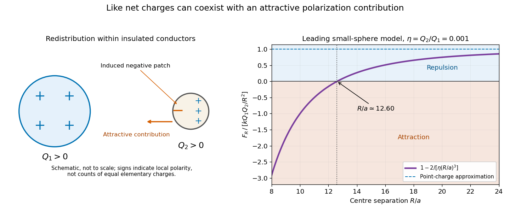

<h1 id="11/solution">Solution</h1>

↑ **Parent:** [11](../11.md)

At a large separation, the two like net charges give the familiar leading repulsion $kQ_1Q_2/R^2$, where $k=(4\pi\epsilon_0)^{-1}$ and $R$ is centre separation. Each conductor also changes the other's surface charge distribution through [electrostatic induction](../../../../../electrostatic-induction.md). The facing and remote surface charge densities need not remain equal, and an external insulating suspension prevents net charge transfer without preventing redistribution within either sphere.

**Like net charges do not guarantee repulsion for arbitrary conducting spheres at every separation.** Sufficiently unequal charges can give an attractive resultant after polarization. This does not contradict [Coulomb's law](../../../../../coulomb-s-law.md): the law still applies to the distributed charges, while the point-charge approximation has lost the relevant induced contribution.

A useful controlled example takes a small conducting sphere of radius $a$ and fixed positive charge $Q_2$ in the nearly uniform field of a much more strongly charged distant sphere. For $a\ll R$, the small sphere has [electric polarizability](../../../../../electric-polarizability.md) $\alpha=4\pi\epsilon_0a^3$ and induced dipole moment $p=\alpha E$. Its leading interaction energy is

$$
U(R)\simeq\frac{kQ_1Q_2}{R}-\frac12\alpha\left(\frac{kQ_1}{R^2}\right)^2.
$$

Differentiation gives the outward radial force

$$
\boxed{F_R\simeq\frac{kQ_1Q_2}{R^2}-\frac{2kQ_1^2a^3}{R^5}.}
$$

The second term is attractive. With $\eta=Q_2/Q_1>0$, this leading model gives $F_R<0$ when $\eta<2(a/R)^3$. One can choose a sufficiently small positive $\eta$ while retaining $a/R\ll1$, so the example does not require a neutral or earthed sphere. It is an asymptotic model, not an exact finite-sphere threshold.

**[Figure 1](#11/image-repulsion-and-attraction-in-a-leading-small-sphere-polarization-model). Repulsion and attraction in a leading small-sphere polarization model**. Original calculated curves for fixed positive charge ratio Q2/Q1=0.001. The force is normalized by the outward point-charge force. The curve assumes a/R is small and retains the leading induced-dipole term; it is not an exact two-sphere calculation or experimental data.

An exact analysis confirms that close-range attraction is possible for like-charged conducting spheres and identifies a special contact-charge ratio for which the force remains repulsive.[2012, Introduction and the like-charge attraction result](../../../../../electrostatics-of-two-charged-conducting-spheres-by-john-lekner.md) This later analysis supplies a precise qualification to the elementary expectation; the source question gives neither a charge ratio nor a separation regime that would justify asserting universal repulsion.

## ↑ Ancestors (11)

1. [11](../11.md)
2. [Physics](../../physics-split.md)
3. [First examination](../../split.md)
4. [1865](../../../split.md)
5. [Past exam of the medicine course of the University of Oxford](../../../../split.md)
6. [Medicine course of the University of Oxford](../../../../../medicine-course-of-the-university-of-oxford.md)
7. [Undergraduate course of the University of Oxford](../../../../../undergraduate-course-of-the-university-of-oxford.md)
8. [Course of the University of Oxford](../../../../../course-of-the-university-of-oxford.md)
9. [University of Oxford](../../../../../university-of-oxford-split.md)
10. [List of universities](../../../../../list-of-universities.md)
11. [Codex Wiki](../../../../../split.md)
