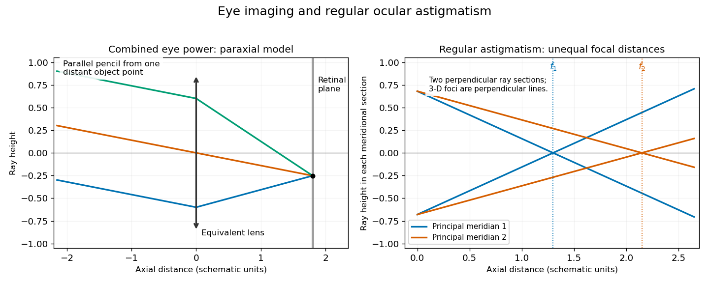

# Physics

↑ **Parent:** [First examination](../first-examination.md)

Original volume: [Examination papers for the Degree of Bachelor of Medicine by the University of Oxford (1864–1867)](../../../biology-bibliography.md#examination-papers-for-the-degree-of-bachelor-of-medicine-by-the-university-of-oxford-1864-1867). [Open the original paper in the scanned volume](https://upload.wikimedia.org/wikipedia/commons/3/3e/Examination_papers_for_the_Degree_of_Bachelor_of_medicine_-_1864-67_(IA_b24757810).pdf#page=53).

Original questions are transcribed from the public-domain edition. Credit: Wellcome Collection; original supplied by Royal College of Physicians, London. [Source and public-domain rights statement](https://wellcomecollection.org/works/d7b9zgnx).

**Table of contents**

- [1](#1)
  - [Solution](#1/solution)
- [2](#2)
  - [Solution](#2/solution)
- [3](#3)
  - [Solution](#3/solution)
- [4](#4)
  - [Solution](#4/solution)
- [5](#5)
  - [Solution](#5/solution)
- [6](#6)
  - [Solution](#6/solution)
- [7](#7)
  - [Solution](#7/solution)
- [8](#8)
  - [Solution](#8/solution)
- [9](#9)
  - [Solution](#9/solution)
- [10](#10)
  - [Solution](#10/solution)
- [11](#11)
  - [Solution](#11/solution)
- [12](#12)
  - [Solution](#12/solution)

## 1

↑ **Parent:** [Physics](physics.md)

**Original question.**

Define a _lever_, and state its mechanical advantage. Into what classes have straight levers been divided ? Describe the mechanism by which the human arm is bent and extended.

<h3 id="1/solution">Solution</h3>

↑ **Parent:** [1](#1)

A [lever](../../../classical-mechanics.md#lever) is a body free to rotate about a [fulcrum](../../../classical-mechanics.md#fulcrum). Its usefulness comes from a balance of [torques](../../../momentum.md#torque), not from producing [energy](../../../energy.md). For a stationary ideal [lever](../../../classical-mechanics.md#lever), let $d_E$ and $d_L$ be the perpendicular [lever arms](../../../momentum.md#lever-arm) of the effort $E$ and load $L$. Then

$$
E d_E=L d_L,\qquad \boxed{\mathrm{MA}=\frac{L}{E}=\frac{d_E}{d_L}.}
$$

The [mechanical advantage](../../../classical-mechanics.md#mechanical-advantage) uses perpendicular distances to the lines of action, which need not equal distances measured along a bent or obliquely loaded arm. In an ideal slow motion, the effort moves through the larger distance when its [force](../../../force.md) is the smaller: [work](../../../energy.md#work) is conserved.

For the three familiar straight arrangements, the [fulcrum](../../../classical-mechanics.md#fulcrum) lies between effort and load in a first-class [lever](../../../classical-mechanics.md#lever), the load lies between [fulcrum](../../../classical-mechanics.md#fulcrum) and effort in a second-class [lever](../../../classical-mechanics.md#lever), and the effort lies between [fulcrum](../../../classical-mechanics.md#fulcrum) and load in a third-class [lever](../../../classical-mechanics.md#lever). The second class has ideal [mechanical advantage](../../../classical-mechanics.md#mechanical-advantage) greater than one; the third has it less than one. The first can have either, depending on the [lever arms](../../../momentum.md#lever-arm).

The forearm bends by [elbow flexion](../../../organism.md#elbow-flexion). The [biceps brachii](../../../physiology.md#biceps-brachii) and [brachialis](../../../physiology.md#brachialis) pull through short [tendons](../../../anatomy.md#tendon) close to the [elbow](../../../organism.md#elbow), while a load in the hand acts farther away. This is predominantly a third-class arrangement: a large [muscle force](../../../anatomy.md#muscle-force) buys a comparatively large and rapid hand displacement. The [biceps brachii](../../../physiology.md#biceps-brachii) also contributes to [forearm supination](../../../anatomy.md#forearm-supination). [Elbow extension](../../../organism.md#elbow-extension) is produced chiefly by the [triceps brachii](../../../physiology.md#triceps-brachii), whose [tendon](../../../anatomy.md#tendon) acts on the [olecranon](../../../organism.md#olecranon) behind the [elbow](../../../organism.md#elbow). The extensor insertion and forearm load lie on opposite sides of the effective pivot, giving the corresponding first-class analogy. Actual [anatomical joint](../../../anatomy.md#anatomical-joint) motion has changing [muscle moment arms](../../../anatomy.md#muscle-moment-arm), and the [joint reaction force](../../../anatomy.md#joint-reaction-force) also enters the full [force](../../../force.md) balance; the body is not a set of frictionless pins. [§11.1, lever systems and antagonistic muscle action; §11.5, arm muscles](../../../anatomy-and-physiology-bibliography.md#anatomy-and-physiology-2e-by-j-gordon-betts-and-others)

## 2

↑ **Parent:** [Physics](physics.md)

**Original question.**

Describe the variations which the effective force of gravity undergoes in sustaining the motion of a simple pendulum.

How is the pendulum employed in determining the accelerating effect of the force of gravity ?

<h3 id="2/solution">Solution</h3>

↑ **Parent:** [2](#2)

The magnitude of the gravitational [force](../../../force.md) remains approximately $mg$ during a laboratory swing. Its **tangential component changes with position**, however. For [simple pendulum](../../../simple-pendulum.md) length $\ell$ and [angle](../../../geometry-and-topology.md#angle) $\theta$ measured from the downward vertical,

$$
\boxed{F_t=-mg\sin\theta,\qquad \ddot\theta=-\frac g\ell\sin\theta.}
$$

This restoring component is zero at the lowest point and largest in magnitude at the turning points. It always accelerates the bob towards the lowest point. The radial gravitational component is $mg\cos\theta$; the [string tension](../../../bosonic-string-theory.md#string-tension) $S$ must additionally supply the [centripetal acceleration](../../../classical-mechanics.md#centripetal-acceleration), so $S-mg\cos\theta=mv^2/\ell$. Thus it is the radial resultant, not gravity alone, that bends the trajectory. The bob has maximum speed at the bottom even though its tangential [acceleration](../../../classical-mechanics.md#acceleration) is then zero.

For a small angular [amplitude](../../../wave.md#wave-amplitude), the [small-angle approximation](../../../geometry-and-topology.md#small-angle-approximation) gives [simple harmonic motion](../../../classical-mechanics.md#simple-harmonic-motion) with [oscillation period](../../../classical-mechanics.md#period-of-an-oscillation) $T=2\pi\sqrt{\ell/g}$. Measure $\ell$ from pivot to the bob's [centre of mass](../../../classical-mechanics.md#center-of-mass), time many complete swings, divide the elapsed time by their number, and calculate

$$
\boxed{g=\frac{4\pi^2\ell}{T^2}.}
$$

Repeat with several lengths and plot $T^2$ against $\ell$; the ideal slope is $4\pi^2/g$. The first-order relative uncertainty obeys $\delta g/g\simeq\delta\ell/\ell-2\delta T/T$, with absolute uncertainty contributions combined according to their dependence. Keep the [amplitude](../../../wave.md#wave-amplitude) small: the finite-amplitude period is $T=T_0(1+\theta_0^2/16+\cdots)$, with $\theta_0$ in [radians](../../../geometry-and-topology.md#radian). Using the longer finite-amplitude period in the small-amplitude formula would underestimate $g$. Pivot friction, a finite bob and support motion are further experimental corrections.[§15.4, simple pendulum and small-angle period](../../../physics-bibliography.md#university-physics-volume-1-by-william-moebs-and-others)

## 3

↑ **Parent:** [Physics](physics.md)

**Original question.**

Describe the common Hydrometer, and the method of using it.

<h3 id="3/solution">Solution</h3>

↑ **Parent:** [3](#3)

A [hydrometer](../../../fluid-mechanics.md#hydrometer) is a sealed floating instrument with a weighted bulb and a narrow graduated stem. The ballast keeps the stem upright. By [Archimedes' principle](../../../fluid-mechanics.md#archimedes-principle), its [gravitational weight](../../../force.md#weight-physics) equals the [buoyancy](../../../fluid-mechanics.md#buoyancy):

$$
mg=\rho gV_{\rm displaced},\qquad \boxed{\rho=\frac{m}{V_{\rm displaced}}.}
$$

It therefore sinks farther into a less dense [liquid](../../../thermodynamics.md#liquid), displacing more volume, and floats higher in a denser one. The stem makes a small volume change readily visible as a change in immersion. If its cross-sectional area is $A$, then $V_{\rm displaced}=V_0+A z$ over a uniform part of the stem. A [density](../../../fluid-mechanics.md#density) scale is consequently not generally uniform in $z$.

Float the clean instrument freely in a sufficiently deep sample, without its touching the wall or bottom. Remove adhering bubbles, allow the [temperature](../../../temperature.md) and motion to settle, and read the liquid surface at eye level using the meniscus convention specified for that instrument. A calibration for a particular [temperature](../../../temperature.md) or reference [density](../../../fluid-mechanics.md#density) cannot be transferred without correction: both the sample and the instrument expand. An ordinary [hydrometer](../../../fluid-mechanics.md#hydrometer) measures [density](../../../fluid-mechanics.md#density) or [specific gravity](../../../fluid-mechanics.md#relative-density); a special scale for a particular [chemical solution](../../../mixture.md#solution-chemistry) does not make it chemically selective. In particular, dissolved substances other than [glucose](../../../chemical-substance.md#glucose) can affect the [density](../../../fluid-mechanics.md#density) of [urine](../../../physiology.md#urine).

## 4

↑ **Parent:** [Physics](physics.md)

**Original question.**

When a fine tube open at both ends is dipped in a liquid, describe the principal phenomena observed, and state the laws which they are found to obey.

To what forces are these phenomena to be ascribed ?

<h3 id="4/solution">Solution</h3>

↑ **Parent:** [4](#4)

A clean narrow tube dipped in a wetting [liquid](../../../thermodynamics.md#liquid) displays a curved [meniscus](../../../surface-tension.md#meniscus-liquid) and a rise above the external free surface. With a nonwetting [liquid](../../../thermodynamics.md#liquid), such as [Mercury](../../../planetary-science.md#mercury-planet) against clean glass under the usual conditions, there is a convex [meniscus](../../../surface-tension.md#meniscus-liquid) and a depression. The material pair and surface cleanliness matter; small diameter alone does not determine the sign.

For a circular tube of radius $r$, [surface tension](../../../surface-tension.md) $\gamma$, and equilibrium [contact angle](../../../surface-tension.md#contact-angle) $\theta$ measured through the [liquid](../../../thermodynamics.md#liquid), the vertical force at the contact line is $2\pi r\gamma\cos\theta$. Neglecting the small meniscus-volume correction, its balance with the excess column's [gravitational weight](../../../force.md#weight-physics) gives [Jurin's law](../../../surface-tension.md#jurin-s-law):

$$
2\pi r\gamma\cos\theta=(\rho_l-\rho_g)g\pi r^2h,
\qquad
\boxed{h=\frac{2\gamma\cos\theta}{(\rho_l-\rho_g)gr}.}
$$

Thus the signed height is inversely proportional to radius for a fixed [liquid](../../../thermodynamics.md#liquid), wall, [temperature](../../../temperature.md) and [contact angle](../../../surface-tension.md#contact-angle). Increasing the tube length beyond the required column does not increase the equilibrium height. A short tube that cannot contain that column is a different boundary problem.

The same result follows from the [Young–Laplace equation](../../../surface-tension.md#young-laplace-equation): a curved interface supports a [capillary pressure](../../../surface-tension.md#capillary-pressure) difference, balanced by the hydrostatic head. Molecular interactions establish the [surface tension](../../../surface-tension.md) and the preference for wetting the solid, encoded in the [contact angle](../../../surface-tension.md#contact-angle). The force balance does not require molecules to attract across the whole height of the column. To test the inverse-radius law, use tubes of several measured radii with the same surface preparation, and compare $hr$ after equilibrium; different cleaning or contact-angle hysteresis can otherwise imitate a failure of the radius law.

## 5

↑ **Parent:** [Physics](physics.md)

**Original question.**

Describe the construction and action of a _free reed_ organ pipe.

Explain upon the principle of the free reed the action of the human organs of speech.

<h3 id="5/solution">Solution</h3>

↑ **Parent:** [5](#5)

A [free reed](../../../physics.md#free-reed) is a thin elastic tongue fixed at one end over a closely fitting opening in a rigid frame. A pressure difference drives an airflow; displacement of the tongue alters the available opening, and the changing aerodynamic force can sustain its vibration against elastic restoring force and damping. Unlike a beating reed, the tongue passes through the opening without regularly striking its rim. The air supply provides the [energy](../../../energy.md); the reed's dimensions and stiffness largely set the pitch, while its enclosure and any attached pipe modify the response and radiated [sound waves](../../../fluid-mechanics.md#acoustic-wave).

The useful analogy with [phonation](../../../anatomy.md#phonation) is an airflow-driven valve coupled to an elastic oscillator. Air from the [lungs](../../../anatomy.md#lung) passes between the [vocal folds](../../../anatomy.md#vocal-fold) in the [larynx](../../../anatomy.md#larynx). Their motion periodically modulates the flow, generating a rich [sound spectrum](../../../physics.md#sound-spectrum); the [pharynx](../../../anatomy.md#pharynx), mouth and nasal passages filter it, while the [tongue](../../../anatomy.md#tongue) and lips help form speech sounds. The [vocal folds](../../../anatomy.md#vocal-fold) are paired living tissues with adjustable tension and geometry, rather than a single metal tongue. Their oscillation should not be explained as a passive string struck repeatedly by air, nor does the free-reed analogy establish every detail of tissue motion. [“What is voice?” and the labelled structures of voice production](../../../neuroscience-bibliography.md#taking-care-of-your-voice-by-the-national-institute-on-deafness-and-other-communication-disorders)

Changing vocal-fold tension and effective vibrating mass changes the source pitch. Changing the resonating passages changes its spectral envelope and the vowel quality. Those are different controls: a singer can change pitch while retaining a recognisable vowel, or change vowel while sustaining approximately the same pitch.

## 6

↑ **Parent:** [Physics](physics.md)

**Original question.**

Describe the structure of the eye, considered as an optical instrument, and trace the course of the pencils of light which produce the image on the retina, illustrating by a figure.

What is the nature of the defect known as _regular astigmatism_, what is its cause, how is it detected, and how remedied ?

<h3 id="6/solution">Solution</h3>

↑ **Parent:** [6](#6)

The [cornea](../../../anatomy.md#cornea) supplies much of the eye's converging [optical power](../../../geometrical-optics.md#optical-power); the [crystalline lens](../../../anatomy.md#crystalline-lens) supplies additional, adjustable power through [ocular accommodation](../../../anatomy.md#accommodation-vertebrate-eye). The transparent aqueous and vitreous media transmit the [light](../../../optics.md#light). The [iris](../../../anatomy.md#iris) controls the [pupil](../../../anatomy.md#pupil), acting as an aperture rather than as the focusing element, and the [retina](../../../neuroscience.md#retina) is the receiving surface. The posterior [optic nerve](../../../neuroscience.md#optic-nerve) conveys the resulting neural signals; it does not carry an optical picture out of the eye.

Each sufficiently small object patch sends a pencil of rays through the [pupil](../../../anatomy.md#pupil). Refraction at the corneal and lenticular surfaces brings that pencil towards a retinal image point. Pencils from different object heights meet at different retinal positions, producing a real inverted image. In a paraxial equivalent model,

$$
\frac1u+\frac1v=\frac1f,\qquad m=-\frac vu.
$$

The several physical refracting surfaces have been replaced here by an equivalent [thin lens](../../../geometrical-optics.md#thin-lens); this is a model, not a claim that all bending occurs at the [crystalline lens](../../../anatomy.md#crystalline-lens). For a distant object, approximately parallel incoming pencils focus near the back focal surface. [Ocular accommodation](../../../anatomy.md#accommodation-vertebrate-eye) increases power for nearer objects while the retinal position remains nearly fixed.

**[Figure 1](#6/image-image-formation-by-an-equivalent-eye-and-the-two-principal-meridians-of-regular-ocular-astigmatism). Image formation by an equivalent eye and the two principal meridians of regular ocular astigmatism**. Original paraxial schematics, not anatomical measurements. Left: one equivalent thin lens represents the combined corneal and lenticular power; parallel rays from one off-axis direction meet on a receiving plane. Right: ray fans in two perpendicular meridional sections have unequal focal distances. In three dimensions their focal images are perpendicular lines, not two complete point images.

In [regular ocular astigmatism](../../../biology.md#regular-ocular-astigmatism), the two principal meridians are perpendicular but have different refractive powers, commonly because the [cornea](../../../anatomy.md#cornea) has different curvatures in those meridians. A point object then gives two line foci at different depths rather than a single sharp point. The difference is not merely an overall spherical focusing error. Refraction with differently oriented cylindrical trial lenses can locate the power and axis; [keratometry](../../../biology.md#keratometry) or [corneal topography](../../../biology.md#corneal-topography) measures corneal shape. [Cylindrical lens](../../../geometrical-optics.md#cylindrical-lens) or [toric lens](../../../geometrical-optics.md#toric-lens) correction supplies the missing meridional power with the proper orientation. [Spectacles](../../../biology.md#spectacles) and appropriately fitted [toric contact lenses](../../../anatomy.md#toric-contact-lens) can provide such correction. A method for measuring corneal curvature should not be confused with a complete measurement of the eye's total refractive error.[Regular astigmatism and principal meridians](../../../neuroscience-bibliography.md#physiology-of-astigmatism-by-the-american-academy-of-ophthalmology)[Diagnosis and correction with glasses or contact lenses](../../../neuroscience-bibliography.md#astigmatism-by-the-national-eye-institute)

## 7

↑ **Parent:** [Physics](physics.md)

**Original question.**

When plane polarised light, after passing through a tube filled with an aqueous solution of sugar, is plane analysed, what phenomena are observed ?

Describe Biot's Saccharometer, and the method of using it for determining the amount of sugar present in diabetic urine.

<h3 id="7/solution">Solution</h3>

↑ **Parent:** [7](#7)

An optically active [glucose](../../../chemical-substance.md#glucose) solution rotates the direction of [linear polarization](../../../electromagnetic-wave.md#linear-polarization). With monochromatic illumination, rotating the [polarimeter analyzer](../../../stereochemistry.md#polarimeter-analyzer) again produces a maximum and an extinction, but at angles shifted from the water-filled reference tube. In an ideal transparent sample, [Malus's law](../../../wave.md#malus-s-law) gives

$$
I(\phi)=I_0\cos^2(\phi-\alpha),\qquad \boxed{\alpha=[\alpha]^T_\lambda\ell c.}
$$

The [specific rotation](../../../stereochemistry.md#specific-rotation) $[\alpha]^T_\lambda$ is defined for a stated [temperature](../../../temperature.md), [wavelength](../../../wave-equation.md#wavelength), solvent and concentration convention. With $\ell$ in decimetres and $c$ in grams per millilitre, the conventional numerical value of $[\alpha]$ must use the matching units. A broadband source generally gives coloured appearances because the rotation varies with [wavelength](../../../wave-equation.md#wavelength); one analyser angle need not extinguish every colour.

[Biot's saccharimeter](../../../stereochemistry.md#biot-s-saccharimeter) is an angular [polarimeter](../../../stereochemistry.md#polarimeter): a polarizing element, a tube of accurately known optical path length holding the sample between plane end windows, and a rotatable analysing element with an angular scale. The original arrangement used a black-glass polarizing mirror and a calcite analyser; later two-prism designs implement the same angular measurement. It should be distinguished from a later quartz-wedge compensating saccharimeter, which cancels the sample's rotation instead of directly reading the analyser rotation.[pp.84–85, original Biot polariscope and simple angular polariscope; chapter VI, quartz-wedge compensation](../../../chemistry-bibliography.md#a-handbook-of-sugar-analysis-by-charles-albert-browne-jr)

For a historical [urine](../../../physiology.md#urine) estimate, clarify a sample without changing its sugar inventory, fill the tube without bubbles, make a solvent blank at the same settings, and measure the signed rotation relative to that blank. With a known dilution factor $D$ and an appropriate equilibrium [glucose](../../../chemical-substance.md#glucose) calibration,

$$
\boxed{c_{\rm original}=D\frac{\alpha_{\rm sample}-\alpha_{\rm blank}}{[\alpha]^T_\lambda\ell}.}
$$

Repeat the reading and check a known [glucose](../../../chemical-substance.md#glucose) solution. [Mutarotation](../../../chemical-reaction.md#mutarotation) makes the time since preparation relevant. The inference is selective only to the extent that other optically active solutes have been excluded or accounted for; a net rotation is not proof that every contribution is [glucose](../../../chemical-substance.md#glucose). This is a historical analytical application, not a replacement for present clinical assessment of [diabetes](../../../biology.md#diabetes).

## 8

↑ **Parent:** [Physics](physics.md)

**Original question.**

Describe experiments shewing the conversion of work into heat (1) directly, (2) indirectly through electricity.

How much work must be done upon half a kilogram of copper (specific heat 0·095) in order to raise its temperature from $10^\circ$C to $20^\circ$C ?

<h3 id="8/solution">Solution</h3>

↑ **Parent:** [8](#8)

For direct conversion, descending masses can drive paddles in an insulated vessel of [water](../../../chemical-substance.md#water). Measure the lost gravitational [potential energy](../../../energy.md#potential-energy) and the [temperature](../../../temperature.md) rise, including the vessel's [heat capacity](../../../heat.md#heat-capacity) and corrections for unwanted [heat transfer](../../../heat.md#heat-transfer). Repeated reversal of the paddles and fixed baffles inhibit simple bulk co-rotation, directing more of the input towards dissipative fluid motion. [Joule's paddle-wheel experiment](../../../internal-energy.md#joule-s-paddle-wheel-experiment) tests a quantitative mechanical-to-thermal balance, rather than merely observing that stirring can warm water.[1850, friction experiments and calorimetric corrections](../../../physics-bibliography.md#on-the-mechanical-equivalent-of-heat-by-james-prescott-joule)

For conversion through [electricity](../../../electromagnetism.md#electricity), mechanical [work](../../../energy.md#work) drives a generator, whose [electric current](../../../electric-charge.md#electric-current) passes through a resistor in a [calorimeter](../../../calorimetry.md#calorimeter). The measured electrical input is $\int VI\,dt$, or $I^2Rt$ for constant [electric current](../../../electric-charge.md#electric-current) and [electrical resistance](../../../electric-charge.md#electrical-resistance). [Joule heating](../../../electric-charge.md#joule-heating) increases the [internal energy](../../../internal-energy.md) of the resistor and surrounding [water](../../../chemical-substance.md#water). Compare the generator's mechanical input with the total thermal gains, including generator and circuit losses if the system boundary contains them. A battery alone demonstrates electrical-to-thermal conversion; without accounting for a mechanically driven source it does not establish the requested mechanical intermediate chain.

Using the given value relative to [water](../../../chemical-substance.md#water), the copper requires

$$
Q=(500\,\mathrm g)(0.095\,\mathrm{cal\,g^{-1}K^{-1}})(20-10)\,\mathrm K
=475\,\mathrm{cal}.
$$

With the modern thermochemical [calorie](../../../energy.md#calorie), $1\,\mathrm{cal}=4.184\,\mathrm J$, so the ideal required [work](../../../energy.md#work) is

$$
\boxed{W=1987.4\,\mathrm J\simeq1.99\,\mathrm{kJ}.}
$$

Equivalently it is about $203\,\mathrm{kgf\,m}$ using standard gravity. A nineteenth-century numerical equivalent of heat could give a slightly different rounded result. The stipulated constant [specific heat capacity](../../../heat.md#specific-heat-capacity) is used here; an unprovided vessel [heat capacity](../../../heat.md#heat-capacity) and environmental losses would add to the required input.

## 9

↑ **Parent:** [Physics](physics.md)

**Original question.**

Describe any experiment which shews that when a liquid changes into a vapour heat disappears.

How is the latent heat of a vapour estimated ? How has it been proposed to employ the absorption of heat attending the change from the liquid to the gaseous state as a means of destroying sensation in any part of the body, on which an operation is to be performed ?

<h3 id="9/solution">Solution</h3>

↑ **Parent:** [9](#9)

Evaporation cools the remaining material when the escaping vapour takes [energy](../../../energy.md) from it faster than the surroundings supply [heat](../../../heat.md). For an observable demonstration, compare two similar thermometer bulbs at the same initial [temperature](../../../temperature.md), one dry and the other wetted with a volatile [liquid](../../../thermodynamics.md#liquid). Expose both to the same controlled airflow. The wetted bulb falls in [temperature](../../../temperature.md); the effect depends on vapour removal and environmental conditions. Another demonstration is continued heating during boiling at constant [pressure](../../../pressure.md): vapour is produced while the boiling [liquid](../../../thermodynamics.md#liquid)'s [temperature](../../../temperature.md) remains nearly constant. The supplied [energy](../../../energy.md) has not vanished; it contributes to the [latent heat](../../../thermodynamic-potential.md#latent-heat) and expansion associated with the [phase transition](../../../critical-phenomenon.md#phase-transition).

One [calorimetry](../../../calorimetry.md) method estimates the specific [latent heat of vaporization](../../../thermodynamic-potential.md#specific-latent-heat-of-vaporization) by condensing a known mass $m_s$ of dry saturated steam at $T_s$ into a known mass $m_w$ of cooler [water](../../../chemical-substance.md#water). Let $C_{\rm cal}$ be the vessel's [heat capacity](../../../heat.md#heat-capacity), and $T_i,T_f$ the initial and final water temperatures. Assuming complete condensation without escaped steam or thermal losses,

$$
m_s\{L_v+c_w(T_s-T_f)\}=(m_wc_w+C_{\rm cal})(T_f-T_i),
$$

so

$$
\boxed{L_v=\frac{(m_wc_w+C_{\rm cal})(T_f-T_i)}{m_s}-c_w(T_s-T_f).}
$$

The last term removes the sensible cooling of the condensed steam. Weighing the receiving vessel before and after gives $m_s$ only if splashing, evaporation and liquid carried in with the steam are controlled. A steam trap and an insulated transfer path address two distinct errors: droplets falsely counted as condensing steam, and cooling before the calorimeter.

The historical local application was [Richardson's ether spray](../../../biology.md#richardson-s-ether-spray). A bellows atomizer dispersed [diethyl ether](../../../chemical-substance.md#diethyl-ether) into fine droplets, promoting rapid [vaporization](../../../critical-phenomenon.md#vaporization) and withdrawal of [heat](../../../heat.md) from the surface; the cooling could produce local loss of sensation. [Benjamin Ward Richardson](../../../physician.md#benjamin-ward-richardson)'s 1866 account describes this evaporative method and its apparatus. Its historical physiological language is not adopted as a modern description of [nerve](../../../neuroscience.md#nerve) signalling, and the account does not establish that the method is appropriate for every operation.[1866, description of the spray apparatus and cooling mechanism](../../../pharmacology-and-toxicology-bibliography.md#on-a-new-and-ready-mode-of-producing-local-anaesthesia-by-benjamin-ward-richardson)

## 10

↑ **Parent:** [Physics](physics.md)

**Original question.**

When a closed vessel containing a gas is heated at the bottom, explain how the gas becomes heated throughout.

In ventilating a room, at what places should the cold air be admitted ? Give your reasons for your answer.

<h3 id="10/solution">Solution</h3>

↑ **Parent:** [10](#10)

At the heated bottom, [thermal conduction](../../../heat.md#thermal-conduction) first transfers [energy](../../../energy.md) into the adjacent gas. A warmer parcel ordinarily has lower [density](../../../fluid-mechanics.md#density) than its cooler surroundings at approximately the same local [pressure](../../../pressure.md), so [buoyancy](../../../fluid-mechanics.md#buoyancy) drives it upward. Cooler gas replaces it below, creating [natural convection](../../../convection.md#natural-convection). Motion and mixing transport warm gas through the vessel, with conduction continuing across smaller temperature differences. In a sealed rigid vessel the mean [pressure](../../../pressure.md) can rise as heating continues; “less dense at the same local pressure” is the buoyancy comparison, not a claim that the vessel's overall [pressure](../../../pressure.md) stays fixed.

A useful control heats an otherwise similar vessel at the top: the resulting warm-over-cold arrangement is stably stratified, suppressing the overturning seen with bottom heating. Heat still spreads by [thermal conduction](../../../heat.md#thermal-conduction); absence of bulk overturning does not mean absence of heat transfer.

For **unwarmed cold outside air**, use distributed high-level inlets or upper window openings that let the incoming stream mix with warmer room air before descending into the occupied region. A concentrated low-level cold stream can pass directly across people's feet without first mixing. Provide a separate route for outgoing air and avoid an inlet-to-outlet shortcut that leaves the occupied region poorly ventilated. The UK Health Security Agency's guidance specifically notes that a top window opening allows incoming air to warm as it mixes, reducing cold draughts.[Natural ventilation in the home, top window openings and mixing](../../../microbiology-and-infectious-disease-bibliography.md#ventilation-to-reduce-the-spread-of-respiratory-infections-by-the-uk-health-security-agency)

This is not a universal rule that every inlet belongs at the ceiling. A low inlet beside a heat source can warm the air before it rises, and deliberately designed displacement systems use other arrangements. Wind, opening heights, available pressure differences and the exhaust path determine the actual flow. The relevant principles are controlled air replacement, [buoyancy](../../../fluid-mechanics.md#buoyancy) and mixing, not height in isolation.

## 11

↑ **Parent:** [Physics](physics.md)

**Original question.**

When a plate of copper, and a plate of amalgamated zinc are placed in a vessel containing dilute sulphuric acid, state what takes place (1) when the plates are not connected, (2) when they are connected by a wire.

<h3 id="11/solution">Solution</h3>

↑ **Parent:** [11](#11)

With the electrodes disconnected, the copper has no sustained external route through which to receive electrons from the zinc. It is not appreciably attacked by a clean, dilute nonoxidizing [sulfuric acid](../../../chemical-substance.md#sulfuric-acid) solution. Zinc can in principle reduce acid while dissolving, but amalgamation suppresses much of the local action associated with impurities and promotes a high kinetic barrier for hydrogen evolution on the amalgamated surface. Thus the intended historical observation is **little visible action with the circuit open**, not a thermodynamic assertion that zinc cannot react with acid.

Closing the external wire supplies an electron path. At the zinc [anode](../../../electrochemistry.md#anode),

$$
\mathrm{Zn}\longrightarrow\mathrm{Zn}^{2+}+2e^-;
$$

at the copper [cathode](../../../electrochemistry.md#cathode),

$$
2\mathrm H^++2e^-\longrightarrow\mathrm H_2.
$$

The net [redox](../../../chemical-reaction.md#redox) is therefore

$$
\boxed{\mathrm{Zn}+2\mathrm H^+\longrightarrow\mathrm{Zn}^{2+}+\mathrm H_2.}
$$

The zinc dissolves, and bubbles of [hydrogen](../../../chemical-substance.md#hydrogen) appear chiefly at the copper. Electrons flow through the wire from zinc to copper; conventional [electric current](../../../electric-charge.md#electric-current) flows oppositely there. Ionic transport through the [electrolyte](../../../electrochemistry.md#electrolyte) completes the circuit and prevents indefinite charge accumulation in the solution. The copper primarily provides a conducting surface: there is no stipulated copper-ion solution from which metallic copper must be deposited, so this is not the [Daniell cell](../../../electrochemistry.md#daniell-cell) reaction.

The [chemical energy](../../../energy.md#chemical-energy) supplies the electrical [work](../../../energy.md#work). Accumulation of hydrogen and changing interfacial conditions can polarize the cell, reducing the current. A complete description therefore distinguishes the initial closed-circuit response from an indefinitely constant-current idealization. [Electrochemical overpotential](../../../electrochemistry.md#overpotential) explains why a favorable reaction and its observable rate are different questions.

## 12

↑ **Parent:** [Physics](physics.md)

**Original question.**

Describe Œrsted's experiment as to the action of an electric current on a moveable magnetic needle.

Explain the construction of Nobili's astatic Multiplier.

In physiological research should the Multiplier be constructed with a long or a short coil ? Give your reasons for your answer.

<h3 id="12/solution">Solution</h3>

↑ **Parent:** [12](#12)

For [Ørsted's experiment](../../../electromagnetism.md#orsted-s-experiment), place a long straight conducting wire close to and parallel with a freely moving horizontal compass needle. With no [electric current](../../../electric-charge.md#electric-current), the needle follows the horizontal terrestrial [magnetic field](../../../magnetic-field.md). Closing the circuit deflects it; reversing the [electric current](../../../electric-charge.md#electric-current) reverses the deflection, and moving the wire from above to below the needle also reverses the effect. For a long straight wire, the modern idealization is

$$
B_{\rm wire}=\frac{\mu_0 I}{2\pi r},
$$

with the circular direction given by the [right-hand rule](../../../electromagnetism.md#right-hand-rule). These controls distinguish a magnetic action of the current from a fixed magnetized piece of wire or a mechanical disturbance.

[Nobili's astatic galvanometer](../../../electric-charge.md#nobili-s-astatic-galvanometer) increases sensitivity in two ways. A coil with many turns multiplies the magnetic action of a given [electric current](../../../electric-charge.md#electric-current). Two nearly equal magnetized needles are rigidly connected with opposite [magnetic dipole moments](../../../electromagnetism.md#magnetic-dipole-moment) and suspended by a fine thread. Their torques in the approximately uniform terrestrial field nearly cancel. In a common arrangement one needle lies inside the coil and the other above it, outside its strongest field, so the coil retains a substantial torque while the terrestrial restoring torque is reduced. A weak residual magnetic or suspension torque still provides a reproducible equilibrium; “astatic” means nearly cancelled terrestrial torque, not magnetic shielding. A museum instrument dated 1840 has many turns of fine wire and is identified with measurements of muscle currents.[Inventory 1417: construction and muscle-current provenance](../../../physics-bibliography.md#astatic-galvanometer-nobili-pattern-by-museo-galileo)

For weak physiological sources, use **a long fine-wire winding with many turns**, rather than the short thick winding appropriate to a low-resistance thermoelectric source. The physiological source commonly has a large effective [internal resistance](../../../electrical-circuit.md#internal-resistance); a moderate added coil resistance is then outweighed by the gain in turns. This is a source-and-detector matching argument, not a claim that arbitrarily much wire always improves sensitivity.

For example, at fixed mean turn length and fixed copper winding volume, $R_{\rm coil}=aN^2$. For source [electromotive force](../../../electric-charge.md#electromotive-force) $\mathcal E$ and resistance $R_s$, the small-angle driving torque is proportional to

$$
\frac{N\mathcal E}{R_s+aN^2}.
$$

Differentiation gives its maximum at $\boxed{R_{\rm coil}=R_s}$. This simple [optimal turn count for fixed winding volume](../../../electric-charge.md#optimal-turn-count-for-fixed-winding-volume) model explains why high-source-resistance work favors more turns, while also exposing the limit. Actual instruments additionally trade response time, damping, geometry and source loading against their steady deflection.

## ↑ Ancestors (9)

1. [First examination](../first-examination.md)
2. [1866](../../1866.md)
3. [Past exam of the medicine course of the University of Oxford](../../../past-exam-of-the-medicine-course-of-the-university-of-oxford.md)
4. [Medicine course of the University of Oxford](../../../university-of-oxford.md#medicine-course-of-the-university-of-oxford)
5. [Undergraduate course of the University of Oxford](../../../university-of-oxford.md#undergraduate-course-of-the-university-of-oxford)
6. [Course of the University of Oxford](../../../university-of-oxford.md#course-of-the-university-of-oxford)
7. [University of Oxford](../../../university-of-oxford.md)
8. [List of universities](../../../README.md#list-of-universities)
9. [Codex Wiki](../../../README.md)
