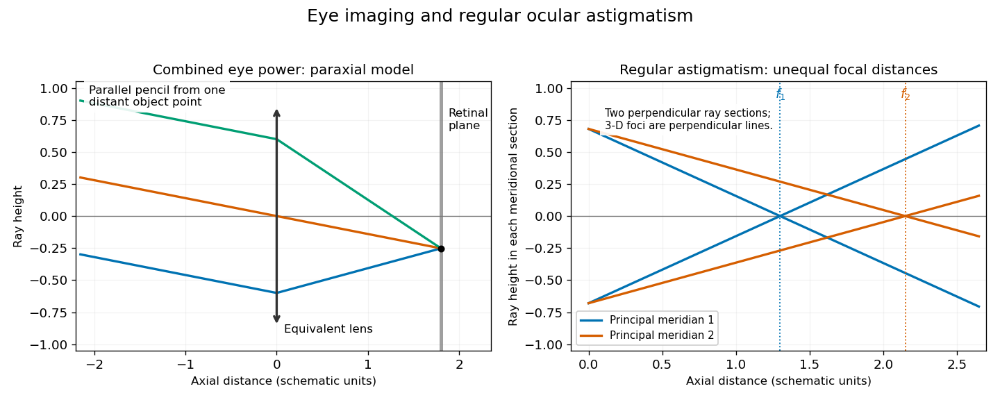

<h1 id="6/solution">Solution</h1>

↑ **Parent:** [6](../6.md)

The [cornea](../../../../../cornea.md) supplies much of the eye's converging [optical power](../../../../../optical-power.md); the [crystalline lens](../../../../../crystalline-lens.md) supplies additional, adjustable power through [ocular accommodation](../../../../../accommodation-vertebrate-eye.md). The transparent aqueous and vitreous media transmit the [light](../../../../../light.md). The [iris](../../../../../iris.md) controls the [pupil](../../../../../pupil.md), acting as an aperture rather than as the focusing element, and the [retina](../../../../../retina.md) is the receiving surface. The posterior [optic nerve](../../../../../optic-nerve.md) conveys the resulting neural signals; it does not carry an optical picture out of the eye.

Each sufficiently small object patch sends a pencil of rays through the [pupil](../../../../../pupil.md). Refraction at the corneal and lenticular surfaces brings that pencil towards a retinal image point. Pencils from different object heights meet at different retinal positions, producing a real inverted image. In a paraxial equivalent model,

$$
\frac1u+\frac1v=\frac1f,\qquad m=-\frac vu.
$$

The several physical refracting surfaces have been replaced here by an equivalent [thin lens](../../../../../thin-lens.md); this is a model, not a claim that all bending occurs at the [crystalline lens](../../../../../crystalline-lens.md). For a distant object, approximately parallel incoming pencils focus near the back focal surface. [Ocular accommodation](../../../../../accommodation-vertebrate-eye.md) increases power for nearer objects while the retinal position remains nearly fixed.

**[Figure 1](#6/image-image-formation-by-an-equivalent-eye-and-the-two-principal-meridians-of-regular-ocular-astigmatism). Image formation by an equivalent eye and the two principal meridians of regular ocular astigmatism**. Original paraxial schematics, not anatomical measurements. Left: one equivalent thin lens represents the combined corneal and lenticular power; parallel rays from one off-axis direction meet on a receiving plane. Right: ray fans in two perpendicular meridional sections have unequal focal distances. In three dimensions their focal images are perpendicular lines, not two complete point images.

In [regular ocular astigmatism](../../../../../regular-ocular-astigmatism.md), the two principal meridians are perpendicular but have different refractive powers, commonly because the [cornea](../../../../../cornea.md) has different curvatures in those meridians. A point object then gives two line foci at different depths rather than a single sharp point. The difference is not merely an overall spherical focusing error. Refraction with differently oriented cylindrical trial lenses can locate the power and axis; [keratometry](../../../../../keratometry.md) or [corneal topography](../../../../../corneal-topography.md) measures corneal shape. [Cylindrical lens](../../../../../cylindrical-lens.md) or [toric lens](../../../../../toric-lens.md) correction supplies the missing meridional power with the proper orientation. [Spectacles](../../../../../spectacles.md) and appropriately fitted [toric contact lenses](../../../../../toric-contact-lens.md) can provide such correction. A method for measuring corneal curvature should not be confused with a complete measurement of the eye's total refractive error.[Regular astigmatism and principal meridians](../../../../../physiology-of-astigmatism-by-the-american-academy-of-ophthalmology.md)[Diagnosis and correction with glasses or contact lenses](../../../../../astigmatism-by-the-national-eye-institute.md)

## ↑ Ancestors (11)

1. [6](../6.md)
2. [Physics](../../physics-split.md)
3. [First examination](../../split.md)
4. [1866](../../../split.md)
5. [Past exam of the medicine course of the University of Oxford](../../../../split.md)
6. [Medicine course of the University of Oxford](../../../../../medicine-course-of-the-university-of-oxford.md)
7. [Undergraduate course of the University of Oxford](../../../../../undergraduate-course-of-the-university-of-oxford.md)
8. [Course of the University of Oxford](../../../../../course-of-the-university-of-oxford.md)
9. [University of Oxford](../../../../../university-of-oxford-split.md)
10. [List of universities](../../../../../list-of-universities.md)
11. [Codex Wiki](../../../../../split.md)
