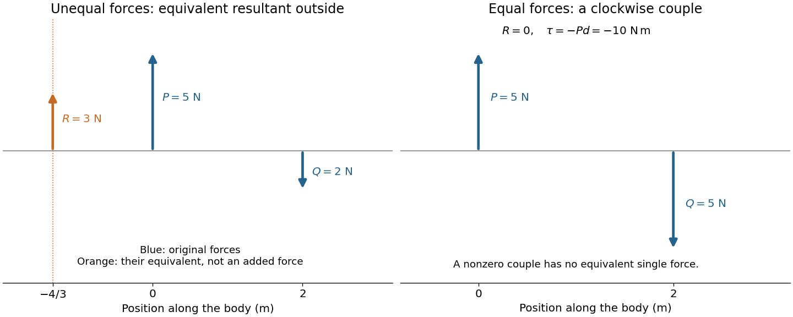
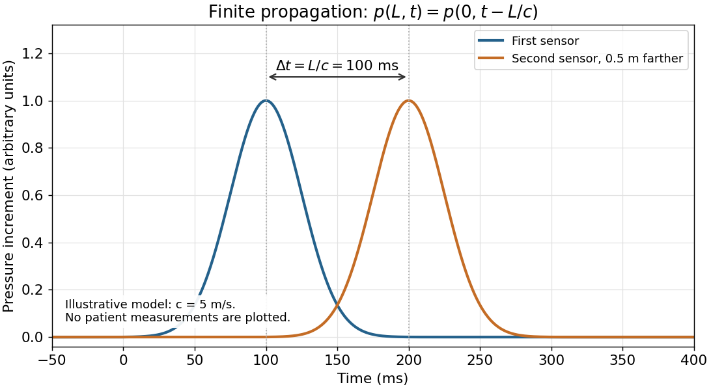

# Physics

↑ **Parent:** [First examination](../first-examination.md)

Original volume: [Examination papers for the Degree of Bachelor of Medicine by the University of Oxford (1864–1867)](../../../biology-bibliography.md#examination-papers-for-the-degree-of-bachelor-of-medicine-by-the-university-of-oxford-1864-1867). [Original paper, PDF pages 85–86](https://upload.wikimedia.org/wikipedia/commons/3/3e/Examination_papers_for_the_Degree_of_Bachelor_of_medicine_-_1864-67_(IA_b24757810).pdf#page=85).

Original questions are transcribed from the public-domain edition. Credit: Wellcome Collection; original supplied by Royal College of Physicians, London. [Source and public-domain rights statement](https://wellcomecollection.org/works/d7b9zgnx).

**Table of contents**

- [1](#1)
  - [Solution](#1/solution)
- [2](#2)
  - [Solution](#2/solution)
- [3](#3)
  - [Solution](#3/solution)
- [4](#4)
  - [Solution](#4/solution)
- [5](#5)
  - [Solution](#5/solution)
- [6](#6)
  - [Solution](#6/solution)
- [7](#7)
  - [Solution](#7/solution)
- [8](#8)
  - [Solution](#8/solution)
- [9](#9)
  - [Solution](#9/solution)
- [10](#10)
  - [Solution](#10/solution)
- [11](#11)
  - [Solution](#11/solution)

## 1

↑ **Parent:** [Physics](physics.md)

**Original question.**

If two parallel forces act upon a rigid body in _opposite_ directions, state how to determine the magnitude and position of their single resultant.

Discuss the case in which the two forces become equal in magnitude.

Describe the arrangement and action of the muscles by which the motion of the eye-ball is produced.

<h3 id="1/solution">Solution</h3>

↑ **Parent:** [1](#1)

Let an upward [force](../../../force.md) $P$ act along $x=0$ and a downward parallel [force](../../../force.md) $Q$ along $x=d>0$. An equivalent [resultant force](../../../force.md#resultant-force) must preserve both total [force](../../../force.md) and [torque](../../../momentum.md#torque). Its signed vertical component is $R=P-Q$, and taking [torques](../../../momentum.md#torque) about the first line gives $Rx_R=-Qd$. Thus

$$
\boxed{R=P-Q,\qquad x_R=-\frac{Qd}{P-Q}\quad(P\ne Q).}
$$

Its magnitude is $|P-Q|$ and its direction agrees with the larger [force](../../../force.md). Its line lies outside the two original lines on the side of that larger [force](../../../force.md); for example, $P>Q$ gives $x_R<0$. The products of the original [forces](../../../force.md) and their perpendicular distances from this line are equal.

If $P=Q\ne0$ and $d\ne0$, the total [force](../../../force.md) vanishes but the [torque](../../../momentum.md#torque) is $-Pd$. **No single force is equivalent to this system:** it is a [force couple](../../../momentum.md#couple-mechanics) of magnitude $Pd$. Its [torque](../../../momentum.md#torque) is independent of the reference point because translating that point changes the [torque](../../../momentum.md#torque) by the [cross product](../../../vector-space.md#cross-product) of the shift and the zero [resultant force](../../../force.md#resultant-force). Equal opposite [forces](../../../force.md) on the same line instead cancel completely.

**[Figure 1](#1/image-unequal-opposed-forces-have-an-external-resultant-line-equal-separated-forces-form-a-couple). Unequal opposed forces have an external resultant line; equal separated forces form a couple**.

The [eye](../../../anatomy.md#eye) is rotated by six [extraocular muscles](../../../anatomy.md#extraocular-muscle). The rectus [muscles](../../../anatomy.md#muscle) approach it from behind; the oblique [muscles](../../../anatomy.md#muscle) have oblique lines of pull, with the [superior oblique muscle](../../../anatomy.md#superior-oblique-muscle) tendon redirected by an orbital pulley. Attachments on the [sclera](../../../anatomy.md#sclera) give [lever arms](../../../momentum.md#lever-arm) about the rotation centre. In the straight-ahead position their actions are as follows; vertical and torsional contributions vary with gaze direction.[Chapter 20, “The Actions and Innervation of Extraocular Muscles”: antagonistic pairs, axes and eye-position dependence](../../../neuroscience-bibliography.md#neuroscience-2nd-edition-edited-by-d-purves-and-others)

| [Extraocular muscle](../../../anatomy.md#extraocular-muscle) | Actions | Innervation |
| --- | --- | --- |
| [Medial rectus muscle](../../../anatomy.md#medial-rectus-muscle) | Turns the [eye](../../../anatomy.md#eye) inward | [Oculomotor nerve](../../../neuroscience.md#oculomotor-nerve), III |
| [Lateral rectus muscle](../../../anatomy.md#lateral-rectus-muscle) | Turns the [eye](../../../anatomy.md#eye) outward | [Abducens nerve](../../../neuroscience.md#abducens-nerve), VI |
| [Superior rectus muscle](../../../anatomy.md#superior-rectus-muscle) | Elevates; also turns inward and rotates the upper pole inward | [Oculomotor nerve](../../../neuroscience.md#oculomotor-nerve), III |
| [Inferior rectus muscle](../../../anatomy.md#inferior-rectus-muscle) | Depresses; also turns inward and rotates the upper pole outward | [Oculomotor nerve](../../../neuroscience.md#oculomotor-nerve), III |
| [Superior oblique muscle](../../../anatomy.md#superior-oblique-muscle) | Rotates the upper pole inward; also depresses and turns outward | [Trochlear nerve](../../../neuroscience.md#trochlear-nerve), IV |
| [Inferior oblique muscle](../../../anatomy.md#inferior-oblique-muscle) | Rotates the upper pole outward; also elevates and turns outward | [Oculomotor nerve](../../../neuroscience.md#oculomotor-nerve), III |

Coordinated contraction selects the desired rotation and balances unwanted components. This illustrates [torque](../../../momentum.md#torque) control; the full ocular geometry is not simply the parallel-force pair of the first calculation.

## 2

↑ **Parent:** [Physics](physics.md)

**Original question.**

When a force produces motion in a body, how is the _work_ done expressed in terms of the force and the circumstances of the motion ? Explain generally the appropriateness of this expression.

When a man walks along a horizontal road, in what way does he perform _work_ ?

<h3 id="2/solution">Solution</h3>

↑ **Parent:** [2](#2)

For constant [force](../../../force.md) $\mathbf F$ and [displacement](../../../classical-mechanics.md#displacement) $\mathbf s$, the [work](../../../energy.md#work) is

$$
\boxed{W=\mathbf F\cdot\mathbf s=Fs\cos\theta.}
$$

For a variable [force](../../../force.md), $W=\int_C\mathbf F\cdot d\mathbf r$. The [work-energy theorem](../../../energy.md#work-energy-theorem) explains this choice: [Newton's second law](../../../force.md#newton-s-second-law) for fixed [mass](../../../classical-mechanics.md#mass) gives $\mathbf F\cdot d\mathbf r=m\mathbf a\cdot\mathbf v\,dt=d(mv^2/2)$. The component along the motion changes [kinetic energy](../../../energy.md#kinetic-energy); a perpendicular [force](../../../force.md) can change direction without doing [work](../../../energy.md#work). Exerting a [force](../../../force.md) on a stationary object likewise does no [work](../../../energy.md#work) on it.

Walking on level ground still requires muscular [work](../../../energy.md#work). The [centre of mass](../../../classical-mechanics.md#center-of-mass) rises and falls during each step; the limbs gain and lose [kinetic energy](../../../energy.md#kinetic-energy); and [muscles](../../../anatomy.md#muscle) perform positive [work](../../../energy.md#work) that replaces [energy](../../../energy.md) dissipated in impacts and tissue motion. Air resistance can add another cost. Returning to the same height makes the net change of [gravitational potential energy](../../../energy.md#gravitational-energy) zero, not every intermediate [work](../../../energy.md#work) contribution.

At ideal no-slip contact with an immovable road, the contact point is instantaneously stationary, so the road's [force](../../../force.md) does no [work](../../../energy.md#work) through that point. The [muscles](../../../anatomy.md#muscle) convert internal chemical [energy](../../../energy.md) into motion. **Zero net gain of height is compatible with positive muscular work and energy expenditure.**

## 3

↑ **Parent:** [Physics](physics.md)

**Original question.**

If a body falls in vacuo, express the velocity, and the distance of the body from the starting point, at any instant in terms of the time which has elapsed since motion commenced.

Account for the comparatively small velocity of a drop of rain when it reaches the earth, and state what is the _effective force_ upon the drop at that time.

<h3 id="3/solution">Solution</h3>

↑ **Parent:** [3](#3)

Take downward [displacement](../../../classical-mechanics.md#displacement) as positive and [gravitational acceleration](../../../newton-s-law-of-universal-gravitation.md#gravitational-acceleration) $g$ as constant. In a vacuum, $m\,dv/dt=mg$, so with initial downward [velocity](../../../classical-mechanics.md#velocity) $u$,

$$
\boxed{v=u+gt,\qquad s=ut+\tfrac12gt^2.}
$$

For release from rest these become $v=gt$ and $s=gt^2/2$.

A raindrop encounters an increasing upward [drag force](../../../fluid-mechanics.md#drag-physics) as its [speed](../../../classical-mechanics.md#speed) grows. At [terminal velocity](../../../classical-mechanics.md#terminal-velocity), [gravitational weight](../../../force.md#weight-physics) is balanced by [drag force](../../../fluid-mechanics.md#drag-physics) and the small [buoyancy](../../../fluid-mechanics.md#buoyancy) contribution:

$$
\boxed{F_{\rm net}=mg-F_{\rm drag}-F_{\rm buoyancy}=0,\qquad a=0.}
$$

The drop remains in motion: zero [acceleration](../../../classical-mechanics.md#acceleration) does not imply zero [velocity](../../../classical-mechanics.md#velocity). In a quadratic [drag force](../../../fluid-mechanics.md#drag-physics) model, $F_{\rm drag}=\rho_{\rm air}C_DAv^2/2$, giving $v_t=\sqrt{2(m-\rho_{\rm air}V)g/(\rho_{\rm air}C_DA)}$. That formula assumes a fixed effective area and [drag coefficient](../../../fluid-mechanics.md#drag-coefficient); sufficiently small drops or deforming large drops need an appropriate model. The question's “effective force” at settled [terminal velocity](../../../classical-mechanics.md#terminal-velocity) is the approximately zero [resultant force](../../../force.md#resultant-force), not its nonzero [gravitational weight](../../../force.md#weight-physics).

## 4

↑ **Parent:** [Physics](physics.md)

**Original question.**

Describe some experiment illustrating the property, possessed by a fluid, of transmitting pressure applied to it equally in all directions.

Should the pulse occur simultaneously in all parts of the body ? What is the result of experiment on this point ?

<h3 id="4/solution">Solution</h3>

↑ **Parent:** [4](#4)

[Pascal's law](../../../pressure.md#pascal-s-law) concerns a [pressure](../../../pressure.md) increment imposed on a confined [fluid](../../../fluid-mechanics.md#fluid) at rest. A water-filled vessel with small openings in differently oriented walls and a close-fitting [piston](../../../engineering.md#piston) illustrates it: pressing the [piston](../../../engineering.md#piston) produces jets in different directions, showing that [pressure](../../../pressure.md) acts normally to each local surface. Compare ports at the same height to remove differences of [hydrostatic pressure](../../../fluid-mechanics.md#hydrostatic-pressure). Pressure gauges at equally high ports show the same imposed increment after the disturbance settles.

For an ideal [hydraulic press](../../../pressure.md#hydraulic-press) with [piston](../../../engineering.md#piston) areas $A_1,A_2$,

$$
\boxed{\Delta p=\frac{F_1}{A_1}=\frac{F_2}{A_2},\qquad F_2=F_1A_2/A_1.}
$$

Conservation of [fluid](../../../fluid-mechanics.md#fluid) volume gives $A_1s_1=A_2s_2$, hence $F_1s_1=F_2s_2$: the larger output [force](../../../force.md) accompanies a smaller [displacement](../../../classical-mechanics.md#displacement) and does not create [energy](../../../energy.md).

**The arterial pulse is not simultaneous throughout the body.** [Pascal's law](../../../pressure.md#pascal-s-law) is an equilibrium statement, not instantaneous transmission. An [arterial pulse](../../../physiology.md#arterial-pulse) travels through coupled [blood](../../../physiology.md#blood) and elastic arterial walls. Synchronized recordings at two sites show different arrival times of corresponding waveform features. For effective propagation distance $L$, [pulse wave velocity](../../../physiology.md#pulse-wave-velocity) is $c_p=L/\Delta t$. It differs from the transport [velocity](../../../classical-mechanics.md#velocity) of individual blood cells.[Transit-time estimation from pressure waveforms; diastolic-foot detection and temporal resolution](../../../anatomy-and-physiology-bibliography.md#2024-recommendations-for-validation-of-noninvasive-arterial-pulse-wave-velocity-measurement-devices)

A bench demonstration uses an elastic liquid-filled tube, two pressure sensors at known positions, and a short pressure pulse at one end. The delayed second recording tests finite [pressure wave propagation](../../../wave.md#pressure-wave-propagation) independently of the eventual static [pressure](../../../pressure.md) balance.

**[Figure 2](#4/image-an-illustrative-pressure-pulse-reaches-the-second-sensor-later-these-curves-are-a-model-rather-than-patient-data). An illustrative pressure pulse reaches the second sensor later; these curves are a model rather than patient data**.

## 5

↑ **Parent:** [Physics](physics.md)

**Original question.**

Enunciate Boyle's law connecting the volume and tension of a gas.

Explain the process of respiration, as far as it is due to the motion of the Diaphragm.

Assuming the lungs to contain 1600 cubic centimetres of air at the termination of an expiration, and 400 cubic centimetres to be introduced by each inspiration, if, after an expiration a vertical tube be placed in the mouth, with its lower end dipping in mercury, and, the nose being stopped, the act of inspiration be performed, to what height will the mercury rise in the tube ? The height of the mercury in the barometer being 760 m.m., and the air in the tube being neglected.

<h3 id="5/solution">Solution</h3>

↑ **Parent:** [5](#5)

[Boyle's law](../../../second-law-of-thermodynamics.md#boyle-s-law) states that a fixed amount of [gas](../../../thermodynamics.md#gas) at constant [temperature](../../../temperature.md) obeys

$$
\boxed{pV=\text{constant},}
$$

where $p$ is absolute [pressure](../../../pressure.md), not [gauge pressure](../../../fluid-mechanics.md#gauge-pressure). It is an ideal-gas approximation, not an assertion that every rapid compression is isothermal.

The [respiratory diaphragm](../../../anatomy.md#respiratory-diaphragm) contracts and lowers its dome, increasing thoracic volume. Mechanical coupling through the pleural space lets the [lungs](../../../anatomy.md#lung) expand; alveolar [pressure](../../../pressure.md) falls below atmospheric [pressure](../../../pressure.md), drawing air in. Relaxation of the [respiratory diaphragm](../../../anatomy.md#respiratory-diaphragm) and elastic recoil drive quiet expiration. These [respiratory mechanics](../../../physiology.md#respiratory-mechanics) describe ventilation, distinct from chemical [cellular respiration](../../../metabolism.md#cellular-respiration).[“Breathing in” and “Breathing out”: diaphragm movement, expansion and recoil](../../../anatomy-and-physiology-bibliography.md#how-the-lungs-work-what-breathing-does-for-the-body-by-the-national-heart-lung-and-blood-institute)

For the stipulated sealed, isothermal gas, initial and final volumes are $1600$ and $2000\,\mathrm{cm^3}$. Expressing absolute [pressure](../../../pressure.md) as a mercury-column height,

$$
p_f=760\frac{1600}{2000}=608\,\mathrm{mmHg}.
$$

The mercury column is supported by the atmospheric-to-internal [pressure](../../../pressure.md) difference:

$$
\boxed{h=760-608=152\,\mathrm{mm}=15.2\,\mathrm{cm}.}
$$

The specified volume change belongs to the historical idealized model. Real tube-air volume, temperature changes and limits on respiratory-muscle pressure generation would affect a physical apparatus.

## 6

↑ **Parent:** [Physics](physics.md)

**Original question.**

How are differences of _quality_ in musical sounds of the same pitch accounted for ?

Describe briefly the apparatus in the human ear which, it seems probable, is employed in producing the sensation of _quality_ in musical sounds.

<h3 id="6/solution">Solution</h3>

↑ **Parent:** [6](#6)

Equal [pitch](../../../neuroscience.md#pitch) need not mean equal [frequency spectrum](../../../fourier-analysis.md#frequency-spectrum). For an ideal periodic [sound wave](../../../fluid-mechanics.md#acoustic-wave) of fundamental [frequency](../../../wave.md#frequency) $f$, a [Fourier series](../../../fourier-series.md) has the form

$$
p(t)=\sum_{n\ge1}A_n\cos(2\pi nft+\phi_n).
$$

Changing relative amplitudes $A_n$ changes the waveform and generally its [timbre](../../../neuroscience.md#timbre) without changing its fundamental period. Attack, decay and the time evolution of the [frequency spectrum](../../../fourier-analysis.md#frequency-spectrum) also matter for real musical notes.

The [middle ear](../../../neuroscience.md#middle-ear) transfers vibration into the [cochlea](../../../neuroscience.md#cochlea). The [basilar membrane](../../../neuroscience.md#basilar-membrane) supports a frequency-selective travelling wave: higher-frequency responses occur nearer the base and lower-frequency responses nearer the apex. [Hair cells](../../../neuroscience.md#hair-cell) in the [organ of Corti](../../../neuroscience.md#organ-of-corti) transduce mechanical stimulation into signals transmitted through the [auditory nerve](../../../neuroscience.md#auditory-nerve). Different spectral and temporal patterns therefore produce different sensory-activity patterns.[Steps 3–6: cochlear travelling wave, hair cells and auditory nerve](../../../neuroscience-bibliography.md#how-do-we-hear-by-the-national-institute-on-deafness-and-other-communication-disorders)

This supplies a physical basis for [timbre](../../../neuroscience.md#timbre) discrimination. It does not make the [cochlea](../../../neuroscience.md#cochlea) a set of independent strings, nor does excitation position alone explain every perceptual distinction: the [cochlear amplifier](../../../neuroscience.md#cochlear-amplifier) and temporal neural coding also contribute.

## 7

↑ **Parent:** [Physics](physics.md)

**Original question.**

Describe the way in which an image of an object is. formed by a convex lens, and state the relation between the distances of the object and image from the lens.

In what way is the eye enabled to produce, upon the retina, distinct images of objects at different distances from it ?

<h3 id="7/solution">Solution</h3>

↑ **Parent:** [7](#7)

In the paraxial [thin lens](../../../geometrical-optics.md#thin-lens) approximation, let a converging [lens](../../../geometrical-optics.md#lens-optics) have [focal length](../../../geometrical-optics.md#focal-length) $f>0$, real-object distance $u>0$, and signed image distance $v$, positive beyond the [lens](../../../geometrical-optics.md#lens-optics). Then

$$
\boxed{\frac1u+\frac1v=\frac1f,\qquad m=-\frac vu.}
$$

A ray parallel to the axis emerges through the far focus; a ray through the optical centre is approximately undeviated. Their intersection gives a real, inverted image for $u>f$: reduced for $u>2f$, equal-sized at $u=2f$, and enlarged for $f<u<2f$. At $u=f$ the emerging rays are parallel. For $u<f$ their backward extensions meet on the object side: $v<0$ and the image is virtual and upright.

The [retina](../../../neuroscience.md#retina) remains at an approximately fixed distance from the refracting apparatus. [Ocular accommodation](../../../anatomy.md#accommodation-vertebrate-eye) changes the [optical power](../../../geometrical-optics.md#optical-power). A nearer object increases $1/u$, so a fixed retinal image distance requires larger $1/f$.

For near vision, the [ciliary muscle](../../../anatomy.md#ciliary-muscle) contracts and reduces tension in the [zonular fibres](../../../anatomy.md#zonular-fibre). The elastic [crystalline lens](../../../anatomy.md#crystalline-lens) becomes more rounded, increasing its [optical power](../../../geometrical-optics.md#optical-power). For distant vision the [ciliary muscle](../../../anatomy.md#ciliary-muscle) relaxes, zonular tension flattens the [crystalline lens](../../../anatomy.md#crystalline-lens), and less power is needed. The [eye](../../../anatomy.md#eye)'s several refracting surfaces make the single [thin lens](../../../geometrical-optics.md#thin-lens) a qualitative model rather than its full optical prescription.

## 8

↑ **Parent:** [Physics](physics.md)

**Original question.**

Describe the common thermometer, and the way in which it is graduated.

To what change is a thermometer liable, which produces errors in the indications of the instrument ?

<h3 id="8/solution">Solution</h3>

↑ **Parent:** [8](#8)

A [liquid-in-glass thermometer](../../../temperature.md#liquid-in-glass-thermometer) has a bulb connected to a narrow graduated capillary. [Thermal expansion](../../../thermodynamics.md#thermal-expansion) of its liquid relative to the glass raises or lowers the column. A simple linear model is

$$
\Delta\ell\simeq\frac{V_0(\beta_{\rm liquid}-\beta_{\rm glass})}{A}\Delta T,
$$

with capillary area $A$ and volumetric expansion coefficients $\beta$.

For the historical Celsius graduation, establish an ice point in an equilibrium mixture of pure ice and water, and a steam point in saturated steam at standard atmospheric [pressure](../../../pressure.md), here a barometer height of $760\,\mathrm{mm}$. Mark $0^\circ\mathrm C$ and $100^\circ\mathrm C$, then divide the interval into one hundred equal parts. This is a historical two-fixed-point instrument calibration, not the modern definition of the [kelvin](../../../temperature.md#kelvin) or of Celsius [temperature](../../../temperature.md). Nonuniform capillary area and nonlinear expansion limit exactness.

**Bulb contraction raises the column and makes the reading too high; retained expansion makes it too low.** Glass volume changes with age and thermal history; heating can cause temporary zero-point depression followed by slow recovery. Rechecking the ice point detects a shifted zero, although it does not diagnose every scale error.[NIST SP 1088, printed p. 4 and §§7.4–7.5: permanent and temporary bulb-volume changes](../../../physics-bibliography.md#maintenance-and-validation-of-liquid-in-glass-thermometers-by-christina-d-cross-and-others)

## 9

↑ **Parent:** [Physics](physics.md)

**Original question.**

Define the _specific heat_ of a body.

If 100 grammes of iron be boiled for some time in water, when the height of the barometer is 760 m.m., and be then quickly transferred to a vessel containing 150 grammes of water at $10^\circ$C, what will be the common temperature of the iron and water ? It being assumed that no heat is lost, that a gramme of hot water adheres to the iron when it is transferred to the cold water, and that the specific heat of iron is 0.114.

<h3 id="9/solution">Solution</h3>

↑ **Parent:** [9](#9)

[Specific heat capacity](../../../heat.md#specific-heat-capacity) is [heat capacity](../../../heat.md#heat-capacity) per unit [mass](../../../classical-mechanics.md#mass). For a specified thermodynamic process without a [phase transition](../../../critical-phenomenon.md#phase-transition),

$$
\boxed{c=\frac1m\frac{dQ}{dT}.}
$$

The constraint matters: constant-[pressure](../../../pressure.md) and constant-volume [heat capacities](../../../heat.md#heat-capacity) need not coincide. Here the supplied iron value and water value are treated as constants.

At the stipulated barometer reading, iron left in boiling water reaches $100^\circ\mathrm C$. Taking water's [specific heat capacity](../../../heat.md#specific-heat-capacity) as one in the given units, the iron has [heat capacity](../../../heat.md#heat-capacity) $100(0.114)=11.4$. The adhering gramme of hot water adds another one. Thus the hot material has total [heat capacity](../../../heat.md#heat-capacity) $12.4$, compared with $150$ for the initially cool water.

The no-loss [calorimetry](../../../calorimetry.md) [energy](../../../energy.md) balance is

$$
100(0.114)(100-T)+1(100-T)=150(T-10),
$$

so

$$
\boxed{T=\frac{12.4(100)+150(10)}{162.4}
=\frac{3425}{203}\,{}^\circ\mathrm C\simeq16.8719^\circ\mathrm C.}
$$

The adhering water enters on the hot side, not as extra water initially at $10^\circ\mathrm C$. The vessel's [heat capacity](../../../heat.md#heat-capacity) is neglected, as none is supplied.

## 10

↑ **Parent:** [Physics](physics.md)

**Original question.**

Explain how a person may be knocked down in a thunderstorm without being actually struck by lightning.

<h3 id="10/solution">Solution</h3>

↑ **Parent:** [10](#10)

**A direct lightning strike is unnecessary.** A nearby strike can produce a [ground current](../../../geophysics.md#ground-current), putting the feet at different [electric potentials](../../../electric-field.md#electric-potential) and driving current through the body by a [step voltage](../../../electric-field.md#step-voltage). A side flash from a struck object or conduction along a contacted conductor also provides an indirect current path.[“Ground Current”, “Side Flash” and “Conduction”: indirect electrical exposure](../../../physics-bibliography.md#lightning-science-five-ways-lightning-strikes-people-by-the-national-weather-service)

Rapid air heating by a nearby [lightning](../../../geophysics.md#lightning) discharge also produces an expanding pressure disturbance. Its blast can impart a mechanical [impulse](../../../classical-mechanics.md#impulse), causing a fall or blunt injury without current passing through the person.[p. 1, “How Lightning Hurts Us”: expanding air and blast-related blunt trauma](../../../physics-bibliography.md#frontcountry-lightning-risk-management)

The absence of a direct strike therefore does not distinguish electrical incapacity from mechanical displacement. Observations would be needed to identify the mechanism in a particular event.

## 11

↑ **Parent:** [Physics](physics.md)

**Original question.**

If round an electromagnet, a quantity of insulated wire be coiled, in the same way as the coil of the magnet itself, and the ends of this wire be connected with the terminals of a multiplying galvanometer, describe what takes place, when a current is sent round the coil of the magnet, and when this current is stopped.

<h3 id="11/solution">Solution</h3>

↑ **Parent:** [11](#11)

The coils form a [mutual induction](../../../electromagnetism.md#mutual-induction) apparatus. Changing primary [electric current](../../../electric-charge.md#electric-current) changes secondary [magnetic flux linkage](../../../electromagnetism.md#magnetic-flux-linkage) $\Lambda_2$. [Faraday's law of induction](../../../maxwell-equations.md#faraday-s-law-of-induction) gives

$$
\boxed{\mathcal E_2=-\frac{d\Lambda_2}{dt}.}
$$

On closing the primary circuit, increasing [electric current](../../../electric-charge.md#electric-current) produces a transient secondary [electric current](../../../electric-charge.md#electric-current) and [galvanometer](../../../electric-charge.md#galvanometer) deflection. By [Lenz's law](../../../maxwell-equations.md#lenz-s-law) its direction opposes the increasing [magnetic flux](../../../magnetic-field.md#magnetic-flux). Once primary [electric current](../../../electric-charge.md#electric-current) and core [magnetization](../../../electromagnetism.md#magnetization) are steady, the derivative vanishes: the [galvanometer](../../../electric-charge.md#galvanometer) returns to zero despite the continuing [magnetic field](../../../magnetic-field.md).

On opening the circuit, the decreasing [magnetic flux](../../../magnetic-field.md#magnetic-flux) induces a secondary [electric current](../../../electric-charge.md#electric-current) tending to sustain that flux. The [galvanometer](../../../electric-charge.md#galvanometer) deflects oppositely, then returns to zero. **Making and breaking produce opposite transient deflections; steady primary current produces no sustained induced current.**

For fixed linear coils, $\Lambda_2=MI_1$ and $\mathcal E_2=-M\,dI_1/dt$, with [mutual inductance](../../../electromagnetism.md#mutual-inductance) $M$. Opposite equal changes of primary [electric current](../../../electric-charge.md#electric-current) give opposite equal areas under the induced-[electromotive force](../../../electric-charge.md#electromotive-force) curves in that model. Peak sizes can differ with switching times. Real iron-core [magnetic hysteresis](../../../critical-phenomenon.md#magnetic-hysteresis) and remanent [magnetization](../../../electromagnetism.md#magnetization) can also change the flux excursion, so equality of the actual peaks is not required.

## ↑ Ancestors (9)

1. [First examination](../first-examination.md)
2. [1867](../../1867.md)
3. [Past exam of the medicine course of the University of Oxford](../../../past-exam-of-the-medicine-course-of-the-university-of-oxford.md)
4. [Medicine course of the University of Oxford](../../../university-of-oxford.md#medicine-course-of-the-university-of-oxford)
5. [Undergraduate course of the University of Oxford](../../../university-of-oxford.md#undergraduate-course-of-the-university-of-oxford)
6. [Course of the University of Oxford](../../../university-of-oxford.md#course-of-the-university-of-oxford)
7. [University of Oxford](../../../university-of-oxford.md)
8. [List of universities](../../../README.md#list-of-universities)
9. [Codex Wiki](../../../README.md)
