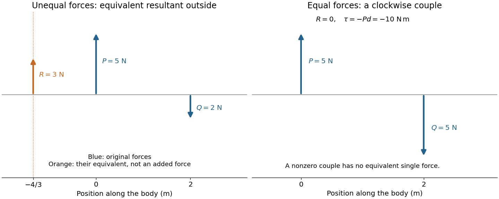

<h1 id="1/solution">Solution</h1>

↑ **Parent:** [1](../1.md)

Let an upward [force](../../../../../force-split.md) $P$ act along $x=0$ and a downward parallel [force](../../../../../force-split.md) $Q$ along $x=d>0$. An equivalent [resultant force](../../../../../resultant-force.md) must preserve both total [force](../../../../../force-split.md) and [torque](../../../../../torque.md). Its signed vertical component is $R=P-Q$, and taking [torques](../../../../../torque.md) about the first line gives $Rx_R=-Qd$. Thus

$$
\boxed{R=P-Q,\qquad x_R=-\frac{Qd}{P-Q}\quad(P\ne Q).}
$$

Its magnitude is $|P-Q|$ and its direction agrees with the larger [force](../../../../../force-split.md). Its line lies outside the two original lines on the side of that larger [force](../../../../../force-split.md); for example, $P>Q$ gives $x_R<0$. The products of the original [forces](../../../../../force-split.md) and their perpendicular distances from this line are equal.

If $P=Q\ne0$ and $d\ne0$, the total [force](../../../../../force-split.md) vanishes but the [torque](../../../../../torque.md) is $-Pd$. **No single force is equivalent to this system:** it is a [force couple](../../../../../couple-mechanics.md) of magnitude $Pd$. Its [torque](../../../../../torque.md) is independent of the reference point because translating that point changes the [torque](../../../../../torque.md) by the [cross product](../../../../../cross-product.md) of the shift and the zero [resultant force](../../../../../resultant-force.md). Equal opposite [forces](../../../../../force-split.md) on the same line instead cancel completely.

**[Figure 1](#1/image-unequal-opposed-forces-have-an-external-resultant-line-equal-separated-forces-form-a-couple). Unequal opposed forces have an external resultant line; equal separated forces form a couple**.

The [eye](../../../../../eye.md) is rotated by six [extraocular muscles](../../../../../extraocular-muscle.md). The rectus [muscles](../../../../../muscle.md) approach it from behind; the oblique [muscles](../../../../../muscle.md) have oblique lines of pull, with the [superior oblique muscle](../../../../../superior-oblique-muscle.md) tendon redirected by an orbital pulley. Attachments on the [sclera](../../../../../sclera.md) give [lever arms](../../../../../lever-arm.md) about the rotation centre. In the straight-ahead position their actions are as follows; vertical and torsional contributions vary with gaze direction.[Chapter 20, “The Actions and Innervation of Extraocular Muscles”: antagonistic pairs, axes and eye-position dependence](../../../../../neuroscience-2nd-edition-edited-by-d-purves-and-others.md)

| [Extraocular muscle](../../../../../extraocular-muscle.md) | Actions | Innervation |
| --- | --- | --- |
| [Medial rectus muscle](../../../../../medial-rectus-muscle.md) | Turns the [eye](../../../../../eye.md) inward | [Oculomotor nerve](../../../../../oculomotor-nerve.md), III |
| [Lateral rectus muscle](../../../../../lateral-rectus-muscle.md) | Turns the [eye](../../../../../eye.md) outward | [Abducens nerve](../../../../../abducens-nerve.md), VI |
| [Superior rectus muscle](../../../../../superior-rectus-muscle.md) | Elevates; also turns inward and rotates the upper pole inward | [Oculomotor nerve](../../../../../oculomotor-nerve.md), III |
| [Inferior rectus muscle](../../../../../inferior-rectus-muscle.md) | Depresses; also turns inward and rotates the upper pole outward | [Oculomotor nerve](../../../../../oculomotor-nerve.md), III |
| [Superior oblique muscle](../../../../../superior-oblique-muscle.md) | Rotates the upper pole inward; also depresses and turns outward | [Trochlear nerve](../../../../../trochlear-nerve.md), IV |
| [Inferior oblique muscle](../../../../../inferior-oblique-muscle.md) | Rotates the upper pole outward; also elevates and turns outward | [Oculomotor nerve](../../../../../oculomotor-nerve.md), III |

Coordinated contraction selects the desired rotation and balances unwanted components. This illustrates [torque](../../../../../torque.md) control; the full ocular geometry is not simply the parallel-force pair of the first calculation.

## ↑ Ancestors (11)

1. [1](../1.md)
2. [Physics](../../physics-split.md)
3. [First examination](../../split.md)
4. [1867](../../../split.md)
5. [Past exam of the medicine course of the University of Oxford](../../../../split.md)
6. [Medicine course of the University of Oxford](../../../../../medicine-course-of-the-university-of-oxford.md)
7. [Undergraduate course of the University of Oxford](../../../../../undergraduate-course-of-the-university-of-oxford.md)
8. [Course of the University of Oxford](../../../../../course-of-the-university-of-oxford.md)
9. [University of Oxford](../../../../../university-of-oxford-split.md)
10. [List of universities](../../../../../list-of-universities.md)
11. [Codex Wiki](../../../../../split.md)
