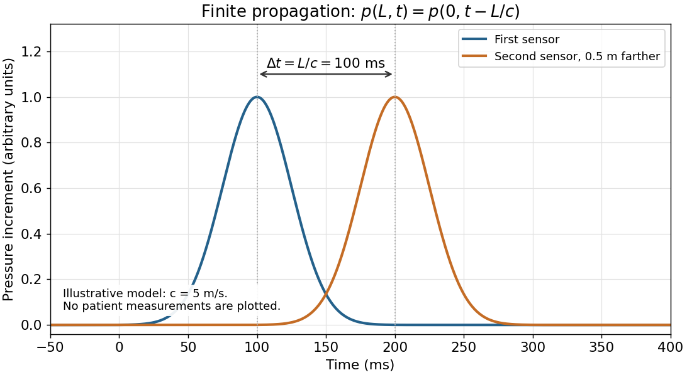

<h1 id="4/solution">Solution</h1>

↑ **Parent:** [4](../4.md)

[Pascal's law](../../../../../pascal-s-law.md) concerns a [pressure](../../../../../pressure-split.md) increment imposed on a confined [fluid](../../../../../fluid.md) at rest. A water-filled vessel with small openings in differently oriented walls and a close-fitting [piston](../../../../../piston.md) illustrates it: pressing the [piston](../../../../../piston.md) produces jets in different directions, showing that [pressure](../../../../../pressure-split.md) acts normally to each local surface. Compare ports at the same height to remove differences of [hydrostatic pressure](../../../../../hydrostatic-pressure.md). Pressure gauges at equally high ports show the same imposed increment after the disturbance settles.

For an ideal [hydraulic press](../../../../../hydraulic-press.md) with [piston](../../../../../piston.md) areas $A_1,A_2$,

$$
\boxed{\Delta p=\frac{F_1}{A_1}=\frac{F_2}{A_2},\qquad F_2=F_1A_2/A_1.}
$$

Conservation of [fluid](../../../../../fluid.md) volume gives $A_1s_1=A_2s_2$, hence $F_1s_1=F_2s_2$: the larger output [force](../../../../../force-split.md) accompanies a smaller [displacement](../../../../../displacement.md) and does not create [energy](../../../../../energy-split.md).

**The arterial pulse is not simultaneous throughout the body.** [Pascal's law](../../../../../pascal-s-law.md) is an equilibrium statement, not instantaneous transmission. An [arterial pulse](../../../../../arterial-pulse.md) travels through coupled [blood](../../../../../blood.md) and elastic arterial walls. Synchronized recordings at two sites show different arrival times of corresponding waveform features. For effective propagation distance $L$, [pulse wave velocity](../../../../../pulse-wave-velocity.md) is $c_p=L/\Delta t$. It differs from the transport [velocity](../../../../../velocity.md) of individual blood cells.[Transit-time estimation from pressure waveforms; diastolic-foot detection and temporal resolution](../../../../../2024-recommendations-for-validation-of-noninvasive-arterial-pulse-wave-velocity-measurement-devices.md)

A bench demonstration uses an elastic liquid-filled tube, two pressure sensors at known positions, and a short pressure pulse at one end. The delayed second recording tests finite [pressure wave propagation](../../../../../pressure-wave-propagation.md) independently of the eventual static [pressure](../../../../../pressure-split.md) balance.

**[Figure 2](#4/image-an-illustrative-pressure-pulse-reaches-the-second-sensor-later-these-curves-are-a-model-rather-than-patient-data). An illustrative pressure pulse reaches the second sensor later; these curves are a model rather than patient data**.

## ↑ Ancestors (11)

1. [4](../4.md)
2. [Physics](../../physics-split.md)
3. [First examination](../../split.md)
4. [1867](../../../split.md)
5. [Past exam of the medicine course of the University of Oxford](../../../../split.md)
6. [Medicine course of the University of Oxford](../../../../../medicine-course-of-the-university-of-oxford.md)
7. [Undergraduate course of the University of Oxford](../../../../../undergraduate-course-of-the-university-of-oxford.md)
8. [Course of the University of Oxford](../../../../../course-of-the-university-of-oxford.md)
9. [University of Oxford](../../../../../university-of-oxford-split.md)
10. [List of universities](../../../../../list-of-universities.md)
11. [Codex Wiki](../../../../../split.md)
