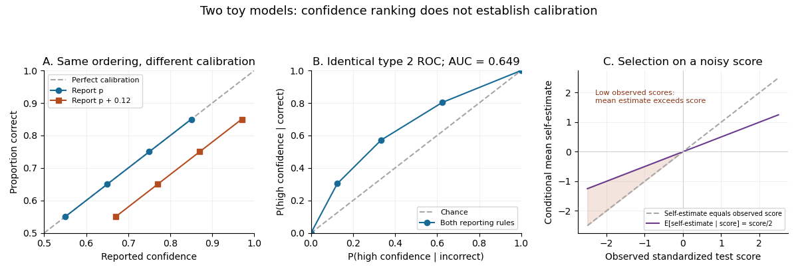

# 2022

↑ **Parent:** [Past exam of the metacognition course of the University of Oxford](../past-exam-of-the-metacognition-course-of-the-university-of-oxford.md)

Worked answers to all six questions in the Metacognition examination of 23 May 2022. Source: [Oxford's released examination archive](https://www.whatdotheyknow.com/request/experimental_psychology_past_exa/response/2757831/attach/3/New%20Compressed%20zipped%20Folder.zip?cookie_passthrough=1), member `a14397w1.pdf`.

**Table of contents**

- [1](#1)
  - [Solution](#1/solution)
- [2](#2)
  - [Solution](#2/solution)
- [3](#3)
  - [Solution](#3/solution)
- [4](#4)
  - [Solution](#4/solution)
- [5](#5)
  - [Solution](#5/solution)
- [6](#6)
  - [Solution](#6/solution)

## 1

↑ **Parent:** [2022](2022.md)

<h3 id="1/solution">Solution</h3>

↑ **Parent:** [1](#1)

The useful distinction in [George Armitage Miller](../psychologist.md#george-armitage-miller)'s position is between experiencing a mental event and knowing how that event was produced. An answer, image or feeling of difficulty can enter [consciousness](../psychology.md#consciousness) while the computations producing it remain inaccessible. Experiencing an intermediate thought also does not reveal the neural or cognitive mechanism generating that thought. Thus a restriction on [introspection](../psychology.md#introspection) into mechanisms is compatible with awareness of some intermediate stages of [reasoning](../psychology.md#reasoning).

There is evidence against treating an explanation of one's behaviour as a transparent record of its causes. [Richard E. Nisbett](../psychologist.md#richard-e-nisbett) and [Timothy D. Wilson](../psychologist.md#timothy-d-wilson) distinguished causal accounts constructed from plausible beliefs from direct access to the relevant processing.[1977, abstract: plausible causal theories can support accurate or inaccurate reports without direct process access](../psychology-bibliography.md#telling-more-than-we-can-know-verbal-reports-on-mental-processes-by-richard-e-nisbett-and-timothy-d-wilson) A particularly clear experimental test is [choice blindness](../psychology.md#choice-blindness): participants chose between faces, but the experimenter sometimes presented the rejected face as the selected one. Some participants accepted the substitution and explained the choice they had not made.[2005, abstract: covert choice–outcome substitutions and subsequent explanations](../psychology-bibliography.md#failure-to-detect-mismatches-between-intention-and-outcome-in-a-simple-decision-task-by-petter-johansson-and-others) This challenges the reliability of retrospective causal explanations. It does not establish that every report of a current experience is false: noticing a vivid image and explaining why one preferred a face are different reporting tasks.

[Metacognition](../animal-behaviour.md#metacognition) does not require a complete inspection of the processes being monitored. A [judgment of learning](../animal-behaviour.md#judgment-of-learning) can use how easily an answer is retrieved; a [retrospective confidence](../animal-behaviour.md#retrospective-confidence) judgment can use the strength or consistency of available evidence. Such [metacognitive monitoring](../animal-behaviour.md#metacognitive-monitoring) is useful when these cues predict future recall or present correctness, even if the participant cannot explain why a cue is informative. A useful experimental distinction is consequently between report content, predictive accuracy and causal access. Measuring one does not settle the others.

[Second-order inference about decisions](../animal-behaviour.md#second-order-inference-about-decisions) provides a computational possibility: the observer estimates the correctness of a decision from partially shared evidence and the action taken, rather than reading an infallible internal label.[2017, abstract and first-order/second-order model comparison](../psychology-bibliography.md#self-evaluation-of-decision-making-a-general-bayesian-framework-for-metacognitive-computation-by-stephen-m-fleming-and-nathaniel-d-daw) The computation producing this estimate can itself remain unconscious. Calling it second order specifies what it estimates, not a requirement that a person verbally reflect upon it.

The strongest interpretation of Miller's claim would exclude experience of any unfolding thought. That goes further than the evidence just considered. A person can report successive candidate answers, detect uncertainty, or notice attention drifting, while misdescribing the mechanisms responsible. Conversely, asking for an explanation can create a new inferential task, so a fluent explanation after the event is weak evidence that the same reasoning caused the original decision. Immediate reports, independent performance measures, experimentally manipulated cues and interventions on the proposed mechanism provide stronger tests than introspective plausibility alone. **A defensible theory allows informative but selective access to mental states, with fallible inference about their causes; it need not choose between complete transparency and complete ignorance.**

## 2

↑ **Parent:** [2022](2022.md)

<h3 id="2/solution">Solution</h3>

↑ **Parent:** [2](#2)

[Metamemory](../animal-behaviour.md#metamemory) includes several judgments with different targets: a [judgment of learning](../animal-behaviour.md#judgment-of-learning) predicts later recall, a [feeling of knowing](../animal-behaviour.md#feeling-of-knowing) predicts whether currently unrecalled material could be recognized, and [retrospective confidence](../animal-behaviour.md#retrospective-confidence) evaluates an answer already produced. Their accuracy can depend on different information. Agreement between two judgments is therefore not sufficient evidence for one directly inspected memory-strength variable.

In [Asher Koriat](../psychologist.md#asher-koriat)'s [cue-utilization approach to metamemory](../animal-behaviour.md#cue-utilization-approach-to-metamemory), [intrinsic metamemory cues](../animal-behaviour.md#intrinsic-metamemory-cue) concern the material, [extrinsic metamemory cues](../animal-behaviour.md#extrinsic-metamemory-cue) concern study conditions, and [mnemonic cues](../animal-behaviour.md#mnemonic-cue) concern the learner's current processing experience. Paired-associate experiments compared item difficulty, repetition and study duration with both learning predictions and later recall. Item difficulty affected both measures, whereas some changes in study conditions improved recall more than judgments anticipated. Practice could improve item discrimination while producing underconfidence.[1997, abstract and paired-associate experiments; intrinsic, extrinsic and mnemonic cue distinction](../psychology-bibliography.md#monitoring-one-s-own-knowledge-during-study-by-asher-koriat) The different patterns argue against treating all judgments as an identical readout of eventual memory performance.

A useful manipulation changes an accessible cue while measuring whether memory changes with it. [Matthew G. Rhodes](../psychologist.md#matthew-g-rhodes) and [Alan D. Castel](../psychologist.md#alan-d-castel) varied the printed size of studied words and collected itemwise learning predictions before a free-recall test. Larger words received higher predictions, despite little corresponding recall advantage; the effect changed when more diagnostic associative information was available.[2008, abstract: font size, recall, associative cues and reading-fluency manipulation](../psychology-bibliography.md#memory-predictions-are-influenced-by-perceptual-information-by-matthew-g-rhodes-and-alan-d-castel) This is evidence for cue use and cue competition, rather than evidence that large print inevitably improves learning. A cue's influence on a judgment and its validity for predicting memory must be measured separately.

The timing and content of the judgment matter too. [Thomas O. Nelson](../psychologist.md#thomas-o-nelson) and [John Dunlosky](../psychologist.md#john-dunlosky) found a [delayed judgment-of-learning effect](../animal-behaviour.md#delayed-judgment-of-learning-effect); their subsequent manipulation showed a strong benefit for delayed judgments made from the cue alone, with little corresponding benefit when the cue and target were both displayed.[1992, abstract: cue-alone versus cue–target judgments](../psychology-bibliography.md#importance-of-the-kind-of-cue-for-judgments-of-learning-and-the-delayed-jol-effect-by-john-dunlosky-and-thomas-o-nelson) A cue-alone test permits a retrieval attempt resembling what will be needed later; seeing the answer can instead make it accessible without establishing that it could be independently recovered. Delay alone is therefore an incomplete description of the effect.

These findings have three implications. First, a cue-based judgment can be accurate without privileged access to a stored trace: accuracy depends on the relation between the sampled cues and the eventual test. Second, [metacognitive calibration](../animal-behaviour.md#metacognitive-calibration) and [metacognitive resolution](../animal-behaviour.md#metacognitive-sensitivity) can change separately. Learning predictions can become better at ranking items while being systematically too low overall. Third, monitoring affects [metacognitive control](../animal-behaviour.md#metacognitive-control). If an easily read item is mistakenly considered learned, a learner may stop studying it too early. An appropriate study therefore measures subsequent choices and recall, rather than assuming that a changed confidence report necessarily improves learning.

Multiple cues do not imply that every cue has an independent additive weight, nor that the same weights hold across tasks. To distinguish models, factorially manipulate candidate cues, control prior knowledge and test format, and predict judgments separately from memory outcomes. Include delayed and immediate judgments without assuming that eliciting a judgment is itself behaviourally inert. **The evidence supports context-sensitive inference from several cues, with predictable successes and illusions, rather than one universally accurate memory gauge.**

## 3

↑ **Parent:** [2022](2022.md)

<h3 id="3/solution">Solution</h3>

↑ **Parent:** [3](#3)

The apparent conflict largely disappears when [metacognitive calibration](../animal-behaviour.md#metacognitive-calibration) is distinguished from [metacognitive resolution](../animal-behaviour.md#metacognitive-sensitivity). Calibration asks whether, for example, answers assigned confidence $0.8$ are correct about $80\%$ of the time. Resolution asks whether a person's more confident answers tend to be more accurate than that same person's less confident answers. A consistently overconfident person can still discriminate relatively well between stronger and weaker answers.

[Justin Kruger](../psychologist.md#justin-kruger) and [David Dunning](../psychologist.md#david-dunning) found that low-scoring groups in humour, grammar and logic tasks overestimated their relative performance, and argued that limited task knowledge can also impair error recognition.[1999, abstract: four studies, self-assessments and effects of skill improvement](../psychology-bibliography.md#unskilled-and-unaware-of-it-by-justin-kruger-and-david-dunning) Such global, often comparative judgments are not the same measurement as trialwise confidence in a repeated perceptual task. A participant may recognize which of their own answers are weak while lacking an accurate model of the comparison group's performance. Conversely, a person who knows their overall success rate can still fail to identify their particular mistakes.

A simple illustration is a task with four equally common classes of answers, whose success probabilities are $0.55,0.65,0.75,0.85$. Reporting these probabilities is calibrated. Reporting $0.67,0.77,0.87,0.97$ instead creates an average overestimate of $0.12$, but preserves every ordering and tie between confidence values. Consequently the [type 2 receiver operating characteristic](../animal-behaviour.md#type-2-receiver-operating-characteristic) and its [area under the receiver operating characteristic curve](../statistical-learning.md#area-under-the-roc-curve) remain unchanged. This is the general result that [a strictly increasing confidence transformation preserves metacognitive resolution](../animal-behaviour.md#a-strictly-increasing-confidence-transformation-preserves-metacognitive-resolution).

**[Figure 1](#3/image-illustrative-metacognitive-calibration-metacognitive-resolution-and-regression-to-the-mean). Illustrative metacognitive calibration, metacognitive resolution and regression to the mean**.

There is also a statistical selection issue. Let standardized observed performance be $X=A+\varepsilon$ and self-estimated performance be $S=A+\eta$, where latent ability $A$ and the two errors are centred [normal random variables](../probability-distribution.md#gaussian-random-variable) and are [independent random variables](../random-variable.md#independent-random-variables). Then [selection on noisy performance can produce apparent overconfidence](../psychology.md#selection-on-noisy-performance-can-produce-apparent-overconfidence):

$$
\mathbb E[S\mid X=x]=\lambda x,\qquad \lambda=\frac{\operatorname{Var}(A)}{\operatorname{Var}(A)+\operatorname{Var}(\varepsilon)}.
$$

For a low observed score $x<0$ and $0<\lambda<1$, the expected self-estimate exceeds $x$ despite being unbiased before selection. The highest observed scores show the reverse pattern. This toy model demonstrates why a quartile plot alone cannot identify a monitoring deficit. It does not prove that all observed miscalibration is a statistical artifact or that the original skill-training results are uninformative.

Perceptual findings also require qualification. Good resolution can reflect variation in stimulus difficulty; it need not establish optimal monitoring at fixed difficulty. [Metacognitive sensitivity](../animal-behaviour.md#metacognitive-sensitivity) depends partly on first-order discrimination, and raw confidence–accuracy correlations can differ because task accuracy or confidence criteria differ. [Meta-d-prime](../animal-behaviour.md#meta-d-prime) estimates the signal-detection sensitivity compatible with observed confidence ratings under its model assumptions. The original method found visual metacognitive sensitivity close to, but below, its optimal benchmark.[2012, abstract: measurement confounds, meta-d-prime and visual-task result](../psychology-bibliography.md#a-signal-detection-theoretic-approach-for-estimating-metacognitive-sensitivity-from-confidence-ratings-by-brian-maniscalco-and-hakwan-lau)

A decisive comparison would measure global and trialwise estimates in the same people, match task performance where possible, estimate test reliability, distinguish raw scores from percentile beliefs, and examine the uncertainty of sensitivity estimates. Transfer of feedback or training should be tested rather than presumed. **Overconfidence, useful trialwise discrimination and genuine limits in domain knowledge can coexist; their relative contributions require separable measurements.**

## 4

↑ **Parent:** [2022](2022.md)

<h3 id="4/solution">Solution</h3>

↑ **Parent:** [4](#4)

A common computational target is plausible: [retrospective confidence](../animal-behaviour.md#retrospective-confidence) evaluates whether an already selected answer is correct. In a [Bayesian inference](../bayesian-statistics.md) model this can be written $P(\text{selected answer correct}\mid\text{available evidence, action})$. The evidence might be a sensory signal in [perception](../neuroscience.md#perception) or retrieved information in [memory retrieval](../neuroscience.md#memory-retrieval). A shared target does not require the same evidence representation, parameters or neural implementation in both domains.

A basic [signal detection theory](../neuroscience.md#signal-detection-theory) account illustrates the common structure. Two alternatives generate different distributions of internal evidence, the decision selects an alternative, and confidence reflects evidence relative to the decision boundary. With equal prior probabilities and two alternatives, let $L$ be the [log-likelihood ratio](../statistical-hypothesis-test.md#log-likelihood-ratio) for the observed evidence. For the alternative with the larger posterior probability, [confidence as posterior correctness probability](../animal-behaviour.md#confidence-as-posterior-correctness-probability) gives

$$
P(\text{correct}\mid L)=\frac{1}{1+e^{-|L|}}.
$$

This is a normative consequence of the assumed model, rather than a universal empirical law. The same algebra can describe old/new recognition or a perceptual discrimination only when their assumed likelihoods, priors and decision rule justify it. An old/new discrimination also has a different response structure from comparing two simultaneously presented objects.

A different common account is [self-consistency theory of confidence](../animal-behaviour.md#self-consistency-theory-of-confidence): confidence tracks how consistently a choice is supported across sampled representations. [Asher Koriat](../psychologist.md#asher-koriat) found predictions of this account, previously applied to knowledge judgments, also held in perceptual judgments.[2011, abstract: consistency, response latency and confidence–correctness dissociations](../psychology-bibliography.md#subjective-confidence-in-perceptual-judgments-by-asher-koriat) Its distinctive implication is that confidently repeated errors are possible when misleading evidence consistently favours the wrong choice. Reliable internal agreement need not entail external correctness. This differs from simply identifying subjective confidence with an objectively calibrated posterior.

Important limitations remain. Recognition can be supported by [familiarity](../neuroscience.md#familiarity) and [recollection](../neuroscience.md#recollection), while a perceptual choice may depend on a currently visible stimulus. The content and timing of evidence differ. Confidence can incorporate an additional retrieval attempt, response fluency, or evidence acquired after the initial decision. A common computation can therefore give different levels of metacognitive efficiency across tasks without requiring a wholly different function for confidence. Conversely, similar average rating curves do not prove a single mechanism: quite different latent processes can produce them.

[Second-order inference about decisions](../animal-behaviour.md#second-order-inference-about-decisions) makes the relation explicit by distinguishing the information supporting the decision from the partially correlated information supporting its evaluation.[2017, distinction between first-order, postdecisional and second-order architectures](../psychology-bibliography.md#self-evaluation-of-decision-making-a-general-bayesian-framework-for-metacognitive-computation-by-stephen-m-fleming-and-nathaniel-d-daw) A model in which confidence has exactly the same evidence as the choice is a stronger hypothesis than a model with a shared inferential goal and separate noisy samples. Error detection and later changes of mind are useful tests because they constrain what further information confidence can use.

Strong evidence for a common mechanism would include quantitative predictions across domains, transfer to a new domain after controlled training, and common effects of selective interventions after matching first-order performance. A shared brain region or a cross-task correlation alone is insufficient: task demands and measurement reliability can produce either apparent commonality or apparent dissociation. **The most defensible common basis is a family of evidence-based evaluations of correctness, while the claim of one identical process for memory and perception remains substantially stronger.**

## 5

↑ **Parent:** [2022](2022.md)

<h3 id="5/solution">Solution</h3>

↑ **Parent:** [5](#5)

The strongest cross-species comparison concerns a function: using information about the reliability of one's cognition to regulate behaviour. [Metacognitive monitoring](../animal-behaviour.md#metacognitive-monitoring) can influence whether an individual answers, seeks more information or declines a test. Humans can additionally give verbal explanations, but a verbal report is neither necessary for adaptive uncertainty control nor sufficient proof of an accurate account of its mechanism.

[Robert R. Hampton](../psychologist.md#robert-r-hampton) tested two [rhesus macaques](../organism.md#rhesus-macaque) with images on a monitor. After viewing a sample and waiting through a delay, the monkeys sometimes chose whether to accept a memory test before seeing its alternatives. Correct tests yielded a preferred reward, errors none, and declining a smaller guaranteed reward. Accepted tests were more accurate than forced tests, and declining increased when memory was experimentally weakened. The two animals did not meet every condition equally clearly.[2001, abstract and task description: prospective test acceptance, reward contingencies, two-subject qualification](../psychology-bibliography.md#rhesus-monkeys-know-when-they-remember-by-robert-r-hampton) Separating the acceptance decision from the test display reduces explanations based solely on the visible test alternatives. It does not make the animal's subjective experience directly observable.

A complementary demonstration used auditory-duration discrimination in [rats](../organism.md#rat), with an option to decline difficult tests. A noise lasted between two and eight seconds; illuminated nose-poke apertures signalled whether a test could be accepted or declined, and two levers then represented the duration categories. A correct test earned six food pellets, an error none, and declining three.[2007, experimental report on duration judgments and uncertainty responding](../psychology-bibliography.md#metacognition-in-the-rat-by-allison-l-foote-and-jonathon-d-crystal) The opportunity to avoid an error is an operational measure of uncertainty regulation, but interpreting the same behaviour requires comparing metacognitive and simpler learning models. A stimulus near the trained category boundary can acquire a low response value, making an uncertainty option attractive without an explicit representation of knowing.

The [optimal confidence threshold for an uncertainty response](../animal-behaviour.md#optimal-confidence-threshold-for-an-uncertainty-response) clarifies a further issue. If correct testing earns $r$, an error earns zero and declining earns $s$, an individual maximizing the [expected value](../expected-value.md) of reward should accept when $pr>s$, where $p$ is its estimated probability of being correct. Identical beliefs can therefore produce different opt-out behaviour when reward size, risk preference or opportunity cost differs. Species comparisons must match or model these contingencies, as well as motivation, sensory ability and task experience.

More diagnostic tests use novel stimuli or task transfer, omitted study samples, memory manipulations not fully predictable from external cues, and conditions that separate delay, retrieval strength and reinforcement history. Different candidate models should predict held-out behaviour. Information seeking when uncertainty cannot be resolved by repeating a familiar action is especially useful. No single control eliminates all first-order alternatives; converging tests constrain them progressively.

Human advantages plausibly include language-supported explanation, explicit general beliefs about one's abilities, instruction-driven strategies and social communication of confidence. These are hypotheses about particular components, not a licence to infer a categorical absence of uncertainty monitoring in every nonhuman species. Human verbal judgments also use learned cues and can be miscalibrated. **Current experiments support specific functional parallels in monitoring and control, while the equivalence of reflective awareness, domain generality and subjective experience remains a separate question.**

## 6

↑ **Parent:** [2022](2022.md)

<h3 id="6/solution">Solution</h3>

↑ **Parent:** [6](#6)

A benefit can explain why a capacity is retained without showing that every occurrence is beneficial. [Mind-wandering](../psychology.md#mind-wandering) can support internally generated plans or new associations while competing with the external task. Explaining its prevalence requires comparing those possible gains with attention, monitoring and opportunity costs across contexts; prevalence alone is not evidence that [natural selection](../evolution.md#natural-selection) optimized the observed frequency.

[Benjamin Baird](../psychologist.md#benjamin-baird) and colleagues used an [incubation effect](../psychology.md#incubation-effect) design with unusual-use problems. Between attempts, participants performed an undemanding task, a demanding task, rested, or had no break. The undemanding condition improved later performance on previously encountered problems and was associated with more reported mind wandering.[2012, abstract: randomized incubation contexts, previously encountered problems and thought reports](../psychology-bibliography.md#inspired-by-distraction-mind-wandering-facilitates-creative-incubation-by-benjamin-baird-and-others) This supports a contextual benefit of a condition permitting mind wandering. Because the manipulation also changes external demands and other aspects of processing, it does not by itself show that each reported wandering episode caused the improvement, or that an unmonitored episode is better than a monitored one.

Costs are independently important. Smartphone [experience sampling](../psychology.md#experience-sampling-method) associated off-task thought with lower reported happiness.[2010, smartphone sampling of ongoing thought, activity and affect](../psychology-bibliography.md#a-wandering-mind-is-an-unhappy-mind-by-matthew-a-killingsworth-and-daniel-t-gilbert) Such observations concern everyday experience but are not randomized assignments to thought content. They cannot settle every causal direction or establish that all forms of internal thought have the same effect. Laboratory work separately distinguished mind wandering with and without [meta-awareness](../animal-behaviour.md#meta-awareness), relating unrecognized episodes to failures of response inhibition in a word-encoding and target-detection task.[2007, abstract: awareness, response inhibition and subsequent recollection](../psychology-bibliography.md#the-lights-are-on-but-no-one-s-home-by-jonathan-smallwood-and-others) Thus a potentially useful change in thought content and a failure to notice that change should not be treated as one phenomenon.

An adaptive account can be formulated as a resource-allocation model. Continuously verifying attention has a cost; internally directed processing may have delayed value when current external demands are low. A policy that sometimes permits drift can outperform one that prevents every diversion. However, this is a conditional argument. It predicts that benefits depend on task importance, timing and the ability to return to the task. It does not establish that the actual policy is optimal, or that lapses during safety-critical activity are advantageous.

Other apparent failures require the same discipline. In [self-consistency theory of confidence](../animal-behaviour.md#self-consistency-theory-of-confidence), relying on a fast consistency cue can be economical in an environment where consistent answers tend to be correct. Systematic misinformation can break that relation and produce confident errors.[2012, abstract: consistency, accessibility and reliability–validity discrepancy](../psychology-bibliography.md#the-self-consistency-model-of-subjective-confidence-by-asher-koriat) Similarly, an imperfect [judgment of learning](../animal-behaviour.md#judgment-of-learning) might be cheaper than continually testing every item, but an observed illusion is not automatically a useful bias. One must compare it with feasible alternative policies under the same costs and show an actual benefit, rather than inventing a beneficial purpose after observing the error.

A convincing test would manipulate context and monitoring opportunity, separately measure intentionality and awareness, and assess both the current task and later benefits. It should distinguish immediate experimental utility, long-run learned adaptation and an evolutionary history. **Benefits can explain some mind wandering and economical monitoring policies; they do not justify a universal adaptive explanation of metacognitive failure.**

## ↑ Ancestors (9)

1. [Past exam of the metacognition course of the University of Oxford](../past-exam-of-the-metacognition-course-of-the-university-of-oxford.md)
2. [Metacognition course of the University of Oxford](../university-of-oxford.md#metacognition-course-of-the-university-of-oxford)
3. [Year 3 of the psychology (experimental) course of the University of Oxford](../university-of-oxford.md#year-3-of-the-psychology-experimental-course-of-the-university-of-oxford)
4. [Psychology (experimental) course of the University of Oxford](../university-of-oxford.md#psychology-experimental-course-of-the-university-of-oxford)
5. [Undergraduate course of the University of Oxford](../university-of-oxford.md#undergraduate-course-of-the-university-of-oxford)
6. [Course of the University of Oxford](../university-of-oxford.md#course-of-the-university-of-oxford)
7. [University of Oxford](../university-of-oxford.md)
8. [List of universities](../README.md#list-of-universities)
9. [Codex Wiki](../README.md)
