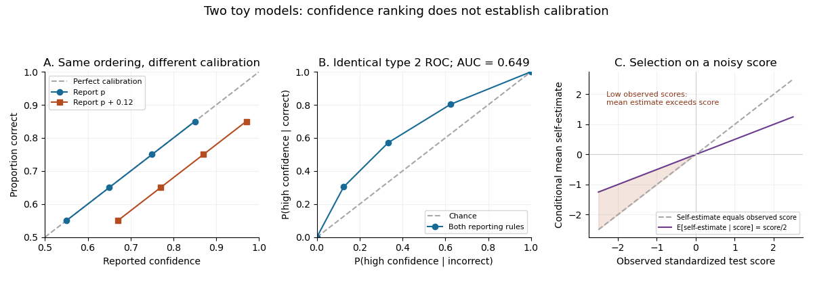

<h1 id="3/solution">Solution</h1>

↑ **Parent:** [3](../3.md)

The apparent conflict largely disappears when [metacognitive calibration](../../../metacognitive-calibration.md) is distinguished from [metacognitive resolution](../../../metacognitive-sensitivity.md). Calibration asks whether, for example, answers assigned confidence $0.8$ are correct about $80\%$ of the time. Resolution asks whether a person's more confident answers tend to be more accurate than that same person's less confident answers. A consistently overconfident person can still discriminate relatively well between stronger and weaker answers.

[Justin Kruger](../../../justin-kruger.md) and [David Dunning](../../../david-dunning.md) found that low-scoring groups in humour, grammar and logic tasks overestimated their relative performance, and argued that limited task knowledge can also impair error recognition.[1999, abstract: four studies, self-assessments and effects of skill improvement](../../../unskilled-and-unaware-of-it-by-justin-kruger-and-david-dunning.md) Such global, often comparative judgments are not the same measurement as trialwise confidence in a repeated perceptual task. A participant may recognize which of their own answers are weak while lacking an accurate model of the comparison group's performance. Conversely, a person who knows their overall success rate can still fail to identify their particular mistakes.

A simple illustration is a task with four equally common classes of answers, whose success probabilities are $0.55,0.65,0.75,0.85$. Reporting these probabilities is calibrated. Reporting $0.67,0.77,0.87,0.97$ instead creates an average overestimate of $0.12$, but preserves every ordering and tie between confidence values. Consequently the [type 2 receiver operating characteristic](../../../type-2-receiver-operating-characteristic.md) and its [area under the receiver operating characteristic curve](../../../area-under-the-roc-curve.md) remain unchanged. This is the general result that [a strictly increasing confidence transformation preserves metacognitive resolution](../../../a-strictly-increasing-confidence-transformation-preserves-metacognitive-resolution.md).

**[Figure 1](#3/image-illustrative-metacognitive-calibration-metacognitive-resolution-and-regression-to-the-mean). Illustrative metacognitive calibration, metacognitive resolution and regression to the mean**.

There is also a statistical selection issue. Let standardized observed performance be $X=A+\varepsilon$ and self-estimated performance be $S=A+\eta$, where latent ability $A$ and the two errors are centred [normal random variables](../../../gaussian-random-variable.md) and are [independent random variables](../../../independent-random-variables.md). Then [selection on noisy performance can produce apparent overconfidence](../../../selection-on-noisy-performance-can-produce-apparent-overconfidence.md):

$$
\mathbb E[S\mid X=x]=\lambda x,\qquad \lambda=\frac{\operatorname{Var}(A)}{\operatorname{Var}(A)+\operatorname{Var}(\varepsilon)}.
$$

For a low observed score $x<0$ and $0<\lambda<1$, the expected self-estimate exceeds $x$ despite being unbiased before selection. The highest observed scores show the reverse pattern. This toy model demonstrates why a quartile plot alone cannot identify a monitoring deficit. It does not prove that all observed miscalibration is a statistical artifact or that the original skill-training results are uninformative.

Perceptual findings also require qualification. Good resolution can reflect variation in stimulus difficulty; it need not establish optimal monitoring at fixed difficulty. [Metacognitive sensitivity](../../../metacognitive-sensitivity.md) depends partly on first-order discrimination, and raw confidence–accuracy correlations can differ because task accuracy or confidence criteria differ. [Meta-d-prime](../../../meta-d-prime.md) estimates the signal-detection sensitivity compatible with observed confidence ratings under its model assumptions. The original method found visual metacognitive sensitivity close to, but below, its optimal benchmark.[2012, abstract: measurement confounds, meta-d-prime and visual-task result](../../../a-signal-detection-theoretic-approach-for-estimating-metacognitive-sensitivity-from-confidence-ratings-by-brian-maniscalco-and-hakwan-lau.md)

A decisive comparison would measure global and trialwise estimates in the same people, match task performance where possible, estimate test reliability, distinguish raw scores from percentile beliefs, and examine the uncertainty of sensitivity estimates. Transfer of feedback or training should be tested rather than presumed. **Overconfidence, useful trialwise discrimination and genuine limits in domain knowledge can coexist; their relative contributions require separable measurements.**

## ↑ Ancestors (11)

1. [3](../3.md)
2. [2022](../../2022-split.md)
3. [Past exam of the metacognition course of the University of Oxford](../../split.md)
4. [Metacognition course of the University of Oxford](../../../metacognition-course-of-the-university-of-oxford.md)
5. [Year 3 of the psychology (experimental) course of the University of Oxford](../../../year-3-of-the-psychology-experimental-course-of-the-university-of-oxford.md)
6. [Psychology (experimental) course of the University of Oxford](../../../psychology-experimental-course-of-the-university-of-oxford.md)
7. [Undergraduate course of the University of Oxford](../../../undergraduate-course-of-the-university-of-oxford.md)
8. [Course of the University of Oxford](../../../course-of-the-university-of-oxford.md)
9. [University of Oxford](../../../university-of-oxford-split.md)
10. [List of universities](../../../list-of-universities.md)
11. [Codex Wiki](../../../split.md)
