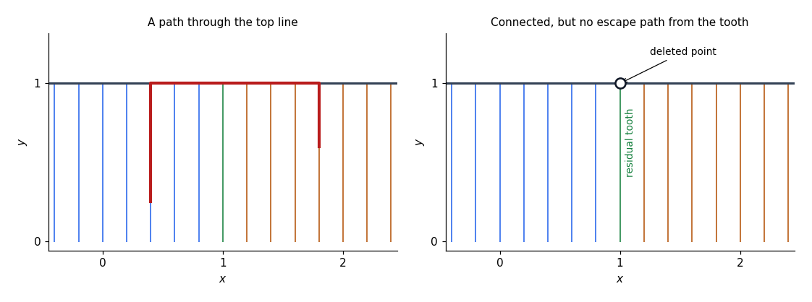
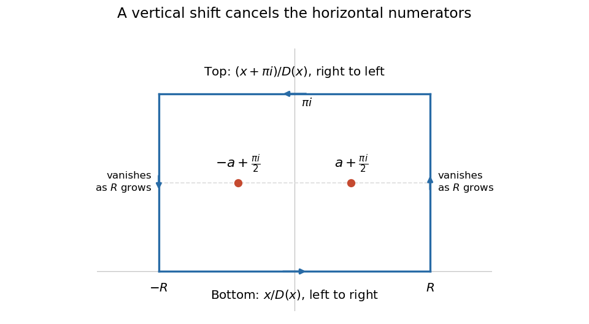
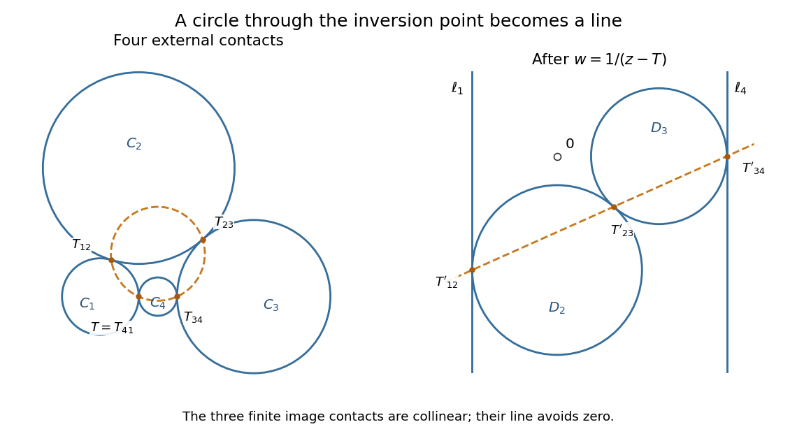

# 2015

↑ **Parent:** [Past exam of the metric spaces and complex analysis course of the University of Oxford](../past-exam-of-the-metric-spaces-and-complex-analysis-course-of-the-university-of-oxford.md)

Original sitting: Friday 19 June 2015, 9.30am to 12.30pm. The recovered original cover establishes this date despite the enclosing archive's directory label. [Original source archive, member 2014/T/a13754w1.pdf; recovered cover headed Trinity Term 2015](https://www.whatdotheyknow.com/request/ba_computer_science_past_papers/response/2577745/attach/2/202402%20183%20CS%20Papers.zip?cookie_passthrough=1)

The complete five-page replacement is in [the Mathematics Part A FOI release](https://www.whatdotheyknow.com/request/maths_papers_2/response/1850333/attach/3/FOI%2020210708%201%20Data.zip?cookie_passthrough=1), member `FOI-20210708-1 - Data/a13754w1 (3).pdf`. Its intact printed page 2 supplies Questions 1–3; the readable original Questions 4–6 and all twelve existing answers are retained unchanged. The original archive link above is preserved for provenance.

**Table of contents**

- [1](#1)
  - [a](#1/a)
    - [Solution](#1/a/solution)
  - [b](#1/b)
    - [Solution](#1/b/solution)
  - [c](#1/c)
    - [i](#1/c/i)
      - [Solution](#1/c/i/solution)
    - [ii](#1/c/ii)
      - [Solution](#1/c/ii/solution)
    - [iii](#1/c/iii)
      - [Solution](#1/c/iii/solution)
    - [iv](#1/c/iv)
      - [Solution](#1/c/iv/solution)
    - [v](#1/c/v)
      - [Solution](#1/c/v/solution)
  - [d](#1/d)
    - [Solution](#1/d/solution)
  - [e](#1/e)
    - [Solution](#1/e/solution)
- [2](#2)
  - [a](#2/a)
    - [i](#2/a/i)
      - [Solution](#2/a/i/solution)
    - [ii](#2/a/ii)
      - [Solution](#2/a/ii/solution)
  - [b](#2/b)
    - [Solution](#2/b/solution)
  - [c](#2/c)
    - [i](#2/c/i)
      - [Solution](#2/c/i/solution)
    - [ii](#2/c/ii)
      - [Solution](#2/c/ii/solution)
    - [iii](#2/c/iii)
      - [Solution](#2/c/iii/solution)
    - [iv](#2/c/iv)
      - [Solution](#2/c/iv/solution)
    - [v](#2/c/v)
      - [Solution](#2/c/v/solution)
    - [vi](#2/c/vi)
      - [Solution](#2/c/vi/solution)
  - [d](#2/d)
    - [Solution](#2/d/solution)
- [3](#3)
  - [a](#3/a)
    - [Solution](#3/a/solution)
  - [b](#3/b)
    - [Solution](#3/b/solution)
  - [c](#3/c)
    - [Solution](#3/c/solution)
- [4](#4)
  - [a](#4/a)
    - [i](#4/a/i)
      - [Solution](#4/a/i/solution)
    - [ii](#4/a/ii)
      - [Solution](#4/a/ii/solution)
  - [b](#4/b)
    - [Solution](#4/b/solution)
  - [c](#4/c)
    - [Solution](#4/c/solution)
- [5](#5)
  - [a](#5/a)
    - [Solution](#5/a/solution)
  - [b](#5/b)
    - [i](#5/b/i)
      - [Solution](#5/b/i/solution)
    - [ii](#5/b/ii)
      - [Solution](#5/b/ii/solution)
  - [c](#5/c)
    - [i](#5/c/i)
      - [Solution](#5/c/i/solution)
    - [ii](#5/c/ii)
      - [Solution](#5/c/ii/solution)
- [6](#6)
  - [a](#6/a)
    - [Solution](#6/a/solution)
  - [b](#6/b)
    - [Solution](#6/b/solution)
  - [c](#6/c)
    - [Solution](#6/c/solution)

## 1

↑ **Parent:** [2015](2015.md)

<h3 id="1/a">a</h3>

↑ **Parent:** [1](#1)

<h4 id="1/a/solution">Solution</h4>

↑ **Parent:** [A](#1/a)

The [Heine-Borel theorem](../topology.md#heine-borel-theorem) says that a [subset](../set.md#subset) $K$ of finite-dimensional [Euclidean space](../normed-vector-space.md#euclidean-norm) is [compact](../topology.md#compact-space) exactly when it is both [closed](../topology.md#closed-set) and [bounded](../topological-analysis.md#boundedness):

$$
\boxed{K\subseteq\mathbb R^n\text{ compact}\iff K\text{ closed and bounded}.}
$$

Here [compactness](../topology.md#compact-space) refers to the [subspace topology](../topology.md#subspace-topology) induced by the usual [Euclidean metric](../riemannian-metric.md#euclidean-metric), and [closedness](../topology.md#closedness) and [boundedness](../topological-analysis.md#boundedness) are measured in the ambient [Euclidean space](../normed-vector-space.md#euclidean-norm). This characterization does not hold for arbitrary [metric spaces](../topological-analysis.md#metric-space).

<h3 id="1/b">b</h3>

↑ **Parent:** [1](#1)

<h4 id="1/b/solution">Solution</h4>

↑ **Parent:** [B](#1/b)

The [empty set](../set.md#empty-set) is [bounded](../topological-analysis.md#boundedness). Otherwise choose $p$ in the [compact metric space](../topological-analysis.md#compact-metric-space) $X$. The [open balls](../topology.md#open-ball) $B(p,n)$, $n=1,2,\ldots$, form an [open cover](../topology.md#open-cover). A [finite subcover](../topology.md#finite-subcover) exists by [compactness](../topology.md#compact-space); because the balls are nested, the largest one already covers $X$. Hence $X\subseteq B(p,N)$ for some $N$.

For $x,y\in X$, the [triangle inequality](../topological-analysis.md#triangle-inequality) gives $d(x,y)\leq d(x,p)+d(p,y)<2N$. Thus

$$
\boxed{\operatorname{diam}X\leq2N<\infty,\quad\text{so }X\text{ is bounded}.}
$$

The proof uses only [compactness](../topology.md#compact-space) and the [metric](../topological-analysis.md#metric), not a coordinate system.

<h3 id="1/c">c</h3>

↑ **Parent:** [1](#1)

<h4 id="1/c/i">i</h4>

↑ **Parent:** [C](#1/c)

<h5 id="1/c/i/solution">Solution</h5>

↑ **Parent:** [I](#1/c/i)

The [sequence](../sequence-and-series.md#sequence) $n\in[0,\infty)$ is [unbounded](../topological-analysis.md#unbounded). Every [compact metric space](../topological-analysis.md#compact-metric-space) is [bounded](../topological-analysis.md#boundedness), by part (b), so **this subspace is not [compact](../topology.md#compact-space)**.

<h4 id="1/c/ii">ii</h4>

↑ **Parent:** [C](#1/c)

<h5 id="1/c/ii/solution">Solution</h5>

↑ **Parent:** [Ii](#1/c/ii)

Take an [irrational number](../algebra.md#irrational-number) $a\in(0,1)$. The [density of the rational numbers](../number-theory.md#density-of-the-rational-numbers) provides a [sequence](../sequence-and-series.md#sequence) in $\mathbb Q\cap[0,1]$ converging to $a$, which is outside that [subset](../set.md#subset). Thus the [subset](../set.md#subset) is not [closed](../topology.md#closed-set) in $\mathbb R$. By the [Heine-Borel theorem](../topology.md#heine-borel-theorem), **it is not [compact](../topology.md#compact-space)**, despite being [bounded](../topological-analysis.md#boundedness).

<h4 id="1/c/iii">iii</h4>

↑ **Parent:** [C](#1/c)

<h5 id="1/c/iii/solution">Solution</h5>

↑ **Parent:** [Iii](#1/c/iii)

The [unit circle](../complex-analysis.md#complex-unit-circle) is the inverse image of the [closed set](../topology.md#closed-set) $\{1\}$ under the [continuous map](../topology.md#continuous-map) $(x,y)\mapsto x^2+y^2$, so it is [closed](../topology.md#closed-set). It is also [bounded](../topological-analysis.md#boundedness), since every point has [Euclidean norm](../normed-vector-space.md#euclidean-norm) one. The [Heine-Borel theorem](../topology.md#heine-borel-theorem) gives **[compactness](../topology.md#compact-space)**.

<h4 id="1/c/iv">iv</h4>

↑ **Parent:** [C](#1/c)

<h5 id="1/c/iv/solution">Solution</h5>

↑ **Parent:** [Iv](#1/c/iv)

The open [unit disk](../euclidean-geometry.md#unit-disk) is [bounded](../topological-analysis.md#boundedness) but not [closed](../topology.md#closed-set): $(1-1/n,0)$ lies in it for $n\geq2$ and converges to the omitted point $(1,0)$. By the [Heine-Borel theorem](../topology.md#heine-borel-theorem), **it is not [compact](../topology.md#compact-space)**.

<h4 id="1/c/v">v</h4>

↑ **Parent:** [C](#1/c)

<h5 id="1/c/v/solution">Solution</h5>

↑ **Parent:** [V](#1/c/v)

The points $(n,0)$ belong to the indicated [subset](../set.md#subset) for every positive integer $n$. They form an [unbounded](../topological-analysis.md#unbounded) [sequence](../sequence-and-series.md#sequence), so this [metric space](../topological-analysis.md#metric-space) is not [bounded](../topological-analysis.md#boundedness). Therefore **it is not [compact](../topology.md#compact-space)**. Shrinking the vertical width does not bound its horizontal extent.

<h3 id="1/d">d</h3>

↑ **Parent:** [1](#1)

<h4 id="1/d/solution">Solution</h4>

↑ **Parent:** [D](#1/d)

By the [Heine-Borel theorem](../topology.md#heine-borel-theorem), a noncompact [subset](../set.md#subset) $X\subseteq\mathbb R$ is either [unbounded](../topological-analysis.md#unbounded) or not [closed](../topology.md#closed-set). If $X$ is [unbounded](../topological-analysis.md#unbounded), the restriction $f(x)=x$ is a [continuous function](../calculus.md#continuous-function) with [unbounded](../topological-analysis.md#unbounded) range.

Otherwise $X$ is [bounded](../topological-analysis.md#boundedness) and not [closed](../topology.md#closed-set). Choose $a\in\overline X\setminus X$, and define

$$
\boxed{f(x)=\frac1{|x-a|},\qquad x\in X.}
$$

Its denominator is nonzero on $X$, so it is [continuous](../calculus.md#continuous-function). Since $a$ is in the [closure](../topology.md#closure-topology), for every $n$ there is $x_n\in X$ with $0<|x_n-a|<1/n$. Hence $f(x_n)>n$, proving that this [continuous function](../calculus.md#continuous-function) is [unbounded](../topological-analysis.md#unbounded). These two cases establish [unbounded continuous witnesses to noncompactness of a real subspace](../topology.md#unbounded-continuous-witnesses-to-noncompactness-of-a-real-subspace).

<h3 id="1/e">e</h3>

↑ **Parent:** [1](#1)

<h4 id="1/e/solution">Solution</h4>

↑ **Parent:** [E](#1/e)

We can arrange that **neither the [supremum](../real-analysis.md#supremum) nor the [infimum](../real-analysis.md#infimum) is attained**. By part (d), choose a [continuous function](../calculus.md#continuous-function) $f$ on $X$ with [unbounded](../topological-analysis.md#unbounded) range, and put $u=|f|$. Choose $x_n\in X$ so that $t_n=u(x_n)$ increases strictly to infinity. Construct a [continuous function](../calculus.md#continuous-function) $h:[0,\infty)\to\mathbb R$ with

$$
h(t_n)=(-1)^n n:
$$

keep it constant up to $t_1$ and interpolate linearly on each $[t_n,t_{n+1}]$. Since $t_n\to\infty$, the joining points have no finite accumulation, so this defines a [continuous function](../calculus.md#continuous-function) everywhere on its domain.

Now set

$$
\boxed{g(x)=\frac{h(u(x))}{\sqrt{1+h(u(x))^2}}.}
$$

By [function composition](../function.md#function-composition), $g$ is [continuous](../calculus.md#continuous-function), and $-1<g(x)<1$ for every $x$. Along the even and odd chosen points,

$$
g(x_{2n})\longrightarrow1,\qquad g(x_{2n+1})\longrightarrow-1.
$$

Thus $\sup_Xg=1$ and $\inf_Xg=-1$, and neither is a value of $g$. This proves the [bounded continuous witness with neither extremum attained](../real-analysis.md#bounded-continuous-witness-with-neither-extremum-attained) construction, including for [subsets](../set.md#subset) that are [bounded](../topological-analysis.md#boundedness) but not [closed](../topology.md#closed-set).

## 2

↑ **Parent:** [2015](2015.md)

<h3 id="2/a">a</h3>

↑ **Parent:** [2](#2)

<h4 id="2/a/i">i</h4>

↑ **Parent:** [A](#2/a)

<h5 id="2/a/i/solution">Solution</h5>

↑ **Parent:** [I](#2/a/i)

A [metric space](../topological-analysis.md#metric-space) is [connected](../geometry-and-topology.md#connected-space) when it has no [separation of a topological space](../geometry-and-topology.md#separation-of-a-topological-space): it cannot be written as the union of two disjoint nonempty [open subsets](../topology.md#open-set). Equivalently, the only [subsets](../set.md#subset) that are both [open](../topology.md#open-set) and [closed](../topology.md#closed-set) are the [empty set](../set.md#empty-set) and the whole space.

$$
\boxed{X\text{ connected}\iff\text{no two disjoint nonempty open sets cover }X.}
$$

The [open sets](../topology.md#open-set) here are those of the [metric topology](../topological-analysis.md#metric-topology).

<h4 id="2/a/ii">ii</h4>

↑ **Parent:** [A](#2/a)

<h5 id="2/a/ii/solution">Solution</h5>

↑ **Parent:** [Ii](#2/a/ii)

A [metric space](../topological-analysis.md#metric-space) is [path-connected](../geometry-and-topology.md#path-connected-space) if every pair $x,y$ can be joined by a [path](../geometry-and-topology.md#continuous-path): a [continuous map](../topology.md#continuous-map) $\gamma:[0,1]\to X$ with $\gamma(0)=x$ and $\gamma(1)=y$.

$$
\boxed{\forall x,y\in X\ \exists\gamma:[0,1]\to X\text{ continuous joining }x\text{ to }y.}
$$

The [path](../geometry-and-topology.md#continuous-path) must remain in $X$, including at its endpoints.

<h3 id="2/b">b</h3>

↑ **Parent:** [2](#2)

<h4 id="2/b/solution">Solution</h4>

↑ **Parent:** [B](#2/b)

Suppose a [path-connected space](../geometry-and-topology.md#path-connected-space) had a [separation](../set-theory.md#axiom-schema-of-specification) $X=U\cup V$. Choose $u\in U$, $v\in V$, and a [path](../geometry-and-topology.md#continuous-path) $\gamma$ from $u$ to $v$. The [inverse images](../set-theory.md#preimage) $\gamma^{-1}(U)$ and $\gamma^{-1}(V)$ are disjoint [open sets](../topology.md#open-set) in the [subspace topology](../topology.md#subspace-topology) of $[0,1]$, cover it, and are nonempty because they contain its opposite endpoints. This contradicts the [connectedness](../geometry-and-topology.md#connected-space) of an [interval](../real-analysis.md#interval-mathematics).

Therefore **every [path-connected space](../geometry-and-topology.md#path-connected-space) is [connected](../geometry-and-topology.md#connected-space)**. Notice that it is the [subspace topology](../topology.md#subspace-topology) on $[0,1]$ that is used in the inverse-image argument.

<h3 id="2/c">c</h3>

↑ **Parent:** [2](#2)

<h4 id="2/c/i">i</h4>

↑ **Parent:** [C](#2/c)

<h5 id="2/c/i/solution">Solution</h5>

↑ **Parent:** [I](#2/c/i)

The two [open balls](../topology.md#open-ball) are disjoint: a common point would have distances to their centres summing to less than two, contradicting the [triangle inequality](../topological-analysis.md#triangle-inequality). Both are nonempty and relatively [open](../topology.md#open-set), and they cover the union. They therefore give a [separation](../set-theory.md#axiom-schema-of-specification), so the union is **neither [connected](../geometry-and-topology.md#connected-space) nor [path-connected](../geometry-and-topology.md#path-connected-space)**.

<h4 id="2/c/ii">ii</h4>

↑ **Parent:** [C](#2/c)

<h5 id="2/c/ii/solution">Solution</h5>

↑ **Parent:** [Ii](#2/c/ii)

Each [closed ball](../topological-analysis.md#closed-ball) is a [convex set](../convex-set.md) and contains the origin. Join any point to zero by a [line segment](../convex-set.md#line-segment) inside its ball, then join zero to the other point. Concatenating the two segments gives a [path](../geometry-and-topology.md#continuous-path) in the union. It is therefore **[path-connected](../geometry-and-topology.md#path-connected-space) and [connected](../geometry-and-topology.md#connected-space)**.

<h4 id="2/c/iii">iii</h4>

↑ **Parent:** [C](#2/c)

<h5 id="2/c/iii/solution">Solution</h5>

↑ **Parent:** [Iii](#2/c/iii)

Only the right-hand ball is [closed](../topology.md#closed-set), but the union is still **[path-connected](../geometry-and-topology.md#path-connected-space) and [connected](../geometry-and-topology.md#connected-space)**. Its right-hand [closed ball](../topological-analysis.md#closed-ball) contains zero, and every point $z$ of the left-hand [open ball](../topology.md#open-ball) can be joined to zero by $\gamma(t)=(1-t)z$.

To check the endpoint carefully, write $a=(-1,0)$. For $0\leq t<1$, [convexity](../real-analysis.md#convex-function) and the [triangle inequality](../topological-analysis.md#triangle-inequality) give

$$
\lVert(1-t)z-a\rVert
\leq(1-t)\lVert z-a\rVert+t\lVert a\rVert<1.
$$

At $t=1$, the [path](../geometry-and-topology.md#continuous-path) reaches zero in the other, closed ball. Points in that ball also join zero by [line segments](../convex-set.md#line-segment), completing the construction.

<h4 id="2/c/iv">iv</h4>

↑ **Parent:** [C](#2/c)

<h5 id="2/c/iv/solution">Solution</h5>

↑ **Parent:** [Iv](#2/c/iv)

Each vertical [line segment](../convex-set.md#line-segment) over a rational coordinate meets the horizontal [line](../euclidean-geometry.md#straight-line) at height one. A point on such a segment can move vertically to the top, then horizontally along that [line](../euclidean-geometry.md#straight-line); points already at height one use only the horizontal motion. Concatenating these motions joins any two points.

Thus the [rational comb with a deleted attachment point](../geometry-and-topology.md#rational-comb-with-a-deleted-attachment-point) construction, before deletion, is **[path-connected](../geometry-and-topology.md#path-connected-space) and hence [connected](../geometry-and-topology.md#connected-space)**. The infinitely many vertical pieces cause no difficulty because each individual [path](../geometry-and-topology.md#continuous-path) uses only finitely many segments.

<h4 id="2/c/v">v</h4>

↑ **Parent:** [C](#2/c)

<h5 id="2/c/v/solution">Solution</h5>

↑ **Parent:** [V](#2/c/v)

Let $D$ be this union of rational-coordinate horizontal and vertical [lines](../euclidean-geometry.md#straight-line). A point $(x,y)\in D$ has either rational $x$, in which case it moves vertically to $(x,0)$ then horizontally to $(0,0)$, or rational $y$, in which case it moves horizontally to $(0,y)$ then vertically to $(0,0)$. Every segment remains on a [line](../euclidean-geometry.md#straight-line) with a rational fixed coordinate.

Thus **$D$ is [path-connected](../geometry-and-topology.md#path-connected-space) and [connected](../geometry-and-topology.md#connected-space)**. It is not necessary for both coordinates to be rational.

<h4 id="2/c/vi">vi</h4>

↑ **Parent:** [C](#2/c)

<h5 id="2/c/vi/solution">Solution</h5>

↑ **Parent:** [Vi](#2/c/vi)

Write $C'=C\setminus\{(1,1)\}$ and $V=\{1\}\times[0,1)$. Let $L$ and $R$ be the portions of $C'$ with first coordinate respectively less than and greater than one. Each is [path-connected](../geometry-and-topology.md#path-connected-space): move along a rational tooth to its corresponding open half of the top [line](../euclidean-geometry.md#straight-line), then horizontally there. By the [density of the rational numbers](../number-theory.md#density-of-the-rational-numbers), every point of $V$ is a [limit point](../topology.md#limit-point) of both $L$ and $R$.

Use the elementary fact that adjoining any collection of [limit points](../topology.md#limit-point) to a [connected set](../geometry-and-topology.md#connected-set) preserves [connectedness](../geometry-and-topology.md#connected-space). Indeed, in a proposed [separation](../set-theory.md#axiom-schema-of-specification), the connected subset lies on one side; relative openness would prevent any point on the other side from being a [limit point](../topology.md#limit-point) of it. Therefore $L\cup V$ and $R\cup V$ are [connected](../geometry-and-topology.md#connected-space). They intersect in $V$, so their union $C'$ is [connected](../geometry-and-topology.md#connected-space).

There is, however, no [path](../geometry-and-topology.md#continuous-path) from $(1,0)$ to $(0,1)$. If $\gamma(t)=(x(t),y(t))$ were one, let $t_0$ be the first time at which $y(t_0)=1$. Such a first time exists by [continuity](../calculus.md#continuous-function) and [compactness](../topology.md#compact-space) of $[0,1]$, and $t_0>0$. For $0\leq t<t_0$, membership in the comb forces $x(t)\in\mathbb Q$. The [continuous image of a connected space](../geometry-and-topology.md#continuous-image-of-a-connected-space) is [connected](../geometry-and-topology.md#connected-space), and a [connected subset](../geometry-and-topology.md#connected-subset) of $\mathbb Q$ is a [singleton](../set.md#singleton-mathematics): an irrational number between any two distinct rational values would separate it. Hence $x(t)=1$ for $t<t_0$. By [continuity](../calculus.md#continuous-function), $\gamma(t_0)=(1,1)$, which was deleted.

$$
\boxed{C'\text{ is connected but not path-connected}.}
$$

**[Figure 1](#2/c/vi/image-deleting-one-attachment-point-destroys-paths-but-preserves-connectedness). Deleting one attachment point destroys paths but preserves connectedness**. Finite samples of rational vertical teeth illustrate the full rational comb. The right panel marks the deleted point with an open circle; the residual vertical tooth is still approached from both sides.

<h3 id="2/d">d</h3>

↑ **Parent:** [2](#2)

<h4 id="2/d/solution">Solution</h4>

↑ **Parent:** [D](#2/d)

Define $g(p)=f(p)-f(-p)$ on the [sphere](../euclidean-geometry.md#sphere). It is [continuous](../calculus.md#continuous-function) and satisfies $g(-p)=-g(p)$. If $g(p)=0$ at a chosen point, we are done. Otherwise choose a [unit vector](../vector-space.md#unit-vector) $q$ perpendicular to $p$ and follow the half [great circle](../euclidean-geometry.md#great-circle)

$$
\gamma(t)=\cos(\pi t)p+\sin(\pi t)q,\qquad0\leq t\leq1.
$$

The [Pythagorean theorem](../euclidean-geometry.md#pythagorean-theorem) shows that $\gamma(t)$ lies on the [sphere](../euclidean-geometry.md#sphere), and its endpoints are $p,-p$. The [continuous function](../calculus.md#continuous-function) $g\circ\gamma$ has opposite signs at the endpoints. The [Intermediate value theorem](../calculus.md#intermediate-value-theorem) therefore gives a zero $t_*$, so

$$
\boxed{f(\gamma(t_*))=f(-\gamma(t_*))}.
$$

This is a scalar equal-value assertion for an [antipodal pair](../euclidean-geometry.md#antipodal-pair); it uses only a [path](../geometry-and-topology.md#continuous-path) and the [Intermediate value theorem](../calculus.md#intermediate-value-theorem).

## 3

↑ **Parent:** [2015](2015.md)

<h3 id="3/a">a</h3>

↑ **Parent:** [3](#3)

<h4 id="3/a/solution">Solution</h4>

↑ **Parent:** [A](#3/a)

One standard form of the [Cauchy integral formula](../analysis.md#cauchy-integral-formula) is this: if $f$ is [holomorphic](../holomorphic-function.md) on an [open set](../topology.md#open-set) containing a [contour](../complex-analysis.md#complex-integration-contour) that is a [simple closed curve](../geometry-and-topology.md#simple-closed-curve) $\Gamma$ and its interior, and $\Gamma$ has [positive orientation of a contour](../complex-analysis.md#positive-orientation-of-a-contour), then for every point $w$ inside it,

$$
\boxed{f(w)=\frac1{2\pi i}\int_\Gamma\frac{f(z)}{z-w}\,dz.}
$$

The hypothesis includes the contour itself; [singularities](../complex-analysis.md#complex-singularity) on the contour are excluded. In particular, the formula applies on a [circle](../topology.md#circle) whose closed [disk](../topology.md#disk-mathematics) is contained in the domain of [holomorphy](../holomorphic-function.md).

<h3 id="3/b">b</h3>

↑ **Parent:** [3](#3)

<h4 id="3/b/solution">Solution</h4>

↑ **Parent:** [B](#3/b)

Put $S=\sum_{j=0}^{n-1}|a_j|$ and choose $R>\max(1,2S/|a_n|)$. For $|z|>R$, the [triangle inequality](../topological-analysis.md#triangle-inequality) gives

$$
\left|\sum_{j=0}^{n-1}a_jz^j\right|\leq S|z|^{n-1}<\frac{|a_n|}{2}|z|^n.
$$

The [reverse triangle inequality](../topological-analysis.md#reverse-triangle-inequality) therefore yields

$$
\boxed{|P(z)|>\frac{|a_n|}{2}|z|^n\qquad(|z|>R).}
$$

If $P$ had no [root](../semisimple-lie-algebra.md#root-of-a-root-system), the [function](../function.md) $h=1/P$ would be an [entire function](../holomorphic-function.md#entire-function). The bound just proved makes $h(z)\to0$ as $|z|\to\infty$. On the remaining closed [disk](../topology.md#disk-mathematics), [continuity](../calculus.md#continuous-function) and the [extreme value theorem](../real-analysis.md#extreme-value-theorem) make $h$ [bounded](../topological-analysis.md#boundedness). Thus $h$ is a bounded [entire function](../holomorphic-function.md#entire-function), so [Liouville's theorem](../complex-analysis.md#liouville-theorem) makes it constant. Its limit at infinity forces that constant to be zero, impossible for a reciprocal.

Consequently **$P$ has a [root](../semisimple-lie-algebra.md#root-of-a-root-system) in $\mathbb C$**. This proves the existence part of the [fundamental theorem of algebra](../algebra.md#fundamental-theorem-of-algebra). The invoked [Liouville theorem](../complex-analysis.md#liouville-theorem) follows from the [Cauchy integral formula](../analysis.md#cauchy-integral-formula): the [Cauchy estimate](../analysis.md#cauchy-estimate) $|h'(w)|\leq M/r$ on arbitrarily large [circles](../topology.md#circle) gives $h'=0$ when $h$ is bounded by $M$.

<h3 id="3/c">c</h3>

↑ **Parent:** [3](#3)

<h4 id="3/c/solution">Solution</h4>

↑ **Parent:** [C](#3/c)

List the [roots](../semisimple-lie-algebra.md#root-of-a-root-system) with their [multiplicities](../polynomial.md#multiplicity-mathematics). By the [factor theorem](../polynomial.md#factor-theorem), $Q(z)=a\prod_{k=1}^n(z-\alpha_k)$ with $a\ne0$. The [product rule](../calculus.md#product-rule), followed by division where $Q(z)\ne0$, gives its [logarithmic derivative](../analytic-number-theory.md#logarithmic-derivative):

$$
\boxed{\frac{Q'(z)}{Q(z)}=\sum_{k=1}^n\frac1{z-\alpha_k}.}
$$

Let $Q'(\beta)=0$. If $Q(\beta)=0$ too, then $\beta$ is already one of the [roots](../semisimple-lie-algebra.md#root-of-a-root-system), so either desired location conclusion follows immediately. Otherwise the displayed sum vanishes at $\beta$. If all [roots](../semisimple-lie-algebra.md#root-of-a-root-system) have positive [imaginary parts](../complex-analysis.md#imaginary-part) but $\operatorname{Im}\beta\leq0$, then

$$
\operatorname{Im}\frac1{\beta-\alpha_k}
=\frac{\operatorname{Im}\alpha_k-\operatorname{Im}\beta}{|\beta-\alpha_k|^2}>0
$$

for every $k$. Their sum cannot be zero. Thus **$\operatorname{Im}\beta>0$**.

For the [unit disk](../euclidean-geometry.md#unit-disk) conclusion, the same sum gives an especially transparent [convex combination](../convex-set.md#convex-combination). Taking [complex conjugates](../complex-analysis.md#complex-conjugate) and setting $w_k=|\beta-\alpha_k|^{-2}>0$ gives

$$
0=\sum_k w_k(\beta-\alpha_k),\qquad
\boxed{\beta=\frac{\sum_k w_k\alpha_k}{\sum_k w_k}.}
$$

Therefore, if every $|\alpha_k|<1$,

$$
|\beta|\leq\frac{\sum_k w_k|\alpha_k|}{\sum_k w_k}<1.
$$

The strict inequality follows because this is a finite weighted average of numbers strictly below one. This also proves the [Gauss-Lucas theorem](../polynomial.md#gauss-lucas-theorem): every [critical point](../analysis.md#critical-point) of a nonconstant [polynomial](../polynomial.md) lies in the [convex hull](../convex-set.md#convex-hull) of its [roots](../semisimple-lie-algebra.md#root-of-a-root-system). The common-root case, handled before division, is essential when [multiplicities](../polynomial.md#multiplicity-mathematics) occur.

## 4

↑ **Parent:** [2015](2015.md)

<h3 id="4/a">a</h3>

↑ **Parent:** [4](#4)

<h4 id="4/a/i">i</h4>

↑ **Parent:** [A](#4/a)

<h5 id="4/a/i/solution">Solution</h5>

↑ **Parent:** [I](#4/a/i)

Choose $0<\rho<r$ and traverse the [circle](../topology.md#circle) $|z|=\rho$ counterclockwise, so it has [positive orientation of a contour](../complex-analysis.md#positive-orientation-of-a-contour). The [Cauchy coefficient formula](../analysis.md#cauchy-coefficient-formula) gives, for every [nonnegative integer](../arithmetic.md#natural-number) $n$,

$$
\boxed{c_n=\frac{1}{2\pi i}\int_{|z|=\rho}\frac{f(z)}{z^{n+1}}\,dz,\qquad 0<\rho<r.}
$$

The smaller [radius](../topology.md#radius) matters: the [holomorphic function](../holomorphic-function.md) is only known on $|z|<r$, so its values on $|z|=r$ need not exist. To see directly why this [contour integral](../complex-analysis.md#contour-integral) selects $c_n$, the [power series](../sequence-and-series.md#power-series) converges uniformly on $|z|=\rho$, allowing [uniform convergence and contour integration](../complex-analysis.md#uniform-convergence-and-contour-integration) to justify integrating term by term. The [contour integral](../complex-analysis.md#contour-integral) of $z^{k-n-1}$ is zero for $k\ne n$ and $2\pi i$ for $k=n$. Thus all other terms disappear.

<h4 id="4/a/ii">ii</h4>

↑ **Parent:** [A](#4/a)

<h5 id="4/a/ii/solution">Solution</h5>

↑ **Parent:** [Ii](#4/a/ii)

Use the [generalized binomial theorem](../sequence-and-series.md#binomial-series) with exponent $-1/2$, choosing the [analytic branch of a square root](../analysis.md#analytic-branch-of-a-square-root) that equals $1$ at $z=0$. For $|z|<1$,

$$
(1-z)^{-1/2}=\sum_{n=0}^{\infty}\binom{-1/2}{n}(-z)^n.
$$

The signs cancel in each [binomial coefficient](../binomial-coefficient.md). For $n\geq1$,

$$
(-1)^n\binom{-1/2}{n}=\frac{1\cdot3\cdots(2n-1)}{2^n n!}=\frac{(2n)!}{2^{2n}(n!)^2}=\frac1{4^n}\binom{2n}{n}.
$$

The same expression equals $1$ for $n=0$, using the empty-product convention. Consequently the [power series](../sequence-and-series.md#power-series) is

$$
\boxed{\frac1{\sqrt{1-z}}=\sum_{n=0}^{\infty}\binom{2n}{n}\left(\frac z4\right)^n,\qquad |z|<1.}
$$

Its coefficients are the [normalized central binomial coefficients](../binomial-coefficient.md#normalized-central-binomial-coefficients). As a convergence check, the ratio of successive absolute terms tends to $|z|$, so the [ratio test](../sequence-and-series.md#ratio-test) gives absolute convergence inside the [unit disc](../topology.md#unit-disc). Applying the [Cauchy coefficient formula](../analysis.md#cauchy-coefficient-formula) to the [holomorphic function](../holomorphic-function.md) $(1-z)^{-1/2}$ now immediately yields

$$
\boxed{\int_{\gamma(0,r)}\frac{dz}{z^{n+1}\sqrt{1-z}}=\frac{2\pi i}{4^n}\binom{2n}{n},\qquad 0<r<1,\quad n=0,1,2,\ldots.}
$$

This value is independent of the chosen [radius](../topology.md#radius) because the [contour integral](../complex-analysis.md#contour-integral) extracts the same coefficient on every such [circle](../topology.md#circle).

<h3 id="4/b">b</h3>

↑ **Parent:** [4](#4)

<h4 id="4/b/solution">Solution</h4>

↑ **Parent:** [B](#4/b)

For $z\in\mathbb C\setminus[1,\infty)$, the number $w=1-z$ avoids the nonpositive [real axis](../complex-analysis.md#real-axis). Define the [branch of the complex logarithm](../analysis.md#branch-of-the-complex-logarithm) by

$$
\boxed{L(1-z)=\log|1-z|+i\operatorname{Arg}(1-z),\qquad -\pi<\operatorname{Arg}(1-z)<\pi.}
$$

Here the [principal argument](../complex-analysis.md#principal-argument) is selected as a [continuous map](../topology.md#continuous-map) on that slit [domain](../topology.md#domain-mathematical-analysis), so this is a [holomorphic function](../holomorphic-function.md), with [derivative](../calculus.md#derivative) $-1/(1-z)$ and $L(1)=0$. For example, locally writing $w=\rho e^{i\phi}$ gives $d(\log\rho+i\phi)=dw/w$, verifying the [complex derivative](../holomorphic-function.md#complex-derivative). The normalization also makes this [branch of the complex logarithm](../analysis.md#branch-of-the-complex-logarithm) unique: any two continuous choices differ by a constant integer multiple of $2\pi i$ on the [connected](../geometry-and-topology.md#connected-space) slit [domain](../topology.md#domain-mathematical-analysis), and their values at $w=1$ agree.

To evaluate the corresponding [analytic branch of a square root](../analysis.md#analytic-branch-of-a-square-root) on the [unit circle](../complex-analysis.md#complex-unit-circle), factor

$$
1-e^{i\theta}=e^{i\theta/2}\bigl(e^{-i\theta/2}-e^{i\theta/2}\bigr)=2\sin(\theta/2)e^{i(\theta/2-\pi/2)}.
$$

For $0<\theta<2\pi$, we have $\sin(\theta/2)>0$ and $-\pi/2<\theta/2-\pi/2<\pi/2$. Thus this factorization already uses the selected [principal argument](../complex-analysis.md#principal-argument), with no hidden change by $2\pi$. It follows that

$$
L(1-e^{i\theta})=\log\bigl(2\sin(\theta/2)\bigr)+i(\theta/2-\pi/2).
$$

Halving this expression and applying the [exponential function](../calculus.md#exponential-function) gives

$$
\sqrt{1-e^{i\theta}}=\sqrt{2\sin(\theta/2)}\,e^{i\theta/4-i\pi/4}.
$$

Since $\sqrt2e^{-i\pi/4}=1-i$, the desired branch value is

$$
\boxed{\sqrt{1-e^{i\theta}}=(1-i)\sqrt{\sin(\theta/2)}\,e^{i\theta/4},\qquad 0<\theta<2\pi.}
$$

For instance, $\theta=\pi$ gives $\sqrt2>0$, a quick check that the sign agrees with the normalization.

<h3 id="4/c">c</h3>

↑ **Parent:** [4](#4)

<h4 id="4/c/solution">Solution</h4>

↑ **Parent:** [C](#4/c)

Write $b_n=4^{-n}\binom{2n}{n}$. The given limiting identity and the [Cauchy coefficient formula](../analysis.md#cauchy-coefficient-formula) from part (a) give the boundary [contour integral](../complex-analysis.md#contour-integral)

$$
J_n:=\int_{\gamma(0,1)}\frac{dz}{z^{n+1}\sqrt{1-z}}=2\pi i b_n.
$$

The [contour](../complex-analysis.md#complex-integration-contour) passes through $z=1$, so its value here is an [improper integral](../real-analysis.md#improper-integral) using the one-sided branch values. Parametrize its open arc by $z=e^{i\theta}$, $0<\theta<2\pi$. Substitution of the [analytic branch of a square root](../analysis.md#analytic-branch-of-a-square-root) calculated in part (b) gives

$$
J_n=\frac{i}{1-i}\int_0^{2\pi}\frac{e^{-i(n+1/4)\theta}}{\sqrt{\sin(\theta/2)}}\,d\theta.
$$

The factor $e^{-in\theta}$ comes from cancelling $e^{i\theta}$ in $dz$ against $z^{n+1}$; the extra $e^{-i\theta/4}$ comes from the chosen branch. Keeping both phases prevents a change in the half-integer frequency.

Now put $t=\theta/2$. Then

$$
J_n=\frac{2i}{1-i}\int_0^\pi\frac{e^{-i(2n+1/2)t}}{\sqrt{\sin t}}\,dt=(i-1)\int_0^\pi\frac{e^{-i(2n+1/2)t}}{\sqrt{\sin t}}\,dt.
$$

Dividing by $i-1$ gives

$$
\int_0^\pi\frac{e^{-i(2n+1/2)t}}{\sqrt{\sin t}}\,dt=\frac{2\pi i b_n}{i-1}=\pi b_n(1-i).
$$

Taking the [real part](../complex-analysis.md#real-part) therefore proves

$$
\boxed{\int_0^\pi\frac{\cos\bigl((2n+\tfrac12)t\bigr)}{\sqrt{\sin t}}\,dt=\frac{\pi}{4^n}\binom{2n}{n},\qquad n=0,1,2,\ldots.}
$$

All these [improper integrals](../real-analysis.md#improper-integral) converge absolutely: the numerators are bounded, while $(\sin t)^{-1/2}$ is of order $t^{-1/2}$ at zero and $(\pi-t)^{-1/2}$ at $\pi$. Hence the substitutions and passage to the [real part](../complex-analysis.md#real-part) are legitimate. The [imaginary part](../complex-analysis.md#imaginary-part) also shows that the corresponding sine [integral](../integral.md) has the same positive value, which checks the phase calculation.

## 5

↑ **Parent:** [2015](2015.md)

<h3 id="5/a">a</h3>

↑ **Parent:** [5](#5)

<h4 id="5/a/solution">Solution</h4>

↑ **Parent:** [A](#5/a)

One standard form of [Cauchy's residue theorem](../analysis.md#residue-theorem) is the following. Let $\Gamma$ be a [positively oriented contour](../complex-analysis.md#positive-orientation-of-a-contour) that is a [simple closed curve](../geometry-and-topology.md#simple-closed-curve), and let $f$ be a [holomorphic function](../holomorphic-function.md) on an [open set](../topology.md#open-set) containing $\Gamma$ and its interior except for finitely many interior [isolated singularities](../isolated-singularity.md) $z_1,\ldots,z_m$. There are no [singularities](../complex-analysis.md#complex-singularity) on $\Gamma$. Then

$$
\boxed{\int_\Gamma f(z)\,dz=2\pi i\sum_{j=1}^m\operatorname{Res}(f,z_j).}
$$

The [residue](../analysis.md#residue) $\operatorname{Res}(f,z_j)$ is the coefficient of $(z-z_j)^{-1}$ in the [Laurent series](../analysis.md#laurent-series) at $z_j$. Each interior [isolated singularity](../isolated-singularity.md) contributes once because the [winding number](../complex-analysis.md#winding-number) of this [positively oriented contour](../complex-analysis.md#positive-orientation-of-a-contour) about each such point is one. Reversing the [orientation of a contour](../complex-analysis.md#orientation-of-a-contour) reverses the sign. This form of [Cauchy's residue theorem](../analysis.md#residue-theorem) applies to the rectangle below.

<h3 id="5/b">b</h3>

↑ **Parent:** [5](#5)

<h4 id="5/b/i">i</h4>

↑ **Parent:** [B](#5/b)

<h5 id="5/b/i/solution">Solution</h5>

↑ **Parent:** [I](#5/b/i)

Start with the [exponential function](../calculus.md#exponential-function) definition of the [hyperbolic sine](../calculus.md#hyperbolic-sine) and use [Euler's formula](../complex-analysis.md#euler-s-formula):

$$
\begin{aligned}
\sinh(x+iy)&=\frac{e^xe^{iy}-e^{-x}e^{-iy}}2\\
&=\frac{e^x(\cos y+i\sin y)-e^{-x}(\cos y-i\sin y)}2\\
&=\frac{e^x-e^{-x}}2\cos y+i\frac{e^x+e^{-x}}2\sin y.
\end{aligned}
$$

Identifying the [hyperbolic sine](../calculus.md#hyperbolic-sine) and [hyperbolic cosine](../calculus.md#hyperbolic-cosine) in the final line gives

$$
\boxed{\sinh(x+iy)=\sinh x\cos y+i\cosh x\sin y.}
$$

<h4 id="5/b/ii">ii</h4>

↑ **Parent:** [B](#5/b)

<h5 id="5/b/ii/solution">Solution</h5>

↑ **Parent:** [Ii](#5/b/ii)

The two terms in the preceding formula are the [real part](../complex-analysis.md#real-part) and [imaginary part](../complex-analysis.md#imaginary-part). Their squared sum is the squared [complex modulus](../complex-analysis.md#complex-modulus):

$$
\begin{aligned}
|\sinh(x+iy)|^2&=\sinh^2x\cos^2y+\cosh^2x\sin^2y\\
&=\sinh^2x(\cos^2y+\sin^2y)+\sin^2y\\
&=\sinh^2x+\sin^2y.
\end{aligned}
$$

Here $\cosh^2x-\sinh^2x=1$ follows directly from the [exponential function](../calculus.md#exponential-function) definitions. The [hyperbolic sine modulus identity](../calculus.md#hyperbolic-sine-modulus-identity) therefore yields

$$
\boxed{|\sinh(x+iy)|=\sqrt{\sinh^2x+\sin^2y}\geq|\sinh x|.}
$$

Equality holds exactly when $\sin y=0$, that is, when $y$ is an integer multiple of $\pi$. The lower bound is uniform in $y$, which will control whole vertical sides of the [contour](../complex-analysis.md#complex-integration-contour) rather than just their endpoints.

<h3 id="5/c">c</h3>

↑ **Parent:** [5](#5)

<h4 id="5/c/i">i</h4>

↑ **Parent:** [C](#5/c)

<h5 id="5/c/i/solution">Solution</h5>

↑ **Parent:** [I](#5/c/i)

The equation requires $\sinh z=\pm i\cosh a$. Write $z=x+iy$, with real $x,y$. Comparing [real parts](../complex-analysis.md#real-part) and [imaginary parts](../complex-analysis.md#imaginary-part) using part (b)(i) gives

$$
\sinh x\cos y=0,\qquad \cosh x\sin y=\pm\cosh a.
$$

If $x=0$, the second equality would require $|\sin y|=\cosh a>1$, impossible because $a>0$. Thus $\sinh x\ne0$, forcing $\cos y=0$ and

$$
y=\frac\pi2+k\pi,\qquad k\in\mathbb Z.
$$

Now $|\sin y|=1$, so $\cosh x=\cosh a$. The [hyperbolic cosine](../calculus.md#hyperbolic-cosine) is even and is a [strictly increasing function](../calculus.md#strictly-increasing-function) on $[0,\infty)$, hence $x=\pm a$. Conversely, substituting these values gives $\sinh(x+iy)=i(-1)^k\cosh a$, so every value found does satisfy the original equation. Therefore the complete set is

$$
\boxed{z=\pm a+i\left(\frac\pi2+k\pi\right),\qquad k\in\mathbb Z.}
$$

<h4 id="5/c/ii">ii</h4>

↑ **Parent:** [C](#5/c)

<h5 id="5/c/ii/solution">Solution</h5>

↑ **Parent:** [Ii](#5/c/ii)

Put $D(z)=\sinh^2z+\cosh^2a$ and $S=\sinh(2a)>0$. Traverse the rectangle $-R\to R\to R+\pi i\to-R+\pi i\to-R$ with [positive orientation of a contour](../complex-analysis.md#positive-orientation-of-a-contour), taking $R>a$. Part (i) shows that the only enclosed [poles](../isolated-singularity.md#pole) of $f(z)=z/D(z)$ are

$$
z_+=a+\frac{\pi i}2,\qquad z_-=-a+\frac{\pi i}2.
$$

They are [simple poles](../isolated-singularity.md#simple-pole) because

$$
D'(z)=2\sinh z\cosh z=\sinh(2z),\qquad D'(z_+)=-S,\quad D'(z_-)=S.
$$

The [residue formula for a quotient at a simple denominator zero](../analysis.md#residue-formula-for-a-quotient-at-a-simple-denominator-zero) gives

$$
\operatorname{Res}(f,z_+)=-\frac{a+\pi i/2}{S},\qquad \operatorname{Res}(f,z_-)=\frac{-a+\pi i/2}{S}.
$$

Their imaginary terms cancel and their [residues](../analysis.md#residue) sum to $-2a/S$. Thus [Cauchy's residue theorem](../analysis.md#residue-theorem) gives

$$
\int_{\Gamma_R}f(z)\,dz=-\frac{4\pi ia}{S}.
$$

**[Figure 2](#5/c/ii/image-the-positively-oriented-contour-encloses-the-two-poles-at-pm-a-plus-pi-i-2). The positively oriented contour encloses the two poles at $\pm a+\pi i/2$**. The top edge is traversed from right to left. Its reversed [orientation of a contour](../complex-analysis.md#orientation-of-a-contour) and the imaginary shift in the numerator produce $-i\pi$ times the desired real [integral](../integral.md).

The choice of numerator $z$ makes the horizontal sides useful. The [hyperbolic sine](../calculus.md#hyperbolic-sine) satisfies $\sinh(z+\pi i)=-\sinh z$, so $D(x+\pi i)=D(x)$. Consequently the lower and upper [contour integrals](../complex-analysis.md#contour-integral), with their actual orientations, add to

$$
\begin{aligned}
\int_{-R}^{R}\frac{x}{D(x)}\,dx+\int_R^{-R}\frac{x+\pi i}{D(x)}\,dx
&=-\pi i\int_{-R}^{R}\frac{dx}{D(x)}.
\end{aligned}
$$

It remains to justify discarding both vertical sides. On either side $z=\pm R+iy$, $0\leq y\leq\pi$, the [reverse triangle inequality](../topological-analysis.md#reverse-triangle-inequality) and part (b)(ii) imply

$$
|D(z)|\geq|\sinh z|^2-\cosh^2a\geq\sinh^2R-\cosh^2a.
$$

This lower bound is positive for sufficiently large $R$. Also $|z|\leq R+\pi$ and each vertical side has length $\pi$. The [estimation lemma](../complex-analysis.md#estimation-lemma) bounds the absolute value of the sum $V_R$ of the vertical contributions by

$$
|V_R|\leq\frac{2\pi(R+\pi)}{\sinh^2R-\cosh^2a}\longrightarrow0.
$$

The real [improper integral](../real-analysis.md#improper-integral) converges absolutely, since its integrand is continuous on the [real axis](../complex-analysis.md#real-axis) and decays like $4e^{-2|x|}$ at infinity. Combining all four sides and taking $R\to\infty$ gives

$$
-\pi i\int_{-\infty}^{\infty}\frac{dx}{\sinh^2x+\cosh^2a}=-\frac{4\pi ia}{\sinh(2a)}.
$$

Therefore

$$
\boxed{\int_{-\infty}^{\infty}\frac{dx}{\sinh^2x+\cosh^2a}=\frac{4a}{\sinh(2a)},\qquad a>0.}
$$

An independent real-variable check uses the [hyperbolic tangent](../calculus.md#hyperbolic-tangent) substitution $u=\tanh x$: the [integral](../integral.md) becomes $\int_{-1}^{1}du/(\cosh^2a-u^2\sinh^2a)$. Its [antiderivative](../integral.md#antiderivative) uses the [inverse hyperbolic tangent](../calculus.md#inverse-hyperbolic-tangent), giving $2\operatorname{arctanh}(\tanh a)/(\sinh a\cosh a)=4a/\sinh(2a)$. As $a\downarrow0$, this tends to $2$, agreeing with $\int_{-\infty}^{\infty}\operatorname{sech}^2x\,dx=2$ and checking the factor of two.

## 6

↑ **Parent:** [2015](2015.md)

<h3 id="6/a">a</h3>

↑ **Parent:** [6](#6)

<h4 id="6/a/solution">Solution</h4>

↑ **Parent:** [A](#6/a)

Use $z\overline z=|z|^2$ and $\overline Bz+B\overline z=2\operatorname{Re}(\overline Bz)$. When $A\ne0$, [completing the square](../polynomial.md#completing-the-square) gives

$$
A|z|^2+\overline Bz+B\overline z+C=A\left|z+\frac BA\right|^2+C-\frac{|B|^2}{A}.
$$

Thus, with $\Delta=|B|^2-AC$,

$$
\boxed{\left|z+\frac BA\right|^2=\frac{\Delta}{A^2}\quad(A\ne0).}
$$

If $\Delta>0$, this is a [circle](../topology.md#circle) with centre $-B/A$ and [radius](../topology.md#radius) $\sqrt\Delta/|A|$. If $\Delta=0$, it is the single point $-B/A$, sometimes called a degenerate [circle](../topology.md#circle) of [radius](../topology.md#radius) zero. If $\Delta<0$, it is the [empty set](../set.md#empty-set), because a squared [complex modulus](../complex-analysis.md#complex-modulus) cannot be negative.

When $A=0$ and $B\ne0$, write $B=u+iv$ and $z=x+iy$. The remaining equation is

$$
\boxed{ux+vy=-\frac C2,\qquad (u,v)\ne(0,0),}
$$

which is a [straight line](../euclidean-geometry.md#straight-line) with [normal vector](../differential-geometry.md#normal-vector) $(u,v)$. It passes through zero exactly when $C=0$. Finally, when $A=B=0$, the equation has no solutions if $C\ne0$ and every [complex number](../complex-analysis.md#complex-number) is a solution if $C=0$.

The complete [classification of a real complex-circle equation](../topology.md#classification-of-a-real-complex-circle-equation) therefore includes two degeneracies in addition to ordinary [circles](../topology.md#circle), [straight lines](../euclidean-geometry.md#straight-line) and the [empty set](../set.md#empty-set):

$$
\boxed{\begin{array}{c|c}
\text{condition}&\text{locus}\\\hline
A\ne0,\ \Delta>0&\text{circle}\ (-B/A,\sqrt\Delta/|A|)\\
A\ne0,\ \Delta=0&\{-B/A\}\\
A\ne0,\ \Delta<0&\varnothing\\
A=0,\ B\ne0&\text{line }2\operatorname{Re}(\overline Bz)+C=0\\
A=B=0,\ C\ne0&\varnothing\\
A=B=C=0&\mathbb C
\end{array}}
$$

For the three advertised alternatives to be exhaustive, one must exclude the identically zero equation and either exclude or explicitly allow [radius](../topology.md#radius)-zero [circles](../topology.md#circle). This is a qualification of the unrestricted coefficients, not a reason to discard the genuine [circle](../topology.md#circle) and [straight line](../euclidean-geometry.md#straight-line) cases used next.

<h3 id="6/b">b</h3>

↑ **Parent:** [6](#6)

<h4 id="6/b/solution">Solution</h4>

↑ **Parent:** [B](#6/b)

Put $w=1/z$, so $z=1/w$ and $w\ne0$. Substitute into the equation in part (a) and multiply by $|w|^2$:

$$
\frac{A}{|w|^2}+\frac{\overline B}{w}+\frac B{\overline w}+C=0
\quad\Longleftrightarrow\quad
\boxed{C|w|^2+Bw+\overline B\overline w+A=0.}
$$

This is the [reciprocal transformation of a generalized circle](../group-theory.md#reciprocal-transformation-of-a-generalized-circle). In the original coefficient convention the new triple is $(C,\overline B,A)$: the linear coefficient is conjugated, which reflects the distinction between $1/z$ and [inversion in a circle](../group-theory.md#inversion-in-a-circle) $1/\overline z$.

**A [circle](../topology.md#circle) through zero.** Here $A\ne0$, $C=0$, and nondegeneracy forces $|B|^2>0$. Its image satisfies

$$
2\operatorname{Re}(Bw)+A=0.
$$

This is a [straight line](../euclidean-geometry.md#straight-line), and $w=0$ does not satisfy it because $A\ne0$. Conversely every point of this [straight line](../euclidean-geometry.md#straight-line) has a nonzero reciprocal on the original [circle](../topology.md#circle). Thus the original [circle](../topology.md#circle) with zero omitted maps onto the full finite [straight line](../euclidean-geometry.md#straight-line).

**A [circle](../topology.md#circle) missing zero.** Now $A\ne0$, $C\ne0$ and $\Delta=|B|^2-AC>0$. Applying part (a) to the transformed coefficients gives centre $-\overline B/C$ and [radius](../topology.md#radius) $\sqrt\Delta/|C|$, so the image is again a genuine [circle](../topology.md#circle). It misses zero, because the transformed equation has nonzero constant $A$. The inverse $z=1/w$ proves that the whole of this [circle](../topology.md#circle) is attained.

**A [straight line](../euclidean-geometry.md#straight-line) through zero.** Here $A=C=0$ and $B\ne0$. The transformed equation is $2\operatorname{Re}(Bw)=0$, another [straight line](../euclidean-geometry.md#straight-line) through zero. Precisely, the finite map takes the punctured original [straight line](../euclidean-geometry.md#straight-line) onto the punctured image [straight line](../euclidean-geometry.md#straight-line), since neither the domain nor the image of $1/z$ contains zero.

In the [Riemann sphere](../riemann-surfaces.md#riemann-sphere) convention $0\leftrightarrow\infty$, all three become exact statements about whole [generalized circles](../group-theory.md#generalized-circle-under-a-mobius-transformation):

$$
\boxed{\begin{aligned}
\text{circle through }0&\longmapsto\text{line missing }0,\\
\text{circle missing }0&\longmapsto\text{circle missing }0,\\
\text{line through }0&\longmapsto\text{line through }0.
\end{aligned}}
$$

Finite [straight lines](../euclidean-geometry.md#straight-line) acquire their point at infinity in this convention. Stating it avoids accidentally adding $w=0$ merely because it satisfies a multiplied equation.

<h3 id="6/c">c</h3>

↑ **Parent:** [6](#6)

<h4 id="6/c/solution">Solution</h4>

↑ **Parent:** [C](#6/c)

**The three contacts in the strip.** Work with the external-contact arrangement drawn in the original diagram: both [disks](../topology.md#disk-mathematics) lie between the two [parallel lines](../euclidean-geometry.md#parallel-lines) and touch opposite boundaries. A [rigid motion](../euclidean-geometry.md#rigid-transformation) puts those boundaries at $x=0$ and $x=d$, with $d>0$, and makes $P=(0,0)$. Write $R=(d,h)$, and let the positive [radii](../topology.md#radius) be $r_1,r_2$. Because a [tangent to a circle](../topology.md#tangent-to-a-circle) is perpendicular to the corresponding [radius](../topology.md#radius), the centres are

$$
O_1=(r_1,0),\qquad O_2=(d-r_2,h).
$$

At the [external tangency](../topology.md#external-tangency), the two radial segments form the segment $O_1O_2$, with $|O_1Q|=r_1$ and $|QO_2|=r_2$. Hence the internal division formula gives

$$
Q=\frac{r_2O_1+r_1O_2}{r_1+r_2}=\left(\frac{r_1d}{r_1+r_2},\frac{r_1h}{r_1+r_2}\right)=\frac{r_1}{r_1+r_2}R.
$$

Thus

$$
\boxed{Q=P+\frac{r_1}{r_1+r_2}(R-P),\qquad P,Q,R\text{ are collinear}.}
$$

The coefficient is strictly between zero and one, so $Q$ lies on the actual [line segment](../convex-set.md#line-segment) $PR$. This proves [collinearity for tangent circles between parallel lines](../topology.md#collinearity-for-tangent-circles-between-parallel-lines). We will also use the fact that $PQ$ and $QR$ are [chords](../topology.md#chord-of-a-circle) of the respective [circles](../topology.md#circle); the entire [line segment](../convex-set.md#line-segment) $PR$ therefore lies in the union of their closed [disks](../topology.md#disk-mathematics).

**The four contacts.** Label the successive contact points $T_{12},T_{23},T_{34},T_{41}$, with $T_{jk}$ belonging to $C_j$ and $C_k$. The original diagram has four positive-[radius](../topology.md#radius) [circles](../topology.md#circle) with disjoint interiors, successive [external tangencies](../topology.md#external-tangency), and distinct contact points. Set $T=T_{41}$ and apply the reciprocal [Möbius transformation](../group-theory.md#mobius-transformation)

$$
w=\frac1{z-T}.
$$

By part (b), the two [circles](../topology.md#circle) $C_1,C_4$ through $T$ become [straight lines](../euclidean-geometry.md#straight-line) $\ell_1,\ell_4$. These [straight lines](../euclidean-geometry.md#straight-line) cannot meet at a finite point, since their inverse images would give a second intersection of $C_1,C_4$. They are therefore distinct [parallel lines](../euclidean-geometry.md#parallel-lines). The other two [circles](../topology.md#circle) avoid $T$, so their images $D_2,D_3$ are ordinary [circles](../topology.md#circle) missing zero.

The three remaining contacts retain their tangencies. Indeed, away from $T$ the map and its inverse are [holomorphic functions](../holomorphic-function.md) with nonzero [derivatives](../calculus.md#derivative), hence are local [conformal maps](../geometry-and-topology.md#conformal-map). In particular they preserve a shared [tangent line](../calculus.md#tangent-line). Equivalently, bijectivity preserves the unique intersection of two [generalized circles](../group-theory.md#generalized-circle-under-a-mobius-transformation), which characterizes their tangency here.

The finite closed [disks](../topology.md#disk-mathematics) bounded by $D_2,D_3$ lie between $\ell_1,\ell_4$, have [external tangency](../topology.md#external-tangency) to each other, and touch opposite boundaries at the images of $T_{12}$ and $T_{34}$. To track the sides as well as the boundaries, a closed [disk](../topology.md#disk-mathematics) avoiding $T$ maps to the bounded closed [disk](../topology.md#disk-mathematics) of its image [circle](../topology.md#circle), while each [disk](../topology.md#disk-mathematics) with $T$ on its boundary maps to a closed [half-plane](../geometry-and-topology.md#half-plane). The two latter [half-planes](../geometry-and-topology.md#half-plane) have disjoint interiors, so their complement is the strip containing zero. Disjointness of the original interiors puts $D_2,D_3$ inside that strip. Neither image closed [disk](../topology.md#disk-mathematics) contains zero, since the reciprocal [Möbius transformation](../group-theory.md#mobius-transformation) sends only infinity to zero.

The first part now makes the three finite transformed contact points [collinear](../euclidean-geometry.md#collinearity), on a [straight line](../euclidean-geometry.md#straight-line) $\ell$. It is essential that $\ell$ misses zero. If it passed through zero, its segment between $\ell_1$ and $\ell_4$ would contain zero, since zero lies strictly within the strip. But the first part shows that this whole [line segment](../convex-set.md#line-segment) is covered by the two image closed [disks](../topology.md#disk-mathematics), neither of which contains zero. This contradiction proves $0\notin\ell$.

The inverse image of a [straight line](../euclidean-geometry.md#straight-line) missing zero is a genuine [circle](../topology.md#circle) through $T$, by the same coefficient transformation in part (b), or by applying the involution $u\mapsto1/u$ in reverse and translating back. This [circle](../topology.md#circle) contains $T_{12},T_{23},T_{34}$, while $T$ is the inverse image of the point at infinity on $\ell$. Therefore

$$
\boxed{T_{12},\ T_{23},\ T_{34},\ T_{41}\text{ lie on one circle}.}
$$

This is the [four contact points of a circle chain](../topology.md#four-contact-points-of-a-circle-chain) result; the four contacts form a [cyclic quadrilateral](../euclidean-geometry.md#cyclic-quadrilateral).

**[Figure 3](#6/c/image-the-reciprocal-transformation-of-a-generalized-circle-turns-the-chain-into-two-tangent-circles-between-parallel-lines). The reciprocal transformation of a generalized circle turns the chain into two tangent circles between parallel lines**. An original exact construction illustrates the arrangement. The orange [circle](../topology.md#circle) through all four contacts becomes the orange [straight line](../euclidean-geometry.md#straight-line) through the three finite transformed contacts. The hollow point at zero lies between the [parallel lines](../euclidean-geometry.md#parallel-lines) and outside the two image [disks](../topology.md#disk-mathematics).

The pictured arrangement matters. Arbitrary mixtures of [internal tangency](../topology.md#internal-tangency) and [external tangency](../topology.md#external-tangency) can instead give four distinct [collinear](../euclidean-geometry.md#collinearity) contacts: take four [circles](../topology.md#circle) whose diameter endpoints on the [real axis](../complex-analysis.md#real-axis) are respectively $[0,3]$, $[0,1]$, $[1,2]$, and $[2,3]$. Their successive contacts are $0,1,2,3$, so no ordinary [circle](../topology.md#circle) contains all four. The proof above establishes the requested genuine-[circle](../topology.md#circle) conclusion for the external-contact arrangement actually drawn, rather than silently treating every [generalized circle](../group-theory.md#generalized-circle-under-a-mobius-transformation) as an ordinary [circle](../topology.md#circle).

## ↑ Ancestors (9)

1. [Past exam of the metric spaces and complex analysis course of the University of Oxford](../past-exam-of-the-metric-spaces-and-complex-analysis-course-of-the-university-of-oxford.md)
2. [Metric spaces and complex analysis course of the University of Oxford](../university-of-oxford.md#metric-spaces-and-complex-analysis-course-of-the-university-of-oxford)
3. [Year 2 of the mathematics course of the University of Oxford](../university-of-oxford.md#year-2-of-the-mathematics-course-of-the-university-of-oxford)
4. [Mathematics course of the University of Oxford](../university-of-oxford.md#mathematics-course-of-the-university-of-oxford)
5. [Undergraduate course of the University of Oxford](../university-of-oxford.md#undergraduate-course-of-the-university-of-oxford)
6. [Course of the University of Oxford](../university-of-oxford.md#course-of-the-university-of-oxford)
7. [University of Oxford](../university-of-oxford.md)
8. [List of universities](../README.md#list-of-universities)
9. [Codex Wiki](../README.md)
