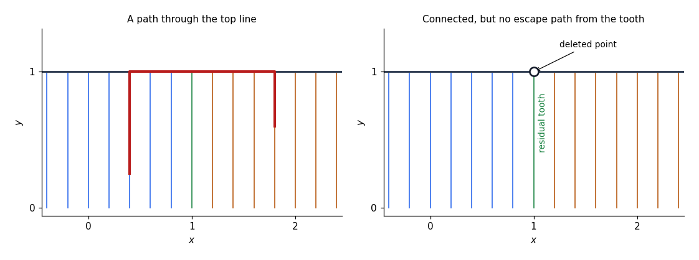

<h1 id="2/c/vi/solution">Solution</h1>

↑ **Parent:** [Vi](../vi.md)

Write $C'=C\setminus\{(1,1)\}$ and $V=\{1\}\times[0,1)$. Let $L$ and $R$ be the portions of $C'$ with first coordinate respectively less than and greater than one. Each is [path-connected](../../../../../path-connected-space.md): move along a rational tooth to its corresponding open half of the top [line](../../../../../straight-line.md), then horizontally there. By the [density of the rational numbers](../../../../../density-of-the-rational-numbers.md), every point of $V$ is a [limit point](../../../../../limit-point.md) of both $L$ and $R$.

Use the elementary fact that adjoining any collection of [limit points](../../../../../limit-point.md) to a [connected set](../../../../../connected-set.md) preserves [connectedness](../../../../../connected-space.md). Indeed, in a proposed [separation](../../../../../axiom-schema-of-specification.md), the connected subset lies on one side; relative openness would prevent any point on the other side from being a [limit point](../../../../../limit-point.md) of it. Therefore $L\cup V$ and $R\cup V$ are [connected](../../../../../connected-space.md). They intersect in $V$, so their union $C'$ is [connected](../../../../../connected-space.md).

There is, however, no [path](../../../../../continuous-path.md) from $(1,0)$ to $(0,1)$. If $\gamma(t)=(x(t),y(t))$ were one, let $t_0$ be the first time at which $y(t_0)=1$. Such a first time exists by [continuity](../../../../../continuous-function.md) and [compactness](../../../../../compact-space.md) of $[0,1]$, and $t_0>0$. For $0\leq t<t_0$, membership in the comb forces $x(t)\in\mathbb Q$. The [continuous image of a connected space](../../../../../continuous-image-of-a-connected-space.md) is [connected](../../../../../connected-space.md), and a [connected subset](../../../../../connected-subset.md) of $\mathbb Q$ is a [singleton](../../../../../singleton-mathematics.md): an irrational number between any two distinct rational values would separate it. Hence $x(t)=1$ for $t<t_0$. By [continuity](../../../../../continuous-function.md), $\gamma(t_0)=(1,1)$, which was deleted.

$$
\boxed{C'\text{ is connected but not path-connected}.}
$$

**[Figure 1](#2/c/vi/image-deleting-one-attachment-point-destroys-paths-but-preserves-connectedness). Deleting one attachment point destroys paths but preserves connectedness**. Finite samples of rational vertical teeth illustrate the full rational comb. The right panel marks the deleted point with an open circle; the residual vertical tooth is still approached from both sides.

## ↑ Ancestors (13)

1. [Vi](../vi.md)
2. [C](../../c.md)
3. [2](../../../2.md)
4. [2015](../../../../2015-split.md)
5. [Past exam of the metric spaces and complex analysis course of the University of Oxford](../../../../split.md)
6. [Metric spaces and complex analysis course of the University of Oxford](../../../../../metric-spaces-and-complex-analysis-course-of-the-university-of-oxford.md)
7. [Year 2 of the mathematics course of the University of Oxford](../../../../../year-2-of-the-mathematics-course-of-the-university-of-oxford.md)
8. [Mathematics course of the University of Oxford](../../../../../mathematics-course-of-the-university-of-oxford.md)
9. [Undergraduate course of the University of Oxford](../../../../../undergraduate-course-of-the-university-of-oxford.md)
10. [Course of the University of Oxford](../../../../../course-of-the-university-of-oxford.md)
11. [University of Oxford](../../../../../university-of-oxford-split.md)
12. [List of universities](../../../../../list-of-universities.md)
13. [Codex Wiki](../../../../../split.md)
