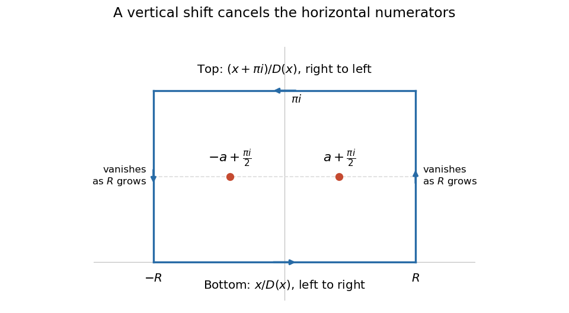

<h1 id="5/c/ii/solution">Solution</h1>

↑ **Parent:** [Ii](../ii.md)

Put $D(z)=\sinh^2z+\cosh^2a$ and $S=\sinh(2a)>0$. Traverse the rectangle $-R\to R\to R+\pi i\to-R+\pi i\to-R$ with [positive orientation of a contour](../../../../../positive-orientation-of-a-contour.md), taking $R>a$. Part (i) shows that the only enclosed [poles](../../../../../pole.md) of $f(z)=z/D(z)$ are

$$
z_+=a+\frac{\pi i}2,\qquad z_-=-a+\frac{\pi i}2.
$$

They are [simple poles](../../../../../simple-pole.md) because

$$
D'(z)=2\sinh z\cosh z=\sinh(2z),\qquad D'(z_+)=-S,\quad D'(z_-)=S.
$$

The [residue formula for a quotient at a simple denominator zero](../../../../../residue-formula-for-a-quotient-at-a-simple-denominator-zero.md) gives

$$
\operatorname{Res}(f,z_+)=-\frac{a+\pi i/2}{S},\qquad \operatorname{Res}(f,z_-)=\frac{-a+\pi i/2}{S}.
$$

Their imaginary terms cancel and their [residues](../../../../../residue.md) sum to $-2a/S$. Thus [Cauchy's residue theorem](../../../../../residue-theorem.md) gives

$$
\int_{\Gamma_R}f(z)\,dz=-\frac{4\pi ia}{S}.
$$

**[Figure 2](#5/c/ii/image-the-positively-oriented-contour-encloses-the-two-poles-at-pm-a-plus-pi-i-2). The positively oriented contour encloses the two poles at $\pm a+\pi i/2$**. The top edge is traversed from right to left. Its reversed [orientation of a contour](../../../../../orientation-of-a-contour.md) and the imaginary shift in the numerator produce $-i\pi$ times the desired real [integral](../../../../../integral-split.md).

The choice of numerator $z$ makes the horizontal sides useful. The [hyperbolic sine](../../../../../hyperbolic-sine.md) satisfies $\sinh(z+\pi i)=-\sinh z$, so $D(x+\pi i)=D(x)$. Consequently the lower and upper [contour integrals](../../../../../contour-integral.md), with their actual orientations, add to

$$
\begin{aligned}
\int_{-R}^{R}\frac{x}{D(x)}\,dx+\int_R^{-R}\frac{x+\pi i}{D(x)}\,dx
&=-\pi i\int_{-R}^{R}\frac{dx}{D(x)}.
\end{aligned}
$$

It remains to justify discarding both vertical sides. On either side $z=\pm R+iy$, $0\leq y\leq\pi$, the [reverse triangle inequality](../../../../../reverse-triangle-inequality.md) and part (b)(ii) imply

$$
|D(z)|\geq|\sinh z|^2-\cosh^2a\geq\sinh^2R-\cosh^2a.
$$

This lower bound is positive for sufficiently large $R$. Also $|z|\leq R+\pi$ and each vertical side has length $\pi$. The [estimation lemma](../../../../../estimation-lemma.md) bounds the absolute value of the sum $V_R$ of the vertical contributions by

$$
|V_R|\leq\frac{2\pi(R+\pi)}{\sinh^2R-\cosh^2a}\longrightarrow0.
$$

The real [improper integral](../../../../../improper-integral.md) converges absolutely, since its integrand is continuous on the [real axis](../../../../../real-axis.md) and decays like $4e^{-2|x|}$ at infinity. Combining all four sides and taking $R\to\infty$ gives

$$
-\pi i\int_{-\infty}^{\infty}\frac{dx}{\sinh^2x+\cosh^2a}=-\frac{4\pi ia}{\sinh(2a)}.
$$

Therefore

$$
\boxed{\int_{-\infty}^{\infty}\frac{dx}{\sinh^2x+\cosh^2a}=\frac{4a}{\sinh(2a)},\qquad a>0.}
$$

An independent real-variable check uses the [hyperbolic tangent](../../../../../hyperbolic-tangent.md) substitution $u=\tanh x$: the [integral](../../../../../integral-split.md) becomes $\int_{-1}^{1}du/(\cosh^2a-u^2\sinh^2a)$. Its [antiderivative](../../../../../antiderivative.md) uses the [inverse hyperbolic tangent](../../../../../inverse-hyperbolic-tangent.md), giving $2\operatorname{arctanh}(\tanh a)/(\sinh a\cosh a)=4a/\sinh(2a)$. As $a\downarrow0$, this tends to $2$, agreeing with $\int_{-\infty}^{\infty}\operatorname{sech}^2x\,dx=2$ and checking the factor of two.

## ↑ Ancestors (13)

1. [Ii](../ii.md)
2. [C](../../c.md)
3. [5](../../../5.md)
4. [2015](../../../../2015-split.md)
5. [Past exam of the metric spaces and complex analysis course of the University of Oxford](../../../../split.md)
6. [Metric spaces and complex analysis course of the University of Oxford](../../../../../metric-spaces-and-complex-analysis-course-of-the-university-of-oxford.md)
7. [Year 2 of the mathematics course of the University of Oxford](../../../../../year-2-of-the-mathematics-course-of-the-university-of-oxford.md)
8. [Mathematics course of the University of Oxford](../../../../../mathematics-course-of-the-university-of-oxford.md)
9. [Undergraduate course of the University of Oxford](../../../../../undergraduate-course-of-the-university-of-oxford.md)
10. [Course of the University of Oxford](../../../../../course-of-the-university-of-oxford.md)
11. [University of Oxford](../../../../../university-of-oxford-split.md)
12. [List of universities](../../../../../list-of-universities.md)
13. [Codex Wiki](../../../../../split.md)
