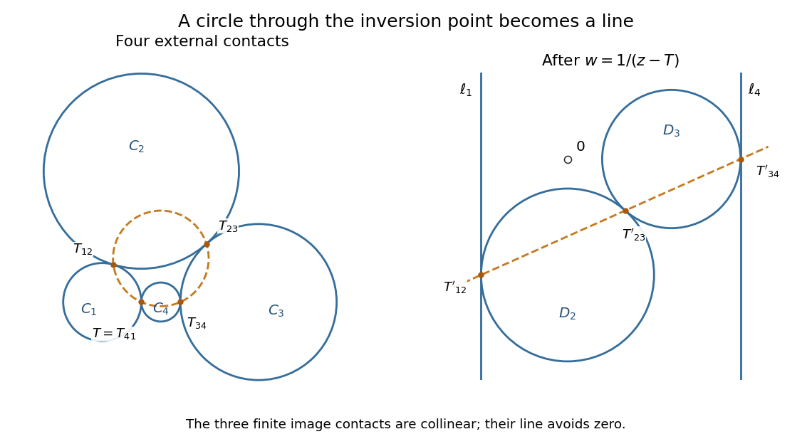

<h1 id="6/c/solution">Solution</h1>

↑ **Parent:** [C](../c.md)

**The three contacts in the strip.** Work with the external-contact arrangement drawn in the original diagram: both [disks](../../../../disk-mathematics.md) lie between the two [parallel lines](../../../../parallel-lines.md) and touch opposite boundaries. A [rigid motion](../../../../rigid-transformation.md) puts those boundaries at $x=0$ and $x=d$, with $d>0$, and makes $P=(0,0)$. Write $R=(d,h)$, and let the positive [radii](../../../../radius.md) be $r_1,r_2$. Because a [tangent to a circle](../../../../tangent-to-a-circle.md) is perpendicular to the corresponding [radius](../../../../radius.md), the centres are

$$
O_1=(r_1,0),\qquad O_2=(d-r_2,h).
$$

At the [external tangency](../../../../external-tangency.md), the two radial segments form the segment $O_1O_2$, with $|O_1Q|=r_1$ and $|QO_2|=r_2$. Hence the internal division formula gives

$$
Q=\frac{r_2O_1+r_1O_2}{r_1+r_2}=\left(\frac{r_1d}{r_1+r_2},\frac{r_1h}{r_1+r_2}\right)=\frac{r_1}{r_1+r_2}R.
$$

Thus

$$
\boxed{Q=P+\frac{r_1}{r_1+r_2}(R-P),\qquad P,Q,R\text{ are collinear}.}
$$

The coefficient is strictly between zero and one, so $Q$ lies on the actual [line segment](../../../../line-segment.md) $PR$. This proves [collinearity for tangent circles between parallel lines](../../../../collinearity-for-tangent-circles-between-parallel-lines.md). We will also use the fact that $PQ$ and $QR$ are [chords](../../../../chord-of-a-circle.md) of the respective [circles](../../../../circle.md); the entire [line segment](../../../../line-segment.md) $PR$ therefore lies in the union of their closed [disks](../../../../disk-mathematics.md).

**The four contacts.** Label the successive contact points $T_{12},T_{23},T_{34},T_{41}$, with $T_{jk}$ belonging to $C_j$ and $C_k$. The original diagram has four positive-[radius](../../../../radius.md) [circles](../../../../circle.md) with disjoint interiors, successive [external tangencies](../../../../external-tangency.md), and distinct contact points. Set $T=T_{41}$ and apply the reciprocal [Möbius transformation](../../../../mobius-transformation.md)

$$
w=\frac1{z-T}.
$$

By part (b), the two [circles](../../../../circle.md) $C_1,C_4$ through $T$ become [straight lines](../../../../straight-line.md) $\ell_1,\ell_4$. These [straight lines](../../../../straight-line.md) cannot meet at a finite point, since their inverse images would give a second intersection of $C_1,C_4$. They are therefore distinct [parallel lines](../../../../parallel-lines.md). The other two [circles](../../../../circle.md) avoid $T$, so their images $D_2,D_3$ are ordinary [circles](../../../../circle.md) missing zero.

The three remaining contacts retain their tangencies. Indeed, away from $T$ the map and its inverse are [holomorphic functions](../../../../holomorphic-function-split.md) with nonzero [derivatives](../../../../derivative.md), hence are local [conformal maps](../../../../conformal-map.md). In particular they preserve a shared [tangent line](../../../../tangent-line.md). Equivalently, bijectivity preserves the unique intersection of two [generalized circles](../../../../generalized-circle-under-a-mobius-transformation.md), which characterizes their tangency here.

The finite closed [disks](../../../../disk-mathematics.md) bounded by $D_2,D_3$ lie between $\ell_1,\ell_4$, have [external tangency](../../../../external-tangency.md) to each other, and touch opposite boundaries at the images of $T_{12}$ and $T_{34}$. To track the sides as well as the boundaries, a closed [disk](../../../../disk-mathematics.md) avoiding $T$ maps to the bounded closed [disk](../../../../disk-mathematics.md) of its image [circle](../../../../circle.md), while each [disk](../../../../disk-mathematics.md) with $T$ on its boundary maps to a closed [half-plane](../../../../half-plane.md). The two latter [half-planes](../../../../half-plane.md) have disjoint interiors, so their complement is the strip containing zero. Disjointness of the original interiors puts $D_2,D_3$ inside that strip. Neither image closed [disk](../../../../disk-mathematics.md) contains zero, since the reciprocal [Möbius transformation](../../../../mobius-transformation.md) sends only infinity to zero.

The first part now makes the three finite transformed contact points [collinear](../../../../collinearity.md), on a [straight line](../../../../straight-line.md) $\ell$. It is essential that $\ell$ misses zero. If it passed through zero, its segment between $\ell_1$ and $\ell_4$ would contain zero, since zero lies strictly within the strip. But the first part shows that this whole [line segment](../../../../line-segment.md) is covered by the two image closed [disks](../../../../disk-mathematics.md), neither of which contains zero. This contradiction proves $0\notin\ell$.

The inverse image of a [straight line](../../../../straight-line.md) missing zero is a genuine [circle](../../../../circle.md) through $T$, by the same coefficient transformation in part (b), or by applying the involution $u\mapsto1/u$ in reverse and translating back. This [circle](../../../../circle.md) contains $T_{12},T_{23},T_{34}$, while $T$ is the inverse image of the point at infinity on $\ell$. Therefore

$$
\boxed{T_{12},\ T_{23},\ T_{34},\ T_{41}\text{ lie on one circle}.}
$$

This is the [four contact points of a circle chain](../../../../four-contact-points-of-a-circle-chain.md) result; the four contacts form a [cyclic quadrilateral](../../../../cyclic-quadrilateral.md).

**[Figure 3](#6/c/image-the-reciprocal-transformation-of-a-generalized-circle-turns-the-chain-into-two-tangent-circles-between-parallel-lines). The reciprocal transformation of a generalized circle turns the chain into two tangent circles between parallel lines**. An original exact construction illustrates the arrangement. The orange [circle](../../../../circle.md) through all four contacts becomes the orange [straight line](../../../../straight-line.md) through the three finite transformed contacts. The hollow point at zero lies between the [parallel lines](../../../../parallel-lines.md) and outside the two image [disks](../../../../disk-mathematics.md).

The pictured arrangement matters. Arbitrary mixtures of [internal tangency](../../../../internal-tangency.md) and [external tangency](../../../../external-tangency.md) can instead give four distinct [collinear](../../../../collinearity.md) contacts: take four [circles](../../../../circle.md) whose diameter endpoints on the [real axis](../../../../real-axis.md) are respectively $[0,3]$, $[0,1]$, $[1,2]$, and $[2,3]$. Their successive contacts are $0,1,2,3$, so no ordinary [circle](../../../../circle.md) contains all four. The proof above establishes the requested genuine-[circle](../../../../circle.md) conclusion for the external-contact arrangement actually drawn, rather than silently treating every [generalized circle](../../../../generalized-circle-under-a-mobius-transformation.md) as an ordinary [circle](../../../../circle.md).

## ↑ Ancestors (12)

1. [C](../c.md)
2. [6](../../6.md)
3. [2015](../../../2015-split.md)
4. [Past exam of the metric spaces and complex analysis course of the University of Oxford](../../../split.md)
5. [Metric spaces and complex analysis course of the University of Oxford](../../../../metric-spaces-and-complex-analysis-course-of-the-university-of-oxford.md)
6. [Year 2 of the mathematics course of the University of Oxford](../../../../year-2-of-the-mathematics-course-of-the-university-of-oxford.md)
7. [Mathematics course of the University of Oxford](../../../../mathematics-course-of-the-university-of-oxford.md)
8. [Undergraduate course of the University of Oxford](../../../../undergraduate-course-of-the-university-of-oxford.md)
9. [Course of the University of Oxford](../../../../course-of-the-university-of-oxford.md)
10. [University of Oxford](../../../../university-of-oxford-split.md)
11. [List of universities](../../../../list-of-universities.md)
12. [Codex Wiki](../../../../split.md)
