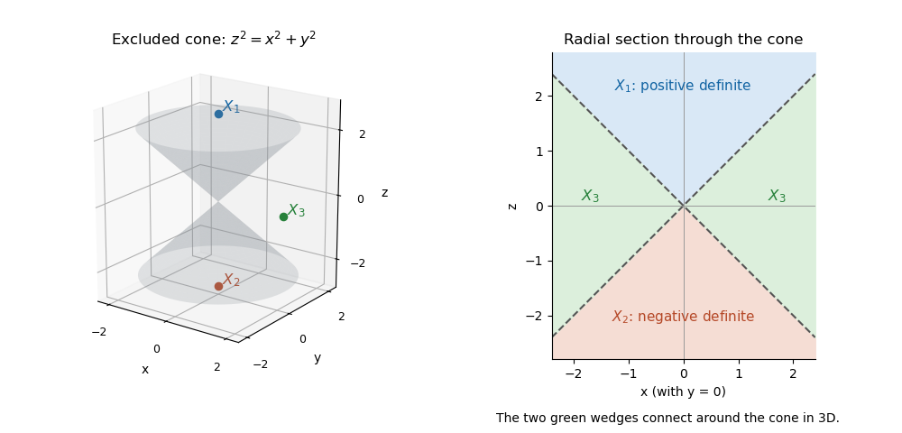
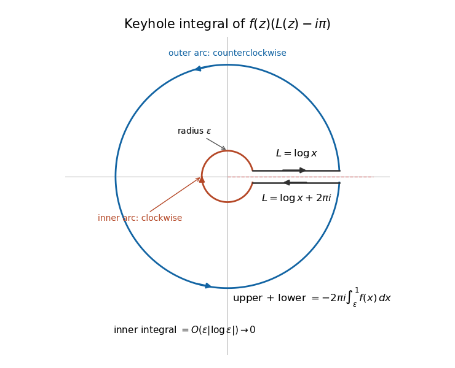
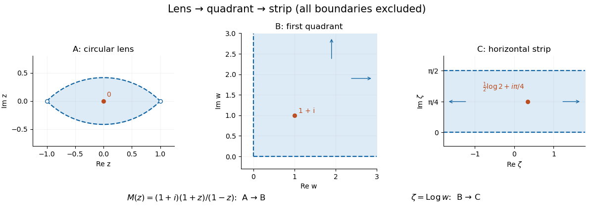

# 2017

↑ **Parent:** [Past exam of the metric spaces and complex analysis course of the University of Oxford](../past-exam-of-the-metric-spaces-and-complex-analysis-course-of-the-university-of-oxford.md)

Source paper: [released examination archive](https://www.whatdotheyknow.com/request/ba_computer_science_past_papers/response/2577745/attach/2/202402%20183%20CS%20Papers.zip?cookie_passthrough=1), member `2016/T/a13754w1.pdf`. The printed cover dates the examination to 13 June 2017. All six questions and all thirty-four terminal subparts are answered below, including the definitions and other requirements printed outside the nested lists.

**Table of contents**

- [1](#1)
  - [a](#1/a)
    - [i](#1/a/i)
      - [Solution](#1/a/i/solution)
    - [ii](#1/a/ii)
      - [Solution](#1/a/ii/solution)
    - [iii](#1/a/iii)
      - [Solution](#1/a/iii/solution)
  - [b](#1/b)
    - [i](#1/b/i)
      - [Solution](#1/b/i/solution)
    - [ii](#1/b/ii)
      - [Solution](#1/b/ii/solution)
    - [iii](#1/b/iii)
      - [Solution](#1/b/iii/solution)
- [2](#2)
  - [a](#2/a)
    - [i](#2/a/i)
      - [Solution](#2/a/i/solution)
    - [ii](#2/a/ii)
      - [Solution](#2/a/ii/solution)
    - [iii](#2/a/iii)
      - [Solution](#2/a/iii/solution)
  - [b](#2/b)
    - [i](#2/b/i)
      - [Solution](#2/b/i/solution)
    - [ii](#2/b/ii)
      - [Solution](#2/b/ii/solution)
- [3](#3)
  - [a](#3/a)
    - [i](#3/a/i)
      - [Solution](#3/a/i/solution)
    - [ii](#3/a/ii)
      - [Solution](#3/a/ii/solution)
  - [b](#3/b)
    - [i](#3/b/i)
      - [Solution](#3/b/i/solution)
    - [ii](#3/b/ii)
      - [Solution](#3/b/ii/solution)
    - [iii](#3/b/iii)
      - [Solution](#3/b/iii/solution)
    - [iv](#3/b/iv)
      - [Solution](#3/b/iv/solution)
  - [c](#3/c)
    - [Solution](#3/c/solution)
- [4](#4)
  - [a](#4/a)
    - [i](#4/a/i)
      - [Solution](#4/a/i/solution)
    - [ii](#4/a/ii)
      - [Solution](#4/a/ii/solution)
    - [iii](#4/a/iii)
      - [Solution](#4/a/iii/solution)
  - [b](#4/b)
    - [i](#4/b/i)
      - [Solution](#4/b/i/solution)
    - [ii](#4/b/ii)
      - [Solution](#4/b/ii/solution)
    - [iii](#4/b/iii)
      - [Solution](#4/b/iii/solution)
    - [iv](#4/b/iv)
      - [Solution](#4/b/iv/solution)
- [5](#5)
  - [a](#5/a)
    - [i](#5/a/i)
      - [Solution](#5/a/i/solution)
    - [ii](#5/a/ii)
      - [Solution](#5/a/ii/solution)
  - [b](#5/b)
    - [i](#5/b/i)
      - [Solution](#5/b/i/solution)
    - [ii](#5/b/ii)
      - [Solution](#5/b/ii/solution)
    - [iii](#5/b/iii)
      - [Solution](#5/b/iii/solution)
- [6](#6)
  - [a](#6/a)
    - [i](#6/a/i)
      - [Solution](#6/a/i/solution)
    - [ii](#6/a/ii)
      - [Solution](#6/a/ii/solution)
  - [b](#6/b)
    - [i](#6/b/i)
      - [Solution](#6/b/i/solution)
    - [ii](#6/b/ii)
      - [Solution](#6/b/ii/solution)

## 1

↑ **Parent:** [2017](2017.md)

<h3 id="1/a">a</h3>

↑ **Parent:** [1](#1)

<h4 id="1/a/i">i</h4>

↑ **Parent:** [A](#1/a)

<h5 id="1/a/i/solution">Solution</h5>

↑ **Parent:** [I](#1/a/i)

A [sequence](../sequence-and-series.md#sequence) $(x_n)$ in a [metric space](../topological-analysis.md#metric-space) $(X,d)$ is a [Cauchy sequence](../sequence-and-series.md#cauchy-sequence) if

$$
\forall\varepsilon>0\ \exists N\ \forall m,n\geq N:\quad d(x_m,x_n)<\varepsilon.
$$

The index $N$ may depend on $\varepsilon$, but must work for every pair of sufficiently late terms. No candidate limit is part of this definition.

<h4 id="1/a/ii">ii</h4>

↑ **Parent:** [A](#1/a)

<h5 id="1/a/ii/solution">Solution</h5>

↑ **Parent:** [Ii](#1/a/ii)

The [sequence](../sequence-and-series.md#sequence) converges to $x\in X$ if

$$
\forall\varepsilon>0\ \exists N\ \forall n\geq N:\quad d(x_n,x)<\varepsilon.
$$

Equivalently $d(x_n,x)\to0$. The limit must belong to the specified [metric space](../topological-analysis.md#metric-space), not just to a larger space containing it.

<h4 id="1/a/iii">iii</h4>

↑ **Parent:** [A](#1/a)

<h5 id="1/a/iii/solution">Solution</h5>

↑ **Parent:** [Iii](#1/a/iii)

A [complete metric space](../topological-analysis.md#complete-metric-space) is one in which **every [Cauchy sequence](../sequence-and-series.md#cauchy-sequence) converges to a point of that space**. For an incomplete example, take $(0,1)$ with the usual [Euclidean metric](../riemannian-metric.md#euclidean-metric) and $x_n=1/(n+1)$. It is [Cauchy](../sequence-and-series.md#cauchy-sequence) because it converges to zero in $\mathbb R$. It cannot converge inside $(0,1)$: any such convergence would also hold in $\mathbb R$, contradicting uniqueness of the limit, since zero is excluded. Thus the ambient metric and the underlying set both matter to [completeness](../topological-analysis.md#completeness).

<h3 id="1/b">b</h3>

↑ **Parent:** [1](#1)

<h4 id="1/b/i">i</h4>

↑ **Parent:** [B](#1/b)

<h5 id="1/b/i/solution">Solution</h5>

↑ **Parent:** [I](#1/b/i)

Put $\phi(t)=t/(1+t)$. Every summand is nonnegative and at most $2^{-i}$, so the series defining $d$ converges and $d\leq1$. Symmetry follows from each $d_i$. If $d(x,y)=0$, every nonnegative summand is zero, hence every $d_i(x_i,y_i)=0$ and $x_i=y_i$. The converse is immediate.

For the [triangle inequality](../topological-analysis.md#triangle-inequality), first observe that for $a,b\geq0$,

$$
\phi(a+b)=\frac a{1+a+b}+\frac b{1+a+b}\leq\frac a{1+a}+\frac b{1+b}=\phi(a)+\phi(b).
$$

Monotonicity of $\phi$ and the triangle inequality for $d_i$ therefore give

$$
\phi(d_i(x_i,z_i))\leq\phi(d_i(x_i,y_i))+\phi(d_i(y_i,z_i)).
$$

Multiply by $2^{-i}$ and sum the convergent nonnegative series. This proves the required triangle inequality for $d$, so **$d$ is a [metric](../topological-analysis.md#metric)**. The construction combines a [bounded metric transform](../topological-analysis.md#bounded-metric-transform) with a [countable product metric](../topological-analysis.md#countable-product-metric).

<h4 id="1/b/ii">ii</h4>

↑ **Parent:** [B](#1/b)

<h5 id="1/b/ii/solution">Solution</h5>

↑ **Parent:** [Ii](#1/b/ii)

Let $(x^{(n)})$ be [Cauchy](../sequence-and-series.md#cauchy-sequence) for $d$, and fix a coordinate $i$. Every nonnegative summand is bounded by the whole sum:

$$
2^{-i}\phi\!\left(d_i(x_i^{(m)},x_i^{(n)})\right)\leq d(x^{(m)},x^{(n)}).
$$

Given $\varepsilon>0$, choose $N$ such that the right-hand side is less than $2^{-i}\varepsilon/(1+\varepsilon)$ for all $m,n\geq N$. Then strict monotonicity of $\phi$ implies $d_i(x_i^{(m)},x_i^{(n)})<\varepsilon$. Hence **every coordinate sequence is [Cauchy](../sequence-and-series.md#cauchy-sequence) in its original metric $d_i$**, with the index bound allowed to depend on the fixed coordinate.

<h4 id="1/b/iii">iii</h4>

↑ **Parent:** [B](#1/b)

<h5 id="1/b/iii/solution">Solution</h5>

↑ **Parent:** [Iii](#1/b/iii)

By part (ii) and completeness of each factor, choose $x_i\in X_i$ with $x_i^{(n)}\to x_i$. Let $x=(x_i)$. Given $\varepsilon>0$, choose $N$ such that $\sum_{i>N}2^{-i}=2^{-N}<\varepsilon/2$. Coordinate convergence gives a single $n_0$ for which $d_i(x_i^{(n)},x_i)<\varepsilon/2$ for every $i\leq N$ and $n\geq n_0$. Since $\phi(t)\leq t$,

$$
d(x^{(n)},x)\leq\sum_{i\leq N}2^{-i}d_i(x_i^{(n)},x_i)+\sum_{i>N}2^{-i}<\varepsilon.
$$

Thus $x^{(n)}\to x$ in the product metric, proving **the product is complete**. The finite head uses coordinate convergence; the summable tail is controlled uniformly, regardless of how large the remaining original coordinate distances are. This is [completeness of a countable product metric](../topological-analysis.md#completeness-of-a-countable-product-metric).

## 2

↑ **Parent:** [2017](2017.md)

<h3 id="2/a">a</h3>

↑ **Parent:** [2](#2)

<h4 id="2/a/i">i</h4>

↑ **Parent:** [A](#2/a)

<h5 id="2/a/i/solution">Solution</h5>

↑ **Parent:** [I](#2/a/i)

A [topological space](../topology.md#topological-space) is [connected](../geometry-and-topology.md#connected-space) if it cannot be expressed as a union of two disjoint nonempty sets open in that space. Suppose $f(X)$ had such a separation $U\cup V$. Here $U,V$ are open in the [subspace topology](../topology.md#subspace-topology) of $f(X)$. Continuity makes $f^{-1}(U)$ and $f^{-1}(V)$ open in $X$. They are disjoint, nonempty because $U,V$ contain image points, and cover $X$. This contradicts connectedness. Hence **a [continuous image of a connected space](../geometry-and-topology.md#continuous-image-of-a-connected-space) is connected**.

<h4 id="2/a/ii">ii</h4>

↑ **Parent:** [A](#2/a)

<h5 id="2/a/ii/solution">Solution</h5>

↑ **Parent:** [Ii](#2/a/ii)

A space is [path-connected](../geometry-and-topology.md#path-connected-space) if for every pair $x_0,x_1$ it contains a [continuous path](../geometry-and-topology.md#continuous-path) $\gamma:[0,1]\to X$ with $\gamma(0)=x_0$ and $\gamma(1)=x_1$. For any $y_0,y_1\in f(X)$ choose preimages $x_0,x_1$. A path between those preimages maps to $f\circ\gamma$, a continuous path from $y_0$ to $y_1$ staying in $f(X)$. Thus **a [continuous image of a path-connected space](../geometry-and-topology.md#continuous-image-of-a-path-connected-space) is [path-connected](../geometry-and-topology.md#path-connected-space)**. Surjectivity onto the ambient codomain $Y$ is not needed; the conclusion concerns $f(X)$.

<h4 id="2/a/iii">iii</h4>

↑ **Parent:** [A](#2/a)

<h5 id="2/a/iii/solution">Solution</h5>

↑ **Parent:** [Iii](#2/a/iii)

Suppose a [path-connected](../geometry-and-topology.md#path-connected-space) space had a separation $X=U\cup V$ as above. Choose $u\in U$, $v\in V$, and a continuous path $\gamma$ joining them. The nonempty disjoint sets $\gamma^{-1}(U)$ and $\gamma^{-1}(V)$ would separate $[0,1]$, contradicting [connectedness of an interval](../geometry-and-topology.md#connectedness-of-an-interval). Hence **[path-connectedness implies connectedness](../geometry-and-topology.md#path-connectedness-implies-connectedness)**. Equivalently, the connected path image from part (i) cannot meet both sides of a separation.

<h3 id="2/b">b</h3>

↑ **Parent:** [2](#2)

<h4 id="2/b/i">i</h4>

↑ **Parent:** [B](#2/b)

<h5 id="2/b/i/solution">Solution</h5>

↑ **Parent:** [I](#2/b/i)

Expanding the [characteristic polynomial](../linear-operator-theory.md#characteristic-polynomial) gives

$$
\det(A-\lambda I)=(z-\lambda)^2-x^2-y^2=\lambda^2-2z\lambda+z^2-x^2-y^2.
$$

Therefore **$a=-2z$ and $b=z^2-x^2-y^2$**. Both are [polynomial functions](../polynomial.md#polynomial-function) of the three real coordinates, so they are [continuous functions](../calculus.md#continuous-function), including on the open subset $X$ of [invertible matrices](../linear-algebra.md#invertible-matrix).

On $X$, $b=\det A\ne0$. Its image contains positive values, for example $b(I)=1$, and negative ones, for example $b(\operatorname{diag}(1,-1))=-1$. If $X$ were connected, its continuous real image would be an interval containing both signs and hence zero. That is impossible. Thus **$X$ is not connected**. More precisely its determinant image is $\mathbb R\setminus\{0\}$: take $x=y=0$ for a positive value and $z=y=0$ for a negative one.

<h4 id="2/b/ii">ii</h4>

↑ **Parent:** [B](#2/b)

<h5 id="2/b/ii/solution">Solution</h5>

↑ **Parent:** [Ii](#2/b/ii)

On $X^+$, $z^2>x^2+y^2$, so $z\ne0$ and therefore $a=-2z\ne0$. Yet $a(I)=-2$ and $a(-I)=2$. The same [continuous image of a connected space](../geometry-and-topology.md#continuous-image-of-a-connected-space) argument shows that **$X^+$ is not connected**.

Put $r=\sqrt{x^2+y^2}$. The required three disjoint nonempty open sets are

$$
\boxed{X_1=\{z>r\},\qquad X_2=\{z<-r\},\qquad X_3=\{|z|<r\}.}
$$

Their union is precisely $X$, the complement of the double cone $z^2=x^2+y^2$. The [eigenvalues](../linear-operator-theory.md#eigenvalue) are $z\pm r$, so $X_1$ consists of [positive-definite matrices](../quadratic-form.md#positive-definite-matrix) above the upper sheet, $X_2$ of [negative-definite matrices](../quadratic-form.md#negative-definite-matrix) below the lower sheet, and $X_3$ of [indefinite matrices](../quadratic-form.md#indefinite-matrix) outside the double cone. Examples are $I,-I,\operatorname{diag}(1,-1)$ respectively.

The two definite cones are [convex sets](../convex-set.md). The indefinite region is [path-connected](../geometry-and-topology.md#path-connected-space): shrink $z$ continuously to zero while keeping $r>0$, then change the nonzero vector $(x,y)$ within the [punctured plane](../riemann-surfaces.md#punctured-complex-plane). Thus these sets are also exactly the three [connected components](../geometry-and-topology.md#connected-component). This is the [determinant cone for real symmetric two-by-two matrices](../linear-algebra.md#determinant-cone-for-real-symmetric-two-by-two-matrices).

**[Figure 1](#2/b/ii/image-the-determinant-zero-cone-separates-three-components-of-invertible-symmetric-matrices). The determinant-zero cone separates three components of invertible symmetric matrices**. The left panel shows the double cone. The right panel is a radial section: the exterior indefinite region is connected around the cone in three dimensions, although its two sides appear separated in this section.

## 3

↑ **Parent:** [2017](2017.md)

<h3 id="3/a">a</h3>

↑ **Parent:** [3](#3)

<h4 id="3/a/i">i</h4>

↑ **Parent:** [A](#3/a)

<h5 id="3/a/i/solution">Solution</h5>

↑ **Parent:** [I](#3/a/i)

For a piecewise continuously differentiable [contour](../complex-analysis.md#complex-integration-contour) $\gamma:[a,b]\to U$, define its [contour integral](../complex-analysis.md#contour-integral) by

$$
\boxed{\int_\gamma f(z)\,dz=\int_a^b f(\gamma(t))\gamma'(t)\,dt,}
$$

adding the integrals over the finitely many smooth pieces if necessary. Continuity of $f$ along the contour makes each integrand integrable. The derivative supplies both the direction and the complex line element; replacing it by its modulus would give a different integral with respect to arc length.

<h4 id="3/a/ii">ii</h4>

↑ **Parent:** [A](#3/a)

<h5 id="3/a/ii/solution">Solution</h5>

↑ **Parent:** [Ii](#3/a/ii)

For $\phi(t)=re^{it}$, $\phi'(t)=ire^{it}$ and $|\phi'(t)|=r$. The [triangle inequality for an integral](../topological-analysis.md#integral-triangle-inequality) applied to the parametrized [contour integral](../complex-analysis.md#contour-integral) gives

$$
\boxed{\left|\int_\phi f(z)\,dz\right|=\left|\int_0^{2\pi}f(re^{it})ire^{it}\,dt\right|\leq r\int_0^{2\pi}|f(re^{it})|\,dt.}
$$

This is the circular-contour instance of the [estimation lemma](../complex-analysis.md#estimation-lemma).

<h3 id="3/b">b</h3>

↑ **Parent:** [3](#3)

<h4 id="3/b/i">i</h4>

↑ **Parent:** [B](#3/b)

<h5 id="3/b/i/solution">Solution</h5>

↑ **Parent:** [I](#3/b/i)

Use the continuous argument $0<\arg z<2\pi$ on the positive-axis slit plane and define

$$
\boxed{L(z)=\log|z|+i\arg z.}
$$

This [analytic logarithm on the positive-axis slit plane](../analysis.md#analytic-logarithm-on-the-positive-axis-slit-plane) is holomorphic, satisfies $e^{L(z)}=z$ and $L'(z)=1/z$, and has $L(-1)=i\pi$. That value fixes the branch uniquely on the connected domain. For positive real $x$, the two boundary limits are

$$
L(x+i0)=\log x,\qquad L(x-i0)=\log x+2\pi i.
$$

The jump, rather than a pole of the integrand, is what the keyhole argument exploits.

<h4 id="3/b/ii">ii</h4>

↑ **Parent:** [B](#3/b)

<h5 id="3/b/ii/solution">Solution</h5>

↑ **Parent:** [Ii](#3/b/ii)

The [Cauchy integral theorem](../complex-analysis.md#cauchy-s-integral-theorem) for a [star-shaped domain](../algebra.md#star-shaped-domain) says: if $U$ is open and star-shaped and $F$ is holomorphic on $U$, then **$\int_\gamma F(z)\,dz=0$ for every closed contour $\gamma$ in $U$**. Equivalently, $F$ has a [complex antiderivative](../integral.md#complex-antiderivative) on $U$. Star-shaped means that there is one point of $U$ from which every straight segment to another point of $U$ remains in $U$.

<h4 id="3/b/iii">iii</h4>

↑ **Parent:** [B](#3/b)

<h5 id="3/b/iii/solution">Solution</h5>

↑ **Parent:** [Iii](#3/b/iii)

Apply the [Cauchy integral theorem](../complex-analysis.md#cauchy-s-integral-theorem) to $F(z)=f(z)(L(z)-i\pi)$ on the slit plane, which is star-shaped about $-1$. For fixed $\varepsilon>0$, first let $\delta\to0$. The upper bank is traversed from $\varepsilon$ to one and the lower bank from one to $\varepsilon$, so their limiting sum is

$$
\int_\varepsilon^1f(x)(\log x-i\pi)\,dx+\int_1^\varepsilon f(x)(\log x+i\pi)\,dx=-2\pi i\int_\varepsilon^1f(x)\,dx.
$$

The outer arc tends to the positively oriented unit-circle integral, interpreting the logarithm by its one-sided boundary values at the cut. On the inner arc, $|L-i\pi|\leq|\log\varepsilon|+\pi$ and $f$ is bounded near zero. Its integral is therefore $O(\varepsilon|\log\varepsilon|)$ and tends to zero. The sum of all four contour pieces is zero. Letting $\varepsilon\to0$ gives

$$
\boxed{\int_0^1f(x)\,dx=\frac1{2\pi i}\int_\phi f(z)(L(z)-i\pi)\,dz.}
$$

The integral around the full circle is a piecewise integral of the branch's boundary values; $L$ is not a single holomorphic function across the cut-crossing point. This is the [centred logarithmic keyhole identity](../analysis.md#centred-logarithmic-keyhole-identity).

**[Figure 2](#3/b/iii/image-the-logarithmic-jump-on-a-keyhole-contour-recovers-a-real-segment-integral). The logarithmic jump on a keyhole contour recovers a real-segment integral**. The upper and lower banks have opposite traversal directions and logarithmic boundary values differing by $2\pi i$. The small circle is traversed clockwise. The slit width is illustrative; its limit is taken before the inner radius tends to zero.

<h4 id="3/b/iv">iv</h4>

↑ **Parent:** [B](#3/b)

<h5 id="3/b/iv/solution">Solution</h5>

↑ **Parent:** [Iv](#3/b/iv)

Along $z=e^{i\theta}$ with $0<\theta<2\pi$, the chosen branch has $L(z)-i\pi=i(\theta-\pi)$. Use part (iii) and the circular estimate in part (a):

$$
\left|\int_0^1f(x)\,dx\right|\leq\frac1{2\pi}\int_0^{2\pi}|f(e^{i\theta})|\,|\theta-\pi|\,d\theta\leq\boxed{\frac12\int_0^{2\pi}|f(e^{i\theta})|\,d\theta.}
$$

The second step uses $|\theta-\pi|\leq\pi$. The single branch-cut point does not affect the integral. Keeping that weight gives the sharper intermediate bound.

<h3 id="3/c">c</h3>

↑ **Parent:** [3](#3)

<h4 id="3/c/solution">Solution</h4>

↑ **Parent:** [C](#3/c)

On the real interval, $h(x)$ is real and $H(x)=h(x)^2\geq0$. Expanding and integrating the finite sum yields

$$
\sum_{r,s=1}^n\frac{a_ra_s}{r+s+1}=\int_0^1h(x)^2\,dx.
$$

Apply part (b)(iv) to the entire function $H=h^2$. Since $|H(e^{i\theta})|=|h(e^{i\theta})|^2$, [orthogonality of complex exponentials](../fourier-analysis.md#orthogonality-of-complex-exponentials) gives

$$
\int_0^{2\pi}|h(e^{i\theta})|^2\,d\theta=\sum_{r,s}a_ra_s\int_0^{2\pi}e^{i(r-s)\theta}\,d\theta=2\pi\sum_{r=1}^n a_r^2.
$$

Consequently

$$
\boxed{\left|\sum_{r,s=1}^n\frac{a_ra_s}{r+s+1}\right|\leq\pi\sum_{r=1}^n a_r^2.}
$$

The quadratic form is actually nonnegative, so its absolute value can be dropped. This [shifted Hilbert quadratic-form bound](../vector-space.md#shifted-hilbert-quadratic-form-bound) comes from combining the logarithmic contour estimate with a finite [Parseval identity](../fourier-analysis.md#parseval-identity).

## 4

↑ **Parent:** [2017](2017.md)

<h3 id="4/a">a</h3>

↑ **Parent:** [4](#4)

<h4 id="4/a/i">i</h4>

↑ **Parent:** [A](#4/a)

<h5 id="4/a/i/solution">Solution</h5>

↑ **Parent:** [I](#4/a/i)

The [identity theorem](../complex-analysis.md#identity-theorem) says that two holomorphic functions on a connected domain which agree on a set with an accumulation point inside that domain agree everywhere there.

**No such [entire function](../holomorphic-function.md#entire-function) exists.** On the [subsequence](../sequence-and-series.md#subsequence) $1/(2m)\to0$ indexed by [even numbers](../integer.md#even-number), the proposed function equals $\sin z$. The [identity theorem](../complex-analysis.md#identity-theorem) would force $f(z)=\sin z$ throughout $\mathbb C$. At the points indexed by [odd numbers](../integer.md#odd-number) it is instead required to equal $-\sin z$, a contradiction since $\sin(1/n)>0$ for positive $n$. The accumulation point zero lies inside the assumed domain of holomorphy, which is essential to this argument.

<h4 id="4/a/ii">ii</h4>

↑ **Parent:** [A](#4/a)

<h5 id="4/a/ii/solution">Solution</h5>

↑ **Parent:** [Ii](#4/a/ii)

**Yes:** take the [unnormalized sinc function](../fourier-transform.md#unnormalized-sinc-function) with its removable value at zero,

$$
\boxed{g(z)=\begin{cases}\sin z/z,&z\ne0,\\1,&z=0.\end{cases}}
$$

Its [power series](../sequence-and-series.md#power-series) is $\sum_{m=0}^\infty(-1)^mz^{2m}/(2m+1)!$, with infinite [radius of convergence](../sequence-and-series.md#radius-of-convergence), so it is an [entire function](../holomorphic-function.md#entire-function). At $z=1/n$ it gives $n\sin(1/n)$ as required. The [identity theorem](../complex-analysis.md#identity-theorem) also proves this entire solution is unique.

<h4 id="4/a/iii">iii</h4>

↑ **Parent:** [A](#4/a)

<h5 id="4/a/iii/solution">Solution</h5>

↑ **Parent:** [Iii](#4/a/iii)

**No such [entire function](../holomorphic-function.md#entire-function) exists.** If it did, the entire function $h(z)^2-z$ would vanish at the distinct points $(n/(n+1))^2$, whose [accumulation point](../topology.md#limit-point) is one. The [identity theorem](../complex-analysis.md#identity-theorem) would give $h(z)^2=z$ on all of $\mathbb C$.

At zero this forces $h(0)=0$. Differentiating the identity gives $2h(z)h'(z)=1$, impossible at zero. Equivalently, a squared holomorphic function has an even-order zero, whereas $z$ has a simple zero. This is the obstruction expressed by [no entire square root of the identity function](../analysis.md#no-entire-square-root-of-the-identity-function); a square-root branch near one cannot extend holomorphically through zero.

<h3 id="4/b">b</h3>

↑ **Parent:** [4](#4)

<h4 id="4/b/i">i</h4>

↑ **Parent:** [B](#4/b)

<h5 id="4/b/i/solution">Solution</h5>

↑ **Parent:** [I](#4/b/i)

[Morera's theorem](../complex-analysis.md#morera-s-theorem) states that a continuous function on a domain is holomorphic if its contour integral around every triangle whose filled-in interior lies in the domain is zero.

The [uniform limit](../sequence-and-series.md#uniform-limit) $f$ is a [continuous function](../calculus.md#continuous-function), by the [uniform limit theorem](../sequence-and-series.md#uniform-limit-theorem). For any such triangle $T$, the [estimation lemma](../complex-analysis.md#estimation-lemma) gives

$$
\left|\int_{\partial T}(f-f_n)(z)\,dz\right|\leq\operatorname{length}(\partial T)\sup_{z\in\partial T}|f(z)-f_n(z)|\longrightarrow0.
$$

Each integral of $f_n$ vanishes by the [Cauchy integral theorem](../complex-analysis.md#cauchy-s-integral-theorem). Hence the integral of $f$ vanishes too, and [Morera's theorem](../complex-analysis.md#morera-s-theorem) proves **$f$ is holomorphic on $D$**. This is the basic [locally uniform convergence of holomorphic functions](../complex-analysis.md#locally-uniform-convergence-of-holomorphic-functions) argument; the given uniform convergence on all of $D$ is more than needed.

<h4 id="4/b/ii">ii</h4>

↑ **Parent:** [B](#4/b)

<h5 id="4/b/ii/solution">Solution</h5>

↑ **Parent:** [Ii](#4/b/ii)

For $|z_0|<1$ and $k\geq0$, the [Cauchy integral formula](../analysis.md#cauchy-integral-formula) for derivatives is

$$
\boxed{f^{(k)}(z_0)=\frac{k!}{2\pi i}\int_\gamma\frac{f(z)}{(z-z_0)^{k+1}}\,dz.}
$$

The formula applies because the closed unit disc lies inside the domain of holomorphy. For $k=0$ this is the ordinary value formula, with $0!=1$.

<h4 id="4/b/iii">iii</h4>

↑ **Parent:** [B](#4/b)

<h5 id="4/b/iii/solution">Solution</h5>

↑ **Parent:** [Iii](#4/b/iii)

Fix $0<r<1$ and $k\geq1$. On $|z|=1$ and $|z_0|<r$, the [reverse triangle inequality](../topological-analysis.md#reverse-triangle-inequality) gives $|z-z_0|\geq1-r$. Subtract the two [Cauchy integral formula](../analysis.md#cauchy-integral-formula) expressions and apply the [estimation lemma](../complex-analysis.md#estimation-lemma), using circle length $2\pi$:

$$
\sup_{|z_0|<r}|f_n^{(k)}(z_0)-f^{(k)}(z_0)|\leq\frac{k!}{(1-r)^{k+1}}\sup_{|z|=1}|f_n(z)-f(z)|\longrightarrow0.
$$

Thus **every fixed-order derivative converges uniformly on each smaller disc**. The right-hand factor tends to zero by the assumed uniform convergence on $D$. Keeping a positive gap $1-r$ from the integration contour is the essential feature of this [Cauchy derivative convergence bound](../complex-analysis.md#cauchy-derivative-convergence-bound). If $r\leq0$, the specified open disc is empty and the claim is vacuous.

<h4 id="4/b/iv">iv</h4>

↑ **Parent:** [B](#4/b)

<h5 id="4/b/iv/solution">Solution</h5>

↑ **Parent:** [Iv](#4/b/iv)

Take **$g_n(z)=z^n/n$ and $g(z)=0$**, for $n\geq1$. These functions are entire and

$$
\sup_{|z|\leq1}|g_n(z)|=1/n\longrightarrow0,
$$

so convergence is uniform on the closed unit disc. But $g_n'(z)=z^{n-1}$, giving

$$
\boxed{\sup_{|z|\leq1}|g_n'(z)-g'(z)|=1}
$$

for every $n$. In particular $g_n'(1)=1$ never approaches zero. On every strictly smaller disc the [derivative](../calculus.md#derivative) does converge uniformly, consistent with part (iii). This is [uniform holomorphic convergence without boundary derivative convergence](../complex-analysis.md#uniform-holomorphic-convergence-without-boundary-derivative-convergence).

## 5

↑ **Parent:** [2017](2017.md)

<h3 id="5/a">a</h3>

↑ **Parent:** [5](#5)

<h4 id="5/a/i">i</h4>

↑ **Parent:** [A](#5/a)

<h5 id="5/a/i/solution">Solution</h5>

↑ **Parent:** [I](#5/a/i)

[Laurent's theorem](../analysis.md#laurent-theorem) states that a function holomorphic on $R<|z-a|<S$ has a unique expansion

$$
f(z)=\sum_{n=-\infty}^{\infty}c_n(z-a)^n,
$$

converging uniformly on every compact subannulus. Its coefficients are

$$
\boxed{c_n=\frac1{2\pi i}\int_{|\zeta-a|=\rho}\frac{f(\zeta)}{(\zeta-a)^{n+1}}\,d\zeta,\qquad R<\rho<S,}
$$

with counterclockwise orientation. The value is independent of the chosen intermediate radius. The nonnegative powers form a power series convergent inside the outer radius, and the negative powers form the [principal part of a Laurent series](../analysis.md#principal-part-of-a-laurent-series).

<h4 id="5/a/ii">ii</h4>

↑ **Parent:** [A](#5/a)

<h5 id="5/a/ii/solution">Solution</h5>

↑ **Parent:** [Ii](#5/a/ii)

The [residue](../analysis.md#residue) $\operatorname{res}(f;a)$ is **the coefficient $c_{-1}$ of $(z-a)^{-1}$** in the [Laurent series](../analysis.md#laurent-series) at the isolated singularity. Equivalently it is $(2\pi i)^{-1}$ times the integral around a sufficiently small counterclockwise circle enclosing $a$.

The [residue theorem](../analysis.md#residue-theorem) states that if $f$ is holomorphic on a neighborhood of a positively oriented simple closed contour and its interior except for finitely many isolated singularities $a_j$ inside, then

$$
\boxed{\int_\gamma f(z)\,dz=2\pi i\sum_j\operatorname{res}(f;a_j).}
$$

No singularity may lie on the integration contour. A more general contour weights each residue by its winding number.

<h3 id="5/b">b</h3>

↑ **Parent:** [5](#5)

<h4 id="5/b/i">i</h4>

↑ **Parent:** [B](#5/b)

<h5 id="5/b/i/solution">Solution</h5>

↑ **Parent:** [I](#5/b/i)

For $z=x+iy$, $e^{iz}=e^{-y}e^{ix}$, so $|e^{iz}|=e^{-y}$. Therefore

$$
\boxed{|e^{iz}|\leq1\iff\operatorname{Im}z\geq0,}
$$

the closed [upper half-plane](../complex-analysis.md#upper-half-plane-complex-analysis). Equality holds on the real axis.

<h4 id="5/b/ii">ii</h4>

↑ **Parent:** [B](#5/b)

<h5 id="5/b/ii/solution">Solution</h5>

↑ **Parent:** [Ii](#5/b/ii)

The [Taylor expansions](../calculus.md#taylor-expansion) give

$$
e^{iaz}\sin(bz)=(1+iaz+O(z^2))(bz+O(z^3))=bz+iabz^2+O(z^3),
$$

and hence $f(z)=b/z+iab+O(z)$. Since $b>0$, zero is **a [simple pole](../isolated-singularity.md#simple-pole) with [residue](../analysis.md#residue) $b$**. It is not a [removable singularity](../isolated-singularity.md#removable-singularity), despite the vanishing numerator, because the denominator has a zero of order two.

<h4 id="5/b/iii">iii</h4>

↑ **Parent:** [B](#5/b)

<h5 id="5/b/iii/solution">Solution</h5>

↑ **Parent:** [Iii](#5/b/iii)

Use the upper half-disc of radius $R$, with a clockwise semicircular indentation of radius $\varepsilon$ above zero. The integrand is [holomorphic](../holomorphic-function.md) inside that indented contour, so its total integral is zero. On the large arc,

$$
f(z)=\frac{e^{i(a+b)z}-e^{i(a-b)z}}{2iz^2},\qquad |f(z)|\leq R^{-2},
$$

because $a+b>0$, $a-b>0$ and $\operatorname{Im}z\geq0$. Its integral has modulus at most $\pi/R$ and vanishes as $R\to\infty$.

On the small clockwise arc, $f(z)=b/z+O(1)$, so the integral tends to $-i\pi b$. Therefore the remaining real-axis integral satisfies

$$
\operatorname{PV}\int_{-\infty}^{\infty}\frac{e^{iax}\sin(bx)}{x^2}\,dx=i\pi b.
$$

The [imaginary part](../complex-analysis.md#imaginary-part) is [even](../calculus.md#even-function) and is an ordinary [absolutely convergent integral](../real-analysis.md#absolutely-convergent-improper-integral): near zero its integrand tends to $ab$, and at infinity it is $O(x^{-2})$. Taking imaginary parts gives

$$
2\int_0^\infty\frac{\sin(ax)\sin(bx)}{x^2}\,dx=\pi b,\qquad\boxed{\int_0^\infty\frac{\sin(ax)\sin(bx)}{x^2}\,dx=\frac{\pi b}{2}.}
$$

The complex integral needs the [Cauchy principal value](../complex-analysis.md#cauchy-principal-value) because its [real part](../complex-analysis.md#real-part) has a $b/x$ [singularity](../complex-analysis.md#complex-singularity); the requested sine-product integral does not. This [sine-product integral with inverse-square weight](../analysis.md#sine-product-integral-with-inverse-square-weight) is an application of the [upper-half-plane indentation rule](../analysis.md#upper-half-plane-indentation-rule).

## 6

↑ **Parent:** [2017](2017.md)

<h3 id="6/a">a</h3>

↑ **Parent:** [6](#6)

<h4 id="6/a/i">i</h4>

↑ **Parent:** [A](#6/a)

<h5 id="6/a/i/solution">Solution</h5>

↑ **Parent:** [I](#6/a/i)

For a [holomorphic map](../riemann-surfaces.md#holomorphic-map), [conformality](../geometry-and-topology.md#conformality) means preservation of oriented angles locally; it holds at every point of $G$ exactly when $f'(z)\ne0$ there. A [Möbius transformation](../group-theory.md#mobius-transformation) is $M(z)=(az+b)/(cz+d)$ with $ad-bc\ne0$, extended to the [Riemann sphere](../riemann-surfaces.md#riemann-sphere) at its pole and at infinity.

For three distinct finite points define

$$
T_z(z)=\frac{(z-z_1)(z_2-z_3)}{(z-z_3)(z_2-z_1)},
$$

which sends $z_1,z_2,z_3$ to $0,1,\infty$. If one point is infinite, take the corresponding limit: for $z_3=\infty$ use $(z-z_1)/(z_2-z_1)$; for $z_1=\infty$ use $(z_2-z_3)/(z-z_3)$; for $z_2=\infty$ use $(z-z_1)/(z-z_3)$. Construct $T_w$ similarly. Then **$M=T_w^{-1}\circ T_z$** has the required three images.

For uniqueness, normalize any two proposed maps by these same transformations. Composing one normalized map with the inverse of the other fixes $0,1,\infty$. A Möbius map fixing infinity has $c=0$, one fixing zero then has $b=0$, and fixing one forces $a=d$ up to the irrelevant common nonzero scalar. It is the identity. This proves [sharp three-transitivity of Möbius transformations](../group-theory.md#sharp-three-transitivity-of-mobius-transformations).

<h4 id="6/a/ii">ii</h4>

↑ **Parent:** [A](#6/a)

<h5 id="6/a/ii/solution">Solution</h5>

↑ **Parent:** [Ii](#6/a/ii)

Treat a straight line together with infinity as a [generalized circle](../group-theory.md#generalized-circle-under-a-mobius-transformation) on the [Riemann sphere](../riemann-surfaces.md#riemann-sphere). Its finite points have a real equation

$$
A|z|^2+Bz+\overline B\,\overline z+C=0,\qquad A,C\in\mathbb R.
$$

Translations and nonzero complex scalings preserve circles and lines. Under $z=1/w$, multiplying the equation by $|w|^2$ gives

$$
C|w|^2+\overline B w+B\overline w+A=0,
$$

again the equation of a circle or line. Nondegeneracy is preserved because the reciprocal map is a bijection of the sphere. The zero and infinite points are interpreted there, rather than discarded when multiplying denominators.

Every Möbius map with $c\ne0$ factors as

$$
\frac{az+b}{cz+d}=\frac ac+\frac{bc-ad}{c^2}\frac1{z+d/c};
$$

if $c=0$ it is already affine. Thus [Möbius translation-scaling-inversion factorization](../group-theory.md#mobius-translation-scaling-inversion-factorization) and the [reciprocal transformation of a generalized circle](../group-theory.md#reciprocal-transformation-of-a-generalized-circle) prove **every generalized circle maps to another generalized circle**. A circle becomes a line exactly when its image contains infinity, that is, when the original circle contains the map's pole.

<h3 id="6/b">b</h3>

↑ **Parent:** [6](#6)

<h4 id="6/b/i">i</h4>

↑ **Parent:** [B](#6/b)

<h5 id="6/b/i/solution">Solution</h5>

↑ **Parent:** [I](#6/b/i)

The first region is the lens around zero bounded by the two circular arcs through $-1$ and $1$. Writing $z=x+iy$, its inequalities combine to $x^2+y^2+2|y|<1$. The second region is the open first quadrant, and the third is the open horizontal strip between imaginary parts zero and $\pi/2$.

Set $t=(1+z)/(1-z)=u+iv$. The inverse is $z=(t-1)/(t+1)$, and

$$
1-|z|^2=\frac{4u}{|t+1|^2},\qquad\operatorname{Im}z=\frac{2v}{|t+1|^2}.
$$

Hence the lens condition is exactly $u>|v|$. Multiplying by $1+i$ gives real part $u-v$ and imaginary part $u+v$, both positive exactly under that condition. Therefore

$$
\boxed{M(z)=(1+i)\frac{1+z}{1-z}}
$$

is a [Möbius transformation](../group-theory.md#mobius-transformation) mapping the lens bijectively to the first quadrant. Its pole at one lies on the boundary, and its inverse is $z=(w-(1+i))/(w+(1+i))$, well-defined throughout the quadrant. The derivative $2(1+i)/(1-z)^2$ never vanishes in the lens. This is a [lens-to-quadrant Möbius map](../group-theory.md#lens-to-quadrant-mobius-map).

**[Figure 3](#6/b/i/image-a-mobius-transformation-followed-by-a-logarithm-maps-the-lens-to-a-horizontal-strip). A Möbius transformation followed by a logarithm maps the lens to a horizontal strip**. The marked interior point travels from zero to $1+i$ to $(\log2)/2+i\pi/4$. Boundaries are excluded. Unbounded directions are indicated by arrows.

<h4 id="6/b/ii">ii</h4>

↑ **Parent:** [B](#6/b)

<h5 id="6/b/ii/solution">Solution</h5>

↑ **Parent:** [Ii](#6/b/ii)

On the first quadrant choose the holomorphic logarithm with $0<\arg w<\pi/2$. It maps $w=\rho e^{i\theta}$ to $\log\rho+i\theta$, so its image is precisely the strip $0<\operatorname{Im}\zeta<\pi/2$. Its inverse there is the [exponential function](../calculus.md#exponential-function); both derivatives are nonzero. Composing with part (i) gives

$$
\boxed{F(z)=\operatorname{Log}\!\left((1+i)\frac{1+z}{1-z}\right).}
$$

This is a bijective [conformal map](../geometry-and-topology.md#conformal-map) from the lens onto the strip, with inverse

$$
z=\frac{e^\zeta-(1+i)}{e^\zeta+(1+i)}.
$$

The logarithm's branch is fixed by its argument range on the quadrant. Using a different branch would shift the strip vertically by an integer multiple of $2\pi$. This is the [lens-to-strip logarithmic conformal map](../geometry-and-topology.md#lens-to-strip-logarithmic-conformal-map).

## ↑ Ancestors (9)

1. [Past exam of the metric spaces and complex analysis course of the University of Oxford](../past-exam-of-the-metric-spaces-and-complex-analysis-course-of-the-university-of-oxford.md)
2. [Metric spaces and complex analysis course of the University of Oxford](../university-of-oxford.md#metric-spaces-and-complex-analysis-course-of-the-university-of-oxford)
3. [Year 2 of the mathematics course of the University of Oxford](../university-of-oxford.md#year-2-of-the-mathematics-course-of-the-university-of-oxford)
4. [Mathematics course of the University of Oxford](../university-of-oxford.md#mathematics-course-of-the-university-of-oxford)
5. [Undergraduate course of the University of Oxford](../university-of-oxford.md#undergraduate-course-of-the-university-of-oxford)
6. [Course of the University of Oxford](../university-of-oxford.md#course-of-the-university-of-oxford)
7. [University of Oxford](../university-of-oxford.md)
8. [List of universities](../README.md#list-of-universities)
9. [Codex Wiki](../README.md)
