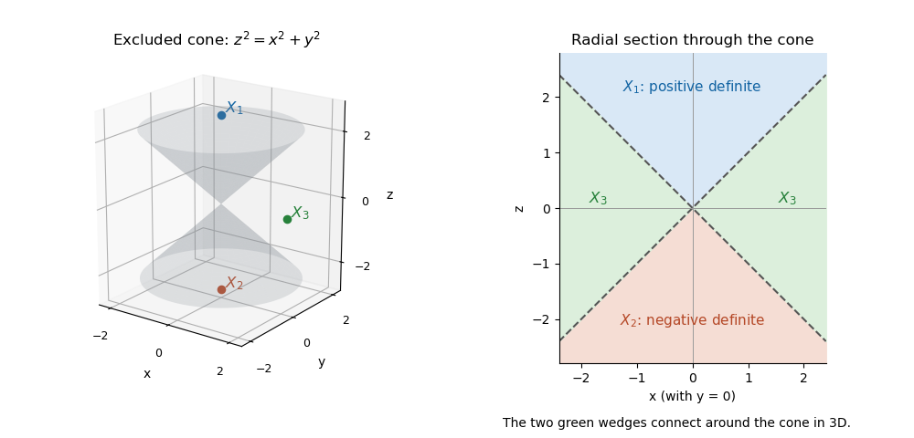

<h1 id="2/b/ii/solution">Solution</h1>

↑ **Parent:** [Ii](../ii.md)

On $X^+$, $z^2>x^2+y^2$, so $z\ne0$ and therefore $a=-2z\ne0$. Yet $a(I)=-2$ and $a(-I)=2$. The same [continuous image of a connected space](../../../../../continuous-image-of-a-connected-space.md) argument shows that **$X^+$ is not connected**.

Put $r=\sqrt{x^2+y^2}$. The required three disjoint nonempty open sets are

$$
\boxed{X_1=\{z>r\},\qquad X_2=\{z<-r\},\qquad X_3=\{|z|<r\}.}
$$

Their union is precisely $X$, the complement of the double cone $z^2=x^2+y^2$. The [eigenvalues](../../../../../eigenvalue.md) are $z\pm r$, so $X_1$ consists of [positive-definite matrices](../../../../../positive-definite-matrix.md) above the upper sheet, $X_2$ of [negative-definite matrices](../../../../../negative-definite-matrix.md) below the lower sheet, and $X_3$ of [indefinite matrices](../../../../../indefinite-matrix.md) outside the double cone. Examples are $I,-I,\operatorname{diag}(1,-1)$ respectively.

The two definite cones are [convex sets](../../../../../convex-set-split.md). The indefinite region is [path-connected](../../../../../path-connected-space.md): shrink $z$ continuously to zero while keeping $r>0$, then change the nonzero vector $(x,y)$ within the [punctured plane](../../../../../punctured-complex-plane.md). Thus these sets are also exactly the three [connected components](../../../../../connected-component.md). This is the [determinant cone for real symmetric two-by-two matrices](../../../../../determinant-cone-for-real-symmetric-two-by-two-matrices.md).

**[Figure 1](#2/b/ii/image-the-determinant-zero-cone-separates-three-components-of-invertible-symmetric-matrices). The determinant-zero cone separates three components of invertible symmetric matrices**. The left panel shows the double cone. The right panel is a radial section: the exterior indefinite region is connected around the cone in three dimensions, although its two sides appear separated in this section.

## ↑ Ancestors (13)

1. [Ii](../ii.md)
2. [B](../../b.md)
3. [2](../../../2.md)
4. [2017](../../../../2017-split.md)
5. [Past exam of the metric spaces and complex analysis course of the University of Oxford](../../../../split.md)
6. [Metric spaces and complex analysis course of the University of Oxford](../../../../../metric-spaces-and-complex-analysis-course-of-the-university-of-oxford.md)
7. [Year 2 of the mathematics course of the University of Oxford](../../../../../year-2-of-the-mathematics-course-of-the-university-of-oxford.md)
8. [Mathematics course of the University of Oxford](../../../../../mathematics-course-of-the-university-of-oxford.md)
9. [Undergraduate course of the University of Oxford](../../../../../undergraduate-course-of-the-university-of-oxford.md)
10. [Course of the University of Oxford](../../../../../course-of-the-university-of-oxford.md)
11. [University of Oxford](../../../../../university-of-oxford-split.md)
12. [List of universities](../../../../../list-of-universities.md)
13. [Codex Wiki](../../../../../split.md)
