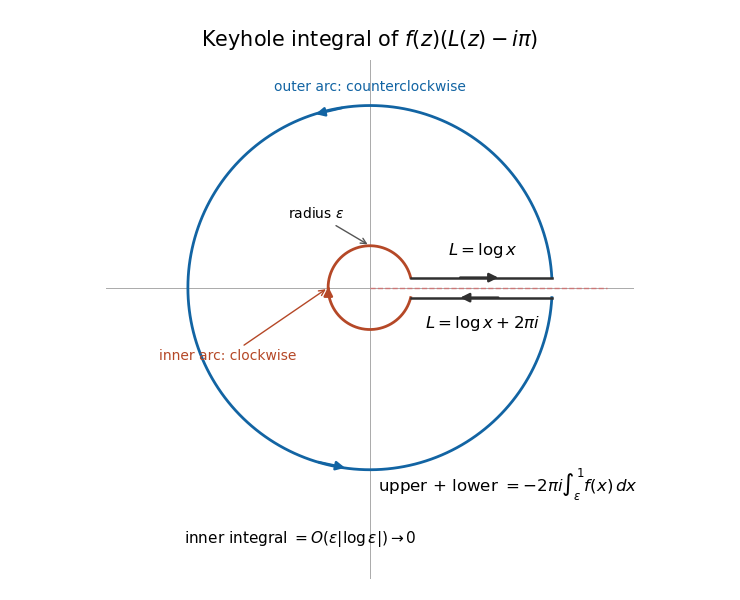

<h1 id="3/b/iii/solution">Solution</h1>

↑ **Parent:** [Iii](../iii.md)

Apply the [Cauchy integral theorem](../../../../../cauchy-s-integral-theorem.md) to $F(z)=f(z)(L(z)-i\pi)$ on the slit plane, which is star-shaped about $-1$. For fixed $\varepsilon>0$, first let $\delta\to0$. The upper bank is traversed from $\varepsilon$ to one and the lower bank from one to $\varepsilon$, so their limiting sum is

$$
\int_\varepsilon^1f(x)(\log x-i\pi)\,dx+\int_1^\varepsilon f(x)(\log x+i\pi)\,dx=-2\pi i\int_\varepsilon^1f(x)\,dx.
$$

The outer arc tends to the positively oriented unit-circle integral, interpreting the logarithm by its one-sided boundary values at the cut. On the inner arc, $|L-i\pi|\leq|\log\varepsilon|+\pi$ and $f$ is bounded near zero. Its integral is therefore $O(\varepsilon|\log\varepsilon|)$ and tends to zero. The sum of all four contour pieces is zero. Letting $\varepsilon\to0$ gives

$$
\boxed{\int_0^1f(x)\,dx=\frac1{2\pi i}\int_\phi f(z)(L(z)-i\pi)\,dz.}
$$

The integral around the full circle is a piecewise integral of the branch's boundary values; $L$ is not a single holomorphic function across the cut-crossing point. This is the [centred logarithmic keyhole identity](../../../../../centred-logarithmic-keyhole-identity.md).

**[Figure 2](#3/b/iii/image-the-logarithmic-jump-on-a-keyhole-contour-recovers-a-real-segment-integral). The logarithmic jump on a keyhole contour recovers a real-segment integral**. The upper and lower banks have opposite traversal directions and logarithmic boundary values differing by $2\pi i$. The small circle is traversed clockwise. The slit width is illustrative; its limit is taken before the inner radius tends to zero.

## ↑ Ancestors (13)

1. [Iii](../iii.md)
2. [B](../../b.md)
3. [3](../../../3.md)
4. [2017](../../../../2017-split.md)
5. [Past exam of the metric spaces and complex analysis course of the University of Oxford](../../../../split.md)
6. [Metric spaces and complex analysis course of the University of Oxford](../../../../../metric-spaces-and-complex-analysis-course-of-the-university-of-oxford.md)
7. [Year 2 of the mathematics course of the University of Oxford](../../../../../year-2-of-the-mathematics-course-of-the-university-of-oxford.md)
8. [Mathematics course of the University of Oxford](../../../../../mathematics-course-of-the-university-of-oxford.md)
9. [Undergraduate course of the University of Oxford](../../../../../undergraduate-course-of-the-university-of-oxford.md)
10. [Course of the University of Oxford](../../../../../course-of-the-university-of-oxford.md)
11. [University of Oxford](../../../../../university-of-oxford-split.md)
12. [List of universities](../../../../../list-of-universities.md)
13. [Codex Wiki](../../../../../split.md)
