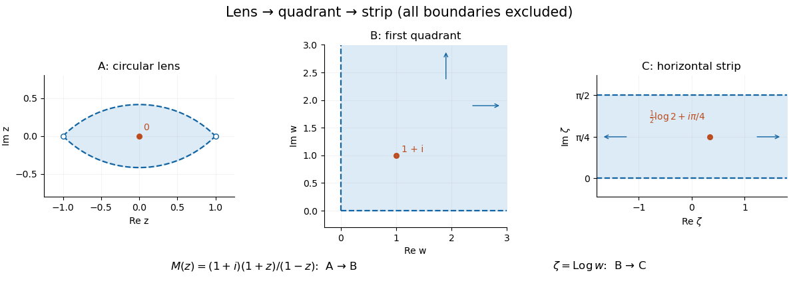

<h1 id="6/b/i/solution">Solution</h1>

↑ **Parent:** [I](../i.md)

The first region is the lens around zero bounded by the two circular arcs through $-1$ and $1$. Writing $z=x+iy$, its inequalities combine to $x^2+y^2+2|y|<1$. The second region is the open first quadrant, and the third is the open horizontal strip between imaginary parts zero and $\pi/2$.

Set $t=(1+z)/(1-z)=u+iv$. The inverse is $z=(t-1)/(t+1)$, and

$$
1-|z|^2=\frac{4u}{|t+1|^2},\qquad\operatorname{Im}z=\frac{2v}{|t+1|^2}.
$$

Hence the lens condition is exactly $u>|v|$. Multiplying by $1+i$ gives real part $u-v$ and imaginary part $u+v$, both positive exactly under that condition. Therefore

$$
\boxed{M(z)=(1+i)\frac{1+z}{1-z}}
$$

is a [Möbius transformation](../../../../../mobius-transformation.md) mapping the lens bijectively to the first quadrant. Its pole at one lies on the boundary, and its inverse is $z=(w-(1+i))/(w+(1+i))$, well-defined throughout the quadrant. The derivative $2(1+i)/(1-z)^2$ never vanishes in the lens. This is a [lens-to-quadrant Möbius map](../../../../../lens-to-quadrant-mobius-map.md).

**[Figure 3](#6/b/i/image-a-mobius-transformation-followed-by-a-logarithm-maps-the-lens-to-a-horizontal-strip). A Möbius transformation followed by a logarithm maps the lens to a horizontal strip**. The marked interior point travels from zero to $1+i$ to $(\log2)/2+i\pi/4$. Boundaries are excluded. Unbounded directions are indicated by arrows.

## ↑ Ancestors (13)

1. [I](../i.md)
2. [B](../../b.md)
3. [6](../../../6.md)
4. [2017](../../../../2017-split.md)
5. [Past exam of the metric spaces and complex analysis course of the University of Oxford](../../../../split.md)
6. [Metric spaces and complex analysis course of the University of Oxford](../../../../../metric-spaces-and-complex-analysis-course-of-the-university-of-oxford.md)
7. [Year 2 of the mathematics course of the University of Oxford](../../../../../year-2-of-the-mathematics-course-of-the-university-of-oxford.md)
8. [Mathematics course of the University of Oxford](../../../../../mathematics-course-of-the-university-of-oxford.md)
9. [Undergraduate course of the University of Oxford](../../../../../undergraduate-course-of-the-university-of-oxford.md)
10. [Course of the University of Oxford](../../../../../course-of-the-university-of-oxford.md)
11. [University of Oxford](../../../../../university-of-oxford-split.md)
12. [List of universities](../../../../../list-of-universities.md)
13. [Codex Wiki](../../../../../split.md)
