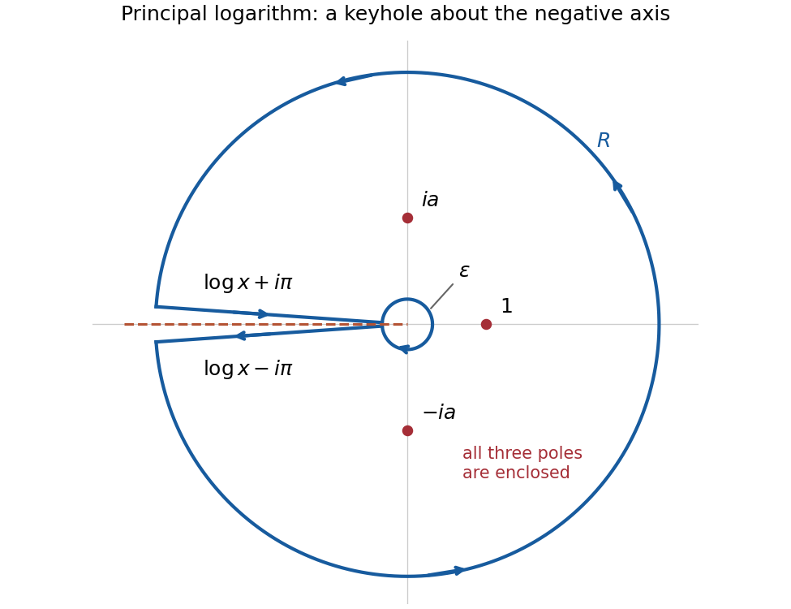
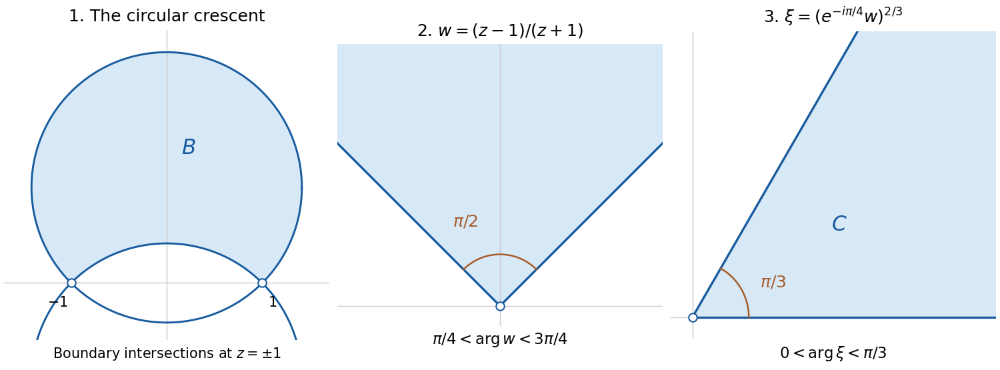

# 2021

↑ **Parent:** [Past exam of the metric spaces and complex analysis course of the University of Oxford](../past-exam-of-the-metric-spaces-and-complex-analysis-course-of-the-university-of-oxford.md)

Solutions to all six questions of the [University of Oxford](../university-of-oxford.md) Part A [metric space](../topological-analysis.md#metric-space) and [complex analysis](../complex-analysis.md) paper, sat on 14 June 2021. Source: [released examination PDF, compilation pages 54–58; paper pages 1–5](https://www.whatdotheyknow.com/request/bsc_mathematics_part_a_examinati/response/2820674/attach/3/FOI%20202410%20944%20Data.pdf#page=54). The examination counted the best four answers; all six are covered here. The printed request in 6(c)(i) is impossible for the stated planar domain: its solution proves this and gives the precise map obtained when the missing point at infinity is accounted for.

**Table of contents**

- [1](#1)
  - [a](#1/a)
    - [i](#1/a/i)
      - [Solution](#1/a/i/solution)
    - [ii](#1/a/ii)
      - [1](#1/a/ii/1)
        - [Solution](#1/a/ii/1/solution)
      - [2](#1/a/ii/2)
        - [Solution](#1/a/ii/2/solution)
      - [3](#1/a/ii/3)
        - [Solution](#1/a/ii/3/solution)
  - [b](#1/b)
    - [i](#1/b/i)
      - [Solution](#1/b/i/solution)
    - [ii](#1/b/ii)
      - [Solution](#1/b/ii/solution)
  - [c](#1/c)
    - [i](#1/c/i)
      - [Solution](#1/c/i/solution)
    - [ii](#1/c/ii)
      - [Solution](#1/c/ii/solution)
    - [iii](#1/c/iii)
      - [Solution](#1/c/iii/solution)
- [2](#2)
  - [a](#2/a)
    - [i](#2/a/i)
      - [Solution](#2/a/i/solution)
    - [ii](#2/a/ii)
      - [Solution](#2/a/ii/solution)
  - [b](#2/b)
    - [i](#2/b/i)
      - [Solution](#2/b/i/solution)
    - [ii](#2/b/ii)
      - [Solution](#2/b/ii/solution)
  - [c](#2/c)
    - [Solution](#2/c/solution)
  - [d](#2/d)
    - [i](#2/d/i)
      - [1](#2/d/i/1)
        - [Solution](#2/d/i/1/solution)
      - [2](#2/d/i/2)
        - [Solution](#2/d/i/2/solution)
    - [ii](#2/d/ii)
      - [Solution](#2/d/ii/solution)
    - [iii](#2/d/iii)
      - [Solution](#2/d/iii/solution)
- [3](#3)
  - [a](#3/a)
    - [i](#3/a/i)
      - [Solution](#3/a/i/solution)
    - [ii](#3/a/ii)
      - [Solution](#3/a/ii/solution)
    - [iii](#3/a/iii)
      - [Solution](#3/a/iii/solution)
    - [iv](#3/a/iv)
      - [Solution](#3/a/iv/solution)
  - [b](#3/b)
    - [Solution](#3/b/solution)
  - [c](#3/c)
    - [Solution](#3/c/solution)
- [4](#4)
  - [a](#4/a)
    - [Solution](#4/a/solution)
  - [b](#4/b)
    - [i](#4/b/i)
      - [Solution](#4/b/i/solution)
    - [ii](#4/b/ii)
      - [Solution](#4/b/ii/solution)
    - [iii](#4/b/iii)
      - [Solution](#4/b/iii/solution)
  - [c](#4/c)
    - [Solution](#4/c/solution)
- [5](#5)
  - [a](#5/a)
    - [i](#5/a/i)
      - [Solution](#5/a/i/solution)
    - [ii](#5/a/ii)
      - [Solution](#5/a/ii/solution)
    - [iii](#5/a/iii)
      - [Solution](#5/a/iii/solution)
  - [b](#5/b)
    - [Solution](#5/b/solution)
- [6](#6)
  - [a](#6/a)
    - [i](#6/a/i)
      - [Solution](#6/a/i/solution)
    - [ii](#6/a/ii)
      - [Solution](#6/a/ii/solution)
  - [b](#6/b)
    - [i](#6/b/i)
      - [Solution](#6/b/i/solution)
    - [ii](#6/b/ii)
      - [Solution](#6/b/ii/solution)
  - [c](#6/c)
    - [i](#6/c/i)
      - [Solution](#6/c/i/solution)
    - [ii](#6/c/ii)
      - [Solution](#6/c/ii/solution)
  - [d](#6/d)
    - [Solution](#6/d/solution)

## 1

↑ **Parent:** [2021](2021.md)

<h3 id="1/a">a</h3>

↑ **Parent:** [1](#1)

<h4 id="1/a/i">i</h4>

↑ **Parent:** [a](#1/a)

<h5 id="1/a/i/solution">Solution</h5>

↑ **Parent:** [i](#1/a/i)

A [metric space](../topological-analysis.md#metric-space) $(X,d)$ is a [complete metric space](../topological-analysis.md#complete-metric-space) if every [Cauchy sequence](../sequence-and-series.md#cauchy-sequence) in $X$ converges to a point of $X$. Explicitly, the hypothesis is

$$
\forall\varepsilon>0\ \exists N\ \forall m,n\geq N:\ d(x_m,x_n)<\varepsilon,
$$

and the conclusion is that some $x\in X$ satisfies $d(x_n,x)\to0$.

It is a [sequentially compact space](../geometry-and-topology.md#sequentially-compact-space) if every [sequence](../sequence-and-series.md#sequence) in $X$ has a [convergent subsequence](../real-analysis.md#convergent-subsequence) whose [limit of a sequence](../sequence-and-series.md#limit-of-a-sequence) belongs to $X$.

It is a [connected space](../geometry-and-topology.md#connected-space) if there are no disjoint nonempty [open subsets](../topology.md#open-set) $U,V$ of $X$ with $X=U\cup V$. Here openness refers to the [metric topology](../topological-analysis.md#metric-topology) of $X$.

It is a [path-connected space](../geometry-and-topology.md#path-connected-space) if, for every $x,y\in X$, there is a [continuous map](../topology.md#continuous-map) $\gamma:[0,1]\to X$ with $\gamma(0)=x$ and $\gamma(1)=y$. Such a map is a [path](../geometry-and-topology.md#continuous-path). Every [path-connected space](../geometry-and-topology.md#path-connected-space) is a [connected space](../geometry-and-topology.md#connected-space): a separation would pull back along a [path](../geometry-and-topology.md#continuous-path) joining its two sides to a separation of the [interval](../real-analysis.md#interval-mathematics) $[0,1]$.

<h4 id="1/a/ii">ii</h4>

↑ **Parent:** [a](#1/a)

<h5 id="1/a/ii/1">1</h5>

↑ **Parent:** [ii](#1/a/ii)

<h6 id="1/a/ii/1/solution">Solution</h6>

↑ **Parent:** [1](#1/a/ii/1)

The answers, in the order [completeness](../topological-analysis.md#completeness), [sequential compactness](../geometry-and-topology.md#sequentially-compact-space), [connectedness](../geometry-and-topology.md#connected-space), and [path connectedness](../geometry-and-topology.md#path-connected-space), are

$$
\boxed{\text{yes, no, yes, yes}.}
$$

Define $F(0)=0$ and $F(x)=\sqrt{x}\sin(1/x)$ for $x>0$. The estimate $|F(x)|\leq\sqrt{x}$ proves [continuity](../calculus.md#continuous-function) at zero by the [squeeze theorem](../calculus.md#squeeze-theorem); elsewhere it follows from the usual [continuous functions](../calculus.md#continuous-function). Thus $X$ is the [graph of a function](../function.md#graph-of-a-function) $F$ on the [closed set](../topology.md#closed-set) $[0,\infty)$.

To check closedness directly, if $(x_n,F(x_n))\to(x,y)$ in the [Euclidean plane](../geometry-and-topology.md#euclidean-plane), then $x\geq0$ and [continuity](../calculus.md#continuous-function) gives $y=F(x)$. Therefore $X$ is a [closed subset](../topology.md#closed-set) of the [complete metric space](../topological-analysis.md#complete-metric-space) $\mathbb R^2$, hence is a [complete metric space](../topological-analysis.md#complete-metric-space). The [sequence](../sequence-and-series.md#sequence) $(n,F(n))$ has no [convergent subsequence](../real-analysis.md#convergent-subsequence), since its first [Cartesian coordinates](../linear-algebra.md#cartesian-coordinate-system) tends to infinity, so [sequential compactness](../geometry-and-topology.md#sequentially-compact-space) fails.

For any two points $(u,F(u)),(v,F(v))$, the map

$$
\gamma(s)=\bigl((1-s)u+sv,F((1-s)u+sv)\bigr),\qquad 0\leq s\leq1,
$$

is a [continuous path](../geometry-and-topology.md#continuous-path) in $X$ joining them. Thus $X$ is [path-connected](../geometry-and-topology.md#path-connected-space), and consequently [connected](../geometry-and-topology.md#connected-space). The factor $\sqrt{x}$ is crucial: the oscillations shrink to the single point $(0,0)$.

<h5 id="1/a/ii/2">2</h5>

↑ **Parent:** [ii](#1/a/ii)

<h6 id="1/a/ii/2/solution">Solution</h6>

↑ **Parent:** [2](#1/a/ii/2)

The answers are

$$
\boxed{\text{yes, no, no, no}.}
$$

Distinct [natural numbers](../arithmetic.md#natural-number) have $d(x,y)>1$. Taking $\varepsilon=1$ in the [Cauchy sequence](../sequence-and-series.md#cauchy-sequence) condition forces every sufficiently late pair of terms to be equal. Every [Cauchy sequence](../sequence-and-series.md#cauchy-sequence) is therefore eventually constant and converges in $\mathbb N$, proving [completeness](../topological-analysis.md#completeness).

The [sequence](../sequence-and-series.md#sequence) $x_n=n$ has no [convergent subsequence](../real-analysis.md#convergent-subsequence), since convergence would force its sufficiently late terms to lie within distance $1$ of its [limit of a sequence](../sequence-and-series.md#limit-of-a-sequence), hence to equal that limit. Thus [sequential compactness](../geometry-and-topology.md#sequentially-compact-space) fails.

Every [singleton](../set.md#singleton-mathematics) is an [open ball](../topology.md#open-ball) of radius $1$, so the [metric topology](../topological-analysis.md#metric-topology) is the [discrete topology](../topology.md#discrete-space). For example, $\{1\}$ and $\mathbb N\setminus\{1\}$ form a separation into two nonempty [open sets](../topology.md#open-set), so $X$ is not [connected](../geometry-and-topology.md#connected-space). It is consequently not [path-connected](../geometry-and-topology.md#path-connected-space) either.

<h5 id="1/a/ii/3">3</h5>

↑ **Parent:** [ii](#1/a/ii)

<h6 id="1/a/ii/3/solution">Solution</h6>

↑ **Parent:** [3](#1/a/ii/3)

The answers are

$$
\boxed{\text{yes, no, yes, yes}.}
$$

Write $M_n(f,g)=\sup_{0\leq t\leq n}|f(t)-g(t)|$. The given [metric](../topological-analysis.md#metric) describes [locally uniform convergence](../sequence-and-series.md#locally-uniform-convergence): $d(f_j,f)\to0$ if and only if $M_n(f_j,f)\to0$ for every fixed $n$. Indeed,

$$
2^{-n}\min\{M_n(f_j,f),1\}\leq d(f_j,f),
$$

so convergence in $d$ forces $M_n\to0$. Conversely, split the defining [series](../sequence-and-series.md#series-mathematics) at $N$: its tail is at most $\sum_{n>N}2^{-n}=2^{-N}$, and its finitely many initial terms tend to zero.

If $(f_j)$ is a [Cauchy sequence](../sequence-and-series.md#cauchy-sequence) in $d$, the same single-term estimate makes it a [Cauchy sequence](../sequence-and-series.md#cauchy-sequence) in the [supremum norm](../normed-vector-space.md#supremum-norm) on every $[0,n]$. The [completeness of the continuous-map space in the uniform metric](../topological-analysis.md#completeness-of-the-continuous-map-space-in-the-uniform-metric) gives a [continuous function](../calculus.md#continuous-function) $F_n$ on $[0,n]$ with $f_j\to F_n$ uniformly there. Uniqueness of the [limit of a sequence](../sequence-and-series.md#limit-of-a-sequence) gives $F_{n+1}|_{[0,n]}=F_n$, so these [functions](../function.md) define a single [continuous function](../calculus.md#continuous-function) $f$ on $[0,\infty)$. The preceding finite-head and tail argument proves $d(f_j,f)\to0$. Thus the space is [complete](../topological-analysis.md#completeness).

The constant [functions](../function.md) $f_j(t)=j$ have $d(f_j,f_k)=1$ whenever $j\ne k$. They have no [convergent subsequence](../real-analysis.md#convergent-subsequence), so the space is not [sequentially compact](../geometry-and-topology.md#sequentially-compact-space).

For fixed $f,g$, set $\gamma(s)=(1-s)f+sg$. On $[0,n]$,

$$
M_n(\gamma(s),\gamma(s'))=|s-s'|M_n(f,g)\longrightarrow0
$$

as $s'\to s$. The equivalence with [locally uniform convergence](../sequence-and-series.md#locally-uniform-convergence) proves that $\gamma$ is a [continuous path](../geometry-and-topology.md#continuous-path) for $d$. Hence the space is [path-connected](../geometry-and-topology.md#path-connected-space) and [connected](../geometry-and-topology.md#connected-space).

<h3 id="1/b">b</h3>

↑ **Parent:** [1](#1)

<h4 id="1/b/i">i</h4>

↑ **Parent:** [b](#1/b)

<h5 id="1/b/i/solution">Solution</h5>

↑ **Parent:** [i](#1/b/i)

The [inverse tangent](../geometry-and-topology.md#inverse-tangent) $T(x)=\arctan x$ is a [homeomorphism](../topology.md#homeomorphism) from the [real line](../real-analysis.md#real-line) with its [Euclidean metric](../riemannian-metric.md#euclidean-metric) onto $I=(-\pi/2,\pi/2)$ with its [subspace topology](../topology.md#subspace-topology): $T$ and its inverse $\tan$ are [continuous](../calculus.md#continuous-function). It is also an [isometry](../riemannian-geometry.md#isometry) from $(\mathbb R,\rho)$ onto $I$, because $\rho(x,y)=|T(x)-T(y)|$. Consequently, for $U\subseteq\mathbb R$,

$$
\boxed{U\text{ is }d\text{-open}\iff T(U)\text{ is open in }I\iff U\text{ is }\rho\text{-open}.}
$$

For a direct [open ball](../topology.md#open-ball) interpretation, $B_\rho(x,r)=T^{-1}((T(x)-r,T(x)+r)\cap I)$ is $d$-open by [continuity](../calculus.md#continuous-function) of $T$. Conversely, [continuity](../calculus.md#continuous-function) of $\tan$ at $T(x)$ supplies a sufficiently small $\rho$-ball inside any prescribed $d$-ball about $x$. Thus both [metrics](../topological-analysis.md#metric) generate exactly the same [open sets](../topology.md#open-set).

<h4 id="1/b/ii">ii</h4>

↑ **Parent:** [b](#1/b)

<h5 id="1/b/ii/solution">Solution</h5>

↑ **Parent:** [ii](#1/b/ii)

The [arctangent pullback metric](../topological-analysis.md#arctangent-pullback-metric) is not [complete](../topological-analysis.md#completeness). Take $x_n=n$. Since $\arctan n\to\pi/2$, its transformed [sequence](../sequence-and-series.md#sequence) is [Cauchy](../sequence-and-series.md#cauchy-sequence), and hence $(x_n)$ is a [Cauchy sequence](../sequence-and-series.md#cauchy-sequence) for $\rho$. If it converged in $\rho$ to $x\in\mathbb R$, then

$$
|\arctan n-\arctan x|\longrightarrow0
$$

would force $\arctan x=\pi/2$, which is impossible. The missing endpoint of $I$ explains the failure of [completeness](../topological-analysis.md#completeness), even though part (i) shows that the [metric topologies](../topological-analysis.md#metric-topology) agree.

<h3 id="1/c">c</h3>

↑ **Parent:** [1](#1)

<h4 id="1/c/i">i</h4>

↑ **Parent:** [c](#1/c)

<h5 id="1/c/i/solution">Solution</h5>

↑ **Parent:** [i](#1/c/i)

Extend the coefficient lists of each [polynomial](../polynomial.md) by zeros. Then $\rho(p,q)=\sum_{k\geq0}|a_k-b_k|$ is finite because only finitely many terms are nonzero. It is nonnegative and symmetric. Moreover, $\rho(p,q)=0$ holds exactly when every coefficient agrees, which by uniqueness of [polynomial coefficients](../polynomial.md#coefficient-of-a-polynomial) is equivalent to $p=q$.

If $r(t)=\sum c_kt^k$, the [triangle inequality](../topological-analysis.md#triangle-inequality) for the [absolute value](../real-analysis.md#absolute-value) gives

$$
\rho(p,r)=\sum_k|a_k-c_k|\leq\sum_k\bigl(|a_k-b_k|+|b_k-c_k|\bigr)=\rho(p,q)+\rho(q,r).
$$

Thus $\rho$ satisfies all the [metric](../topological-analysis.md#metric) axioms. It is the [metric](../topological-analysis.md#metric) induced by the [polynomial coefficient sum norm](../normed-vector-space.md#polynomial-coefficient-sum-norm).

<h4 id="1/c/ii">ii</h4>

↑ **Parent:** [c](#1/c)

<h5 id="1/c/ii/solution">Solution</h5>

↑ **Parent:** [ii](#1/c/ii)

The space of [polynomials](../polynomial.md) is not [complete](../topological-analysis.md#completeness) for the [supremum norm](../normed-vector-space.md#supremum-norm) [metric](../topological-analysis.md#metric) $d$. Consider

$$
p_n(t)=\sum_{k=0}^n(t/2)^k.
$$

The [geometric series](../sequence-and-series.md#geometric-series) has sum $F(t)=1/(1-t/2)$, and for $0\leq t\leq1$ its tail satisfies

$$
|F(t)-p_n(t)|=\frac{(t/2)^{n+1}}{1-t/2}\leq2^{-n}.
$$

Thus $(p_n)$ converges uniformly to $F$ and is a [Cauchy sequence](../sequence-and-series.md#cauchy-sequence) for $d$.

There is no [polynomial](../polynomial.md) $p$ agreeing with $F$ on $[0,1]$: otherwise the [polynomial](../polynomial.md) $(1-t/2)p(t)-1$ would vanish at infinitely many points and therefore be the zero [polynomial](../polynomial.md). Evaluating this identity at $t=2$ gives $-1=0$. By uniqueness of the [uniform limit](../sequence-and-series.md#uniform-limit), $(p_n)$ has no limit in $X$. This proves the claimed failure of [completeness](../topological-analysis.md#completeness).

<h4 id="1/c/iii">iii</h4>

↑ **Parent:** [c](#1/c)

<h5 id="1/c/iii/solution">Solution</h5>

↑ **Parent:** [iii](#1/c/iii)

For $0\leq t\leq1$, the [triangle inequality](../topological-analysis.md#triangle-inequality) gives

$$
|p_n(t)-p(t)|\leq\sum_k|a_{n,k}-a_k|t^k\leq\sum_k|a_{n,k}-a_k|=\rho(p_n,p).
$$

Taking the [supremum](../real-analysis.md#supremum) proves $\boxed{d(p_n,p)\leq\rho(p_n,p)}$. Hence convergence for $\rho$ implies convergence for $d$.

The converse is false. For $n\geq1$, take $q_n(t)=(1-t)^n/n$ and $p=0$. Its [supremum norm](../normed-vector-space.md#supremum-norm) is $d(q_n,0)=1/n\to0$, whereas the [binomial theorem](../binomial-coefficient.md#binomial-theorem) gives

$$
\rho(q_n,0)=\frac1n\sum_{k=0}^n\binom nk=\frac{2^n}{n}\longrightarrow\infty.
$$

The alternating coefficients cancel on $[0,1]$; the [polynomial coefficient sum norm](../normed-vector-space.md#polynomial-coefficient-sum-norm) measures their [absolute values](../real-analysis.md#absolute-value) before any cancellation.

<h2 id="2">2</h2>

↑ **Parent:** [2021](2021.md)

<h3 id="2/a">a</h3>

↑ **Parent:** [2](#2)

<h4 id="2/a/i">i</h4>

↑ **Parent:** [a](#2/a)

<h5 id="2/a/i/solution">Solution</h5>

↑ **Parent:** [i](#2/a/i)

A [norm](../normed-vector-space.md#norm) on a real [vector space](../vector-space.md) $X$ is a map $\|\cdot\|:X\to[0,\infty)$ such that, for $x,y\in X$ and $\lambda\in\mathbb R$,

$$
\|x\|=0\iff x=0,\qquad \|\lambda x\|=|\lambda|\|x\|,\qquad \|x+y\|\leq\|x\|+\|y\|.
$$

The last property is the [triangle inequality](../topological-analysis.md#triangle-inequality); the middle property is [absolute homogeneity of a norm](../normed-vector-space.md#absolute-homogeneity-of-a-norm). The induced [metric](../topological-analysis.md#metric) is

$$
\boxed{d(x,y)=\|x-y\|.}
$$

Positivity and separation follow from the [norm](../normed-vector-space.md#norm) axioms, symmetry from [absolute homogeneity of a norm](../normed-vector-space.md#absolute-homogeneity-of-a-norm) with $\lambda=-1$, and the [triangle inequality](../topological-analysis.md#triangle-inequality) from $x-z=(x-y)+(y-z)$.

<h4 id="2/a/ii">ii</h4>

↑ **Parent:** [a](#2/a)

<h5 id="2/a/ii/solution">Solution</h5>

↑ **Parent:** [ii](#2/a/ii)

First verify that $V_0$ is a [vector space](../vector-space.md). Sums and scalar multiples preserve [continuity](../calculus.md#continuous-function) and the condition at zero. For every [partition of an interval](../real-analysis.md#partition-of-an-interval) $D$, the [triangle inequality](../topological-analysis.md#triangle-inequality) and [absolute homogeneity of a norm](../normed-vector-space.md#absolute-homogeneity-of-a-norm) of the [absolute value](../real-analysis.md#absolute-value) imply

$$
V(f+g,D)\leq V(f,D)+V(g,D),\qquad V(\lambda f,D)=|\lambda|V(f,D).
$$

Taking [suprema](../real-analysis.md#supremum) yields

$$
V(f+g)\leq V(f)+V(g),\qquad V(\lambda f)=|\lambda|V(f).
$$

For $\lambda=0$ the second equality follows directly from $V(0)=0$. In particular, [finite variation](../real-analysis.md#total-variation-of-a-function) is preserved, so $V_0$ is closed under these operations.

Nonnegativity is immediate. For any $t\in[0,1]$, use the [partition of an interval](../real-analysis.md#partition-of-an-interval) $(0,t,1)$, omitting repeated endpoints if necessary, to get

$$
|f(t)|=|f(t)-f(0)|\leq V(f).
$$

Thus $V(f)=0$ forces $f=0$, and conversely $f=0$ has zero [total variation of a function](../real-analysis.md#total-variation-of-a-function). These observations prove that $\|f\|=V(f)$ is a [norm](../normed-vector-space.md#norm) on $V_0$.

Applying the same bound to $f_n-f$ gives

$$
\boxed{\|f_n-f\|_\infty\leq V(f_n-f)=\|f_n-f\|.}
$$

Therefore convergence in the [anchored variation norm](../real-analysis.md#anchored-variation-norm) implies [uniform convergence](../sequence-and-series.md#uniform-convergence) on $[0,1]$. The anchoring condition $f(0)=0$ removes the nonzero constant [functions](../function.md) which otherwise have zero [total variation of a function](../real-analysis.md#total-variation-of-a-function).

<h3 id="2/b">b</h3>

↑ **Parent:** [2](#2)

<h4 id="2/b/i">i</h4>

↑ **Parent:** [b](#2/b)

<h5 id="2/b/i/solution">Solution</h5>

↑ **Parent:** [i](#2/b/i)

Both properties are preserved by a [continuous map](../topology.md#continuous-map).

For [sequential compactness](../geometry-and-topology.md#sequentially-compact-space), take any [sequence](../sequence-and-series.md#sequence) $(y_n)$ in $f(X)$ and choose $x_n\in X$ with $f(x_n)=y_n$. If $X$ is [sequentially compact](../geometry-and-topology.md#sequentially-compact-space), some [subsequence](../sequence-and-series.md#subsequence) satisfies $x_{n_k}\to x\in X$. By [continuity](../calculus.md#continuous-function), $y_{n_k}=f(x_{n_k})\to f(x)\in f(X)$. Hence $f(X)$ is a [sequentially compact space](../geometry-and-topology.md#sequentially-compact-space).

For [connectedness](../geometry-and-topology.md#connected-space), suppose instead that $f(X)=U\cup V$ is a separation into disjoint nonempty relatively [open sets](../topology.md#open-set). Then $f^{-1}(U)$ and $f^{-1}(V)$ are disjoint nonempty [open sets](../topology.md#open-set) of $X$ whose union is $X$, contradicting [connectedness](../geometry-and-topology.md#connected-space). Therefore $f(X)$ is a [connected space](../geometry-and-topology.md#connected-space).

<h4 id="2/b/ii">ii</h4>

↑ **Parent:** [b](#2/b)

<h5 id="2/b/ii/solution">Solution</h5>

↑ **Parent:** [ii](#2/b/ii)

We prove [uniform continuity](../topological-analysis.md#uniform-continuity) by contradiction. If it fails, there is $\varepsilon_0>0$ such that, for every $n\geq1$, we can choose $x_n,y_n\in X$ with

$$
d(x_n,y_n)<1/n,\qquad \rho(f(x_n),f(y_n))\geq\varepsilon_0.
$$

By [sequential compactness](../geometry-and-topology.md#sequentially-compact-space), pass to a [subsequence](../sequence-and-series.md#subsequence) with $x_{n_k}\to x\in X$. The [triangle inequality](../topological-analysis.md#triangle-inequality) gives

$$
d(y_{n_k},x)\leq d(y_{n_k},x_{n_k})+d(x_{n_k},x)\longrightarrow0.
$$

By [continuity](../calculus.md#continuous-function), both $f(x_{n_k})$ and $f(y_{n_k})$ converge to $f(x)$. A second [triangle inequality](../topological-analysis.md#triangle-inequality) therefore gives

$$
\rho(f(x_{n_k}),f(y_{n_k}))\leq\rho(f(x_{n_k}),f(x))+\rho(f(x),f(y_{n_k}))\longrightarrow0,
$$

contradicting the lower bound. Thus the requested $\delta$, independent of $x,y$, exists for every $\varepsilon>0$.

<h3 id="2/c">c</h3>

↑ **Parent:** [2](#2)

<h4 id="2/c/solution">Solution</h4>

↑ **Parent:** [c](#2/c)

We first show that a [continuous injection](../topology.md#continuous-injection) $j:S^1\to S^1$ must be [surjective](../algebra.md#surjective-function). Otherwise its [image](../set-theory.md#image-of-a-function) misses a point $q$. [Stereographic projection](../riemann-surfaces.md#stereographic-projection) identifies $S^1\setminus\{q\}$ with $\mathbb R$, giving a [continuous injection](../topology.md#continuous-injection) $u:S^1\to\mathbb R$. The [extreme value theorem](../real-analysis.md#extreme-value-theorem) supplies distinct points $p_-,p_+$ where $u$ attains its minimum $m$ and maximum $M$, with $m<M$ because $u$ is [injective](../algebra.md#injective-function).

The two [circular arcs](../topology.md#circular-arc) from $p_-$ to $p_+$ each contain a point at which $u=(m+M)/2$, by the [intermediate value theorem](../calculus.md#intermediate-value-theorem). Those points are distinct because they lie in the disjoint interiors of the two arcs. This contradicts [injectivity](../algebra.md#injective-function), proving the claim about $j$.

Now suppose $F:S^2\to S^1$ were a [continuous injection](../topology.md#continuous-injection). Its restriction to the equatorial [circle](../topology.md#circle) $E=\{(x,y,0):x^2+y^2=1\}$ would be a [continuous injection](../topology.md#continuous-injection) from $S^1$ to itself, hence $F(E)=S^1$. The north pole $N=(0,0,1)$ is outside $E$, but $F(N)$ must equal $F(e)$ for some $e\in E$. This contradicts [injectivity](../algebra.md#injective-function). Therefore

$$
\boxed{\text{there is no continuous injection }S^2\longrightarrow S^1.}
$$

<h3 id="2/d">d</h3>

↑ **Parent:** [2](#2)

<h4 id="2/d/i">i</h4>

↑ **Parent:** [d](#2/d)

<h5 id="2/d/i/1">1</h5>

↑ **Parent:** [i](#2/d/i)

<h6 id="2/d/i/1/solution">Solution</h6>

↑ **Parent:** [1](#2/d/i/1)

Assume condition (1). For fixed $a$, the [supremum](../real-analysis.md#supremum)

$$
M_a(r)=\sup_{x\in B(a,r)}f(x)
$$

is nondecreasing as $r$ increases. Therefore its limit as $r\downarrow0$ exists in the extended [real numbers](../arithmetic.md#real-number) and equals $\inf_{r>0}M_a(r)$. Because $a\in B(a,r)$, it is at least $f(a)$. Condition (1) says precisely that this limit is $f(a)$.

It follows that for every $\varepsilon>0$ there is $r>0$ with $M_a(r)<f(a)+\varepsilon$. Fix $C\in\mathbb R$ and $a$ with $f(a)<C$. Taking $\varepsilon=C-f(a)$ produces an [open ball](../topology.md#open-ball) on which $f(x)<C$. Thus $\{x:f(x)<C\}$ is an [open set](../topology.md#open-set), and its [complement](../set.md#complement-of-a-set)

$$
\boxed{\{x:f(x)\geq C\}\text{ is a closed set}.}
$$

This proves (1) implies (2). The property being characterized is [upper semicontinuity](../calculus.md#upper-semicontinuity).

<h5 id="2/d/i/2">2</h5>

↑ **Parent:** [i](#2/d/i)

<h6 id="2/d/i/2/solution">Solution</h6>

↑ **Parent:** [2](#2/d/i/2)

Assume condition (2). Fix $a\in X$ and $\varepsilon>0$. The [superlevel set](../topology.md#superlevel-set)

$$
F=\{x:f(x)\geq f(a)+\varepsilon\}
$$

is a [closed set](../topology.md#closed-set) and does not contain $a$. Its [complement](../set.md#complement-of-a-set) is therefore an [open](../topology.md#open-set) [neighbourhood](../topology.md#neighbourhood-mathematics) of $a$, so some [open ball](../topology.md#open-ball) $B(a,r)$ avoids $F$. Consequently $f(x)<f(a)+\varepsilon$ throughout that ball, giving

$$
M_a(r)\leq f(a)+\varepsilon.
$$

The same bound holds for every smaller radius. Taking $r\downarrow0$ and then $\varepsilon\downarrow0$ yields

$$
\boxed{\lim_{r\downarrow0}\sup_{x\in B(a,r)}f(x)\leq f(a).}
$$

Together with the previous implication this proves the equivalence. A [supremum](../real-analysis.md#supremum) may equal $f(a)+\varepsilon$ even when every individual value is strictly smaller; the non-strict estimate here handles that possibility.

<h4 id="2/d/ii">ii</h4>

↑ **Parent:** [d](#2/d)

<h5 id="2/d/ii/solution">Solution</h5>

↑ **Parent:** [ii](#2/d/ii)

If $f$ is [continuous](../calculus.md#continuous-function) at $a$, then for every $\varepsilon>0$ there is $r_0>0$ such that $d(x,a)<r_0$ implies $|f(x)-f(a)|<\varepsilon$. In particular, for $0<r\leq r_0$,

$$
f(a)\leq\sup_{x\in B(a,r)}f(x)\leq f(a)+\varepsilon.
$$

The [squeeze theorem](../calculus.md#squeeze-theorem) gives

$$
\boxed{\lim_{r\downarrow0}\sup_{x\in B(a,r)}f(x)=f(a),}
$$

which implies condition (1). Thus [continuity](../calculus.md#continuous-function) implies [upper semicontinuity](../calculus.md#upper-semicontinuity).

<h4 id="2/d/iii">iii</h4>

↑ **Parent:** [d](#2/d)

<h5 id="2/d/iii/solution">Solution</h5>

↑ **Parent:** [iii](#2/d/iii)

Apply the local bound from condition (1) separately to $f$ and $-f$. For any $a\in X$ and $\varepsilon>0$, there are $r_+,r_->0$ such that

$$
d(x,a)<r_+\implies f(x)<f(a)+\varepsilon,\qquad d(x,a)<r_-\implies -f(x)<-f(a)+\varepsilon.
$$

With $\delta=\min\{r_+,r_-\}$, both inequalities hold when $d(x,a)<\delta$, so

$$
f(a)-\varepsilon<f(x)<f(a)+\varepsilon.
$$

This is exactly [continuity](../calculus.md#continuous-function) at $a$. Since $a$ was arbitrary, $f$ is [continuous](../calculus.md#continuous-function) on $X$: [upper semicontinuity](../calculus.md#upper-semicontinuity) of $f$ and of $-f$ is equivalent to simultaneous [upper semicontinuity](../calculus.md#upper-semicontinuity) and [lower semicontinuity](../calculus.md#lower-semicontinuity) of $f$.

<h2 id="3">3</h2>

↑ **Parent:** [2021](2021.md)

<h3 id="3/a">a</h3>

↑ **Parent:** [3](#3)

<h4 id="3/a/i">i</h4>

↑ **Parent:** [a](#3/a)

<h5 id="3/a/i/solution">Solution</h5>

↑ **Parent:** [i](#3/a/i)

The [hyperbolic sine](../calculus.md#hyperbolic-sine) satisfies $\sinh z=(e^z-e^{-z})/2$. The [complex exponential function](../calculus.md#complex-exponential-function) is [entire](../holomorphic-function.md#entire-function), and sums and compositions of [entire functions](../holomorphic-function.md#entire-function) are [entire](../holomorphic-function.md#entire-function). Therefore

$$
\boxed{\sinh z\text{ is holomorphic on all of }\mathbb C,\qquad (\sinh z)'=\cosh z.}
$$

<h4 id="3/a/ii">ii</h4>

↑ **Parent:** [a](#3/a)

<h5 id="3/a/ii/solution">Solution</h5>

↑ **Parent:** [ii](#3/a/ii)

The zeros of the [hyperbolic sine](../calculus.md#hyperbolic-sine) are exactly $z=k\pi i$, $k\in\mathbb Z$, since $\sinh z=0$ is equivalent to $e^{2z}=1$. Each zero is simple because $\cosh(k\pi i)=(-1)^k\ne0$. The quotient is therefore [holomorphic](../holomorphic-function.md) precisely on

$$
\boxed{\mathbb C\setminus\{k\pi i:k\in\mathbb Z\}.}
$$

At zero, the [Taylor expansion](../calculus.md#taylor-expansion) $\sinh z=z+O(z^3)$ gives $z/\sinh^2z=1/z+O(z)$, so zero is a [simple pole](../isolated-singularity.md#simple-pole). At $k\pi i\ne0$, the denominator has a double zero and the numerator is nonzero, giving a [pole](../isolated-singularity.md#pole) of order two. Thus none of the omitted points admits a [holomorphic extension](../holomorphic-function.md#holomorphic-extension).

<h4 id="3/a/iii">iii</h4>

↑ **Parent:** [a](#3/a)

<h5 id="3/a/iii/solution">Solution</h5>

↑ **Parent:** [iii](#3/a/iii)

The denominator vanishes exactly when $e^z=-1$, namely at $z=(2k+1)\pi i$, $k\in\mathbb Z$. Its [derivative](../calculus.md#derivative) there is $e^z=-1\ne0$, so each such zero is simple and the numerator does not cancel it. Hence

$$
\boxed{\frac1{1+e^z}\text{ is holomorphic on }\mathbb C\setminus\{(2k+1)\pi i:k\in\mathbb Z\},}
$$

and every omitted point is a [simple pole](../isolated-singularity.md#simple-pole).

<h4 id="3/a/iv">iv</h4>

↑ **Parent:** [a](#3/a)

<h5 id="3/a/iv/solution">Solution</h5>

↑ **Parent:** [iv](#3/a/iv)

Let $F(z)=\overline{\sinh z}$. More generally, for a [holomorphic function](../holomorphic-function.md) $h$, the increment expansion at $z_0$ gives

$$
\frac{\overline{h(z_0+w)}-\overline{h(z_0)}}w=\overline{h'(z_0)}\frac{\overline w}w+o(1).
$$

Along real increments $w$ the first factor $\overline w/w$ is $1$, while along purely imaginary increments it is $-1$. Thus [complex differentiability](../holomorphic-function.md#complex-differentiability) of $\overline h$ requires $h'(z_0)=0$. Conversely, if $h'(z_0)=0$, the displayed expression tends to zero for arbitrary complex increments, so the [complex derivative](../holomorphic-function.md#complex-derivative) exists and equals zero.

For $h=\sinh$, this condition is $\cosh z_0=0$, equivalent to $e^{2z_0}=-1$. Consequently

$$
\boxed{F\text{ is complex differentiable exactly at }z_0=(k+\tfrac12)\pi i,\quad F'(z_0)=0.}
$$

These points form a [discrete subset](../topology.md#discrete-subset) of the [complex plane](../complex-analysis.md#complex-plane) and contain no nonempty [open set](../topology.md#open-set). Every [neighbourhood](../topology.md#neighbourhood-mathematics) of each one contains points where $F$ is not [complex differentiable](../holomorphic-function.md#complex-differentiability). Therefore $F$ is [holomorphic](../holomorphic-function.md) on no nonempty [open set](../topology.md#open-set), even though it has [complex derivatives](../holomorphic-function.md#complex-derivative) at the specified points.

<h3 id="3/b">b</h3>

↑ **Parent:** [3](#3)

<h4 id="3/b/solution">Solution</h4>

↑ **Parent:** [b](#3/b)

The [identity theorem](../complex-analysis.md#identity-theorem) states that if two [holomorphic functions](../holomorphic-function.md) on a [connected](../geometry-and-topology.md#connected-space) [open set](../topology.md#open-set) agree at a [sequence](../sequence-and-series.md#sequence) of distinct points with an [accumulation point](../topology.md#limit-point) inside that set, then they agree everywhere on it. Equivalently, the zeros of a [holomorphic function](../holomorphic-function.md) which is not identically zero cannot accumulate inside its [domain](../topology.md#domain-mathematical-analysis).

Because $f,g$ never vanish, their [logarithmic derivatives](../analytic-number-theory.md#logarithmic-derivative) are [holomorphic](../holomorphic-function.md). The [holomorphic function](../holomorphic-function.md)

$$
H=\frac{f'}f-\frac{g'}g
$$

vanishes at every $a_n$. Since the distinct $a_n$ converge to $a\in U$, the [identity theorem](../complex-analysis.md#identity-theorem) gives $H\equiv0$. Applying the [quotient rule](../calculus.md#quotient-rule) now gives

$$
\left(\frac fg\right)'=\frac{f'g-fg'}{g^2}=\frac fg\left(\frac{f'}f-\frac{g'}g\right)=0.
$$

A [holomorphic function](../holomorphic-function.md) with zero [derivative](../calculus.md#derivative) on a [domain](../topology.md#domain-mathematical-analysis) is constant. One can see this locally from its [Taylor series](../calculus.md#taylor-series), then propagate the constant using [connectedness](../geometry-and-topology.md#connected-space). Hence $f/g=c$ on $U$, with $c\ne0$, and

$$
\boxed{f=cg\text{ on }U.}
$$

The conclusion can fail if the accumulation occurs outside $U$. Take the [punctured complex plane](../riemann-surfaces.md#punctured-complex-plane) $U=\mathbb C\setminus\{0\}$ and

$$
f(z)=\exp(\cos(1/z)),\qquad g(z)=1,\qquad a_n=\frac1{n\pi}\quad(n\geq1).
$$

Both [functions](../function.md) are nowhere vanishing and [holomorphic](../holomorphic-function.md) on $U$, and $a_n\to0\notin U$. The [chain rule](../calculus.md#chain-rule) gives

$$
\frac{f'(z)}{f(z)}=\frac{\sin(1/z)}{z^2},\qquad \frac{g'(z)}{g(z)}=0,
$$

so these [logarithmic derivatives](../analytic-number-theory.md#logarithmic-derivative) agree at every $a_n$. However, $f$ is not constant: for example $f(1/\pi)=e^{-1}$ and $f(1/(2\pi))=e$. Therefore no constant $c$ gives $f=cg$.

<h3 id="3/c">c</h3>

↑ **Parent:** [3](#3)

<h4 id="3/c/solution">Solution</h4>

↑ **Parent:** [c](#3/c)

On the slit [domain](../topology.md#domain-mathematical-analysis) $D$, choose the [complex argument](../complex-analysis.md#argument-complex-analysis) $\theta=\operatorname{Arg}_{(0,2\pi)}z$. The resulting [holomorphic logarithm](../complex-analysis.md#holomorphic-logarithm) is $L(z)=\log|z|+i\theta$, with $L'(z)=1/z$. Define

$$
\boxed{f(z)=\exp\bigl(\tfrac12L(z)\bigr)=\sqrt{|z|}\,e^{i\theta/2}.}
$$

It is [holomorphic](../holomorphic-function.md) as a composition of [holomorphic functions](../holomorphic-function.md), and $f(z)^2=e^{L(z)}=z$. At $z=-1$ the chosen [argument](../complex-analysis.md#argument-complex-analysis) is $\pi$, so $f(-1)=i$.

Suppose a [holomorphic square root](../complex-analysis.md#holomorphic-square-root) $g$ existed on the whole [punctured complex plane](../riemann-surfaces.md#punctured-complex-plane). It would be nonzero, and differentiating $g^2=z$ would give $2gg'=1$. There are several ways to express the resulting obstruction; a direct one uses the [unit circle](../complex-analysis.md#complex-unit-circle). Set

$$
q(t)=e^{-it/2}g(e^{it}),\qquad 0\leq t\leq2\pi.
$$

The [chain rule](../calculus.md#chain-rule) and $g'(z)=g(z)/(2z)$ imply $q'(t)=0$, so $q$ is constant. But

$$
q(0)=g(1),\qquad q(2\pi)=-g(1).
$$

These cannot agree because $g(1)^2=1$. Thus no such global [holomorphic square root](../complex-analysis.md#holomorphic-square-root) exists. Going once around zero changes the sign of the locally chosen root.

## 4

↑ **Parent:** [2021](2021.md)

<h3 id="4/a">a</h3>

↑ **Parent:** [4](#4)

<h4 id="4/a/solution">Solution</h4>

↑ **Parent:** [a](#4/a)

The [Cauchy derivative formula](../complex-analysis.md#cauchy-derivative-formula) says that if $f$ is [holomorphic](../holomorphic-function.md) on a [neighbourhood](../topology.md#neighbourhood-mathematics) of a closed [disk](../topology.md#disk-mathematics) and $z_0$ is inside its positively oriented boundary [circle](../topology.md#circle) $\gamma$, then for $n\geq0$,

$$
\boxed{f^{(n)}(z_0)=\frac{n!}{2\pi i}\int_\gamma\frac{f(z)}{(z-z_0)^{n+1}}\,dz.}
$$

For $n=0$ this is the [Cauchy integral formula](../analysis.md#cauchy-integral-formula). The same formula holds for a positively oriented simple closed [contour](../complex-analysis.md#complex-integration-contour) when $f$ is [holomorphic](../holomorphic-function.md) on a [neighbourhood](../topology.md#neighbourhood-mathematics) of the contour and its enclosed region.

In the present problem the [unit circle](../complex-analysis.md#complex-unit-circle) and its closed interior lie inside $|z|<R$. Parametrize it by $z=e^{it}$, $0\leq t\leq2\pi$, so $dt=dz/(iz)$. For a positive integer $n$,

$$
\begin{aligned}
\int_0^{2\pi}f(e^{it})\cos(nt)\,dt
&=\frac1{2i}\int_{|z|=1}f(z)\bigl(z^{n-1}+z^{-n-1}\bigr)\,dz\\
&=\frac1{2i}\left(0+\frac{2\pi i}{n!}f^{(n)}(0)\right).
\end{aligned}
$$

The first [contour integral](../complex-analysis.md#contour-integral) is zero by the [Cauchy integral theorem](../complex-analysis.md#cauchy-s-integral-theorem), since $f(z)z^{n-1}$ is [holomorphic](../holomorphic-function.md) on the [disk](../topology.md#disk-mathematics); the second is evaluated by the [Cauchy derivative formula](../complex-analysis.md#cauchy-derivative-formula). Therefore

$$
\boxed{\int_0^{2\pi}f(e^{it})\cos(nt)\,dt=\frac{\pi}{n!}f^{(n)}(0),\qquad n\geq1.}
$$

Taking $n=1$ gives the requested $\pi f'(0)$.

<h3 id="4/b">b</h3>

↑ **Parent:** [4](#4)

<h4 id="4/b/i">i</h4>

↑ **Parent:** [b](#4/b)

<h5 id="4/b/i/solution">Solution</h5>

↑ **Parent:** [i](#4/b/i)

The expression is $F(z)=e^{z^2+1/z}=e^{z^2}e^{1/z}$, which is [holomorphic](../holomorphic-function.md) for every $z\ne0$. At zero,

$$
e^{1/z}=\sum_{n=0}^\infty\frac{z^{-n}}{n!}
$$

has infinitely many nonzero negative-power terms, so it has an [essential singularity](../isolated-singularity.md#essential-singularity). Multiplication by the nonvanishing [entire function](../holomorphic-function.md#entire-function) $e^{z^2}$ preserves that classification: if $F$ had a [removable singularity](../isolated-singularity.md#removable-singularity) or a [pole](../isolated-singularity.md#pole), multiplying by $e^{-z^2}$ would give the same type for $e^{1/z}$, a contradiction. Hence

$$
\boxed{0\text{ is the only finite singularity, and it is essential}.}
$$

<h4 id="4/b/ii">ii</h4>

↑ **Parent:** [b](#4/b)

<h5 id="4/b/ii/solution">Solution</h5>

↑ **Parent:** [ii](#4/b/ii)

The only possible finite [singularities](../complex-analysis.md#complex-singularity) are $z_\pm=\pm i\pi/2$, the zeros of $4z^2+\pi^2$. They are simple zeros of the denominator, because its [derivative](../calculus.md#derivative) $8z_\pm$ is nonzero. They are also simple zeros of the numerator: $\cosh z_\pm=0$ and $\sinh z_\pm=\pm i\ne0$.

The common simple factors cancel, so both points are [removable singularities](../isolated-singularity.md#removable-singularity), with extension values

$$
\boxed{\lim_{z\to z_\pm}\frac{\cosh z}{4z^2+\pi^2}=\frac{\sinh z_\pm}{8z_\pm}=\frac1{4\pi}.}
$$

There are no other finite [singularities](../complex-analysis.md#complex-singularity); after inserting these two values the [function](../function.md) is [entire](../holomorphic-function.md#entire-function).

<h4 id="4/b/iii">iii</h4>

↑ **Parent:** [b](#4/b)

<h5 id="4/b/iii/solution">Solution</h5>

↑ **Parent:** [iii](#4/b/iii)

For $z\ne0$, the denominator vanishes exactly when $1/z=(2k+1)\pi i$. Thus set

$$
z_k=\frac1{(2k+1)\pi i},\qquad k\in\mathbb Z.
$$

Each denominator zero is simple, since

$$
\left(e^{1/z}+1\right)'\big|_{z=z_k}=-\frac{e^{1/z_k}}{z_k^2}=\frac1{z_k^2}\ne0.
$$

Every $z_k$ is purely imaginary and nonzero. The identity $\sin(iy)=i\sinh y$ for real $y$ shows $\sin z_k\ne0$, so there is no cancellation. Each $z_k$ is consequently a [simple pole](../isolated-singularity.md#simple-pole), with [residue](../analysis.md#residue) $z_k^2\sin z_k$.

These [poles](../isolated-singularity.md#pole) accumulate at zero. Therefore

$$
\boxed{z_k\text{ are simple poles, and }0\text{ is a non-isolated singularity}.}
$$

In particular, zero has no punctured [neighbourhood](../topology.md#neighbourhood-mathematics) on which the [function](../function.md) is [holomorphic](../holomorphic-function.md), so it cannot be classified as a [removable singularity](../isolated-singularity.md#removable-singularity), a [pole](../isolated-singularity.md#pole), or an isolated [essential singularity](../isolated-singularity.md#essential-singularity). There are no other finite [singularities](../complex-analysis.md#complex-singularity).

<h3 id="4/c">c</h3>

↑ **Parent:** [4](#4)

<h4 id="4/c/solution">Solution</h4>

↑ **Parent:** [c](#4/c)

For $a\ne b$, integrate

$$
F(z)=\frac{e^{iz}}{(z^2+a^2)(z^2+b^2)}
$$

along the [contour](../complex-analysis.md#complex-integration-contour) consisting of $[-R,R]$ and the upper [semicircle](../topology.md#semicircle), with [positive orientation of a contour](../complex-analysis.md#positive-orientation-of-a-contour) and $R>\max\{a,b\}$. Its enclosed [simple poles](../isolated-singularity.md#simple-pole) are $ia$ and $ib$, with [residues](../analysis.md#residue)

$$
\operatorname{Res}(F,ia)=\frac{e^{-a}}{2ia(b^2-a^2)},\qquad
\operatorname{Res}(F,ib)=\frac{e^{-b}}{2ib(a^2-b^2)}.
$$

On the upper [semicircle](../topology.md#semicircle), $|e^{iz}|=e^{-\operatorname{Im}z}\leq1$. The [reverse triangle inequality](../topological-analysis.md#reverse-triangle-inequality) gives $|z^2+a^2|\geq R^2-a^2$ and $|z^2+b^2|\geq R^2-b^2$, so the [estimation lemma](../complex-analysis.md#estimation-lemma) gives

$$
\left|\int_{\mathrm{arc}}F(z)\,dz\right|\leq\frac{\pi R}{(R^2-a^2)(R^2-b^2)}\longrightarrow0.
$$

The [integral](../integral.md) along the [real axis](../complex-analysis.md#real-axis) is absolutely convergent: the denominator stays nonzero on bounded real [intervals](../real-analysis.md#interval-mathematics), and the integrand is $O(x^{-4})$ at infinity. The [residue theorem](../analysis.md#residue-theorem) therefore gives

$$
\int_{-\infty}^{\infty}\frac{e^{ix}}{(x^2+a^2)(x^2+b^2)}\,dx
=\frac{\pi}{a^2-b^2}\left(\frac{e^{-b}}b-\frac{e^{-a}}a\right).
$$

Take [real parts](../complex-analysis.md#real-part). The real integrand is an [even function](../calculus.md#even-function), so

$$
\boxed{\int_0^\infty\frac{\cos x}{(x^2+a^2)(x^2+b^2)}\,dx
=\frac{\pi}{2(a^2-b^2)}\left(\frac{e^{-b}}b-\frac{e^{-a}}a\right).}
$$

To include $a=b$, fix $a>0$ and let $b\to a$. For $a/2\leq b\leq3a/2$, the [absolute value](../real-analysis.md#absolute-value) of the integrand is bounded by

$$
\frac1{(x^2+a^2)(x^2+a^2/4)},
$$

an integrable [function](../function.md) on $[0,\infty)$. The [dominated convergence theorem](../measure-theory.md#dominated-convergence-theorem) justifies passing the limit under the [integral](../integral.md). If $h(t)=e^{-t}/t$, then $h'(a)=-e^{-a}(a+1)/a^2$, and

$$
\lim_{b\to a}\frac{h(b)-h(a)}{a^2-b^2}=-\frac{h'(a)}{2a}=\frac{e^{-a}(a+1)}{2a^3}.
$$

Hence

$$
\boxed{\int_0^\infty\frac{\cos x}{(x^2+a^2)^2}\,dx=\frac{\pi e^{-a}(a+1)}{4a^3}.}
$$

## 5

↑ **Parent:** [2021](2021.md)

<h3 id="5/a">a</h3>

↑ **Parent:** [5](#5)

<h4 id="5/a/i">i</h4>

↑ **Parent:** [a](#5/a)

<h5 id="5/a/i/solution">Solution</h5>

↑ **Parent:** [i](#5/a/i)

Start with the [partial fraction decomposition](../isolated-singularity.md#partial-fraction-decomposition)

$$
\frac1{(z+1)(z-2)}=-\frac1{3(z+1)}+\frac1{3(z-2)}.
$$

For $1<|z|<2$, expand the first fraction in negative powers and the second in nonnegative powers using the [geometric series](../sequence-and-series.md#geometric-series):

$$
\frac1{z+1}=\sum_{n=0}^\infty(-1)^nz^{-n-1},\qquad
\frac1{z-2}=-\sum_{n=0}^\infty\frac{z^n}{2^{n+1}}.
$$

Thus the [Laurent expansion](../analysis.md#laurent-series) on this [annulus](../topology.md#annulus-mathematics) is

$$
\boxed{\frac1{(z+1)(z-2)}=-\frac13\sum_{n=0}^\infty(-1)^nz^{-n-1}-\frac13\sum_{n=0}^\infty\frac{z^n}{2^{n+1}},\qquad1<|z|<2.}
$$

For $|z|>2$, both fractions expand in negative powers:

$$
\frac1{z-2}=\sum_{n=0}^\infty2^nz^{-n-1}.
$$

Combining the two [geometric series](../sequence-and-series.md#geometric-series) gives

$$
\boxed{\frac1{(z+1)(z-2)}=\frac13\sum_{n=0}^\infty\bigl(2^n-(-1)^n\bigr)z^{-n-1},\qquad|z|>2.}
$$

The $z^{-1}$ coefficient is zero, consistently with the original [rational function](../isolated-singularity.md#rational-function) being $O(z^{-2})$ at infinity. Each displayed [series](../sequence-and-series.md#series-mathematics) converges absolutely on its stated [annulus](../topology.md#annulus-mathematics) and uniformly on every [compact subset](../topology.md#compact-space) of that [annulus](../topology.md#annulus-mathematics).

<h4 id="5/a/ii">ii</h4>

↑ **Parent:** [a](#5/a)

<h5 id="5/a/ii/solution">Solution</h5>

↑ **Parent:** [ii](#5/a/ii)

The [Liouville theorem](../complex-analysis.md#liouville-theorem) states that every bounded [entire function](../holomorphic-function.md#entire-function) is constant.

By the [Laurent theorem](../analysis.md#laurent-theorem), $f$ has a unique [Laurent series](../analysis.md#laurent-series) $f(z)=\sum_{n=-\infty}^\infty c_nz^n$ on $R<|z|<S$. Split it into

$$
\boxed{g(z)=\sum_{n=0}^\infty c_nz^n,\qquad h(z)=\sum_{m=1}^\infty c_{-m}z^{-m}.}
$$

Here $g$ is [holomorphic](../holomorphic-function.md) on $D_S$ and $h$ is [holomorphic](../holomorphic-function.md) on $A_{R,\infty}$. To check their extended regions of convergence explicitly, fix $r\in(R,S)$ and put $M_r=\max_{|z|=r}|f(z)|$. The [Laurent coefficient](../analysis.md#laurent-coefficient) formula gives

$$
|c_n|\leq M_rr^{-n}\quad(n\geq0),\qquad |c_{-m}|\leq M_rr^m\quad(m\geq1).
$$

The first bound ensures convergence uniformly on every closed [disk](../topology.md#disk-mathematics) $|z|\leq r'<r$; letting $r$ range up to $S$ covers $D_S$. The second gives convergence uniformly on $|z|\geq r''>r$; letting $r$ range down to $R$ covers $A_{R,\infty}$. Locally uniform convergence of these [power series](../sequence-and-series.md#power-series), in $z$ and $1/z$ respectively, proves the claimed [holomorphy](../holomorphic-function.md). On the original [annulus](../topology.md#annulus-mathematics) their sum is $f$.

The second estimate also proves $h(z)\to0$ as $|z|\to\infty$: for any fixed $r\in(R,S)$ and $|z|>r$,

$$
|h(z)|\leq M_r\sum_{m=1}^\infty(r/|z|)^m=\frac{M_rr}{|z|-r}\longrightarrow0.
$$

For uniqueness under this condition, suppose $f=g_1+h_1=g_2+h_2$. Define $F=g_1-g_2$ on $D_S$ and $F=h_2-h_1$ on $A_{R,\infty}$. The two definitions agree on the overlap, and their [domains](../topology.md#domain-mathematical-analysis) cover $\mathbb C$, so they define an [entire function](../holomorphic-function.md#entire-function). Moreover, $F(z)\to0$ at infinity. It is bounded outside a large [disk](../topology.md#disk-mathematics) by this limit, and inside by [continuity](../calculus.md#continuous-function) and the [extreme value theorem](../real-analysis.md#extreme-value-theorem). The [Liouville theorem](../complex-analysis.md#liouville-theorem) makes $F$ constant, and its limit makes that constant zero. Hence $g_1=g_2$ and $h_1=h_2$. Without the limiting condition, adding a constant to $g$ and subtracting it from $h$ would preserve the decomposition.

<h4 id="5/a/iii">iii</h4>

↑ **Parent:** [a](#5/a)

<h5 id="5/a/iii/solution">Solution</h5>

↑ **Parent:** [iii](#5/a/iii)

Suppose $w\in\mathbb C$ were omitted by $g$. Then

$$
F(z)=\frac1{g(z)-w}
$$

would be an [entire function](../holomorphic-function.md#entire-function). The [reverse triangle inequality](../topological-analysis.md#reverse-triangle-inequality) gives $|g(z)-w|\geq|g(z)|-|w|\to\infty$ as $|z|\to\infty$, so $F(z)\to0$ there. On a sufficiently large closed [disk](../topology.md#disk-mathematics), $F$ is bounded by [continuity](../calculus.md#continuous-function) and the [extreme value theorem](../real-analysis.md#extreme-value-theorem); outside it, the limit gives a bound. The [Liouville theorem](../complex-analysis.md#liouville-theorem) therefore makes $F$ constant, and the limit forces $F\equiv0$.

That is impossible, since $1/(g(z)-w)$ is nonzero at every finite $z$. No value $w$ can be omitted, and hence

$$
\boxed{g\text{ is surjective onto }\mathbb C.}
$$

<h3 id="5/b">b</h3>

↑ **Parent:** [5](#5)

<h4 id="5/b/solution">Solution</h4>

↑ **Parent:** [b](#5/b)

Use the [principal logarithm](../analysis.md#principal-complex-logarithm) $\operatorname{Log}z=\log|z|+i\operatorname{Arg}z$ with $-\pi<\operatorname{Arg}z<\pi$, whose [branch cut](../analysis.md#branch-cut) is the negative [real axis](../complex-analysis.md#real-axis). For this choice,

$$
F(z)=\frac1{(z^2+a^2)\operatorname{Log}z}
$$

has three [simple poles](../isolated-singularity.md#simple-pole) away from the cut: $z=1$, $z=ia$, and $z=-ia$. The pole at $1$, caused by $\operatorname{Log}1=0$, must be included.

Choose $0<\varepsilon<\min\{1,a\}$ and $R>\max\{1,a\}$, and use a positively oriented [keyhole contour](../complex-analysis.md#keyhole-contour) around the negative [real axis](../complex-analysis.md#real-axis): the large [circle](../topology.md#circle) is traversed counterclockwise, the upper bank from $-R$ to $-\varepsilon$, the small [circle](../topology.md#circle) clockwise, and the lower bank from $-\varepsilon$ to $-R$. Formally, use radial segments at [arguments](../complex-analysis.md#argument-complex-analysis) $\pm(\pi-\eta)$, then let $\eta\downarrow0$ with $R,\varepsilon$ fixed. The [function](../function.md) has continuous limiting values on each compact bank, which justifies this limit.

**[Figure 1](#5/b/image-keyhole-contour-around-the-negative-real-axis-including-the-logarithm-s-pole-at-1). Keyhole contour around the negative real axis, including the logarithm's pole at 1**.

Put $L=\log a$. The [residues](../analysis.md#residue) are

$$
\operatorname{Res}(F,1)=\frac1{1+a^2},\qquad
\operatorname{Res}(F,ia)=\frac1{2ia(L+i\pi/2)},\qquad
\operatorname{Res}(F,-ia)=-\frac1{2ia(L-i\pi/2)}.
$$

The first follows from $\operatorname{Log}z=(z-1)+O((z-1)^2)$; the other two follow from the simple zeros of $z^2+a^2$. Their sum is

$$
\Sigma=\frac1{1+a^2}-\frac{\pi}{2a(L^2+\pi^2/4)}.
$$

These expressions are valid also for $a=1$, since $L\pm i\pi/2$ never vanish for real $L$.

On the outer [circle](../topology.md#circle), $|\operatorname{Log}z|\geq\log R$ for $R>1$ and $|z^2+a^2|\geq R^2-a^2$. On the inner [circle](../topology.md#circle), $|\operatorname{Log}z|\geq|\log\varepsilon|$ and $|z^2+a^2|\geq a^2-\varepsilon^2$. Thus the [estimation lemma](../complex-analysis.md#estimation-lemma) bounds the two arc [integrals](../integral.md) by

$$
\frac{2\pi R}{(R^2-a^2)\log R}\longrightarrow0,\qquad
\frac{2\pi\varepsilon}{(a^2-\varepsilon^2)|\log\varepsilon|}\longrightarrow0,
$$

respectively, as $R\to\infty$ and $\varepsilon\downarrow0$.

On the upper bank, $z=-x+i0$ gives $\operatorname{Log}z=\log x+i\pi$; on the lower bank it gives $\log x-i\pi$. Accounting for the opposite orientations, their combined [integral](../integral.md) is

$$
\begin{aligned}
\int_\varepsilon^R\frac1{x^2+a^2}\left(\frac1{\log x+i\pi}-\frac1{\log x-i\pi}\right)\,dx
&=-2\pi i\int_\varepsilon^R\frac{dx}{(x^2+a^2)((\log x)^2+\pi^2)}.
\end{aligned}
$$

The real [improper integral](../real-analysis.md#improper-integral) converges: its integrand is bounded near zero by $1/(a^2\pi^2)$ and at infinity by $1/(\pi^2x^2)$. Taking the arc limits in the [residue theorem](../analysis.md#residue-theorem) gives $-2\pi i I=2\pi i\Sigma$, hence

$$
\boxed{\int_0^\infty\frac{dx}{(x^2+a^2)((\log x)^2+\pi^2)}
=\frac{\pi}{2a((\log a)^2+\pi^2/4)}-\frac1{1+a^2}.}
$$

The final subtraction is exactly the contribution of the pole at $1$.

## 6

↑ **Parent:** [2021](2021.md)

<h3 id="6/a">a</h3>

↑ **Parent:** [6](#6)

<h4 id="6/a/i">i</h4>

↑ **Parent:** [a](#6/a)

<h5 id="6/a/i/solution">Solution</h5>

↑ **Parent:** [i](#6/a/i)

The [Riemann mapping theorem](../riemann-surfaces.md#riemann-mapping-theorem) gives a [conformal bijection](../riemann-surfaces.md#biholomorphism) $G\to D$ exactly when

$$
\boxed{G\ne\mathbb C,}
$$

given the hypothesis that $G$ is a [simply connected domain](../complex-analysis.md#simply-connected-domain). A [domain](../topology.md#domain-mathematical-analysis) is nonempty, [open](../topology.md#open-set), and [connected](../geometry-and-topology.md#connected-space), so no extra nonemptiness qualification is needed.

For necessity, a [conformal bijection](../riemann-surfaces.md#biholomorphism) $\mathbb C\to D$ would be a bounded nonconstant [entire function](../holomorphic-function.md#entire-function), contradicting the [Liouville theorem](../complex-analysis.md#liouville-theorem). For sufficiency, $G$ is a proper [simply connected domain](../complex-analysis.md#simply-connected-domain), exactly the hypothesis of the [Riemann mapping theorem](../riemann-surfaces.md#riemann-mapping-theorem).

<h4 id="6/a/ii">ii</h4>

↑ **Parent:** [a](#6/a)

<h5 id="6/a/ii/solution">Solution</h5>

↑ **Parent:** [ii](#6/a/ii)

Use the [univalent functions](../complex-analysis.md#univalent-function) on $D$, namely the [univalent functions](../complex-analysis.md#univalent-function) $F:D\to\mathbb C$. Each has nonzero [derivative](../calculus.md#derivative), so its [image](../set-theory.md#image-of-a-function) $F(D)$ is a [domain](../topology.md#domain-mathematical-analysis) [conformally equivalent](../geometry-and-topology.md#conformal-equivalence) to $D$, and is therefore [simply connected](../algebraic-topology.md#simply-connected-space). This [image](../set-theory.md#image-of-a-function) is proper: otherwise $F^{-1}:\mathbb C\to D$ would be a bounded nonconstant [entire function](../holomorphic-function.md#entire-function), contrary to the [Liouville theorem](../complex-analysis.md#liouville-theorem).

Conversely, every proper [simply connected domain](../complex-analysis.md#simply-connected-domain) $G\subset\mathbb C$ is $F(D)$ for some such $F$, by taking the inverse of a [Riemann mapping theorem](../riemann-surfaces.md#riemann-mapping-theorem) bijection. Thus these [functions](../function.md) parameterize all proper [simply connected domains](../complex-analysis.md#simply-connected-domain) by their images. The [complex plane](../complex-analysis.md#complex-plane) itself is the exceptional [simply connected domain](../complex-analysis.md#simply-connected-domain) and must be listed separately.

The parameterization has redundancy: two [univalent functions](../complex-analysis.md#univalent-function) $F_1,F_2$ have the same [image](../set-theory.md#image-of-a-function) if and only if $F_2=F_1\circ\phi$ for an [automorphism of the unit disk](../topology.md#automorphism-of-the-unit-disk) $\phi$. All such [automorphisms](../algebra.md#automorphism) have the form

$$
\phi(z)=e^{i\theta}\frac{z-\alpha}{1-\overline\alpha z},\qquad |\alpha|<1,\quad\theta\in\mathbb R.
$$

If an interior point $w_0\in G$ is prescribed, the normalization $F(0)=w_0$ and $F'(0)>0$ real removes this redundancy. Equivalently one can describe these maps through their convergent [Taylor series](../calculus.md#taylor-series) on $D$, imposing [univalence](../complex-analysis.md#univalent-function) on the resulting [holomorphic functions](../holomorphic-function.md).

<h3 id="6/b">b</h3>

↑ **Parent:** [6](#6)

<h4 id="6/b/i">i</h4>

↑ **Parent:** [b](#6/b)

<h5 id="6/b/i/solution">Solution</h5>

↑ **Parent:** [i](#6/b/i)

Write $\Delta=ad-bc>0$. For real $a,b,c,d$ and $z\in H$, the denominator cannot vanish: if $c\ne0$ its zero $-d/c$ is real, and if $c=0$ then $d\ne0$. Taking the [imaginary part](../complex-analysis.md#imaginary-part) after multiplying by $\overline{cz+d}$ gives

$$
\boxed{\operatorname{Im}\frac{az+b}{cz+d}=\frac{\Delta\operatorname{Im}z}{|cz+d|^2}>0.}
$$

Thus $f(H)\subseteq H$. Also

$$
f'(z)=\frac\Delta{(cz+d)^2}\ne0,
$$

so it is [conformal](../geometry-and-topology.md#conformal-map). Cross-multiplication shows that $f(z_1)=f(z_2)$ implies $\Delta(z_1-z_2)=0$, proving [injectivity](../algebra.md#injective-function).

The inverse [Möbius transformation](../group-theory.md#mobius-transformation) is

$$
f^{-1}(w)=\frac{dw-b}{-cw+a}.
$$

Its coefficients are real and its [determinant](../multilinear-algebra.md#determinant) is again $\Delta>0$, so the same [imaginary part](../complex-analysis.md#imaginary-part) identity shows that it maps $H$ into $H$. Therefore every $w\in H$ has a preimage in $H$, proving [surjectivity](../algebra.md#surjective-function). Hence $f$ maps $H$ one-to-one and onto itself.

<h4 id="6/b/ii">ii</h4>

↑ **Parent:** [b](#6/b)

<h5 id="6/b/ii/solution">Solution</h5>

↑ **Parent:** [ii](#6/b/ii)

The prescribed [pole](../isolated-singularity.md#pole) lets us choose $c=4$ and $d=-5-3i$. Write $f(z)=(Az+B)/(4z-5-3i)$. Fixing $1/2$ and $2$ gives

$$
A+2B=-3-3i,\qquad 2A+B=6-6i,
$$

so $A=5-3i$ and $B=-4$. Thus

$$
\boxed{f(z)=\frac{(5-3i)z-4}{4z-5-3i}.}
$$

Its [determinant](../multilinear-algebra.md#determinant) is $-18\ne0$, so it is a genuine [Möbius transformation](../group-theory.md#mobius-transformation). Direct substitution gives $f(1/2)=1/2$, $f(2)=2$, and a pole at $(5+3i)/4$; the numerator at that pole is $9/2\ne0$.

To identify the [image](../set-theory.md#image-of-a-function) of the [unit disc](../topology.md#unit-disc), put

$$
\alpha=\frac4{5-3i}=\frac{10+6i}{17},\qquad
\lambda=-\frac{5-3i}{5+3i}.
$$

Then $|\alpha|^2=8/17<1$, $|\lambda|=1$, and

$$
f(z)=\lambda\frac{z-\alpha}{1-\overline\alpha z}.
$$

In particular, its pole is outside the closed [unit disc](../topology.md#unit-disc). The identity

$$
1-|f(z)|^2=\frac{(1-|\alpha|^2)(1-|z|^2)}{|1-\overline\alpha z|^2}
$$

shows $f(D)\subseteq D$. For any $|w|<1$, solve $w=\lambda(z-\alpha)/(1-\overline\alpha z)$ to get

$$
z=\frac{w/\lambda+\alpha}{1+\overline\alpha w/\lambda}.
$$

Its denominator is nonzero, and the same [modulus](../complex-analysis.md#modulus) identity for this inverse gives $|z|<1$. Thus $f(D)=D$, and global [injectivity](../algebra.md#injective-function) of a [Möbius transformation](../group-theory.md#mobius-transformation) proves the required one-to-one correspondence.

<h3 id="6/c">c</h3>

↑ **Parent:** [6](#6)

<h4 id="6/c/i">i</h4>

↑ **Parent:** [c](#6/c)

<h5 id="6/c/i/solution">Solution</h5>

↑ **Parent:** [i](#6/c/i)

**There is no such map for the domain printed in the paper.** The planar [domain](../topology.md#domain-mathematical-analysis) $A=\mathbb C\setminus[a,b]$ is not [simply connected](../algebraic-topology.md#simply-connected-space). For example, a sufficiently large positively oriented [circle](../topology.md#circle) $\gamma$ surrounds $[a,b]$ and lies in $A$, while

$$
\int_\gamma\frac{dz}{z-a}=2\pi i\ne0.
$$

The integrand is [holomorphic](../holomorphic-function.md) on $A$. If $A$ were [simply connected](../algebraic-topology.md#simply-connected-space), the [Cauchy integral theorem](../complex-analysis.md#cauchy-s-integral-theorem) would force this [integral](../integral.md) to be zero. A [conformal bijection](../riemann-surfaces.md#biholomorphism) is a [homeomorphism](../topology.md#homeomorphism) and preserves [simple connectivity](../algebraic-topology.md#simply-connected-space), whereas $H$ is [simply connected](../algebraic-topology.md#simply-connected-space). Thus a [conformal bijection](../riemann-surfaces.md#biholomorphism) $A\to H$ is impossible.

The explicit construction also pinpoints the missing point. Define

$$
T(z)=\frac{z-a}{z-b}.
$$

This [Möbius transformation](../group-theory.md#mobius-transformation) sends the removed [line segment](../convex-set.md#line-segment) to the nonpositive [real axis](../complex-analysis.md#real-axis), together with infinity. More precisely, its [image](../set-theory.md#image-of-a-function) on the stated planar [domain](../topology.md#domain-mathematical-analysis) is

$$
T(A)=\bigl(\mathbb C\setminus(-\infty,0]\bigr)\setminus\{1\},
$$

since $T(z)=1$ has no finite solution when $a\ne b$. Conversely, its inverse $z=(bw-a)/(w-1)$ is defined for every $w$ in this set and cannot lie on $[a,b]$, proving this image description exactly.

Take the [principal square root](../analysis.md#principal-square-root-of-a-complex-number) of $T(z)$, characterized by positive [real part](../complex-analysis.md#real-part), and then multiply by $i$. The result is the [conformal map](../geometry-and-topology.md#conformal-map)

$$
\boxed{F(z)=i\sqrt{\frac{z-a}{z-b}}:\ A\longrightarrow H\setminus\{i\}.}
$$

Each stage is [injective](../algebra.md#injective-function) and onto the indicated [image](../set-theory.md#image-of-a-function); the [square root](../algebra.md#square-root) maps the slit plane to the [right half-plane](../complex-analysis.md#right-half-plane), with the point $1$ omitted here. Hence this is a [conformal bijection](../riemann-surfaces.md#biholomorphism) onto the punctured [upper half-plane](../complex-analysis.md#upper-half-plane-complex-analysis). Its inverse is

$$
z=\frac{a+bF^2}{1+F^2}.
$$

If the source is instead $(\mathbb C\cup\{\infty\})\setminus[a,b]$ on the [Riemann sphere](../riemann-surfaces.md#riemann-sphere), the same map extends with $F(\infty)=i$ and becomes a [conformal bijection](../riemann-surfaces.md#biholomorphism) onto all of $H$. Indeed, in the local coordinate $u=1/z$ it has expansion $F=i+\tfrac i2(b-a)u+O(u^2)$, whose [derivative](../calculus.md#derivative) at $u=0$ is nonzero. This gives the sphere version of the requested construction without silently changing the printed planar [domain](../topology.md#domain-mathematical-analysis).

<h4 id="6/c/ii">ii</h4>

↑ **Parent:** [c](#6/c)

<h5 id="6/c/ii/solution">Solution</h5>

↑ **Parent:** [ii](#6/c/ii)

Use the same [principal square root](../analysis.md#principal-square-root-of-a-complex-number) $S(z)=\sqrt{(z-a)/(z-b)}$, which is [holomorphic](../holomorphic-function.md) on $A$ because its argument avoids the nonpositive [real axis](../complex-analysis.md#real-axis). Then

$$
\boxed{g(z)=(z-b)\sqrt{\frac{z-a}{z-b}},\qquad z\in A,}
$$

is a [holomorphic function](../holomorphic-function.md) satisfying

$$
g(z)^2=(z-b)^2\frac{z-a}{z-b}=(z-a)(z-b).
$$

Thus it is a [holomorphic branch](../complex-analysis.md#holomorphic-branch) of the requested [square root](../algebra.md#square-root). This construction does not require a global [holomorphic logarithm](../complex-analysis.md#holomorphic-logarithm) of $z-a$ or $z-b$ separately. Its sign is fixed by $S(z)\to1$ at infinity, so $g(z)/z\to1$. The negative of this [function](../function.md) is the other [holomorphic branch](../complex-analysis.md#holomorphic-branch); any two branches have a [continuous](../calculus.md#continuous-function) quotient taking values in $\{1,-1\}$, which is constant because $A$ is [connected](../geometry-and-topology.md#connected-space).

<h3 id="6/d">d</h3>

↑ **Parent:** [6](#6)

<h4 id="6/d/solution">Solution</h4>

↑ **Parent:** [d](#6/d)

The two boundary [circles](../topology.md#circle) meet at $z=\pm1$: subtracting their equations gives $\operatorname{Im}z=0$, and either equation then gives $(\operatorname{Re}z)^2=1$. Send these points to zero and infinity by the [Möbius transformation](../group-theory.md#mobius-transformation)

$$
w=T(z)=\frac{z-1}{z+1},\qquad z=\frac{1+w}{1-w}.
$$

The point $-1$ is on the boundary, so $T$ is [holomorphic](../holomorphic-function.md) throughout $B$. Write $w=u+iv$. Substituting the inverse gives the exact equivalences

$$
\begin{aligned}
|z+i|>\sqrt2
&\iff |1-iw|>|1-w|\iff u+v>0,\\
|z-i|<\sqrt2
&\iff |1+iw|<|1-w|\iff v>u.
\end{aligned}
$$

Thus

$$
T(B)=\{u+iv:v>|u|\}=\{w:\pi/4<\arg w<3\pi/4\}.
$$

There is no missing point from the inverse here: $w=1$ lies outside this [sector](../complex-analysis.md#angular-sector). The [image](../set-theory.md#image-of-a-function) is therefore exactly the stated [sector](../complex-analysis.md#angular-sector), rather than merely a subset of it.

**[Figure 2](#6/d/image-the-circular-crescent-becomes-a-right-angle-sector-then-a-sector-of-angle-pi-over-three). The circular crescent becomes a right-angle sector, then a sector of angle pi over three**.

Rotate by $e^{-i\pi/4}$ to obtain the first quadrant, and take the power $2/3$ using its [holomorphic logarithm](../complex-analysis.md#holomorphic-logarithm) with $0<\arg\zeta<\pi/2$. The required map is

$$
\boxed{\Phi(z)=\exp\left(\frac23\operatorname{Log}\left(e^{-i\pi/4}\frac{z-1}{z+1}\right)\right).}
$$

Here the [principal logarithm](../analysis.md#principal-complex-logarithm) works because the expression inside it lies in the first quadrant. It multiplies its [argument](../complex-analysis.md#argument-complex-analysis) by $2/3$, giving $0<\arg\Phi<\pi/3$, and maps its [modulus](../complex-analysis.md#modulus) $r>0$ to $r^{2/3}$, which ranges over all positive [real numbers](../arithmetic.md#real-number).

For explicit [surjectivity](../algebra.md#surjective-function) and [injectivity](../algebra.md#injective-function), given $\xi$ with $0<\arg\xi<\pi/3$, define

$$
w=e^{i\pi/4}\xi^{3/2},\qquad z=\frac{1+w}{1-w},
$$

where $\xi^{3/2}$ uses $0<\arg\xi<\pi/3$. Then $\pi/4<\arg w<3\pi/4$, so $w\ne1$ and $z\in B$, and these are inverse operations. Each stage is [holomorphic](../holomorphic-function.md) with nonzero [derivative](../calculus.md#derivative), proving that $\Phi$ is the requested [conformal bijection](../riemann-surfaces.md#biholomorphism).

## ↑ Ancestors (9)

1. [Past exam of the metric spaces and complex analysis course of the University of Oxford](../past-exam-of-the-metric-spaces-and-complex-analysis-course-of-the-university-of-oxford.md)
2. [Metric spaces and complex analysis course of the University of Oxford](../university-of-oxford.md#metric-spaces-and-complex-analysis-course-of-the-university-of-oxford)
3. [Year 2 of the mathematics course of the University of Oxford](../university-of-oxford.md#year-2-of-the-mathematics-course-of-the-university-of-oxford)
4. [Mathematics course of the University of Oxford](../university-of-oxford.md#mathematics-course-of-the-university-of-oxford)
5. [Undergraduate course of the University of Oxford](../university-of-oxford.md#undergraduate-course-of-the-university-of-oxford)
6. [Course of the University of Oxford](../university-of-oxford.md#course-of-the-university-of-oxford)
7. [University of Oxford](../university-of-oxford.md)
8. [List of universities](../README.md#list-of-universities)
9. [Codex Wiki](../README.md)
