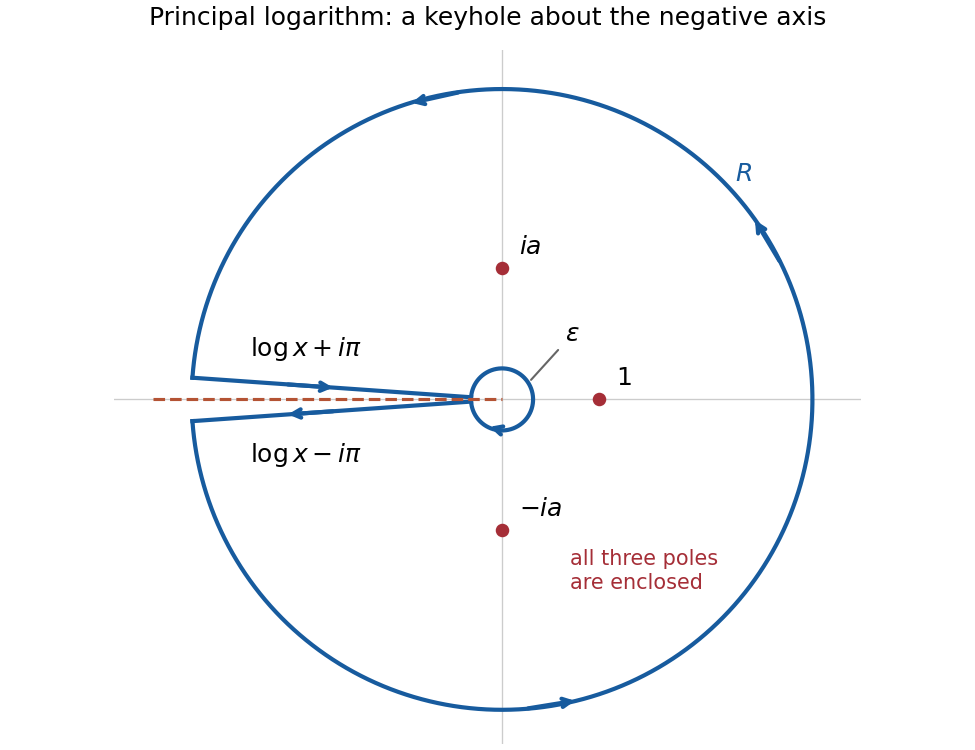

<h1 id="5/b/solution">Solution</h1>

↑ **Parent:** [b](../b.md)

Use the [principal logarithm](../../../../principal-complex-logarithm.md) $\operatorname{Log}z=\log|z|+i\operatorname{Arg}z$ with $-\pi<\operatorname{Arg}z<\pi$, whose [branch cut](../../../../branch-cut.md) is the negative [real axis](../../../../real-axis.md). For this choice,

$$
F(z)=\frac1{(z^2+a^2)\operatorname{Log}z}
$$

has three [simple poles](../../../../simple-pole.md) away from the cut: $z=1$, $z=ia$, and $z=-ia$. The pole at $1$, caused by $\operatorname{Log}1=0$, must be included.

Choose $0<\varepsilon<\min\{1,a\}$ and $R>\max\{1,a\}$, and use a positively oriented [keyhole contour](../../../../keyhole-contour.md) around the negative [real axis](../../../../real-axis.md): the large [circle](../../../../circle.md) is traversed counterclockwise, the upper bank from $-R$ to $-\varepsilon$, the small [circle](../../../../circle.md) clockwise, and the lower bank from $-\varepsilon$ to $-R$. Formally, use radial segments at [arguments](../../../../argument-complex-analysis.md) $\pm(\pi-\eta)$, then let $\eta\downarrow0$ with $R,\varepsilon$ fixed. The [function](../../../../function-split.md) has continuous limiting values on each compact bank, which justifies this limit.

**[Figure 1](#5/b/image-keyhole-contour-around-the-negative-real-axis-including-the-logarithm-s-pole-at-1). Keyhole contour around the negative real axis, including the logarithm's pole at 1**.

Put $L=\log a$. The [residues](../../../../residue.md) are

$$
\operatorname{Res}(F,1)=\frac1{1+a^2},\qquad
\operatorname{Res}(F,ia)=\frac1{2ia(L+i\pi/2)},\qquad
\operatorname{Res}(F,-ia)=-\frac1{2ia(L-i\pi/2)}.
$$

The first follows from $\operatorname{Log}z=(z-1)+O((z-1)^2)$; the other two follow from the simple zeros of $z^2+a^2$. Their sum is

$$
\Sigma=\frac1{1+a^2}-\frac{\pi}{2a(L^2+\pi^2/4)}.
$$

These expressions are valid also for $a=1$, since $L\pm i\pi/2$ never vanish for real $L$.

On the outer [circle](../../../../circle.md), $|\operatorname{Log}z|\geq\log R$ for $R>1$ and $|z^2+a^2|\geq R^2-a^2$. On the inner [circle](../../../../circle.md), $|\operatorname{Log}z|\geq|\log\varepsilon|$ and $|z^2+a^2|\geq a^2-\varepsilon^2$. Thus the [estimation lemma](../../../../estimation-lemma.md) bounds the two arc [integrals](../../../../integral-split.md) by

$$
\frac{2\pi R}{(R^2-a^2)\log R}\longrightarrow0,\qquad
\frac{2\pi\varepsilon}{(a^2-\varepsilon^2)|\log\varepsilon|}\longrightarrow0,
$$

respectively, as $R\to\infty$ and $\varepsilon\downarrow0$.

On the upper bank, $z=-x+i0$ gives $\operatorname{Log}z=\log x+i\pi$; on the lower bank it gives $\log x-i\pi$. Accounting for the opposite orientations, their combined [integral](../../../../integral-split.md) is

$$
\begin{aligned}
\int_\varepsilon^R\frac1{x^2+a^2}\left(\frac1{\log x+i\pi}-\frac1{\log x-i\pi}\right)\,dx
&=-2\pi i\int_\varepsilon^R\frac{dx}{(x^2+a^2)((\log x)^2+\pi^2)}.
\end{aligned}
$$

The real [improper integral](../../../../improper-integral.md) converges: its integrand is bounded near zero by $1/(a^2\pi^2)$ and at infinity by $1/(\pi^2x^2)$. Taking the arc limits in the [residue theorem](../../../../residue-theorem.md) gives $-2\pi i I=2\pi i\Sigma$, hence

$$
\boxed{\int_0^\infty\frac{dx}{(x^2+a^2)((\log x)^2+\pi^2)}
=\frac{\pi}{2a((\log a)^2+\pi^2/4)}-\frac1{1+a^2}.}
$$

The final subtraction is exactly the contribution of the pole at $1$.

## ↑ Ancestors (12)

1. [b](../b.md)
2. [5](../../5.md)
3. [2021](../../../2021-split.md)
4. [Past exam of the metric spaces and complex analysis course of the University of Oxford](../../../split.md)
5. [Metric spaces and complex analysis course of the University of Oxford](../../../../metric-spaces-and-complex-analysis-course-of-the-university-of-oxford.md)
6. [Year 2 of the mathematics course of the University of Oxford](../../../../year-2-of-the-mathematics-course-of-the-university-of-oxford.md)
7. [Mathematics course of the University of Oxford](../../../../mathematics-course-of-the-university-of-oxford.md)
8. [Undergraduate course of the University of Oxford](../../../../undergraduate-course-of-the-university-of-oxford.md)
9. [Course of the University of Oxford](../../../../course-of-the-university-of-oxford.md)
10. [University of Oxford](../../../../university-of-oxford-split.md)
11. [List of universities](../../../../list-of-universities.md)
12. [Codex Wiki](../../../../split.md)
