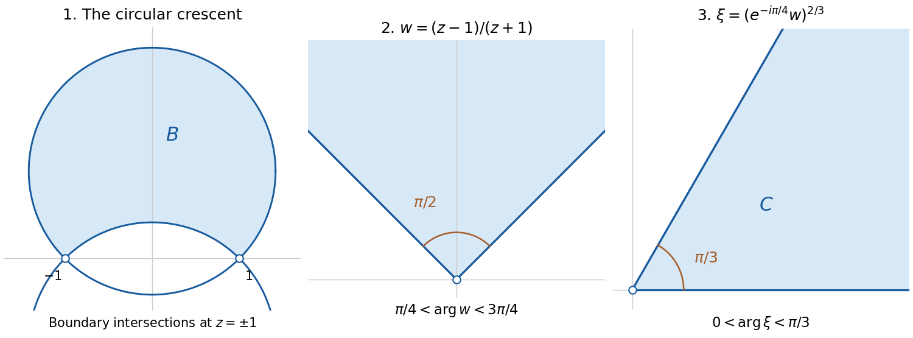

<h1 id="6/d/solution">Solution</h1>

↑ **Parent:** [d](../d.md)

The two boundary [circles](../../../../circle.md) meet at $z=\pm1$: subtracting their equations gives $\operatorname{Im}z=0$, and either equation then gives $(\operatorname{Re}z)^2=1$. Send these points to zero and infinity by the [Möbius transformation](../../../../mobius-transformation.md)

$$
w=T(z)=\frac{z-1}{z+1},\qquad z=\frac{1+w}{1-w}.
$$

The point $-1$ is on the boundary, so $T$ is [holomorphic](../../../../holomorphic-function-split.md) throughout $B$. Write $w=u+iv$. Substituting the inverse gives the exact equivalences

$$
\begin{aligned}
|z+i|>\sqrt2
&\iff |1-iw|>|1-w|\iff u+v>0,\\
|z-i|<\sqrt2
&\iff |1+iw|<|1-w|\iff v>u.
\end{aligned}
$$

Thus

$$
T(B)=\{u+iv:v>|u|\}=\{w:\pi/4<\arg w<3\pi/4\}.
$$

There is no missing point from the inverse here: $w=1$ lies outside this [sector](../../../../angular-sector.md). The [image](../../../../image-of-a-function.md) is therefore exactly the stated [sector](../../../../angular-sector.md), rather than merely a subset of it.

**[Figure 2](#6/d/image-the-circular-crescent-becomes-a-right-angle-sector-then-a-sector-of-angle-pi-over-three). The circular crescent becomes a right-angle sector, then a sector of angle pi over three**.

Rotate by $e^{-i\pi/4}$ to obtain the first quadrant, and take the power $2/3$ using its [holomorphic logarithm](../../../../holomorphic-logarithm.md) with $0<\arg\zeta<\pi/2$. The required map is

$$
\boxed{\Phi(z)=\exp\left(\frac23\operatorname{Log}\left(e^{-i\pi/4}\frac{z-1}{z+1}\right)\right).}
$$

Here the [principal logarithm](../../../../principal-complex-logarithm.md) works because the expression inside it lies in the first quadrant. It multiplies its [argument](../../../../argument-complex-analysis.md) by $2/3$, giving $0<\arg\Phi<\pi/3$, and maps its [modulus](../../../../modulus.md) $r>0$ to $r^{2/3}$, which ranges over all positive [real numbers](../../../../real-number.md).

For explicit [surjectivity](../../../../surjective-function.md) and [injectivity](../../../../injective-function.md), given $\xi$ with $0<\arg\xi<\pi/3$, define

$$
w=e^{i\pi/4}\xi^{3/2},\qquad z=\frac{1+w}{1-w},
$$

where $\xi^{3/2}$ uses $0<\arg\xi<\pi/3$. Then $\pi/4<\arg w<3\pi/4$, so $w\ne1$ and $z\in B$, and these are inverse operations. Each stage is [holomorphic](../../../../holomorphic-function-split.md) with nonzero [derivative](../../../../derivative.md), proving that $\Phi$ is the requested [conformal bijection](../../../../biholomorphism.md).

## ↑ Ancestors (12)

1. [d](../d.md)
2. [6](../../6.md)
3. [2021](../../../2021-split.md)
4. [Past exam of the metric spaces and complex analysis course of the University of Oxford](../../../split.md)
5. [Metric spaces and complex analysis course of the University of Oxford](../../../../metric-spaces-and-complex-analysis-course-of-the-university-of-oxford.md)
6. [Year 2 of the mathematics course of the University of Oxford](../../../../year-2-of-the-mathematics-course-of-the-university-of-oxford.md)
7. [Mathematics course of the University of Oxford](../../../../mathematics-course-of-the-university-of-oxford.md)
8. [Undergraduate course of the University of Oxford](../../../../undergraduate-course-of-the-university-of-oxford.md)
9. [Course of the University of Oxford](../../../../course-of-the-university-of-oxford.md)
10. [University of Oxford](../../../../university-of-oxford-split.md)
11. [List of universities](../../../../list-of-universities.md)
12. [Codex Wiki](../../../../split.md)
