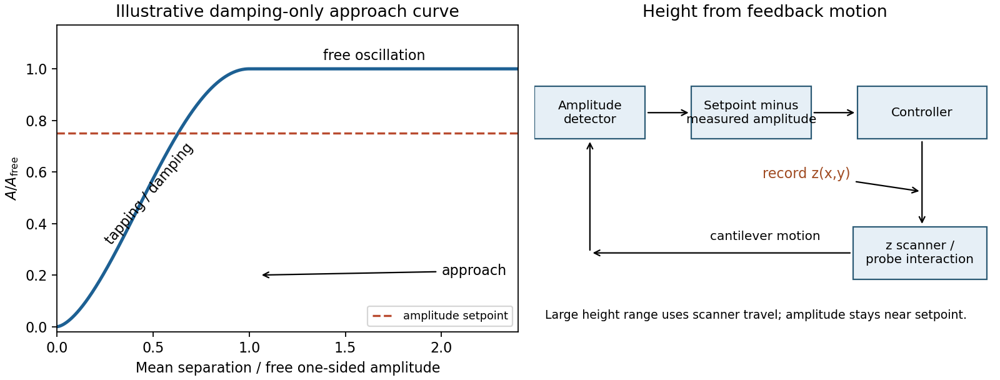

# Paper 1

↑ **Parent:** [2017](../2017.md)

Original archive: [Cambridge FOI 2024/50 released ZIP](https://www.whatdotheyknow.com/request/mphil_in_micro_and_nanotechnolog_5/response/2556540/attach/2/FOI%202024%2050%20Dai%20materials.zip?cookie_passthrough=1). The original is the member `NanoMPhil Paper 1 2017.pdf`, physical pages 1–13.

**Table of contents**

- [Section A(i)](#section-a-i)
  - [1](#section-a-i/1)
    - [i](#section-a-i/1/i)
      - [Solution](#section-a-i/1/i/solution)
    - [ii](#section-a-i/1/ii)
      - [Solution](#section-a-i/1/ii/solution)
    - [iii](#section-a-i/1/iii)
      - [Solution](#section-a-i/1/iii/solution)
  - [2](#section-a-i/2)
    - [i](#section-a-i/2/i)
      - [Solution](#section-a-i/2/i/solution)
    - [ii](#section-a-i/2/ii)
      - [Solution](#section-a-i/2/ii/solution)
    - [iii](#section-a-i/2/iii)
      - [Solution](#section-a-i/2/iii/solution)
- [Section A(ii)](#section-a-ii)
  - [3](#section-a-ii/3)
    - [i](#section-a-ii/3/i)
      - [Solution](#section-a-ii/3/i/solution)
    - [ii](#section-a-ii/3/ii)
      - [Solution](#section-a-ii/3/ii/solution)
  - [4](#section-a-ii/4)
    - [i](#section-a-ii/4/i)
      - [Solution](#section-a-ii/4/i/solution)
    - [ii](#section-a-ii/4/ii)
      - [Solution](#section-a-ii/4/ii/solution)
    - [iii](#section-a-ii/4/iii)
      - [Solution](#section-a-ii/4/iii/solution)
- [Section A(iii)](#section-a-iii)
  - [5](#section-a-iii/5)
    - [i](#section-a-iii/5/i)
      - [Solution](#section-a-iii/5/i/solution)
    - [ii](#section-a-iii/5/ii)
      - [Solution](#section-a-iii/5/ii/solution)
    - [iii](#section-a-iii/5/iii)
      - [Solution](#section-a-iii/5/iii/solution)
    - [iv](#section-a-iii/5/iv)
      - [Solution](#section-a-iii/5/iv/solution)
  - [6](#section-a-iii/6)
    - [i](#section-a-iii/6/i)
      - [Solution](#section-a-iii/6/i/solution)
    - [ii](#section-a-iii/6/ii)
      - [Solution](#section-a-iii/6/ii/solution)
  - [7](#section-a-iii/7)
    - [Solution](#section-a-iii/7/solution)
- [Section B](#section-b)
  - [8](#section-b/8)
    - [i](#section-b/8/i)
      - [Solution](#section-b/8/i/solution)
    - [ii](#section-b/8/ii)
      - [Solution](#section-b/8/ii/solution)
    - [iii](#section-b/8/iii)
      - [Solution](#section-b/8/iii/solution)
    - [iv](#section-b/8/iv)
      - [a](#section-b/8/iv/a)
        - [Solution](#section-b/8/iv/a/solution)
      - [b](#section-b/8/iv/b)
        - [Solution](#section-b/8/iv/b/solution)
  - [9](#section-b/9)
    - [i](#section-b/9/i)
      - [Solution](#section-b/9/i/solution)
    - [ii](#section-b/9/ii)
      - [Solution](#section-b/9/ii/solution)
    - [iii](#section-b/9/iii)
      - [Solution](#section-b/9/iii/solution)
  - [10](#section-b/10)
    - [i](#section-b/10/i)
      - [Solution](#section-b/10/i/solution)
    - [ii](#section-b/10/ii)
      - [Solution](#section-b/10/ii/solution)
    - [iii](#section-b/10/iii)
      - [a](#section-b/10/iii/a)
        - [Solution](#section-b/10/iii/a/solution)
      - [b](#section-b/10/iii/b)
        - [Solution](#section-b/10/iii/b/solution)
      - [c](#section-b/10/iii/c)
        - [Solution](#section-b/10/iii/c/solution)
    - [iv](#section-b/10/iv)
      - [a](#section-b/10/iv/a)
        - [Solution](#section-b/10/iv/a/solution)
      - [b](#section-b/10/iv/b)
        - [Solution](#section-b/10/iv/b/solution)
      - [c](#section-b/10/iv/c)
        - [Solution](#section-b/10/iv/c/solution)
  - [11](#section-b/11)
    - [i](#section-b/11/i)
      - [Solution](#section-b/11/i/solution)
    - [ii](#section-b/11/ii)
      - [Solution](#section-b/11/ii/solution)
    - [iii](#section-b/11/iii)
      - [Solution](#section-b/11/iii/solution)
    - [iv](#section-b/11/iv)
      - [Solution](#section-b/11/iv/solution)
    - [v](#section-b/11/v)
      - [Solution](#section-b/11/v/solution)
  - [12](#section-b/12)
    - [i](#section-b/12/i)
      - [Solution](#section-b/12/i/solution)
    - [ii](#section-b/12/ii)
      - [Solution](#section-b/12/ii/solution)
    - [iii](#section-b/12/iii)
      - [a](#section-b/12/iii/a)
        - [Solution](#section-b/12/iii/a/solution)
      - [b](#section-b/12/iii/b)
        - [Solution](#section-b/12/iii/b/solution)
      - [c](#section-b/12/iii/c)
        - [Solution](#section-b/12/iii/c/solution)

<h2 id="section-a-i">Section A(i)</h2>

↑ **Parent:** [Paper 1](paper-1.md)

<h3 id="section-a-i/1">1</h3>

↑ **Parent:** [Section A(i)](#section-a-i)

<h4 id="section-a-i/1/i">i</h4>

↑ **Parent:** [1](#section-a-i/1)

<h5 id="section-a-i/1/i/solution">Solution</h5>

↑ **Parent:** [I](#section-a-i/1/i)

The electron-optical column contains an [electron gun](../../physics.md#electron-gun), an accelerating supply, a [condenser lens](../../optics.md#condenser-lens) system, an objective aperture, an [electron objective lens](../../optics.md#electron-objective-lens), scan coils and alignment/stigmation controls. The [electron gun](../../physics.md#electron-gun) may use [thermionic emission](../../thermionic-emission.md) or [field emission](../../quantum-mechanics.md#field-electron-emission). The [condenser lens](../../optics.md#condenser-lens) system sets the incident probe current and source demagnification; the [electron objective lens](../../optics.md#electron-objective-lens) focuses the probe on the specimen. A movable specimen stage controls position, tilt and working distance. The column and specimen chamber need a [vacuum](../../physics.md#vacuum) system, appropriate pumps and specimen-transfer hardware. Detectors collect [secondary electrons](../../physics.md#secondary-electron), [backscattered electrons](../../physics.md#backscattered-electron) or characteristic [X-rays](../../electromagnetic-radiation.md#x-ray); amplification and synchronized raster acquisition assign a measured signal to each image pixel. The first two signals provide different imaging information, while characteristic [X-rays](../../electromagnetic-radiation.md#x-ray) allow elemental analysis. **A source, probe-forming optics, raster scan, specimen stage, detectors, acquisition electronics and [vacuum](../../physics.md#vacuum) system form the essential chain.**[printed pp.3–6, construction of the column, detectors and vacuum system](../../physics-bibliography.md#scanning-electron-microscope-a-to-z-by-jeol)

<h4 id="section-a-i/1/ii">ii</h4>

↑ **Parent:** [1](#section-a-i/1)

<h5 id="section-a-i/1/ii/solution">Solution</h5>

↑ **Parent:** [Ii](#section-a-i/1/ii)

The image annotation gives probe [electric current](../../electric-charge.md#electric-current) $I=43\,\mathrm{pA}=4.3\times10^{-11}\,\mathrm A$ and working distance $L=2.4\,\mathrm{mm}$. Interpret $d_o$ as the probe diameter and $\alpha$ as its convergence semiangle, in radians. To estimate that angle from the available dimensions, approximate the effective aperture plane as a distance $L$ from the specimen. With aperture radius $r_a=25\,\mathrm{\mu m}$,

$$
\alpha\simeq\frac{r_a}{L}=1.0417\times10^{-2},\qquad d_o=\sqrt{\frac{4I}{\pi^2\alpha^2\beta}}=\boxed{4.01\,\mathrm{nm}}.
$$

The [electron beam brightness](../../optics.md#electron-beam-brightness) $\beta$ measures [electric current](../../electric-charge.md#electric-current) per probe area per [solid angle](../../euclidean-geometry.md#solid-angle); the supplied convention corresponds to a circular probe and a paraxial cone of [solid angle](../../euclidean-geometry.md#solid-angle) approximately $\pi\alpha^2$. The aperture diameter must be halved, and the annotated current is in picoamperes. Treating the full aperture angle as $\alpha$ would introduce a factor-of-two error in $d_o$.

This is a conditional optical estimate: the working distance is not necessarily the actual electron-optical distance from the effective aperture to the focused probe. The answer assumes that approximation, the quoted [electron beam brightness](../../optics.md#electron-beam-brightness) at the operating [voltage](../../random-walk.md#voltage), and negligible [optical aberrations](../../geometrical-optics.md#optical-aberration). The 30 kV annotation gives a much shorter [de Broglie wavelength](../../wave-function.md#de-broglie-wavelength) than 4 nm, so a nanometre-scale probe is plausible. Actual [electron microscope resolution](../../optics.md#electron-microscope-resolution) also depends on [diffraction](../../quantum-scattering.md#diffraction), scattering in the specimen, signal generation and collection, [signal-to-noise ratio](../../electrical-engineering.md#signal-to-noise-ratio), drift and specimen charging. A 4 nm probe does not establish that every measured edge width is 4 nm.

<h4 id="section-a-i/1/iii">iii</h4>

↑ **Parent:** [1](#section-a-i/1)

<h5 id="section-a-i/1/iii/solution">Solution</h5>

↑ **Parent:** [Iii](#section-a-i/1/iii)

The SE annotation identifies a [secondary electron](../../physics.md#secondary-electron) image. The specimen has an open network of ridges, thin walls and irregular cavities, with lateral features on the scale of tens to hundreds of nanometres when compared with the 500 nm bar. Exposed edges can emit [secondary electrons](../../physics.md#secondary-electron) from more than one nearby surface; inclined faces also have a larger near-surface escape fraction than a face perpendicular to the beam. These mechanisms make protruding rims conspicuous. Recesses can be dark because emitted [secondary electrons](../../physics.md#secondary-electron) are intercepted or collected less efficiently. A through-lens detector changes the collection geometry, so a simple one-sided illumination analogy is incomplete.[printed pp.10–14, secondary-electron inclination, edge effects and detector collection](../../physics-bibliography.md#scanning-electron-microscope-a-to-z-by-jeol)

**An irregular porous relief with bright rims and darker recesses is consistent with the image.** The cross-section below is an original illustrative geometry, rather than a reconstruction of a particular image line. A single [secondary electron](../../physics.md#secondary-electron) intensity map does not supply calibrated heights, prove that every dark patch is a through-hole, or distinguish charging from all material contrast. Repeat with specimen tilt, altered detector collection or reduced accelerating [voltage](../../random-walk.md#voltage), and compare [backscattered electron](../../physics.md#backscattered-electron) or elemental signals before assigning a compositional cause.

**[Figure 1](#section-a-i/1/iii/image-an-illustrative-porous-surface-topography-cross-section-and-the-aperture-cone-approximation). An illustrative porous surface topography cross-section and the aperture-cone approximation**.

<h3 id="section-a-i/2">2</h3>

↑ **Parent:** [Section A(i)](#section-a-i)

<h4 id="section-a-i/2/i">i</h4>

↑ **Parent:** [2](#section-a-i/2)

<h5 id="section-a-i/2/i/solution">Solution</h5>

↑ **Parent:** [I](#section-a-i/2/i)

Model the [AFM cantilever](../../engineering.md#afm-cantilever) as a driven [damped harmonic oscillator](../../analysis.md#damped-harmonic-oscillator). If the drive stays at the free-space [resonance](../../dynamical-systems.md#resonance) and the [spring constant](../../elasticity-physics.md#spring-constant) $k$ and effective [mass](../../classical-mechanics.md#mass) $m$ are unchanged, its steady amplitude is

$$
A=\frac{F_d}{\sqrt{(k-m\omega^2)^2+(\gamma\omega)^2}},\qquad A(\omega_0)=\frac{F_d}{(\gamma_0+\gamma_{\rm ts})\omega_0}.
$$

Here $\gamma_0$ is intrinsic damping and $\gamma_{\rm ts}$ the added dissipative interaction with the surface. At large average separation there is no tapping, so $\gamma_{\rm ts}\simeq0$ and $A=A_{\rm free}$. As the lower turning point reaches the surface, intermittent contacts dissipate [energy](../../energy.md) and the amplitude decreases. With further approach the oscillation becomes strongly constrained, eventually approaching a continuously contacting, nearly quenched response. **The damping-only sketch has a free-amplitude plateau followed by a descending amplitude on approach.** The rounded transition in the sketch is illustrative; [adhesion](../../continuum-mechanics.md#adhesion) and actual contact mechanics determine its shape. The deliberately omitted force-gradient-induced [resonance](../../dynamical-systems.md#resonance) shift can make real approach curves more complicated.

**[Figure 2](#section-a-i/2/i/image-damping-only-tapping-mode-atomic-force-microscopy-response-and-amplitude-feedback). Damping-only tapping-mode atomic force microscopy response and amplitude feedback**.

<h4 id="section-a-i/2/ii">ii</h4>

↑ **Parent:** [2](#section-a-i/2)

<h5 id="section-a-i/2/ii/solution">Solution</h5>

↑ **Parent:** [Ii](#section-a-i/2/ii)

An uncorrected amplitude image has a useful vertical range only across the transition between free oscillation and strongly suppressed oscillation. If the free motion is a few tens of nanometres peak-to-peak, its one-sided amplitude is half that excursion. The relevant vertical height range is therefore **of the order of the oscillation excursion, only tens of nanometres**, rather than micrometres. It is not a sharp universal limit equal to the quoted peak-to-peak value: the chosen mean gap, contact law and usable sensitivity determine the actual range. A sufficiently high feature can quench the motion or produce destructive contact; a sufficiently deep depression leaves the probe oscillating freely with essentially no height sensitivity. This argument limits height tracking, not the lateral width of a feature. Lateral resolution instead depends on [AFM tip convolution](../../engineering.md#afm-tip-convolution), sampling and the probe-surface interaction.

<h4 id="section-a-i/2/iii">iii</h4>

↑ **Parent:** [2](#section-a-i/2)

<h5 id="section-a-i/2/iii/solution">Solution</h5>

↑ **Parent:** [Iii](#section-a-i/2/iii)

In [tapping-mode atomic force microscopy](../../engineering.md#tapping-mode-atomic-force-microscopy), demodulate the cantilever displacement to obtain its amplitude and compare it with a setpoint below $A_{\rm free}$. A [closed-loop control](../../control-theory.md#closed-loop-control) system drives a [piezoelectric scanner](../../engineering.md#piezoelectric-scanner) in $z$ to restore the setpoint as the raster crosses raised or depressed regions. The interaction remains in its sensitive amplitude range while the scanner follows heights much larger than the oscillation amplitude. **The principal height image is the calibrated feedback $z$ displacement at each lateral pixel.** The amplitude-error and phase channels are supplementary signals, rather than interchangeable height measurements. Maximum height is now bounded by scanner travel, clearance and stable tracking. Steep features require adequate feedback bandwidth and sufficiently slow scanning; trace/retrace disagreement tests tracking, while a changed [AFM probe](../../engineering.md#afm-probe) tests geometric broadening. Surface-dependent dissipation can move the setpoint height even on a geometrically flat specimen.

<h2 id="section-a-ii">Section A(ii)</h2>

↑ **Parent:** [Paper 1](paper-1.md)

<h3 id="section-a-ii/3">3</h3>

↑ **Parent:** [Section A(ii)](#section-a-ii)

<h4 id="section-a-ii/3/i">i</h4>

↑ **Parent:** [3](#section-a-ii/3)

<h5 id="section-a-ii/3/i/solution">Solution</h5>

↑ **Parent:** [I](#section-a-ii/3/i)

A [sacrificial layer](../../engineering.md#sacrificial-layer) temporarily supports the intended moving structure and determines its clearance above the substrate. One workable [surface micromachining](../../engineering.md#surface-micromachining) sequence deposits [silicon dioxide](../../chemical-substance.md#silicon-dioxide) on [silicon](../../chemical-substance.md#silicon), opens anchor windows in that oxide, deposits a structural [polysilicon](../../chemical-substance.md#polysilicon) film and patterns the beam and release openings. The structural film contacts the substrate at the anchors. Selective removal of the oxide beneath the beam leaves the beam suspended while retaining its attachment. An access opening or exposed perimeter is essential; an etchant cannot instantly reach sealed material.

The release needs substantial lateral removal, so an [isotropic etch](../../engineering.md#isotropic-etch) with high [etch selectivity](../../engineering.md#etch-selectivity) is useful. Hydrofluoric-acid oxide release is compatible with a suitable [polysilicon](../../chemical-substance.md#polysilicon) structure; a directional [reactive-ion etching](../../engineering.md#reactive-ion-etching) step alone would mainly clear exposed vertical paths and leave material beneath the beam. Choose the structural material, anchor design, sacrificial material and etchant together, and allow for transport-limited undercut and structural residual stress. Wet release followed by ordinary evaporation can pull a compliant structure onto the substrate through [capillary force](../../surface-tension.md#capillary-force) and cause [stiction](../../continuum-mechanics.md#stiction). [critical point drying](../../surface-tension.md#critical-point-drying) or a compatible [vapor-phase release etch](../../engineering.md#vapor-phase-release-etch) avoids the receding [liquid](../../thermodynamics.md#liquid) interface. Neither method removes the need to check residues, selectivity and anchor survival. **Pattern the support and structure first, then selectively undercut the support while preserving the anchors.**[Surface Micromachining: oxide/polysilicon/HF example and capillary stiction](../../physics-bibliography.md#fabricating-mems-and-nanotechnology-by-mems-and-nanotechnology-exchange)

**[Figure 3](#section-a-ii/3/i/image-selective-sacrificial-layer-release-and-remote-plasma-ashing). Selective sacrificial layer release and remote plasma ashing**.

<h4 id="section-a-ii/3/ii">ii</h4>

↑ **Parent:** [3](#section-a-ii/3)

<h5 id="section-a-ii/3/ii/solution">Solution</h5>

↑ **Parent:** [Ii](#section-a-ii/3/ii)

**Oxygen-plasma ashing**, preferably a remote or downstream arrangement when low damage matters, removes organic [photoresist](../../engineering.md#photoresist) chemically. Feed [oxygen](../../chemical-substance.md#oxygen) through a plasma source energized by radiofrequency or microwave [power](../../energy.md#power). Electron-impact dissociation generates reactive [oxygen](../../chemical-substance.md#oxygen) species; neutral radicals reach the wafer in a separate downstream region. Keep the wafer off a strongly biased driven [electrode](../../electrochemistry.md#electrode) so energetic [ion](../../chemistry.md#ion) bombardment is much smaller than in directional [reactive-ion etching](../../engineering.md#reactive-ion-etching). A barrel asher with shielded wafers is another chemical-stripping implementation.

$$
\mathrm{O_2}+e^-\longrightarrow2\mathrm O+e^-,\qquad\mathrm C_x\mathrm H_y+(2x+y/2)\mathrm O\longrightarrow x\mathrm{CO_2}+(y/2)\mathrm{H_2O}.
$$

These equations represent radical production and an ideal complete-oxidation balance; actual exhaust can also contain CO and fragments. Pumping removes volatile products. Directional shape fidelity is unnecessary for blanket stripping, while access around surface relief and high chemical removal selectivity are useful. Monitor endpoint and wafer [temperature](../../temperature.md), and verify removal with a witness surface. [oxygen](../../chemical-substance.md#oxygen) can oxidize exposed materials, charging can still damage sensitive structures, and inorganic or metal-containing residues may require a compatible separate clean. **Ashing removes organic contamination; it is not a universal residue-removal step.**[lecture transcript, discussion of barrel and parallel-plate plasma ashing, and comparison with RIE](../../physics-bibliography.md#physics-of-microfabrication-front-end-processing-lecture-20-by-massachusetts-institute-of-technology)

<h3 id="section-a-ii/4">4</h3>

↑ **Parent:** [Section A(ii)](#section-a-ii)

<h4 id="section-a-ii/4/i">i</h4>

↑ **Parent:** [4](#section-a-ii/4)

<h5 id="section-a-ii/4/i/solution">Solution</h5>

↑ **Parent:** [I](#section-a-ii/4/i)

Assume that each target's incorporated flux is proportional to its applied [power](../../energy.md#power) over this operating range, and that the same composition convention is used throughout. The calibration gives $F_A/F_B=0.35/0.65$ at equal [powers](../../energy.md#power). Holding the A target unchanged while making the two incorporated fluxes equal therefore requires

$$
\boxed{P_B=30\frac{0.35}{0.65}=16.15\,\mathrm W}.
$$

The B [power](../../energy.md#power) decreases because B originally supplies more material. This linear [magnetron sputtering](../../engineering.md#magnetron-sputtering) approximation neglects power-dependent yield, target condition, resputtering and changes in sticking probability. A second composition measurement is the experimental check.

<h4 id="section-a-ii/4/ii">ii</h4>

↑ **Parent:** [4](#section-a-ii/4)

<h5 id="section-a-ii/4/ii/solution">Solution</h5>

↑ **Parent:** [Ii](#section-a-ii/4/ii)

In the intended additive-deposition model, A originally contributes $0.35\times2.2=0.77\,\mathrm{nm\,s^{-1}}$. At equal incorporated contributions, B also supplies $0.77\,\mathrm{nm\,s^{-1}}$, giving **$1.54\,\mathrm{nm\,s^{-1}}$**. Equivalently, the new total incorporated flux is $0.35+0.35=0.70$ times the calibrated total.

There is a composition-convention qualification. If the percentages represent [mass](../../classical-mechanics.md#mass) flux and the [mass density](../../fluid-mechanics.md#density) stays fixed, the preceding thickness calculation follows directly. If they instead represent atomic fractions, a constant atomic number density would justify the same result, whereas constant [mass density](../../fluid-mechanics.md#density) alone does not. With atomic [masses](../../classical-mechanics.md#mass) $M_A,M_B$ and constant [mass density](../../fluid-mechanics.md#density), the ratio would be

$$
\frac{R_{\rm new}}{R_{\rm old}}=\frac{0.35(M_A+M_B)}{0.35M_A+0.65M_B}.
$$

The PDF does not specify atomic versus [mass](../../classical-mechanics.md#mass) percentages or the two elements. Thus **1.54 nm/s is the intended common flux-to-thickness approximation**, and the formula above states the additional dependence if atomic fraction and constant [mass density](../../fluid-mechanics.md#density) are meant literally.

<h4 id="section-a-ii/4/iii">iii</h4>

↑ **Parent:** [4](#section-a-ii/4)

<h5 id="section-a-ii/4/iii/solution">Solution</h5>

↑ **Parent:** [Iii](#section-a-ii/4/iii)

Approximate each source as localized, keep the angular factors unchanged and use inverse-square flux dilution. The increased distance gives

$$
R_{120}\simeq R_{80}\left(\frac{80}{120}\right)^2=1.54\frac49=\boxed{0.684\,\mathrm{nm\,s^{-1}}}.
$$

This carries the composition/thickness convention of the previous answer. A greater source distance reduces fractional distance and angle variation across a given substrate, improving composition uniformity at the cost of rate. A real [magnetron sputtering](../../engineering.md#magnetron-sputtering) target is extended, with an angular emission distribution, and gas scattering can change the distance law; this is an estimate rather than a calibrated prediction.

<h2 id="section-a-iii">Section A(iii)</h2>

↑ **Parent:** [Paper 1](paper-1.md)

<h3 id="section-a-iii/5">5</h3>

↑ **Parent:** [Section A(iii)](#section-a-iii)

<h4 id="section-a-iii/5/i">i</h4>

↑ **Parent:** [5](#section-a-iii/5)

<h5 id="section-a-iii/5/i/solution">Solution</h5>

↑ **Parent:** [I](#section-a-iii/5/i)

**TODO: user-deferred biology subquestion.**

<h4 id="section-a-iii/5/ii">ii</h4>

↑ **Parent:** [5](#section-a-iii/5)

<h5 id="section-a-iii/5/ii/solution">Solution</h5>

↑ **Parent:** [Ii](#section-a-iii/5/ii)

**TODO: user-deferred biology subquestion.**

<h4 id="section-a-iii/5/iii">iii</h4>

↑ **Parent:** [5](#section-a-iii/5)

<h5 id="section-a-iii/5/iii/solution">Solution</h5>

↑ **Parent:** [Iii](#section-a-iii/5/iii)

**TODO: user-deferred biology subquestion.**

<h4 id="section-a-iii/5/iv">iv</h4>

↑ **Parent:** [5](#section-a-iii/5)

<h5 id="section-a-iii/5/iv/solution">Solution</h5>

↑ **Parent:** [Iv](#section-a-iii/5/iv)

**TODO: user-deferred biology subquestion.**

<h3 id="section-a-iii/6">6</h3>

↑ **Parent:** [Section A(iii)](#section-a-iii)

<h4 id="section-a-iii/6/i">i</h4>

↑ **Parent:** [6](#section-a-iii/6)

<h5 id="section-a-iii/6/i/solution">Solution</h5>

↑ **Parent:** [I](#section-a-iii/6/i)

The solid [electrolyte](../../electrochemistry.md#electrolyte) conducts oxide [ions](../../chemistry.md#ion). Equilibrating [oxygen](../../chemical-substance.md#oxygen) at the two interfaces couples one $\mathrm{O_2}$ molecule to four [electrons](../../physics.md#electron). Taking the positive measured [electromotive force](../../electric-charge.md#electromotive-force) as the air-reference potential relative to the Ni/NiO side, the [Nernst equation](../../electrochemistry.md#nernst-equation) is

$$
E=\frac{RT}{4F}\ln\frac{p_{\rm air}}{p_{\rm eq}},\qquad \frac{p_{\rm eq}}{p^\circ}=\frac{p_{\rm air}}{p^\circ}\exp\left(-\frac{4FE}{RT}\right).
$$

Assume air at one bar with $p_{\rm air}/p^\circ=0.21$, pure solid phases of unit [thermodynamic activity](../../chemical-potential.md#thermodynamic-activity), and $p^\circ=1\,\mathrm{bar}$. For the reaction normalized to one mole of [oxygen](../../chemical-substance.md#oxygen),

$$
2\mathrm{Ni}(s)+\mathrm{O_2}(g)\longrightarrow2\mathrm{NiO}(s),\qquad \Delta_rG^\circ=RT\ln\frac{p_{\rm eq}}{p^\circ}=RT\ln0.21-4FE.
$$

The negative sign is physically consistent with a strongly reducing Ni/NiO equilibrium relative to air. Using the supplied $R$ and $F$ gives

$$
\begin{array}{c|c|r}
T\ (\mathrm K)&p_{\rm eq}\ (\mathrm{bar})&\Delta_rG^\circ\ (\mathrm{kJ\,mol_{O_2}^{-1}})\\\hline
900&6.92\times10^{-19}&-312.88\\
1000&3.95\times10^{-16}&-294.87\\
1100&7.75\times10^{-14}&-276.09
\end{array}
$$

**The tabulated [free energies](../../thermodynamic-potential.md#thermodynamic-free-energy) are per mole of $\mathrm{O_2}$, not per mole of NiO.** Values normalized to one mole of NiO would be half as large. A reliable [oxygen concentration cell](../../electrochemistry.md#oxygen-concentration-cell) measurement requires reversible interfaces, calibrated uniform [temperature](../../temperature.md), a known reference [oxygen](../../chemical-substance.md#oxygen) [pressure](../../pressure.md) and predominantly ionic rather than electronic conduction through [yttria-stabilized zirconia](../../ionic-bonding.md#yttria-stabilized-zirconia). Air is not pure [oxygen](../../chemical-substance.md#oxygen): dropping the $RT\ln0.21$ term changes the inferred [entropy](../../entropy.md).

<h4 id="section-a-iii/6/ii">ii</h4>

↑ **Parent:** [6](#section-a-iii/6)

<h5 id="section-a-iii/6/ii/solution">Solution</h5>

↑ **Parent:** [Ii](#section-a-iii/6/ii)

Approximate the reaction [enthalpy](../../enthalpy.md) and [entropy](../../entropy.md) as constant over the measured interval, so $\Delta_rG^\circ=\Delta_rH^\circ-T\Delta_rS^\circ$. A [linear least squares](../../probability-and-statistics.md#linear-least-squares) fit of all three [free energies](../../thermodynamic-potential.md#thermodynamic-free-energy) against [temperature](../../temperature.md) gives

$$
\Delta_rG^\circ\simeq-478580.96+183.9664T\quad\mathrm{J\,mol_{O_2}^{-1}},
$$

and hence

$$
\boxed{\Delta_rH^\circ\simeq-478.6\,\mathrm{kJ\,mol_{O_2}^{-1}},\qquad\Delta_rS^\circ\simeq-184.0\,\mathrm{J\,K^{-1}\,mol_{O_2}^{-1}}}.
$$

The negative [entropy](../../entropy.md) change is reasonable because [oxygen](../../chemical-substance.md#oxygen) gas is incorporated into solids. The fit residuals are $+0.129,-0.257,+0.129\,\mathrm{kJ\,mol_{O_2}^{-1}}$, so the data support this approximate straight-line description. Extrapolating its intercept to zero [temperature](../../temperature.md) is a way of estimating a constant local [enthalpy](../../enthalpy.md), not evidence that the [heat capacities](../../heat.md#heat-capacity) vanish or that the same phases persist to zero [temperature](../../temperature.md). More [temperatures](../../temperature.md) and repeated heating/cooling measurements would test curvature and equilibration.

<h3 id="section-a-iii/7">7</h3>

↑ **Parent:** [Section A(iii)](#section-a-iii)

<h4 id="section-a-iii/7/solution">Solution</h4>

↑ **Parent:** [7](#section-a-iii/7)

A [thermoelectric generator](../../thermoelectric-effect.md#thermoelectric-generator) maintains hot and cold junctions of two materials with different [Seebeck coefficients](../../thermoelectric-effect.md#seebeck-coefficient). Mobile charge carriers redistribute in the [temperature gradient](../../heat.md#temperature-gradient), producing an open-circuit [voltage](../../random-walk.md#voltage) of magnitude $|V|=|S_p-S_n|\Delta T$ for constant coefficients. A load permits [electric current](../../electric-charge.md#electric-current); pairs of p-type and n-type legs are commonly connected electrically in series and thermally in parallel. Maintaining the output requires continuous [heat transfer](../../heat.md#heat-transfer) from the hot reservoir and rejection of [heat](../../heat.md) to the cold reservoir. The [thermoelectric figure of merit](../../thermoelectric-effect.md#thermoelectric-figure-of-merit) $ZT=S^2\sigma T/\kappa$ expresses the favorable combination of large [Seebeck coefficient](../../thermoelectric-effect.md#seebeck-coefficient), large [electrical conductivity](../../electric-charge.md#electrical-conductivity) and small [thermal conductivity](../../heat.md#thermal-conductivity). Contact losses, Joule heating and parasitic [heat](../../heat.md) leaks reduce practical efficiency.

A [pyroelectric generator](../../electromagnetism.md#pyroelectric-generator) instead exploits a change of spontaneous [electric polarization](../../electromagnetism.md#polarization-density) with [temperature](../../temperature.md). If the relevant component of the [pyroelectric coefficient](../../electromagnetism.md#pyroelectric-coefficient) is $p=dP_s/dT$, an [electrode](../../electrochemistry.md#electrode) of area $A$ receives a short-circuit [electric current](../../electric-charge.md#electric-current) approximately $I=pA\,dT/dt$. A heating stroke and a cooling stroke produce opposite charge changes. Rectification or a synchronized electrical cycle can transfer [energy](../../energy.md) to storage. **A spatial [temperature](../../temperature.md) difference drives the thermoelectric device; a temporal [temperature](../../temperature.md) change drives the pyroelectric device.** Uniform, constant [temperature](../../temperature.md) gives no continuing current from [pyroelectricity](../../electromagnetism.md#pyroelectricity) even if the material is hot. Reported nanowire generators deliberately use changing [temperature](../../temperature.md), rather than infer continuous generation from a static hot specimen.[Nano Letters 12 (2012), pp.2833–2838, transient-temperature operating principle](../../physics-bibliography.md#pyroelectric-nanogenerators-for-harvesting-thermoelectric-energy-by-ya-yang-and-others)

Both approaches can be compact, silent and free of macroscopic moving parts. The [thermoelectric generator](../../thermoelectric-effect.md#thermoelectric-generator) gives continuous output under a sustained gradient, but needs two effective thermal contacts and sufficient [heat](../../heat.md) flow; very small $\Delta T$ gives a small [voltage](../../random-walk.md#voltage) and thermal contacts can consume much of the available gradient. Thin films exhibiting [pyroelectricity](../../electromagnetism.md#pyroelectricity) can respond to intermittent heating without a permanently maintained hot/cold separation across their thickness, but require repeated thermal cycling, low electrical leakage and suitable charge extraction. Their thermal [time constant](../../analysis.md#time-constant) limits useful cycling [frequency](../../wave.md#frequency), and sensible heating/cooling can dominate the [heat](../../heat.md) budget. A steady hot pipe with an available cold sink favors a [thermoelectric generator](../../thermoelectric-effect.md#thermoelectric-generator); periodic radiative heating can favor a [pyroelectric generator](../../electromagnetism.md#pyroelectric-generator). Neither converts equilibrium thermal motion at a single fixed [temperature](../../temperature.md) into sustained useful [work](../../energy.md#work).

## Section B

↑ **Parent:** [Paper 1](paper-1.md)

<h3 id="section-b/8">8</h3>

↑ **Parent:** [Section B](#section-b)

<h4 id="section-b/8/i">i</h4>

↑ **Parent:** [8](#section-b/8)

<h5 id="section-b/8/i/solution">Solution</h5>

↑ **Parent:** [I](#section-b/8/i)

In [transmission electron microscopy](../../optics.md#transmission-electron-microscopy), the [electron objective lens](../../optics.md#electron-objective-lens) forms an intermediate real-space image and intermediate/projector lenses enlarge it onto a screen or camera. The total optical [magnification](../../optics.md#magnification) is the product of the relevant stage magnifications. The user changes imaging-lens excitations to select [magnification](../../optics.md#magnification), while separately controlling illumination and focus. Display resizing introduces an additional enlargement, so the recorded pixel calibration matters.

In [scanning transmission electron microscopy](../../optics.md#scanning-transmission-electron-microscopy), a focused probe is rastered across the specimen and a detector signal is assigned to each probe position. The displayed [magnification](../../optics.md#magnification) is display width divided by scanned specimen width. The user increases [magnification](../../optics.md#magnification) by reducing raster-deflection amplitude, independently of choosing a smaller incident probe with the probe-forming lenses. **TEM changes image-forming lens magnification; STEM changes the raster field of view.** A smaller field or more pixels does not create finer physical resolution than the probe, specimen scattering and detection permit. A calibrated real-space scale is more transferable than the apparent size on a monitor.[printed p.7, raster-width/display-width magnification; this geometric relation also applies to scanned transmitted-electron imaging](../../physics-bibliography.md#scanning-electron-microscope-a-to-z-by-jeol)

<h4 id="section-b/8/ii">ii</h4>

↑ **Parent:** [8](#section-b/8)

<h5 id="section-b/8/ii/solution">Solution</h5>

↑ **Parent:** [Ii](#section-b/8/ii)

Choose cyclic reciprocal units, so the incident and elastically scattered wavevectors have magnitude $1/\lambda$. Place the [reciprocal lattice](../../quantum-scattering.md#reciprocal-lattice) origin $O$ at the end of the incident vector from the sphere centre $C$. A reciprocal vector $\mathbf g$ is excited when its endpoint $G$ lies on the [Ewald sphere](../../inverse-problem.md#ewald-sphere), because

$$
\mathbf k_s=\mathbf k_0+\mathbf g,\qquad |\mathbf k_s|=|\mathbf k_0|=1/\lambda.
$$

A specimen tilt rotates the [reciprocal lattice](../../quantum-scattering.md#reciprocal-lattice) relative to this construction. The very short [electron](../../physics.md#electron) [de Broglie wavelength](../../wave-function.md#de-broglie-wavelength) makes the sphere nearly flat across several ordinary reciprocal-lattice spacings. In a thin foil, finite thickness $t$ broadens reciprocal points into [reciprocal lattice rods](../../quantum-scattering.md#reciprocal-lattice-rod) approximately along the foil normal, with characteristic longitudinal extent $1/t$. A rod may intersect the sphere even when its ideal point is slightly off it. Consequently several reflections can appear simultaneously near a [zone axis](../../physical-chemistry.md#zone-axis), and thinning changes the excitation tolerance. A small particle has finite-size broadening in other directions too. This geometrical excitation condition does not guarantee a particular spot intensity: [crystal basis structure factors](../../quantum-scattering.md#crystal-basis-structure-factor), specimen thickness and [dynamical diffraction](../../quantum-scattering.md#dynamical-diffraction) still matter.

**[Figure 4](#section-b/8/ii/image-local-ewald-sphere-intersections-and-calculated-fcc-gold-reflections). Local Ewald sphere intersections and calculated fcc gold reflections**.

<h4 id="section-b/8/iii">iii</h4>

↑ **Parent:** [8](#section-b/8)

<h5 id="section-b/8/iii/solution">Solution</h5>

↑ **Parent:** [Iii](#section-b/8/iii)

Indexed [electron diffraction](../../quantum-scattering.md#electron-diffraction) ring positions from a polycrystalline deposit identify candidate phases and give [lattice parameters](../../physical-chemistry.md#lattice-constant) after camera-length calibration. Spot patterns from a small selected area establish [zone axis](../../physical-chemistry.md#zone-axis) directions, epitaxial orientation relationships or [crystal twinning](../../physical-chemistry.md#crystal-twinning). Nanobeam mapping can reveal grain orientation changes, while systematic spot shifts can measure relative [strain](../../continuum-mechanics.md#strain) if lens distortions and scan drift are controlled. Spot or ring broadening can reflect finite coherent size, but also [strain](../../continuum-mechanics.md#strain) and instrumental broadening, so it is not an unqualified particle-diameter measurement. Use a calibration standard and an empty support region, vary dose to check [electron beam damage](../../optics.md#electron-beam-damage), and combine spacing information with elemental analysis when chemically distinct phases have similar [lattice parameters](../../physical-chemistry.md#lattice-constant).

<h4 id="section-b/8/iv">iv</h4>

↑ **Parent:** [8](#section-b/8)

<h5 id="section-b/8/iv/a">a</h5>

↑ **Parent:** [Iv](#section-b/8/iv)

<h6 id="section-b/8/iv/a/solution">Solution</h6>

↑ **Parent:** [A](#section-b/8/iv/a)

The resolved periodic contrast comes principally from [electron phase contrast](../../optics.md#electron-phase-contrast): transmitted and diffracted [electron](../../physics.md#electron) waves interfere after passing through the image-forming optics. The resulting intensity depends on specimen thickness, orientation, defocus and the [contrast transfer function](../../optics.md#contrast-transfer-function); bright dots cannot automatically be labelled gold-atom positions without image simulation. The surrounding nonperiodic background is consistent with an amorphous support or contamination, but its chemistry is not determined by contrast alone.

The particle contains differently oriented fringe regions, and the [Fourier transform](../../fourier-transform.md) has several opposing spot pairs with an approximately pentagonal/tenfold composite appearance. Together with the faceted outline, this is **consistent with a multiply twinned [gold](../../chemical-substance.md#gold) particle, plausibly a decahedral arrangement**, rather than one perfect cubic lattice with fivefold rotational symmetry. Opposite Fourier spots occur because the recorded image intensity is real; counting ten spots is not itself proof of a tenfold crystal. Overlapping domains, contrast-transfer effects and a slightly off-axis view can complicate the pattern. A tilt series or spatially windowed transforms across individual domains would test the twinning interpretation. The stability of such particles involves a competition among surface, twin-boundary and elastic strain energies.[J. Phys. Soc. Jpn. 27 (1969), pp.941–953, abstract: decahedral/icosahedral particle energetics](../../physics-bibliography.md#stability-of-multiply-twinned-particles-by-shozo-ino)

<h5 id="section-b/8/iv/b">b</h5>

↑ **Parent:** [Iv](#section-b/8/iv)

<h6 id="section-b/8/iv/b/solution">Solution</h6>

↑ **Parent:** [B](#section-b/8/iv/b)

For cubic [lattice planes](../../physical-chemistry.md#lattice-plane), $d_{hkl}=a/\sqrt{h^2+k^2+l^2}$. The [face-centred cubic selection rule](../../quantum-scattering.md#face-centred-cubic-selection-rule) permits indices that are all odd or all even. Thus

$$
d_{111}=0.2336\,\mathrm{nm},\qquad d_{200}=0.2023\,\mathrm{nm},\qquad d_{220}=0.1430\,\mathrm{nm}.
$$

The first two spacings exceed the quoted 0.19 nm real-space resolution, whereas $d_{220}$ does not. This restriction is for the resolved image and its transform; a [diffraction](../../quantum-scattering.md#diffraction) instrument need not have the same cutoff.

A natural candidate is a beam near a **local $\langle110\rangle$ [zone axis](../../physical-chemistry.md#zone-axis)**. For example, the $[110]$ [zone law](../../physical-chemistry.md#zone-law) $h+k=0$ includes four $\{111\}$ reflections and two $\{200\}$ reflections, all within that real-space cutoff. Their reciprocal-space [length](../../physics.md#length) ratio is $g_{200}/g_{111}=2/\sqrt3=1.1547$. The angle between $(1\bar11)$ and $(1\bar1\bar1)$ reciprocal vectors is $\cos^{-1}(1/3)=70.53^\circ$. In contrast, a $[001]$ view gives a fourfold arrangement of the resolvable $\{200\}$ family, while the lowest ordinary $[111]$ zone reflections are $\{220\}$ and would not be resolved at the stated cutoff.

In a five-domain decahedral interpretation, neighboring tetrahedral fcc regions meet on $\{111\}$ twin planes around a common near-$\langle110\rangle$ axis. Five unstrained wedges supply $5\times70.53^\circ=352.64^\circ$; elastic distortion accommodates the remaining $7.36^\circ$. Their rotated [diffraction](../../quantum-scattering.md#diffraction) contributions need not resemble a single six-spot $[110]$ pattern. **Near-$\langle110\rangle$ fcc domains in a [multiply twinned particle](../../physical-chemistry.md#multiply-twinned-particle) are a defensible orientation proposal, not a unique full indexing.** The printed transform has no reciprocal-space scale or indexed spot list, so it cannot establish every domain rotation or exclude an overlapping-particle contribution. Calibrated spacings and transforms from individual regions would settle those distinctions. The five-domain geometry is independently observed in atomic-resolution gold-particle measurements.[printed p.2, Fig.1 and accompanying discussion of decahedral gold and angular deficit](../../physics-bibliography.md#study-of-nanoparticles-at-utsa-one-year-of-using-the-first-jem-arm200f-installed-in-usa-by-alvaro-mayoral-and-others)

<h3 id="section-b/9">9</h3>

↑ **Parent:** [Section B](#section-b)

<h4 id="section-b/9/i">i</h4>

↑ **Parent:** [9](#section-b/9)

<h5 id="section-b/9/i/solution">Solution</h5>

↑ **Parent:** [I](#section-b/9/i)

Finite [numerical aperture](../../point-spread-function.md#numerical-aperture) and [diffraction](../../quantum-scattering.md#diffraction) remove high [spatial frequencies](../../fourier-analysis.md#spatial-frequency) from a mask image. Neighboring features modify the aerial intensity, and the [photoresist](../../engineering.md#photoresist) threshold turns this blurred intensity into biased edges, shortened lines and rounded corners. [optical proximity correction](../../engineering.md#optical-proximity-correction) deliberately predistorts the mask: line-end extensions and small serifs can compensate for local loss of exposure, while other edges are moved back where exposure spreads too far. The correction is calibrated for illumination, resist and focus; it does not restore arbitrarily high lost [spatial frequencies](../../fourier-analysis.md#spatial-frequency).

[double patterning](../../engineering.md#double-patterning) separates a dense target pattern into two sparser patterns, each printable within the single-exposure process window. Two exposures with an intervening pattern-fixing or transfer step combine their features on the wafer. For regular lines, alternating line assignment can halve the final pitch while each exposure retains a larger pitch. **[optical proximity correction](../../engineering.md#optical-proximity-correction) corrects local image bias; [double patterning](../../engineering.md#double-patterning) divides the density burden between exposures.** Overlay error and the minimum printable isolated feature still constrain the result. Simply exposing the same unmodified resist twice without an appropriate process separation does not give the same independent thresholding.

<h4 id="section-b/9/ii">ii</h4>

↑ **Parent:** [9](#section-b/9)

<h5 id="section-b/9/ii/solution">Solution</h5>

↑ **Parent:** [Ii](#section-b/9/ii)

Treat the letter-shaped regions as openings to be etched, using positive-tone resist; the clear mask areas therefore correspond to those openings. Label the two L features $L_1,L_2$ from left to right. An alternating assignment is **mask A: H, $L_1$, O; mask B: E, $L_2$**. Each full letter remains on one mask, avoiding unnecessary stitch boundaries across its stems. Nearest-neighbor interletter gaps now occur between different exposures, rather than having to be resolved within one exposure. Verify that each individual letter's internal spaces are still printable; without dimensions, this partition is a process proposal rather than proof of a particular numerical minimum linewidth.

A robust sequence is [litho-etch-litho-etch double patterning](../../engineering.md#litho-etch-litho-etch-double-patterning) into a durable [hard mask](../../engineering.md#hard-mask). Deposit an oxide [hard mask](../../engineering.md#hard-mask) on [silicon](../../chemical-substance.md#silicon); expose and develop mask A and transfer those openings through the [hard mask](../../engineering.md#hard-mask). Strip resist, apply fresh resist, align and expose mask B, then transfer its openings into the same [hard mask](../../engineering.md#hard-mask), the second resist covering mask-A openings during that second oxide transfer. Remove resist and perform one final deep [silicon](../../chemical-substance.md#silicon) etch through the union of the openings. An inductively coupled [deep reactive-ion etching](../../engineering.md#deep-reactive-ion-etching) process with alternating fluorine [etching](../../engineering.md#etching) and sidewall [passivation](../../electrochemistry.md#passivation) gives much more vertical, high-aspect-ratio features than an [isotropic etch](../../engineering.md#isotropic-etch). Mask thickness and [etch selectivity](../../engineering.md#etch-selectivity) must survive the required depth. Control sidewall scalloping, aspect-ratio-dependent etch rate, charging, microloading and the combined overlay/etch-bias budget.

A spacer-based process can produce very fine regular pitches, but arbitrary letter junctions and terminations require additional cut/block patterning; it is not automatically a two-mask solution for this target. **Use two independently transferred sparse masks, then a selective directional deep etch.** The schematic gives the assignment and a generic corner-correction example without reproducing the supplied pattern.

**[Figure 5](#section-b/9/ii/image-alternating-mask-assignment-and-original-l-corner-optical-proximity-correction). Alternating mask assignment and original L-corner optical proximity correction**.

<h4 id="section-b/9/iii">iii</h4>

↑ **Parent:** [9](#section-b/9)

<h5 id="section-b/9/iii/solution">Solution</h5>

↑ **Parent:** [Iii](#section-b/9/iii)

For a positive-tone opening, place small clear serifs beyond convex outer corners and extend the ends of the L arms to compensate for line-end shortening. Adjust the concave inner corner with a local inward boundary correction or opaque notch where excess exposure would otherwise round/fill it. The diagram exaggerates these additions and the inner correction for visibility; their dimensions are subresolution corrections, not intended printed protrusions. In an opposite mask/resist polarity the clear/opaque roles reverse. **An L with corrected ends, outer-corner serifs and an independently corrected inner corner is the appropriate mask concept.** The particular bias must be fitted to the aerial image plus resist threshold over the required focus/exposure window. A printed test L, measured at the inner and outer corners, is more informative than assuming any decorative serif produces an exact L.

<h3 id="section-b/10">10</h3>

↑ **Parent:** [Section B](#section-b)

<h4 id="section-b/10/i">i</h4>

↑ **Parent:** [10](#section-b/10)

<h5 id="section-b/10/i/solution">Solution</h5>

↑ **Parent:** [I](#section-b/10/i)

In a sufficiently supersaturated [vapor](../../thermodynamics.md#vapor), making [liquid](../../thermodynamics.md#liquid) lowers bulk [Gibbs free energy](../../thermodynamic-potential.md#gibbs-free-energy), but making a small droplet creates a costly liquid-vapor interface. The volume contribution scales as $r^3$ and the interfacial cost as $r^2$. Identifying a positive bulk driving [force](../../force.md) density $|\Delta g_v|$ and [interfacial tension](../../critical-phenomenon.md#interfacial-tension) $\gamma$ gives $A=4|\Delta g_v|/3$ and $B=4\gamma$. In the supplied notation,

$$
\frac{d\Delta G}{dr}=\pi r(-3Ar+2B),\qquad \boxed{r_* =\frac{2B}{3A}},\qquad \Delta G_* =\frac{4\pi B^3}{27A^2}.
$$

At $r_*$, $d^2\Delta G/dr^2=-2\pi B<0$: this is the barrier summit. Subcritical droplets tend to shrink, whereas supercritical droplets can grow by reducing [Gibbs free energy](../../thermodynamic-potential.md#gibbs-free-energy). Fluctuations must cross the barrier before bulk condensation proceeds, especially in a clean [vapor](../../thermodynamics.md#vapor) without effective sites for [heterogeneous nucleation](../../critical-phenomenon.md#heterogeneous-nucleation). A [temperature](../../temperature.md) just below 100 °C implies a supersaturated [vapor](../../thermodynamics.md#vapor) only with a suitable [pressure](../../pressure.md), such as a [vapor](../../thermodynamics.md#vapor) maintained near one atmosphere; [temperature](../../temperature.md) alone does not specify the driving [force](../../force.md). **The [nucleation](../../critical-phenomenon.md#nucleation) barrier can delay condensation even when bulk [liquid](../../thermodynamics.md#liquid) is thermodynamically favored.**

**[Figure 6](#section-b/10/i/image-a-classical-nucleation-theory-barrier-and-a-schematic-la-mer-diagram). A classical nucleation theory barrier and a schematic La Mer diagram**.

<h4 id="section-b/10/ii">ii</h4>

↑ **Parent:** [10](#section-b/10)

<h5 id="section-b/10/ii/solution">Solution</h5>

↑ **Parent:** [Ii](#section-b/10/ii)

A [La Mer diagram](../../critical-phenomenon.md#la-mer-diagram) plots the [concentration](../../mathematical-physics.md#concentration) of growth species against time. Label the equilibrium [solubility](../../ionic-bonding.md#solubility) $C_s$ and a higher effective [nucleation](../../critical-phenomenon.md#nucleation) threshold $C_n$. Generate growth species until the [concentration](../../mathematical-physics.md#concentration) briefly exceeds $C_n$; a short [burst nucleation](../../critical-phenomenon.md#burst-nucleation) interval then creates seeds. Consumption brings the [concentration](../../mathematical-physics.md#concentration) below $C_n$ while leaving it above $C_s$, allowing existing particles to grow without substantial continuing [nucleation](../../critical-phenomenon.md#nucleation). Rapid mixing, a short seed-formation interval and a common growth period help produce a narrow [particle size distribution](../../mixture.md#particle-size-distribution). Suppress secondary [nucleation](../../critical-phenomenon.md#nucleation) and aggregation, then quench or consume the remaining growth species when the desired size is reached. The threshold is an operational kinetic scale, not a sharp new equilibrium phase boundary.

Reducing the solid-liquid [interfacial tension](../../critical-phenomenon.md#interfacial-tension) lowers the classical barrier, which scales as $\gamma^3$ at fixed [supersaturation](../../extremal-graph-theory.md#supersaturation). More seeds can then form at a smaller [supersaturation](../../extremal-graph-theory.md#supersaturation); at fixed total precipitated [mass](../../classical-mechanics.md#mass), more seeds generally mean a **smaller mean final particle size**. A **narrower distribution is not guaranteed**: if [nucleation](../../critical-phenomenon.md#nucleation) continues throughout growth, particles have different ages and the distribution can broaden. A brief well-separated burst and uniform subsequent growth are the controlling requirements, not low [interfacial tension](../../critical-phenomenon.md#interfacial-tension) alone. The historical model concerns separated [nucleation](../../critical-phenomenon.md#nucleation)/growth in [sulfur](../../chemical-substance.md#sulfur) hydrosols, rather than a universal demonstrated mechanism for every nanoparticle synthesis.[JACS 72 (1950), pp.4847–4854, model and monodisperse-hydrosol preparation](../../chemistry-bibliography.md#theory-production-and-mechanism-of-formation-of-monodispersed-hydrosols-by-victor-k-la-mer-and-robert-h-dinegar)

<h4 id="section-b/10/iii">iii</h4>

↑ **Parent:** [10](#section-b/10)

<h5 id="section-b/10/iii/a">a</h5>

↑ **Parent:** [Iii](#section-b/10/iii)

<h6 id="section-b/10/iii/a/solution">Solution</h6>

↑ **Parent:** [A](#section-b/10/iii/a)

For a convex droplet, the [Kelvin equation](../../thermodynamic-potential.md#kelvin-equation) gives $\ln(p_{\rm eq}(r)/p_{\rm sat})=2\gamma\overline V_l/(rRT)$. Smaller droplets therefore require a higher equilibrium [vapor pressure](../../thermodynamic-potential.md#vapor-pressure). At a common ambient [vapor pressure](../../thermodynamic-potential.md#vapor-pressure), sufficiently small droplets evaporate while larger ones can grow, transferring material through the [vapor](../../thermodynamics.md#vapor). **[Ostwald ripening](../../critical-phenomenon.md#ostwald-ripening) decreases the droplet count and increases a characteristic surviving radius.** Direct collision and coalescence can also reduce the count but are a distinct mechanism. In a closed container the final state depends on total [liquid](../../thermodynamics.md#liquid)/[vapor](../../thermodynamics.md#vapor) inventory and volume; an initially undersaturated, liquid-poor system can lose all droplets rather than indefinitely grow a large one.

<h5 id="section-b/10/iii/b">b</h5>

↑ **Parent:** [Iii](#section-b/10/iii)

<h6 id="section-b/10/iii/b/solution">Solution</h6>

↑ **Parent:** [B](#section-b/10/iii/b)

[wetting](../../surface-tension.md#wetting) [liquid](../../thermodynamics.md#liquid) in narrow pores and gaps between fibers can have a concave meniscus. Its signed curvature is negative, so the [Kelvin equation](../../thermodynamic-potential.md#kelvin-equation) permits equilibrium at a [vapor pressure](../../thermodynamic-potential.md#vapor-pressure) below that above a flat [liquid](../../thermodynamics.md#liquid) surface. **[capillary condensation](../../thermodynamic-potential.md#capillary-condensation) in sufficiently small, wettable gaps explains moisture accumulation at high relative humidity.** Increased humidity brings the [vapor](../../thermodynamics.md#vapor) closer to flat-surface saturation and permits condensation in larger gaps. Surface [adsorption](../../physical-chemistry.md#adsorption) can precede a bulk-like meniscus; large open spaces do not automatically fill at every humidity. The interpretation assumes a [wetting](../../surface-tension.md#wetting) contact geometry and does not require the entire cloth to be below the ordinary planar dew point.

<h5 id="section-b/10/iii/c">c</h5>

↑ **Parent:** [Iii](#section-b/10/iii)

<h6 id="section-b/10/iii/c/solution">Solution</h6>

↑ **Parent:** [C](#section-b/10/iii/c)

The coarse texture comes from large ice crystals. Form many small crystals by rapid cooling with agitation and avoid extended storage near partial melting or repeated warming/cooling cycles. Curvature raises the [chemical potential](../../chemical-potential.md) of smaller ice crystals, so material can transfer from smaller to larger crystals during recrystallization; partial melting followed by slow refreezing accelerates loss of a fine texture. A more viscous unfrozen phase and suitable stabilizing ingredients slow molecular transport and coarsening. **Create small crystals quickly and suppress their subsequent growth with stable cold storage and slow transport.** This applies interfacial and phase-change physics; it is not a claim that reducing droplet [vapor pressure](../../thermodynamic-potential.md#vapor-pressure) alone completely models a multicomponent frozen mixture.

<h4 id="section-b/10/iv">iv</h4>

↑ **Parent:** [10](#section-b/10)

<h5 id="section-b/10/iv/a">a</h5>

↑ **Parent:** [Iv](#section-b/10/iv)

<h6 id="section-b/10/iv/a/solution">Solution</h6>

↑ **Parent:** [A](#section-b/10/iv/a)

Use the normal boiling point as the reference, $T_B=373.15\,\mathrm K$ and $P_B=101325\,\mathrm{Pa}$. At $T=313.15\,\mathrm K$,

$$
P_{\rm sat}\simeq101325\exp\left[\frac{41000}{8.314}\left(\frac1{373.15}-\frac1{313.15}\right)\right]=\boxed{8.05\times10^3\,\mathrm{Pa}}.
$$

This is approximately 0.0795 atmosphere. It uses the supplied constant [enthalpy of vaporization](../../critical-phenomenon.md#enthalpy-of-vaporization) approximation across a 60 K interval; it should not be presented as an exact tabulated [vapor pressure](../../thermodynamic-potential.md#vapor-pressure). Absolute [temperature](../../temperature.md), rather than Celsius values, belongs in the exponential.

<h5 id="section-b/10/iv/b">b</h5>

↑ **Parent:** [Iv](#section-b/10/iv)

<h6 id="section-b/10/iv/b/solution">Solution</h6>

↑ **Parent:** [B](#section-b/10/iv/b)

The [Young–Laplace equation](../../surface-tension.md#young-laplace-equation) is $p_l-p_v=\gamma(1/R_1+1/R_2)$ with signed principal curvatures positive for a convex [liquid](../../thermodynamics.md#liquid) droplet. A [wetting](../../surface-tension.md#wetting) bridge between plates has a strongly concave meridional curvature. If the [contact angle](../../surface-tension.md#contact-angle) through the [liquid](../../thermodynamics.md#liquid) is $\theta$, the plate separation is $d$, and the bridge radius is approximately $a\gg d$, then

$$
p_v-p_l\simeq\frac{2\gamma\cos\theta}{d}+O(\gamma/a).
$$

**For complete [wetting](../../surface-tension.md#wetting), the leading suction is $p_v-p_l\simeq2\gamma/d$.** The neglected azimuthal curvature is of order $1/a$. A numerical [pressure](../../pressure.md) cannot be specified without the separation, [surface tension](../../surface-tension.md) and [wetting](../../surface-tension.md#wetting) condition. The full signed-curvature expression remains valid when the narrow-gap approximation is unsuitable.

**[Figure 7](#section-b/10/iv/b/image-capillary-pressure-suction-in-an-original-narrow-liquid-bridge-schematic). capillary pressure suction in an original narrow liquid-bridge schematic**.

<h5 id="section-b/10/iv/c">c</h5>

↑ **Parent:** [Iv](#section-b/10/iv)

<h6 id="section-b/10/iv/c/solution">Solution</h6>

↑ **Parent:** [C](#section-b/10/iv/c)

Let $P_{\rm sat}$ denote the flat-interface [saturation pressure](../../thermodynamic-potential.md#vapor-pressure) at the same [temperature](../../temperature.md), $P_V$ the surrounding equilibrium [vapor pressure](../../thermodynamic-potential.md#vapor-pressure), and $\overline V_l$ the incompressible [liquid](../../thermodynamics.md#liquid) [molar volume](../../thermodynamics.md#molar-volume). Equating [liquid](../../thermodynamics.md#liquid) and ideal-vapor [chemical potentials](../../chemical-potential.md) to their common reference at $P_{\rm sat}$ gives

$$
\overline V_l(p_l-P_{\rm sat})=RT\ln\frac{P_V}{P_{\rm sat}}.
$$

Thus the [pressure](../../pressure.md) contribution to the attractive normal [force](../../force.md) on a wetted circular area is

$$
F_p=\pi a^2(P_V-p_l)=\pi a^2\left[\frac{RT}{\overline V_l}\ln\frac{P_{\rm sat}}{P_V}+P_V-P_{\rm sat}\right].
$$

For [capillary pressures](../../surface-tension.md#capillary-pressure) large compared with the vapor-pressure difference, and a bridge [wetting](../../surface-tension.md#wetting) essentially the plate area,

$$
\boxed{F\simeq\frac{\pi a^2RT}{\overline V_l}\ln\frac{P_{\rm sat}}{P_V}}.
$$

Here $F$ is the magnitude of the external separating [force](../../force.md) balancing attraction, and $P_V<P_{\rm sat}$. A finite [contact angle](../../surface-tension.md#contact-angle) adds a contact-line [force](../../force.md) $2\pi a\gamma\sin\theta$ at each plate's rim, counted once in the [force](../../force.md) on that plate, while the exact [pressure](../../pressure.md) also retains both curvatures. The rim term is normally smaller than the narrow-gap [pressure](../../pressure.md) term by order $d/a$ for appreciable [wetting](../../surface-tension.md#wetting); it cannot be neglected uniformly near $\theta=90^\circ$. For complete [wetting](../../surface-tension.md#wetting) the leading equivalent expression is $F\simeq2\pi a^2\gamma/d$. The corresponding equilibrium humidity is $P_V/P_{\rm sat}\simeq\exp[-2\gamma\overline V_l/(RTd)]$.

These are quasistatic, equilibrium expressions for an existing bridge, neglecting viscous suction, contact-angle hysteresis, disjoining [forces](../../force.md) and deformation of the plates. The wetted radius must replace $a$ if the [liquid](../../thermodynamics.md#liquid) does not reach the plate edge. During actual separation a bridge can shrink, depin or break, so this local [force](../../force.md) balance is not a promise of a constant [force](../../force.md) for arbitrary travel.

<h3 id="section-b/11">11</h3>

↑ **Parent:** [Section B](#section-b)

<h4 id="section-b/11/i">i</h4>

↑ **Parent:** [11](#section-b/11)

<h5 id="section-b/11/i/solution">Solution</h5>

↑ **Parent:** [I](#section-b/11/i)

The desired net process transfers [copper](../../chemical-substance.md#copper) from an impure [anode](../../electrochemistry.md#anode) to a purer [cathode](../../electrochemistry.md#cathode). In the idealized common-electrolyte approximation, both interfaces use the same $\mathrm{Cu}^{2+}$/Cu equilibrium potential. Setting solid [copper](../../chemical-substance.md#copper) activities to one and interfacial [ion](../../chemistry.md#ion) activities equal gives **$E_{\rm rev}=0$ V**: subtracting two equal 0.34 V [reduction](../../chemical-reaction.md#reduction-chemistry) potentials yields zero, rather than 0.34 V.

A strictly thermodynamic refining [voltage](../../random-walk.md#voltage) need not be exactly zero. At equal dissolved-ion activity, the required reversible applied [voltage](../../random-walk.md#voltage) is

$$
V_{\rm rev}=\frac{RT}{2F}\ln\frac{a_{\rm Cu,cath}}{a_{\rm Cu,an}}.
$$

Dilution of [copper](../../chemical-substance.md#copper) in the impure phase can therefore require positive reversible [work](../../energy.md#work). Weight percentage alone does not specify that phase's [thermodynamic activity](../../chemical-potential.md#thermodynamic-activity) or impurity molar composition. The zero result is the intended pure-solid approximation, not a precise chemical-potential measurement from the stated weight purities.

<h4 id="section-b/11/ii">ii</h4>

↑ **Parent:** [11](#section-b/11)

<h5 id="section-b/11/ii/solution">Solution</h5>

↑ **Parent:** [Ii](#section-b/11/ii)

On the stated $1\,\mathrm{m^2}$ area, the total [electric current](../../electric-charge.md#electric-current) is $I=200\,\mathrm A$. The known [ohmic polarization](../../electrochemistry.md#ohmic-polarization) is $IR_\Omega=1.20\,\mathrm V$. Applying the supplied anodic [Tafel equation](../../electrochemistry.md#tafel-equation) gives

$$
\eta_a=0.295\log_{10}(200/1)=0.6788\,\mathrm V.
$$

Assume the quoted limiting current uses the same cathodic area convention. A steady diffusion-film model gives $c_s/c_b=1-j/j_L=1/41$. The [Nernst equation](../../electrochemistry.md#nernst-equation) then makes the cathodic [concentration overpotential](../../electrochemistry.md#concentration-overpotential) magnitude

$$
|\eta_{c,\rm conc}|=\frac{RT}{2F}\ln41=0.04765\,\mathrm V.
$$

Relative to the local surface equilibrium potential, the [cathode](../../electrochemistry.md#cathode) also needs an [activation overpotential](../../electrochemistry.md#activation-overpotential). Neglecting anodic [concentration](../../mathematical-physics.md#concentration) polarization, the separated-loss accounting is

$$
\boxed{V_{\rm app}\simeq1.9265\,\mathrm V+|\eta_{c,\rm act}|}.
$$

To calculate that activation term, adopt a single effective two-electron [Butler-Volmer equation](../../electrochemistry.md#butler-volmer-equation) with constant transfer coefficients satisfying $\alpha_a+\alpha_c=1$, no anodic [concentration](../../mathematical-physics.md#concentration) polarization and [reduction](../../chemical-reaction.md#reduction-chemistry) proportional to the surface $\mathrm{Cu}^{2+}$ [concentration](../../mathematical-physics.md#concentration). The supplied anodic [Tafel slope](../../electrochemistry.md#tafel-slope) then determines the reverse slope through

$$
\alpha_a=\frac{RT\ln10}{2Fb}\simeq0.10016,\qquad\alpha_c=1-\alpha_a\simeq0.89984.
$$

With $f=2F/(RT)$ and cathodic [overpotential](../../electrochemistry.md#overpotential) $\eta_c$ referenced to bulk equilibrium,

$$
\frac{j_c}{j_0}=\exp(\alpha_a f\eta_c)-\frac{c_s}{c_b}\exp(-\alpha_c f\eta_c).
$$

Solving at $j_c=-200\,\mathrm{A\,m^{-2}}$ gives $\eta_c\simeq-0.12854\,\mathrm V$, including both [concentration](../../mathematical-physics.md#concentration) and activation effects. Thus

$$
\boxed{V_{\rm app}\simeq1.20+0.67880+0.12854=2.0073\,\mathrm V\simeq2.01\,\mathrm V.}
$$

The $0.04765$ V [concentration](../../mathematical-physics.md#concentration) loss must not be added again. The kinetic assumption matters: the supplied slope is for [copper](../../chemical-substance.md#copper) [oxidation](../../chemical-reaction.md#oxidation), and an [exchange current density](../../electrochemistry.md#exchange-current-density) alone does not specify every cathodic current-potential relation. A multistep [copper](../../chemical-substance.md#copper) reaction need not obey the effective single-step relation used for this estimate.

<h4 id="section-b/11/iii">iii</h4>

↑ **Parent:** [11](#section-b/11)

<h5 id="section-b/11/iii/solution">Solution</h5>

↑ **Parent:** [Iii](#section-b/11/iii)

[nickel](../../chemical-substance.md#nickel) is less noble than [copper](../../chemical-substance.md#copper) and can dissolve anodically, but its [reduction](../../chemical-reaction.md#reduction-chemistry) requires a much more negative cathodic [electrode potential](../../electrochemistry.md#electrode-potential). It therefore normally accumulates in solution rather than codepositing with [copper](../../chemical-substance.md#copper). [lead](../../chemical-substance.md#lead) can also oxidize, but sulfate can precipitate the resulting [lead](../../chemical-substance.md#lead) [ions](../../chemistry.md#ion) as poorly soluble [lead sulfate](../../chemical-substance.md#lead-sulfate), contributing to [anode slime](../../electrochemistry.md#anode-slime) or [passivation](../../electrochemistry.md#passivation). [gold](../../chemical-substance.md#gold) normally remains in the solid residue. [silver](../../chemical-substance.md#silver) is normally recovered predominantly in [anode slime](../../electrochemistry.md#anode-slime), but its path can include dissolution and reprecipitation or cementation: a permanent refusal of every [silver](../../chemical-substance.md#silver) atom to dissolve is not the mechanism. Experiments with controlled Cu–Ag–Pb [anodes](../../electrochemistry.md#anode), a fixed sulfate [electrolyte](../../electrochemistry.md#electrolyte) and SEM/EDS plus [diffraction](../../quantum-scattering.md#diffraction) analysis explicitly find metallic [silver](../../chemical-substance.md#silver) and sulfate-containing slime phases.[printed pp.137–138 and 141, experimental design and identification of silver/lead-containing slime](../../chemistry-bibliography.md#the-role-of-lead-in-suppressing-passivation-of-high-silver-containing-copper-anodes-during-electrorefining-by-labone-l-godirilwe-and-others)

Selective [electrode potential](../../electrochemistry.md#electrode-potential), solution management and physical exclusion of slime permit purer [copper](../../chemical-substance.md#copper) deposition. However, **the unusually large printed anodic slope prevents an unconditional silver-retention claim here**. The preceding calculation places the [anode](../../electrochemistry.md#anode) near $0.34+0.6788=1.0188$ V versus the [standard hydrogen electrode](../../acid-base-chemistry.md#standard-hydrogen-electrode), above the tabulated $\mathrm{Ag}^+$/Ag value. [silver](../../chemical-substance.md#silver) [oxidation](../../chemical-reaction.md#oxidation) is then thermodynamically possible; any [silver](../../chemical-substance.md#silver) [ions](../../chemistry.md#ion) reaching the [cathode](../../electrochemistry.md#cathode) can be reduced preferentially to [copper](../../chemical-substance.md#copper). Actual activities, precipitation, cementation and transport determine contamination. The requested 99.999 wt% purity cannot be established from the listed standard potentials alone. Monitor [anode](../../electrochemistry.md#anode) potential against a reference, assay the [electrolyte](../../electrochemistry.md#electrolyte) and deposit, and prevent slime entrainment; do not silently replace the printed 0.295 V/decade with a smaller number to remove this issue.

<h4 id="section-b/11/iv">iv</h4>

↑ **Parent:** [11](#section-b/11)

<h5 id="section-b/11/iv/solution">Solution</h5>

↑ **Parent:** [Iv](#section-b/11/iv)

Gas formation is decided by each interfacial [electrode potential](../../electrochemistry.md#electrode-potential) and reaction kinetics, rather than by comparing the terminal cell [voltage](../../random-walk.md#voltage) directly with 1.23 V. On the conditional model above, the [cathode](../../electrochemistry.md#cathode) potential is $E_c\simeq0.34-0.12854=+0.21146$ V versus the [standard hydrogen electrode](../../acid-base-chemistry.md#standard-hydrogen-electrode). At unit proton activity and unit hydrogen [pressure](../../pressure.md) this is above the hydrogen equilibrium potential, so hydrogen evolution is not favored there. The [anode](../../electrochemistry.md#anode) is at $E_a\simeq1.0188$ V, below the unit-activity [oxygen](../../chemical-substance.md#oxygen) equilibrium potential of 1.23 V, so [oxygen](../../chemical-substance.md#oxygen) evolution is likewise not favored at the intended point. **Neither gas is expected in that model, despite a terminal [voltage](../../random-walk.md#voltage) near 2 V; 1.2 V is lost in the [electrolyte](../../electrochemistry.md#electrolyte).**

Without the missing cathodic kinetic information, the exact [cathode](../../electrochemistry.md#cathode) potential is not fixed, so the hydrogen conclusion is conditional. Locally depleted [copper](../../chemical-substance.md#copper) [ions](../../chemistry.md#ion), increased current, [electrode](../../electrochemistry.md#electrode) blocking or strong [passivation](../../electrochemistry.md#passivation) can move an interface into gas evolution. Actual proton/[oxygen](../../chemical-substance.md#oxygen)/hydrogen activities shift equilibrium through the [Nernst equation](../../electrochemistry.md#nernst-equation), and gas [nucleation](../../critical-phenomenon.md#nucleation) and activation barriers further affect observable bubbles. A reference [electrode](../../electrochemistry.md#electrode) at each interface and direct gas observation distinguish these effects from an increased solution-resistance drop.

<h4 id="section-b/11/v">v</h4>

↑ **Parent:** [11](#section-b/11)

<h5 id="section-b/11/v/solution">Solution</h5>

↑ **Parent:** [V](#section-b/11/v)

First hold the production rate fixed, so total [electric current](../../electric-charge.md#electric-current) remains $200\,\mathrm A$. If only the impure [anode](../../electrochemistry.md#anode) receives a factor $10^5$ increase in accessible area, its local [current density](../../electric-charge.md#current-density) becomes $0.002\,\mathrm{A\,m^{-2}}$, far below $j_0=1\,\mathrm{A\,m^{-2}}$. Extrapolating the large-current [Tafel equation](../../electrochemistry.md#tafel-equation) would give a negative anodic [overpotential](../../electrochemistry.md#overpotential), which is physically the wrong regime. Near equilibrium the [Butler-Volmer equation](../../electrochemistry.md#butler-volmer-equation) instead gives, in the same conditional two-electron model,

$$
j\simeq j_0\frac{2F\eta}{RT},\qquad\eta_a\simeq\frac{RT}{2F}\frac{0.002}{1}\simeq2.57\times10^{-5}\,\mathrm V.
$$

**The [anode](../../electrochemistry.md#anode) activation loss nearly disappears; the 1.20 V ohmic loss does not disappear.** The [cathode](../../electrochemistry.md#cathode) still operates close to its original transport limit if it is unchanged. The conditional kinetic model gives $V_{\rm app}\simeq1.3286$ V for anode-only enlargement. Its anodic potential returns close to 0.34 V, making retention of noble [silver](../../chemical-substance.md#silver) and [gold](../../chemical-substance.md#gold) more favorable, while less noble [nickel](../../chemical-substance.md#nickel) dissolution and [lead sulfate](../../chemical-substance.md#lead-sulfate) formation remain relevant.

If both active areas increase by $10^5$ and their independent mass-transfer capacity scales by the same factor, both local kinetic losses become small and the conditional prediction is about $1.20005$ V. Porous internal area does not generally multiply an external diffusion-limited flux by $10^5$: pore access, [ion](../../chemistry.md#ion) depletion, tortuosity, electrical connectivity and slime blockage must be checked. If the specified 200 A/m² is instead held per true enlarged area, total current rises to $2\times10^7$ A and the unchanged [electrolyte](../../electrochemistry.md#electrolyte) resistance would give $1.2\times10^5$ V, so this is an entirely different operating condition.

For the same refining rate and the same effective kinetic model, **the anode-only estimate is therefore $1.3286\,\mathrm V$**. The robust conclusion at fixed total current is reduced local activation polarization on the genuinely accessible enlarged surface, with an unchanged ohmic floor unless cell geometry or conductivity also changes. Increased geometric area alone does not prove a proportionate decrease in [energy](../../energy.md) cost or improved purity. The distinct area and current conventions above specify how to interpret the prediction; they must not be mixed in one calculation.

<h3 id="section-b/12">12</h3>

↑ **Parent:** [Section B](#section-b)

<h4 id="section-b/12/i">i</h4>

↑ **Parent:** [12](#section-b/12)

<h5 id="section-b/12/i/solution">Solution</h5>

↑ **Parent:** [I](#section-b/12/i)

A material exhibiting [piezoelectricity](../../quantum-mechanics.md#piezoelectricity) converts cyclic mechanical stress into [electric charge](../../electric-charge.md); its mechanical and electrical boundary conditions jointly set the extractable [energy](../../energy.md). [piezoelectric ceramics](../../energy.md#piezoelectric-ceramic) such as [lead zirconate titanate](../../chemical-substance.md#lead-zirconate-titanate) are stiff and often have large charge coefficients and electromechanical coupling, but are brittle and can be difficult to match to large-strain flexible motion. [piezoelectric polymers](../../energy.md#piezoelectric-polymer) such as [polyvinylidene fluoride](../../polymer.md#polyvinylidene-fluoride) are compliant, light and compatible with flexible large-area films. Their lower charge coefficient is partly offset in voltage-sensitive applications by lower [permittivity](../../permittivity.md): the [voltage](../../random-walk.md#voltage) coefficient is $g=d/\epsilon$.

**Ceramics often favor strong charge generation and coupling; polymers favor flexibility and strain accommodation.** The larger open-circuit [voltage](../../random-walk.md#voltage) of a low-capacitance film does not itself imply more useful [power](../../energy.md#power). For a simple fixed-stress comparison the electrical [energy](../../energy.md) scale involves $d^2/\epsilon$, while coupling also depends on mechanical compliance. At fixed imposed strain, different stiffnesses change the available mechanical [energy](../../energy.md). [resonance](../../dynamical-systems.md#resonance) tuning, fatigue, mechanical mounting, rectifier losses and load matching can reverse a simplistic material ranking; compare complete devices under the same actual vibration source.

<h4 id="section-b/12/ii">ii</h4>

↑ **Parent:** [12](#section-b/12)

<h5 id="section-b/12/ii/solution">Solution</h5>

↑ **Parent:** [Ii](#section-b/12/ii)

[specific energy](../../energy.md#specific-energy) is usable stored [energy](../../energy.md) divided by device [mass](../../classical-mechanics.md#mass), commonly in Wh/kg; [specific power](../../energy.md#specific-power) is deliverable [power](../../energy.md#power) per the same [mass](../../classical-mechanics.md#mass), in W/kg. The definition must specify whether packaging and inactive components count, and the discharge conditions must be comparable. On a [Ragone plot](../../energy.md#ragone-plot) with [energy](../../energy.md) horizontal and [power](../../energy.md#power) vertical, ordinary [capacitors](../../electromagnetism.md#capacitor) occupy high-power/low-energy territory, [batteries](../../electrical-circuit.md#electric-battery) tend toward higher [energy](../../energy.md) and lower [power](../../energy.md#power), and [supercapacitors](../../electromagnetism.md#supercapacitor) bridge and overlap the two. These are broad regions rather than universal measured boundaries.

**High [specific energy](../../energy.md#specific-energy) means long operation for a given [mass](../../classical-mechanics.md#mass); high [specific power](../../energy.md#specific-power) means rapid delivery.** Their ratio is a characteristic duration: $t_{\rm h}=e_s/p_s$ when the preceding units are used, or $t_{\rm s}=3600e_s/p_s$. The diagonal lines in the sketch keep that unit conversion explicit. A cell's rated [energy](../../energy.md) and peak pulse [power](../../energy.md#power) need not be available simultaneously throughout discharge.

**[Figure 8](#section-b/12/ii/image-qualitative-storage-regions-and-constant-duration-lines-on-a-ragone-plot). Qualitative storage regions and constant-duration lines on a Ragone plot**.

<h4 id="section-b/12/iii">iii</h4>

↑ **Parent:** [12](#section-b/12)

<h5 id="section-b/12/iii/a">a</h5>

↑ **Parent:** [Iii](#section-b/12/iii)

<h6 id="section-b/12/iii/a/solution">Solution</h6>

↑ **Parent:** [A](#section-b/12/iii/a)

Four moles of [lithium](../../chemical-substance.md#lithium) react per mole of [iron disulfide](../../chemical-substance.md#iron-disulfide). Using molar [masses](../../classical-mechanics.md#mass) $M_{\rm Li}=6.94\,\mathrm{g\,mol^{-1}}$, $M_{\rm Fe}=55.845\,\mathrm{g\,mol^{-1}}$ and $M_{\rm S}=32.06\,\mathrm{g\,mol^{-1}}$ gives

$$
\boxed{\frac{m_{\rm Li}}{m_{\rm FeS_2}}=\frac{4(6.94)}{55.845+2(32.06)}=0.2314}.
$$

Thus the stoichiometric [mass](../../classical-mechanics.md#mass) ratio is **Li:FeS₂ = 1:4.322**, or approximately 18.79 wt% [lithium](../../chemical-substance.md#lithium) and 81.21 wt% [iron disulfide](../../chemical-substance.md#iron-disulfide) within the combined active reactants. This excludes [electrolyte](../../electrochemistry.md#electrolyte), current collectors, casing and any deliberate excess of one reactant. The underlying conversion reaction, rather than the nominal cell [voltage](../../random-walk.md#voltage), sets that ratio.[printed p.4, the two-step discharge reaction sums to four Li per FeS₂](../../chemistry-bibliography.md#cylindrical-primary-lithium-handbook-and-application-manual-lithium-iron-disulfide-by-energizer)

<h5 id="section-b/12/iii/b">b</h5>

↑ **Parent:** [Iii](#section-b/12/iii)

<h6 id="section-b/12/iii/b/solution">Solution</h6>

↑ **Parent:** [B](#section-b/12/iii/b)

Each [lithium](../../chemical-substance.md#lithium) atom supplies one [electron](../../physics.md#electron). If all of the stated [lithium](../../chemical-substance.md#lithium) is electrochemically accessible and there is enough [iron disulfide](../../chemical-substance.md#iron-disulfide), the ideal [electric charge](../../electric-charge.md) is

$$
Q=\frac{m_{\rm Li}}{M_{\rm Li}}F=\frac{0.453}{6.94}(96540)=\boxed{6.30\times10^3\,\mathrm C=1.75\,\mathrm{Ah}}.
$$

The [voltage](../../random-walk.md#voltage) is not needed to calculate charge. At an assumed constant 1.5 V the corresponding ideal [energy](../../energy.md) would be $VQ\simeq9.45\,\mathrm{kJ}=2.63\,\mathrm{Wh}$, but an actual discharge [voltage](../../random-walk.md#voltage) varies with load and state of charge. Side reactions, incomplete utilization and the practical cutoff reduce accessible capacity. The preceding optimal ratio would require approximately 1.96 g of [iron disulfide](../../chemical-substance.md#iron-disulfide) for this amount of [lithium](../../chemical-substance.md#lithium).

<h5 id="section-b/12/iii/c">c</h5>

↑ **Parent:** [Iii](#section-b/12/iii)

<h6 id="section-b/12/iii/c/solution">Solution</h6>

↑ **Parent:** [C](#section-b/12/iii/c)

This [lithium iron disulfide battery](../../electrical-circuit.md#lithium-iron-disulfide-battery) consumes a metallic [lithium](../../chemical-substance.md#lithium) [anode](../../electrochemistry.md#anode) and converts [iron disulfide](../../chemical-substance.md#iron-disulfide) into [iron](../../chemical-substance.md#iron) and [lithium sulfide](../../chemical-substance.md#lithium-sulfide). Commercial cells of this chemistry are [primary batteries](../../electrical-circuit.md#primary-battery). A conventional [lithium-ion battery](../../electrical-circuit.md#lithium-ion-battery) is designed for reversible cycling: [lithium](../../chemical-substance.md#lithium) [ions](../../chemistry.md#ion) transfer between two host [electrodes](../../electrochemistry.md#electrode), commonly a carbon insertion [anode](../../electrochemistry.md#anode) and a transition-metal compound [cathode](../../electrochemistry.md#cathode), while [electrons](../../physics.md#electron) travel in the external circuit. Metallic [lithium](../../chemical-substance.md#lithium) is not the intended normal [anode](../../electrochemistry.md#anode) reactant in that design. **Primary Li/FeS₂ conversion is the key distinction from the rechargeable lithium-ion host-electrode system.** The fact that both transport [lithium](../../chemical-substance.md#lithium) [ions](../../chemistry.md#ion) does not make them the same [battery](../../electrical-circuit.md#electric-battery) chemistry, and a nominal 1.5 V is not a definition of either class.[title, printed pp.3–4, metallic-lithium construction and conversion discharge; p.16, nonrechargeable product instruction](../../chemistry-bibliography.md#cylindrical-primary-lithium-handbook-and-application-manual-lithium-iron-disulfide-by-energizer)

## ↑ Ancestors (7)

1. [2017](../2017.md)
2. [Past exam of the MPhil in micro- and nanotechnology enterprise course of the University of Cambridge](../../past-exam-of-the-mphil-in-micro-and-nanotechnology-enterprise-course-of-the-university-of-cambridge.md)
3. [MPhil in micro- and nanotechnology enterprise course of the University of Cambridge](../../university-of-cambridge.md#mphil-in-micro-and-nanotechnology-enterprise-course-of-the-university-of-cambridge)
4. [Course of the University of Cambridge](../../university-of-cambridge.md#course-of-the-university-of-cambridge)
5. [University of Cambridge](../../university-of-cambridge.md)
6. [List of universities](../../README.md#list-of-universities)
7. [Codex Wiki](../../README.md)
