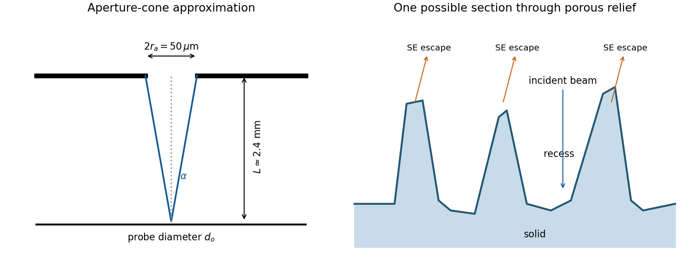

<h1 id="section-a-i/1/iii/solution">Solution</h1>

↑ **Parent:** [Iii](../iii.md)

The SE annotation identifies a [secondary electron](../../../../../../secondary-electron.md) image. The specimen has an open network of ridges, thin walls and irregular cavities, with lateral features on the scale of tens to hundreds of nanometres when compared with the 500 nm bar. Exposed edges can emit [secondary electrons](../../../../../../secondary-electron.md) from more than one nearby surface; inclined faces also have a larger near-surface escape fraction than a face perpendicular to the beam. These mechanisms make protruding rims conspicuous. Recesses can be dark because emitted [secondary electrons](../../../../../../secondary-electron.md) are intercepted or collected less efficiently. A through-lens detector changes the collection geometry, so a simple one-sided illumination analogy is incomplete.[printed pp.10–14, secondary-electron inclination, edge effects and detector collection](../../../../../../scanning-electron-microscope-a-to-z-by-jeol.md)

**An irregular porous relief with bright rims and darker recesses is consistent with the image.** The cross-section below is an original illustrative geometry, rather than a reconstruction of a particular image line. A single [secondary electron](../../../../../../secondary-electron.md) intensity map does not supply calibrated heights, prove that every dark patch is a through-hole, or distinguish charging from all material contrast. Repeat with specimen tilt, altered detector collection or reduced accelerating [voltage](../../../../../../voltage.md), and compare [backscattered electron](../../../../../../backscattered-electron.md) or elemental signals before assigning a compositional cause.

**[Figure 1](#section-a-i/1/iii/image-an-illustrative-porous-surface-topography-cross-section-and-the-aperture-cone-approximation). An illustrative porous surface topography cross-section and the aperture-cone approximation**.

## ↑ Ancestors (11)

1. [Iii](../iii.md)
2. [1](../../1.md)
3. [Section A(i)](../../../section-a-i.md)
4. [Paper 1](../../../../paper-1-split.md)
5. [2017](../../../../split.md)
6. [Past exam of the MPhil in micro- and nanotechnology enterprise course of the University of Cambridge](../../../../../split.md)
7. [MPhil in micro- and nanotechnology enterprise course of the University of Cambridge](../../../../../../mphil-in-micro-and-nanotechnology-enterprise-course-of-the-university-of-cambridge.md)
8. [Course of the University of Cambridge](../../../../../../course-of-the-university-of-cambridge.md)
9. [University of Cambridge](../../../../../../university-of-cambridge-split.md)
10. [List of universities](../../../../../../list-of-universities.md)
11. [Codex Wiki](../../../../../../split.md)
