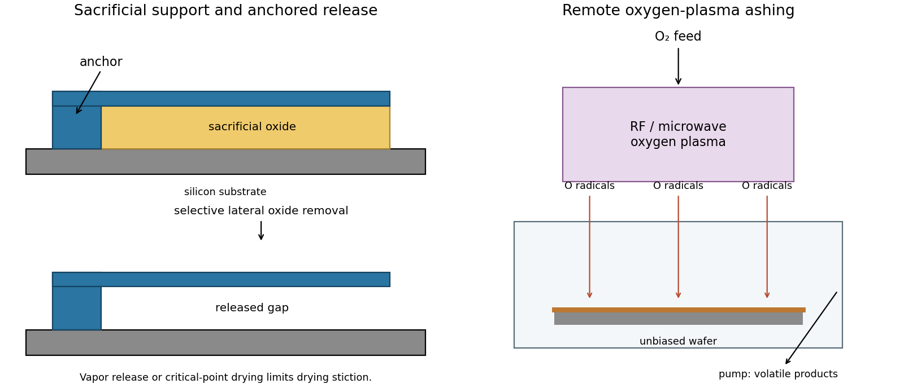

<h1 id="section-a-ii/3/i/solution">Solution</h1>

↑ **Parent:** [I](../i.md)

A [sacrificial layer](../../../../../../sacrificial-layer.md) temporarily supports the intended moving structure and determines its clearance above the substrate. One workable [surface micromachining](../../../../../../surface-micromachining.md) sequence deposits [silicon dioxide](../../../../../../silicon-dioxide.md) on [silicon](../../../../../../silicon.md), opens anchor windows in that oxide, deposits a structural [polysilicon](../../../../../../polysilicon.md) film and patterns the beam and release openings. The structural film contacts the substrate at the anchors. Selective removal of the oxide beneath the beam leaves the beam suspended while retaining its attachment. An access opening or exposed perimeter is essential; an etchant cannot instantly reach sealed material.

The release needs substantial lateral removal, so an [isotropic etch](../../../../../../isotropic-etch.md) with high [etch selectivity](../../../../../../etch-selectivity.md) is useful. Hydrofluoric-acid oxide release is compatible with a suitable [polysilicon](../../../../../../polysilicon.md) structure; a directional [reactive-ion etching](../../../../../../reactive-ion-etching.md) step alone would mainly clear exposed vertical paths and leave material beneath the beam. Choose the structural material, anchor design, sacrificial material and etchant together, and allow for transport-limited undercut and structural residual stress. Wet release followed by ordinary evaporation can pull a compliant structure onto the substrate through [capillary force](../../../../../../capillary-force.md) and cause [stiction](../../../../../../stiction.md). [critical point drying](../../../../../../critical-point-drying.md) or a compatible [vapor-phase release etch](../../../../../../vapor-phase-release-etch.md) avoids the receding [liquid](../../../../../../liquid.md) interface. Neither method removes the need to check residues, selectivity and anchor survival. **Pattern the support and structure first, then selectively undercut the support while preserving the anchors.**[Surface Micromachining: oxide/polysilicon/HF example and capillary stiction](../../../../../../fabricating-mems-and-nanotechnology-by-mems-and-nanotechnology-exchange.md)

**[Figure 3](#section-a-ii/3/i/image-selective-sacrificial-layer-release-and-remote-plasma-ashing). Selective sacrificial layer release and remote plasma ashing**.

## ↑ Ancestors (11)

1. [I](../i.md)
2. [3](../../3.md)
3. [Section A(ii)](../../../section-a-ii.md)
4. [Paper 1](../../../../paper-1-split.md)
5. [2017](../../../../split.md)
6. [Past exam of the MPhil in micro- and nanotechnology enterprise course of the University of Cambridge](../../../../../split.md)
7. [MPhil in micro- and nanotechnology enterprise course of the University of Cambridge](../../../../../../mphil-in-micro-and-nanotechnology-enterprise-course-of-the-university-of-cambridge.md)
8. [Course of the University of Cambridge](../../../../../../course-of-the-university-of-cambridge.md)
9. [University of Cambridge](../../../../../../university-of-cambridge-split.md)
10. [List of universities](../../../../../../list-of-universities.md)
11. [Codex Wiki](../../../../../../split.md)
