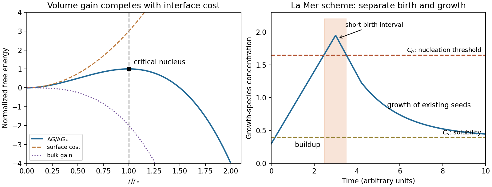

<h1 id="section-b/10/i/solution">Solution</h1>

↑ **Parent:** [I](../i.md)

In a sufficiently supersaturated [vapor](../../../../../../vapor.md), making [liquid](../../../../../../liquid.md) lowers bulk [Gibbs free energy](../../../../../../gibbs-free-energy.md), but making a small droplet creates a costly liquid-vapor interface. The volume contribution scales as $r^3$ and the interfacial cost as $r^2$. Identifying a positive bulk driving [force](../../../../../../force-split.md) density $|\Delta g_v|$ and [interfacial tension](../../../../../../interfacial-tension.md) $\gamma$ gives $A=4|\Delta g_v|/3$ and $B=4\gamma$. In the supplied notation,

$$
\frac{d\Delta G}{dr}=\pi r(-3Ar+2B),\qquad \boxed{r_* =\frac{2B}{3A}},\qquad \Delta G_* =\frac{4\pi B^3}{27A^2}.
$$

At $r_*$, $d^2\Delta G/dr^2=-2\pi B<0$: this is the barrier summit. Subcritical droplets tend to shrink, whereas supercritical droplets can grow by reducing [Gibbs free energy](../../../../../../gibbs-free-energy.md). Fluctuations must cross the barrier before bulk condensation proceeds, especially in a clean [vapor](../../../../../../vapor.md) without effective sites for [heterogeneous nucleation](../../../../../../heterogeneous-nucleation.md). A [temperature](../../../../../../temperature-split.md) just below 100 °C implies a supersaturated [vapor](../../../../../../vapor.md) only with a suitable [pressure](../../../../../../pressure-split.md), such as a [vapor](../../../../../../vapor.md) maintained near one atmosphere; [temperature](../../../../../../temperature-split.md) alone does not specify the driving [force](../../../../../../force-split.md). **The [nucleation](../../../../../../nucleation.md) barrier can delay condensation even when bulk [liquid](../../../../../../liquid.md) is thermodynamically favored.**

**[Figure 6](#section-b/10/i/image-a-classical-nucleation-theory-barrier-and-a-schematic-la-mer-diagram). A classical nucleation theory barrier and a schematic La Mer diagram**.

## ↑ Ancestors (11)

1. [I](../i.md)
2. [10](../../10.md)
3. [Section B](../../../section-b.md)
4. [Paper 1](../../../../paper-1-split.md)
5. [2017](../../../../split.md)
6. [Past exam of the MPhil in micro- and nanotechnology enterprise course of the University of Cambridge](../../../../../split.md)
7. [MPhil in micro- and nanotechnology enterprise course of the University of Cambridge](../../../../../../mphil-in-micro-and-nanotechnology-enterprise-course-of-the-university-of-cambridge.md)
8. [Course of the University of Cambridge](../../../../../../course-of-the-university-of-cambridge.md)
9. [University of Cambridge](../../../../../../university-of-cambridge-split.md)
10. [List of universities](../../../../../../list-of-universities.md)
11. [Codex Wiki](../../../../../../split.md)
