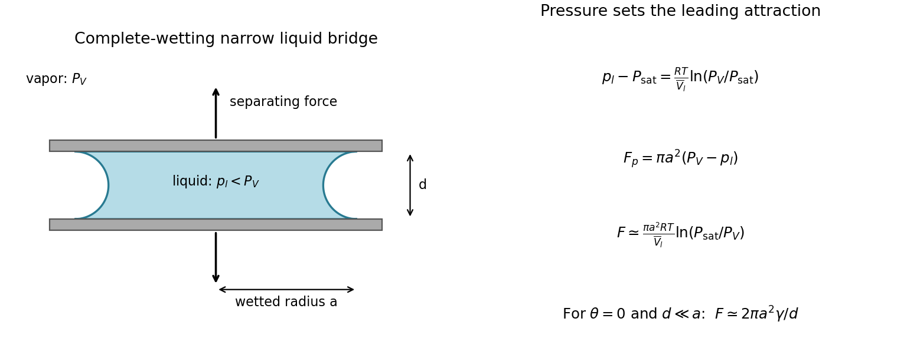

<h1 id="section-b/10/iv/b/solution">Solution</h1>

↑ **Parent:** [B](../b.md)

The [Young–Laplace equation](../../../../../../../young-laplace-equation.md) is $p_l-p_v=\gamma(1/R_1+1/R_2)$ with signed principal curvatures positive for a convex [liquid](../../../../../../../liquid.md) droplet. A [wetting](../../../../../../../wetting.md) bridge between plates has a strongly concave meridional curvature. If the [contact angle](../../../../../../../contact-angle.md) through the [liquid](../../../../../../../liquid.md) is $\theta$, the plate separation is $d$, and the bridge radius is approximately $a\gg d$, then

$$
p_v-p_l\simeq\frac{2\gamma\cos\theta}{d}+O(\gamma/a).
$$

**For complete [wetting](../../../../../../../wetting.md), the leading suction is $p_v-p_l\simeq2\gamma/d$.** The neglected azimuthal curvature is of order $1/a$. A numerical [pressure](../../../../../../../pressure-split.md) cannot be specified without the separation, [surface tension](../../../../../../../surface-tension-split.md) and [wetting](../../../../../../../wetting.md) condition. The full signed-curvature expression remains valid when the narrow-gap approximation is unsuitable.

**[Figure 7](#section-b/10/iv/b/image-capillary-pressure-suction-in-an-original-narrow-liquid-bridge-schematic). capillary pressure suction in an original narrow liquid-bridge schematic**.

## ↑ Ancestors (12)

1. [B](../b.md)
2. [Iv](../../iv.md)
3. [10](../../../10.md)
4. [Section B](../../../../section-b.md)
5. [Paper 1](../../../../../paper-1-split.md)
6. [2017](../../../../../split.md)
7. [Past exam of the MPhil in micro- and nanotechnology enterprise course of the University of Cambridge](../../../../../../split.md)
8. [MPhil in micro- and nanotechnology enterprise course of the University of Cambridge](../../../../../../../mphil-in-micro-and-nanotechnology-enterprise-course-of-the-university-of-cambridge.md)
9. [Course of the University of Cambridge](../../../../../../../course-of-the-university-of-cambridge.md)
10. [University of Cambridge](../../../../../../../university-of-cambridge-split.md)
11. [List of universities](../../../../../../../list-of-universities.md)
12. [Codex Wiki](../../../../../../../split.md)
