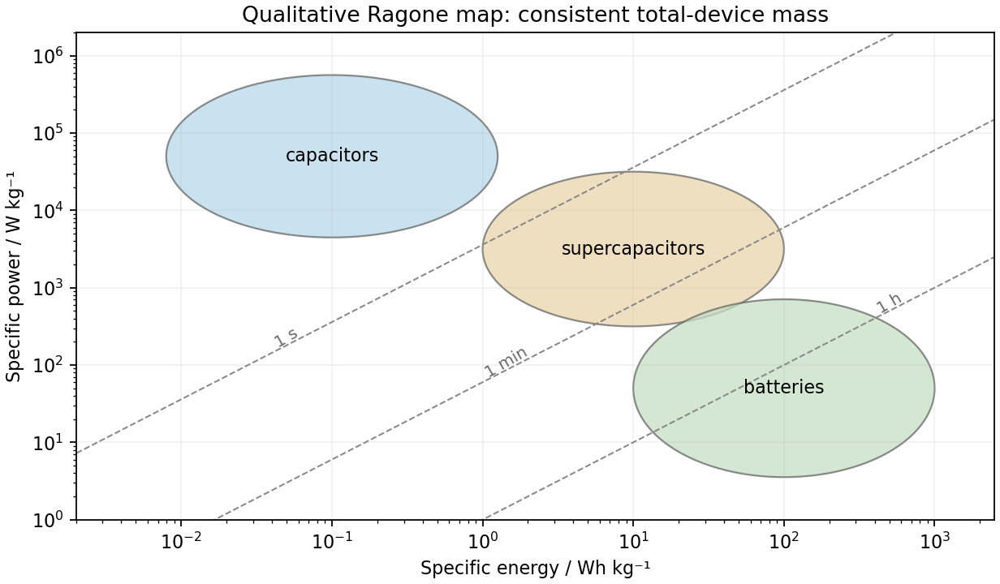

<h1 id="section-b/12/ii/solution">Solution</h1>

↑ **Parent:** [Ii](../ii.md)

[specific energy](../../../../../../specific-energy.md) is usable stored [energy](../../../../../../energy-split.md) divided by device [mass](../../../../../../mass.md), commonly in Wh/kg; [specific power](../../../../../../specific-power.md) is deliverable [power](../../../../../../power.md) per the same [mass](../../../../../../mass.md), in W/kg. The definition must specify whether packaging and inactive components count, and the discharge conditions must be comparable. On a [Ragone plot](../../../../../../ragone-plot.md) with [energy](../../../../../../energy-split.md) horizontal and [power](../../../../../../power.md) vertical, ordinary [capacitors](../../../../../../capacitor.md) occupy high-power/low-energy territory, [batteries](../../../../../../electric-battery.md) tend toward higher [energy](../../../../../../energy-split.md) and lower [power](../../../../../../power.md), and [supercapacitors](../../../../../../supercapacitor.md) bridge and overlap the two. These are broad regions rather than universal measured boundaries.

**High [specific energy](../../../../../../specific-energy.md) means long operation for a given [mass](../../../../../../mass.md); high [specific power](../../../../../../specific-power.md) means rapid delivery.** Their ratio is a characteristic duration: $t_{\rm h}=e_s/p_s$ when the preceding units are used, or $t_{\rm s}=3600e_s/p_s$. The diagonal lines in the sketch keep that unit conversion explicit. A cell's rated [energy](../../../../../../energy-split.md) and peak pulse [power](../../../../../../power.md) need not be available simultaneously throughout discharge.

**[Figure 8](#section-b/12/ii/image-qualitative-storage-regions-and-constant-duration-lines-on-a-ragone-plot). Qualitative storage regions and constant-duration lines on a Ragone plot**.

## ↑ Ancestors (11)

1. [Ii](../ii.md)
2. [12](../../12.md)
3. [Section B](../../../section-b.md)
4. [Paper 1](../../../../paper-1-split.md)
5. [2017](../../../../split.md)
6. [Past exam of the MPhil in micro- and nanotechnology enterprise course of the University of Cambridge](../../../../../split.md)
7. [MPhil in micro- and nanotechnology enterprise course of the University of Cambridge](../../../../../../mphil-in-micro-and-nanotechnology-enterprise-course-of-the-university-of-cambridge.md)
8. [Course of the University of Cambridge](../../../../../../course-of-the-university-of-cambridge.md)
9. [University of Cambridge](../../../../../../university-of-cambridge-split.md)
10. [List of universities](../../../../../../list-of-universities.md)
11. [Codex Wiki](../../../../../../split.md)
