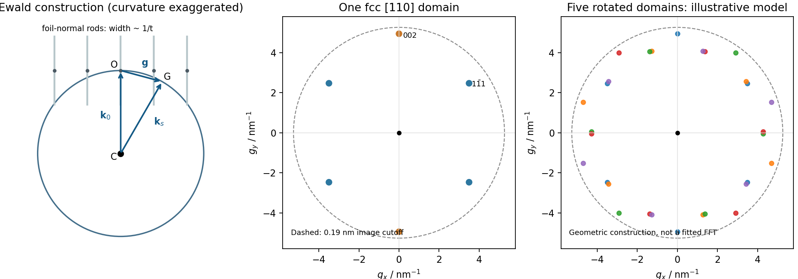

<h1 id="section-b/8/ii/solution">Solution</h1>

↑ **Parent:** [Ii](../ii.md)

Choose cyclic reciprocal units, so the incident and elastically scattered wavevectors have magnitude $1/\lambda$. Place the [reciprocal lattice](../../../../../../reciprocal-lattice.md) origin $O$ at the end of the incident vector from the sphere centre $C$. A reciprocal vector $\mathbf g$ is excited when its endpoint $G$ lies on the [Ewald sphere](../../../../../../ewald-sphere.md), because

$$
\mathbf k_s=\mathbf k_0+\mathbf g,\qquad |\mathbf k_s|=|\mathbf k_0|=1/\lambda.
$$

A specimen tilt rotates the [reciprocal lattice](../../../../../../reciprocal-lattice.md) relative to this construction. The very short [electron](../../../../../../electron.md) [de Broglie wavelength](../../../../../../de-broglie-wavelength.md) makes the sphere nearly flat across several ordinary reciprocal-lattice spacings. In a thin foil, finite thickness $t$ broadens reciprocal points into [reciprocal lattice rods](../../../../../../reciprocal-lattice-rod.md) approximately along the foil normal, with characteristic longitudinal extent $1/t$. A rod may intersect the sphere even when its ideal point is slightly off it. Consequently several reflections can appear simultaneously near a [zone axis](../../../../../../zone-axis.md), and thinning changes the excitation tolerance. A small particle has finite-size broadening in other directions too. This geometrical excitation condition does not guarantee a particular spot intensity: [crystal basis structure factors](../../../../../../crystal-basis-structure-factor.md), specimen thickness and [dynamical diffraction](../../../../../../dynamical-diffraction.md) still matter.

**[Figure 4](#section-b/8/ii/image-local-ewald-sphere-intersections-and-calculated-fcc-gold-reflections). Local Ewald sphere intersections and calculated fcc gold reflections**.

## ↑ Ancestors (11)

1. [Ii](../ii.md)
2. [8](../../8.md)
3. [Section B](../../../section-b.md)
4. [Paper 1](../../../../paper-1-split.md)
5. [2017](../../../../split.md)
6. [Past exam of the MPhil in micro- and nanotechnology enterprise course of the University of Cambridge](../../../../../split.md)
7. [MPhil in micro- and nanotechnology enterprise course of the University of Cambridge](../../../../../../mphil-in-micro-and-nanotechnology-enterprise-course-of-the-university-of-cambridge.md)
8. [Course of the University of Cambridge](../../../../../../course-of-the-university-of-cambridge.md)
9. [University of Cambridge](../../../../../../university-of-cambridge-split.md)
10. [List of universities](../../../../../../list-of-universities.md)
11. [Codex Wiki](../../../../../../split.md)
