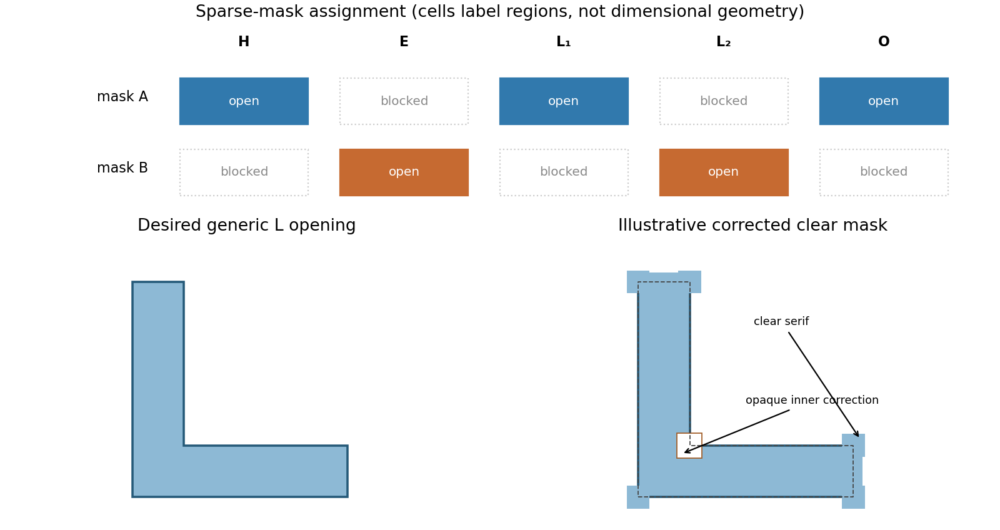

<h1 id="section-b/9/ii/solution">Solution</h1>

↑ **Parent:** [Ii](../ii.md)

Treat the letter-shaped regions as openings to be etched, using positive-tone resist; the clear mask areas therefore correspond to those openings. Label the two L features $L_1,L_2$ from left to right. An alternating assignment is **mask A: H, $L_1$, O; mask B: E, $L_2$**. Each full letter remains on one mask, avoiding unnecessary stitch boundaries across its stems. Nearest-neighbor interletter gaps now occur between different exposures, rather than having to be resolved within one exposure. Verify that each individual letter's internal spaces are still printable; without dimensions, this partition is a process proposal rather than proof of a particular numerical minimum linewidth.

A robust sequence is [litho-etch-litho-etch double patterning](../../../../../../litho-etch-litho-etch-double-patterning.md) into a durable [hard mask](../../../../../../hard-mask.md). Deposit an oxide [hard mask](../../../../../../hard-mask.md) on [silicon](../../../../../../silicon.md); expose and develop mask A and transfer those openings through the [hard mask](../../../../../../hard-mask.md). Strip resist, apply fresh resist, align and expose mask B, then transfer its openings into the same [hard mask](../../../../../../hard-mask.md), the second resist covering mask-A openings during that second oxide transfer. Remove resist and perform one final deep [silicon](../../../../../../silicon.md) etch through the union of the openings. An inductively coupled [deep reactive-ion etching](../../../../../../deep-reactive-ion-etching.md) process with alternating fluorine [etching](../../../../../../etching.md) and sidewall [passivation](../../../../../../passivation.md) gives much more vertical, high-aspect-ratio features than an [isotropic etch](../../../../../../isotropic-etch.md). Mask thickness and [etch selectivity](../../../../../../etch-selectivity.md) must survive the required depth. Control sidewall scalloping, aspect-ratio-dependent etch rate, charging, microloading and the combined overlay/etch-bias budget.

A spacer-based process can produce very fine regular pitches, but arbitrary letter junctions and terminations require additional cut/block patterning; it is not automatically a two-mask solution for this target. **Use two independently transferred sparse masks, then a selective directional deep etch.** The schematic gives the assignment and a generic corner-correction example without reproducing the supplied pattern.

**[Figure 5](#section-b/9/ii/image-alternating-mask-assignment-and-original-l-corner-optical-proximity-correction). Alternating mask assignment and original L-corner optical proximity correction**.

## ↑ Ancestors (11)

1. [Ii](../ii.md)
2. [9](../../9.md)
3. [Section B](../../../section-b.md)
4. [Paper 1](../../../../paper-1-split.md)
5. [2017](../../../../split.md)
6. [Past exam of the MPhil in micro- and nanotechnology enterprise course of the University of Cambridge](../../../../../split.md)
7. [MPhil in micro- and nanotechnology enterprise course of the University of Cambridge](../../../../../../mphil-in-micro-and-nanotechnology-enterprise-course-of-the-university-of-cambridge.md)
8. [Course of the University of Cambridge](../../../../../../course-of-the-university-of-cambridge.md)
9. [University of Cambridge](../../../../../../university-of-cambridge-split.md)
10. [List of universities](../../../../../../list-of-universities.md)
11. [Codex Wiki](../../../../../../split.md)
