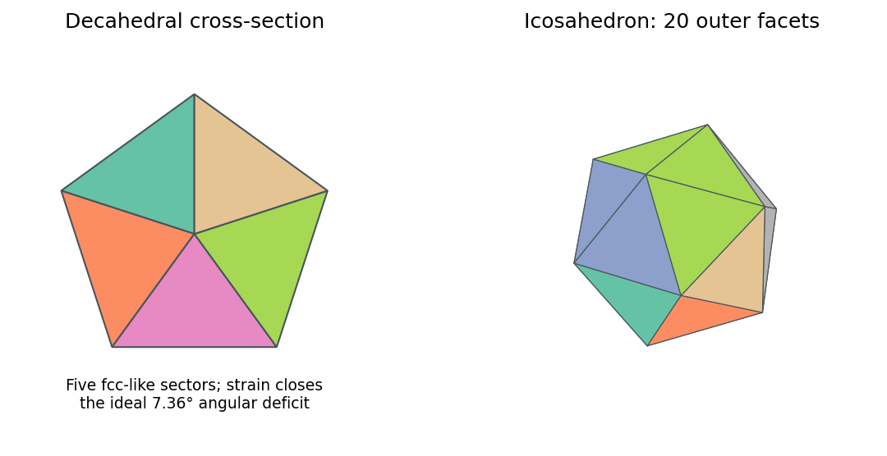
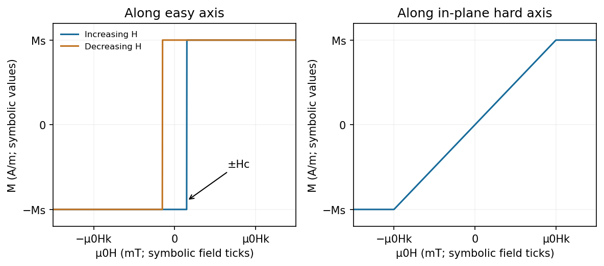
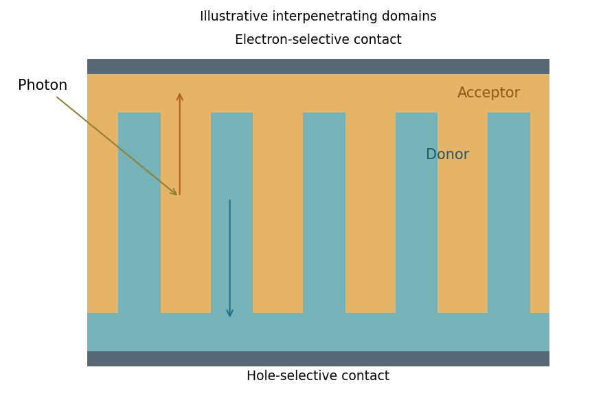
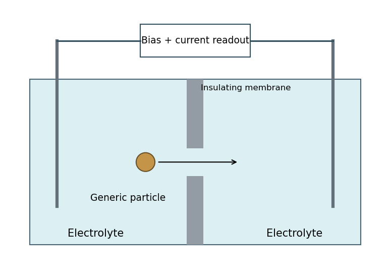
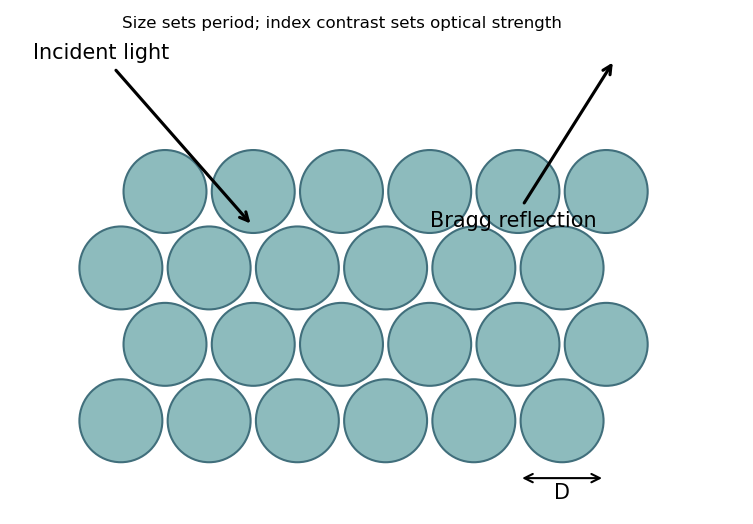

# Paper 2

↑ **Parent:** [2017](../2017.md)

[Original examination archive; NanoMPhil Paper 2 2017.pdf](https://www.whatdotheyknow.com/request/mphil_in_micro_and_nanotechnolog_5/response/2556540/attach/2/FOI%202024%2050%20Dai%20materials.zip?cookie_passthrough=1)

**Table of contents**

- [Section A(i)](#section-a-i)
  - [13](#section-a-i/13)
    - [i](#section-a-i/13/i)
      - [Solution](#section-a-i/13/i/solution)
    - [ii](#section-a-i/13/ii)
      - [Solution](#section-a-i/13/ii/solution)
    - [iii](#section-a-i/13/iii)
      - [Solution](#section-a-i/13/iii/solution)
  - [14](#section-a-i/14)
    - [i](#section-a-i/14/i)
      - [Solution](#section-a-i/14/i/solution)
    - [ii](#section-a-i/14/ii)
      - [Solution](#section-a-i/14/ii/solution)
- [Section A(ii)](#section-a-ii)
  - [15](#section-a-ii/15)
    - [i](#section-a-ii/15/i)
      - [Solution](#section-a-ii/15/i/solution)
    - [ii](#section-a-ii/15/ii)
      - [Solution](#section-a-ii/15/ii/solution)
    - [iii](#section-a-ii/15/iii)
      - [Solution](#section-a-ii/15/iii/solution)
  - [16](#section-a-ii/16)
    - [i](#section-a-ii/16/i)
      - [Solution](#section-a-ii/16/i/solution)
    - [ii](#section-a-ii/16/ii)
      - [a](#section-a-ii/16/ii/a)
        - [Solution](#section-a-ii/16/ii/a/solution)
      - [b](#section-a-ii/16/ii/b)
        - [Solution](#section-a-ii/16/ii/b/solution)
- [Section A(iii)](#section-a-iii)
  - [17](#section-a-iii/17)
    - [i](#section-a-iii/17/i)
      - [Solution](#section-a-iii/17/i/solution)
    - [ii](#section-a-iii/17/ii)
      - [Solution](#section-a-iii/17/ii/solution)
    - [iii](#section-a-iii/17/iii)
      - [Solution](#section-a-iii/17/iii/solution)
  - [18](#section-a-iii/18)
    - [Solution](#section-a-iii/18/solution)
  - [19](#section-a-iii/19)
    - [i](#section-a-iii/19/i)
      - [Solution](#section-a-iii/19/i/solution)
    - [ii](#section-a-iii/19/ii)
      - [Solution](#section-a-iii/19/ii/solution)
    - [iii](#section-a-iii/19/iii)
      - [Solution](#section-a-iii/19/iii/solution)
    - [iv](#section-a-iii/19/iv)
      - [Solution](#section-a-iii/19/iv/solution)
- [Section B](#section-b)
  - [20](#section-b/20)
    - [i](#section-b/20/i)
      - [Solution](#section-b/20/i/solution)
    - [ii](#section-b/20/ii)
      - [Solution](#section-b/20/ii/solution)
    - [iii](#section-b/20/iii)
      - [Solution](#section-b/20/iii/solution)
    - [iv](#section-b/20/iv)
      - [Solution](#section-b/20/iv/solution)
    - [v](#section-b/20/v)
      - [Solution](#section-b/20/v/solution)
  - [21](#section-b/21)
    - [i](#section-b/21/i)
      - [Solution](#section-b/21/i/solution)
    - [ii](#section-b/21/ii)
      - [Solution](#section-b/21/ii/solution)
    - [iii](#section-b/21/iii)
      - [Solution](#section-b/21/iii/solution)
    - [iv](#section-b/21/iv)
      - [Solution](#section-b/21/iv/solution)
  - [22](#section-b/22)
    - [i](#section-b/22/i)
      - [Solution](#section-b/22/i/solution)
    - [ii](#section-b/22/ii)
      - [Solution](#section-b/22/ii/solution)
    - [iii](#section-b/22/iii)
      - [Solution](#section-b/22/iii/solution)
    - [iv](#section-b/22/iv)
      - [Solution](#section-b/22/iv/solution)
    - [v](#section-b/22/v)
      - [Solution](#section-b/22/v/solution)
  - [23A](#section-b/23a)
    - [i](#section-b/23a/i)
      - [Solution](#section-b/23a/i/solution)
    - [ii](#section-b/23a/ii)
      - [Solution](#section-b/23a/ii/solution)
    - [iii](#section-b/23a/iii)
      - [Solution](#section-b/23a/iii/solution)
  - [23B](#section-b/23b)
    - [i](#section-b/23b/i)
      - [Solution](#section-b/23b/i/solution)
    - [ii](#section-b/23b/ii)
      - [Solution](#section-b/23b/ii/solution)
    - [iii](#section-b/23b/iii)
      - [Solution](#section-b/23b/iii/solution)
    - [iv](#section-b/23b/iv)
      - [Solution](#section-b/23b/iv/solution)
    - [v](#section-b/23b/v)
      - [Solution](#section-b/23b/v/solution)

<h2 id="section-a-i">Section A(i)</h2>

↑ **Parent:** [Paper 2](paper-2.md)

<h3 id="section-a-i/13">13</h3>

↑ **Parent:** [Section A(i)](#section-a-i)

<h4 id="section-a-i/13/i">i</h4>

↑ **Parent:** [13](#section-a-i/13)

<h5 id="section-a-i/13/i/solution">Solution</h5>

↑ **Parent:** [I](#section-a-i/13/i)

A **[decahedral nanoparticle](../../engineering.md#decahedral-nanoparticle)** is a [multiply twinned nanoparticle](../../engineering.md#multiply-twinned-nanoparticle): five fcc-like tetrahedral domains share a common fivefold axis and meet on coherent twin planes. The angle of an ideal fcc tetrahedral wedge is $\arccos(1/3)=70.53^\circ$, so five wedges leave about **$7.36^\circ$ of angular deficit**. Elastic distortion and defects accommodate closure. The external shape can be a pentagonal bipyramid or a truncated variant; it is not one unstrained, periodically repeated fcc crystal.

An **[icosahedral nanoparticle](../../engineering.md#icosahedral-nanoparticle)** comprises twenty tetrahedral domains arranged around a common centre, with twenty approximately triangular outer facets, twelve vertices and thirty edges. Five domains meet around each radial fivefold direction. Coherent twinning exposes many low-energy close-packed facets, but fivefold symmetry cannot tile ordinary three-dimensional space periodically without strain. The competition between favourable surface/twin energies and volume-dependent elastic strain explains why such morphologies are especially plausible for small particles.

**[Figure 1](#section-a-i/13/i/image-five-tetrahedral-sectors-in-a-decahedral-cross-section-and-the-twenty-outer-facets-of-an-icosahedron). Five tetrahedral sectors in a decahedral cross-section and the twenty outer facets of an icosahedron**. [Source](paper-2-twinned-particles.py).

These labels describe the observed domain geometry; cobalt can adopt different crystal phases, so identifying fcc-like twinning also requires diffraction rather than assuming every cobalt particle is bulk fcc.

<h4 id="section-a-i/13/ii">ii</h4>

↑ **Parent:** [13](#section-a-i/13)

<h5 id="section-a-i/13/ii/solution">Solution</h5>

↑ **Parent:** [Ii](#section-a-i/13/ii)

The **[Winterbottom construction](../../thermodynamics.md#winterbottom-construction)** extends the [Wulff construction](../../thermodynamics.md#wulff-construction) to a crystal supported on a substrate. It includes the particle-substrate interfacial [energy](../../energy.md) and the substrate [surface energy](../../surface-tension.md#surface-energy) displaced by contact, so the equilibrium Wulff body is truncated by the support plane. The relevant contact contribution is $(\gamma_{ps}-\gamma_s)A_{\rm contact}$; it determines wetting and contact geometry. The basic unsupported construction accounts only for orientation-dependent free surface energies.[Supported-particle equilibrium construction](../../physics-bibliography.md#equilibrium-shape-of-a-small-particle-in-contact-with-a-foreign-substrate-by-w-l-winterbottom)

<h4 id="section-a-i/13/iii">iii</h4>

↑ **Parent:** [13](#section-a-i/13)

<h5 id="section-a-i/13/iii/solution">Solution</h5>

↑ **Parent:** [Iii](#section-a-i/13/iii)

In [cluster-beam deposition](../../engineering.md#cluster-beam-deposition), evaporated or sputtered cobalt atoms cool in an aggregation gas, nucleate clusters and are carried to a substrate. Source [temperature](../../temperature.md), gas pressure, aggregation length and residence time tune the mean size and distribution. A [mass](../../classical-mechanics.md#mass) selector can narrow the delivered size range, at the cost of transmitted flux; an unfiltered beam does not automatically produce monodisperse particles.

Shape control is less direct. Growth kinetics and cluster [temperature](../../temperature.md) can favour particular structures, while multiple morphologies can coexist at one size. Landing [energy](../../energy.md), substrate interactions and post-deposition annealing can change the delivered shape or cause coalescence. Soft landing helps preserve gas-phase clusters. In solution, [ligands](../../protein.md#ligand-biochemistry), selective facet binding, seed-mediated growth and precursor feeding can give stronger chemical control over shape and size, but introduce [ligand](../../protein.md#ligand-biochemistry)/solvent residues and require purification. **Neither method guarantees a unique shape merely by selecting particle size.**

<h3 id="section-a-i/14">14</h3>

↑ **Parent:** [Section A(i)](#section-a-i)

<h4 id="section-a-i/14/i">i</h4>

↑ **Parent:** [14](#section-a-i/14)

<h5 id="section-a-i/14/i/solution">Solution</h5>

↑ **Parent:** [I](#section-a-i/14/i)

A bulk fcc atom has twelve nearest neighbours, whereas surface atoms are undercoordinated: ideal (111) terrace atoms have nine and (100) terrace atoms eight. Steps, kinks, edges and corners can have still lower coordination and different bond-angle environments. These sites change electronic structure, [adsorption](../../physical-chemistry.md#adsorption) energies and activation barriers, making geometrically different sites catalytically inequivalent.

In a Pt-Pd particle, a site's neighbours may be Pt, Pd or a mixture; [surface segregation](../../chemical-substance.md#surface-segregation) means surface composition need not equal overall composition. Alloying also changes strain and electronic interactions. Surface relaxation, reconstruction, adsorbed [ligands](../../protein.md#ligand-biochemistry), oxide or contamination can further alter accessibility and chemical state. A high nominal Pt fraction therefore does not establish either accessible Pt sites or a particular catalytic activity.

<h4 id="section-a-i/14/ii">ii</h4>

↑ **Parent:** [14](#section-a-i/14)

<h5 id="section-a-i/14/ii/solution">Solution</h5>

↑ **Parent:** [Ii](#section-a-i/14/ii)

Use complementary composition, spatial and population measurements:

- **Insufficient Pt:** digest representative aliquots and measure calibrated ICP-OES or ICP-MS to obtain bulk Pt/Pd ratio and trace Fe. Blanks, recovery checks and standards control contamination and matrix effects. This is sensitive and quantitative but destructive and supplies no particle-by-particle spatial information.
- **Poor Pt-Pd mixing:** use STEM-EDS maps or line profiles of many individual particles. Characteristic X-ray energies identify the elements; background subtraction and calibrated sensitivity factors permit local composition estimates. HAADF-STEM supplies complementary atomic-number-sensitive contrast, with Pt generally brighter than Pd for comparable thickness. Core-shell segregation or distinct domains can then be tested. Projected overlap can imitate mixing, and low counts, thickness and beam damage limit nanoscale quantification; tomography or multiple views can resolve important ambiguities.
- **Fe impurities:** [EDS](../../physics.md#energy-dispersive-x-ray-spectroscopy)/[EELS](../../physics.md#electron-energy-loss-spectroscopy) can locate Fe-rich inclusions or surface-associated material, while the bulk digest establishes whether a trace signal is representative. Failure to detect Fe in a few [TEM](../../optics.md#transmission-electron-microscopy) fields does not rule out dilute contamination below local detection limits. [XPS](../../physical-chemistry.md#x-ray-photoelectron-spectroscopy) can additionally assess near-surface composition and oxidation state, but is not a bulk assay.
- **Size uniformity:** obtain calibrated [TEM](../../optics.md#transmission-electron-microscopy) images from randomly chosen independent fields, segment individual particles and report a number-weighted size histogram with sample count and shape descriptors. Avoid overlap and selection of only well-dispersed or attractive particles. A projected diameter is not a complete three-dimensional volume; scattering methods can corroborate ensemble size but weight particles differently.

The strength of [TEM](../../optics.md#transmission-electron-microscopy) is correlating structure, size and local chemistry; its limited sampling is why a representative bulk chemical assay remains valuable.

<h2 id="section-a-ii">Section A(ii)</h2>

↑ **Parent:** [Paper 2](paper-2.md)

<h3 id="section-a-ii/15">15</h3>

↑ **Parent:** [Section A(ii)](#section-a-ii)

<h4 id="section-a-ii/15/i">i</h4>

↑ **Parent:** [15](#section-a-ii/15)

<h5 id="section-a-ii/15/i/solution">Solution</h5>

↑ **Parent:** [I](#section-a-ii/15/i)

Let $x$ run along the wire and $y$ across it. In a separable approximation,

$$
\boxed{\psi_{nk}(x,y)=\frac{e^{ikx}}{\sqrt{L_x}}\phi_n(y),\qquad E_n(k)=E_n^\perp+\frac{\hbar^2k^2}{2m^*}.}
$$

Transverse confinement gives discrete levels $E_n^\perp$, but the long unconfined direction has a nearly continuous longitudinal [wave vector](../../elasticity-physics.md#wavevector) and a **plane-wave factor**. The result is a family of one-dimensional subbands, not a completely discrete spectrum in both in-plane directions. For a hard-wall width $W$, $E_n^\perp=\hbar^2\pi^2n^2/(2m^*W^2)$; an electrostatic confinement potential gives different thresholds. The suppressed out-of-plane degree of freedom is already frozen into the 2DEG subband.

**[Figure 2](#section-a-ii/15/i/image-discrete-transverse-thresholds-coexist-with-continuous-longitudinal-dispersion). Discrete transverse thresholds coexist with continuous longitudinal dispersion**. [Source](paper-2-wire-subbands.py).

<h4 id="section-a-ii/15/ii">ii</h4>

↑ **Parent:** [15](#section-a-ii/15)

<h5 id="section-a-ii/15/ii/solution">Solution</h5>

↑ **Parent:** [Ii](#section-a-ii/15/ii)

One suitable platform is a monolayer **[molybdenum disulfide](../../chemical-substance.md#molybdenum-disulfide)** [semiconductor](../../semiconductor.md). An electrostatic accumulation gate supplies conduction electrons whose motion is confined to the atomic sheet; source and drain contacts act as reservoirs. A clean insulating substrate and dielectric or encapsulation reduce disorder and prevent gate leakage. Two split gates deplete the adjacent sheet and leave a narrow conducting gap, thereby confining the in-plane transverse direction while retaining transport along the gap.

**[Figure 3](#section-a-ii/15/ii/image-split-gates-narrow-a-gated-two-dimensional-semiconductor-sheet-between-source-and-drain-reservoirs). Split gates narrow a gated two-dimensional semiconductor sheet between source and drain reservoirs**. [Source](paper-2-split-gate-device.py).

Apply a small source-drain [voltage](../../random-walk.md#voltage), measure the current and determine linear-response conductance while tuning the split-gate [voltage](../../random-walk.md#voltage) and carrier [density](../../fluid-mechanics.md#density). A [graphene](../../chemical-substance.md#graphene) sheet is another two-dimensional carrier system, but its lack of an ordinary gap complicates purely electrostatic confinement; etched boundaries or a suitable gapped architecture may be needed. A two-dimensional material does not by itself guarantee ballistic transport or resolved subbands.[Electrostatic confinement in a two-dimensional [semiconductor](../../semiconductor.md) platform](../../physics-bibliography.md#split-gated-point-contact-in-mos2-hbn-structures-by-chithra-h-sharma-and-madhu-thalakulam)

<h4 id="section-a-ii/15/iii">iii</h4>

↑ **Parent:** [15](#section-a-ii/15)

<h5 id="section-a-ii/15/iii/solution">Solution</h5>

↑ **Parent:** [Iii](#section-a-ii/15/iii)

For a clean, adiabatically connected GaAs channel at low [temperature](../../temperature.md) and small bias, opening successive spin-degenerate subbands gives

$$
\boxed{G=N\frac{2e^2}{h}.}
$$

Conductance therefore shows a **staircase of plateaux**, rather than the continuously geometry-dependent classical Ohmic result. Each fully transmitted mode contributes approximately $77.5\,\mu\mathrm S$. More positive, or less negative, depletion-gate [voltage](../../random-walk.md#voltage) opens a conventional GaAs constriction; more negative [voltage](../../random-walk.md#voltage) closes it.

**[Figure 4](#section-a-ii/15/iii/image-conductance-rises-in-quantum-steps-as-a-depletion-gate-constriction-opens). Conductance rises in quantum steps as a depletion-gate constriction opens**. [Source](paper-2-conductance.py).

Require subband spacings larger than thermal and bias broadening and a [mean free path](../../ideal-gas.md#mean-free-path) exceeding the constriction length. The general [Landauer formula](../../quantum-mechanics.md#landauer-formula) is $G=(e^2/h)\sum_\alpha T_\alpha$ with each spin/valley channel counted separately. A material with additional valley degeneracy need not have the same step sequence as GaAs, and imperfect transmission or contact resistance blurs the ideal plateaux.

<h3 id="section-a-ii/16">16</h3>

↑ **Parent:** [Section A(ii)](#section-a-ii)

<h4 id="section-a-ii/16/i">i</h4>

↑ **Parent:** [16](#section-a-ii/16)

<h5 id="section-a-ii/16/i/solution">Solution</h5>

↑ **Parent:** [I](#section-a-ii/16/i)

In a **[vibrating-sample magnetometer](../../electromagnetism.md#vibrating-sample-magnetometer)**, a magnetized specimen vibrates sinusoidally in a nominally uniform applied field. Its motion changes the magnetic flux through stationary pickup coils, producing an induced [voltage](../../random-walk.md#voltage) by [Faraday's law of induction](../../maxwell-equations.md#faraday-s-law-of-induction). The component at the vibration frequency is proportional to the sample [magnetic moment](../../electromagnetism.md#magnetic-dipole-moment) times vibration amplitude and frequency, for a calibrated coil geometry.

A lock-in detector referenced to the vibration extracts this small signal. Calibrate with a known moment, stabilize the vibration amplitude and sweep the applied field to measure a [magnetization](../../electromagnetism.md#magnetization) loop. Dividing moment by film volume gives $M$ in $\mathrm{A\,m^{-1}}$; the silicon substrate and holder background must be subtracted for such a thin film.[Section 4.1: pickup signal, vibration amplitude/frequency and synchronous detection](../../physics-bibliography.md#7300-series-vsm-system-user-s-manual-by-lake-shore-cryotronics)

<h4 id="section-a-ii/16/ii">ii</h4>

↑ **Parent:** [16](#section-a-ii/16)

<h5 id="section-a-ii/16/ii/a">a</h5>

↑ **Parent:** [Ii](#section-a-ii/16/ii)

<h6 id="section-a-ii/16/ii/a/solution">Solution</h6>

↑ **Parent:** [A](#section-a-ii/16/ii/a)

Along the **easy axis**, expect an approximately rectangular loop: after saturation the remanent [magnetization](../../electromagnetism.md#magnetization) is close to $\pm M_s$, and reversal occurs near $\pm H_c$ through [nucleation](../../critical-phenomenon.md#nucleation) and domain-wall motion. Permalloy is magnetically soft, so $H_c$ is ordinarily small, although defects and growth conditions set its actual value.

**[Figure 5](#section-a-ii/16/ii/a/image-easy-axis-switching-and-hard-axis-rotation-for-an-idealized-uniaxial-thin-film). Easy-axis switching and hard-axis rotation for an idealized uniaxial thin film**. [Source](paper-2-permalloy-loops.py).

The axes are $M$ in $\mathrm{A\,m^{-1}}$ and applied $\mu_0H$ in $\mathrm{mT}$. $M_s,H_c,H_k$ are symbolic because their measured values are not supplied. The $50\,\mathrm{mT}$ deposition field establishes an axis; it is not the measured coercive or anisotropy field.

<h5 id="section-a-ii/16/ii/b">b</h5>

↑ **Parent:** [Ii](#section-a-ii/16/ii)

<h6 id="section-a-ii/16/ii/b/solution">Solution</h6>

↑ **Parent:** [B](#section-a-ii/16/ii/b)

Along the **in-plane hard axis**, the ideal uniform-magnetization model gives reversible rotation from the easy direction toward the applied field. With uniaxial anisotropy [energy](../../energy.md) [density](../../fluid-mechanics.md#density) $K_u\sin^2\theta$, minimization gives

$$
\boxed{M_{\parallel H}=M_s\frac{H}{H_k}\quad(|H|\leq H_k),\qquad H_k=\frac{2K_u}{\mu_0M_s},}
$$

followed by saturation at $\pm M_s$. The right panel of the preceding figure therefore has a nearly linear central section, essentially zero remanence and ideally no [hysteresis](../../critical-phenomenon.md#hysteresis). Actual domains, misalignment and defects can produce rounding or a small loop. This is an in-plane hard axis; the much larger out-of-plane [demagnetizing field](../../statistical-physics.md#demagnetizing-field) is a different effect.

<h2 id="section-a-iii">Section A(iii)</h2>

↑ **Parent:** [Paper 2](paper-2.md)

<h3 id="section-a-iii/17">17</h3>

↑ **Parent:** [Section A(iii)](#section-a-iii)

<h4 id="section-a-iii/17/i">i</h4>

↑ **Parent:** [17](#section-a-iii/17)

<h5 id="section-a-iii/17/i/solution">Solution</h5>

↑ **Parent:** [I](#section-a-iii/17/i)

TODO: biology deferred by the user.

<h4 id="section-a-iii/17/ii">ii</h4>

↑ **Parent:** [17](#section-a-iii/17)

<h5 id="section-a-iii/17/ii/solution">Solution</h5>

↑ **Parent:** [Ii](#section-a-iii/17/ii)

TODO: biology deferred by the user.

<h4 id="section-a-iii/17/iii">iii</h4>

↑ **Parent:** [17](#section-a-iii/17)

<h5 id="section-a-iii/17/iii/solution">Solution</h5>

↑ **Parent:** [Iii](#section-a-iii/17/iii)

TODO: biology deferred by the user.

<h3 id="section-a-iii/18">18</h3>

↑ **Parent:** [Section A(iii)](#section-a-iii)

<h4 id="section-a-iii/18/solution">Solution</h4>

↑ **Parent:** [18](#section-a-iii/18)

A charged colloid in a polar [electrolyte](../../electrochemistry.md#electrolyte) is surrounded by an **[electric double layer](../../electrostatics.md#electric-double-layer)**. For a negatively charged surface, [counterions](../../chemistry.md#counterion) are positive and [co-ions](../../electrostatics.md#co-ion) negative; their distributions reverse for a positive surface. A compact [Stern layer](../../electrostatics.md#stern-layer) contains specifically adsorbed or closely approaching ions, followed by a diffuse layer where electrostatic attraction competes with thermal motion. Mobile charge integrated over the surroundings balances the particle charge in an overall neutral system.

**[Figure 6](#section-a-iii/18/image-compact-and-diffuse-countercharge-screen-a-negatively-charged-colloidal-surface). Compact and diffuse countercharge screen a negatively charged colloidal surface**. [Source](paper-2-double-layer.py).

For a mean-field dilute [electrolyte](../../electrochemistry.md#electrolyte), $n_i(r)=n_{i,\infty}\exp[-z_ie\psi(r)/(k_BT)]$ with [Poisson's equation](../../partial-differential-equation.md#poisson-s-equation) relates charge [density](../../fluid-mechanics.md#density) and potential. At weak potential, the diffuse potential outside a sphere decays approximately as $\psi(r)\propto e^{-\kappa(r-a)}/r$. The inverse screening length obeys $\kappa^2=e^2\sum_i z_i^2n_{i,\infty}/(\epsilon k_BT)$: added salt shortens the [Debye length](../../physics.md#debye-length). The [zeta potential](../../electrostatics.md#zeta-potential) is the potential at the hydrodynamic slip plane, not necessarily the surface potential. The simple model neglects ion size, correlations and chemical charge regulation; a polar solvent with almost no dissociated ions need not provide a short screening length.

<h3 id="section-a-iii/19">19</h3>

↑ **Parent:** [Section A(iii)](#section-a-iii)

<h4 id="section-a-iii/19/i">i</h4>

↑ **Parent:** [19](#section-a-iii/19)

<h5 id="section-a-iii/19/i/solution">Solution</h5>

↑ **Parent:** [I](#section-a-iii/19/i)

Two examples are **[poly(3-hexylthiophene)](../../semiconductor.md#poly-3-hexylthiophene), [P3HT](../../semiconductor.md#poly-3-hexylthiophene)**, a conjugated polymer commonly used as an electron donor, and **[PCBM](../../semiconductor.md#pcbm)**, a soluble fullerene derivative commonly used as an electron acceptor. Both are [organic semiconductors](../../semiconductor.md#organic-semiconductor); “organic” does not imply that their transport properties are identical. Their blend is a familiar donor-acceptor photovoltaic model system.

<h4 id="section-a-iii/19/ii">ii</h4>

↑ **Parent:** [19](#section-a-iii/19)

<h5 id="section-a-iii/19/ii/solution">Solution</h5>

↑ **Parent:** [Ii](#section-a-iii/19/ii)

An **[exciton](../../quantum-mechanics.md#exciton)** is a Coulomb-correlated electron-hole pair, electrically neutral overall. Three useful properties are:

- **[Exciton binding energy](../../quantum-mechanics.md#exciton-binding-energy):** the [energy](../../energy.md) required to separate the correlated pair into unbound carriers. A larger value makes thermal dissociation less effective; [dielectric screening](../../quantum-mechanics.md#dielectric-screening) and electronic delocalization influence it.
- **Spatial extent:** the characteristic electron-hole separation or [exciton](../../quantum-mechanics.md#exciton) radius. A localized Frenkel-like [exciton](../../quantum-mechanics.md#exciton) is small compared with a [Wannier-Mott exciton](../../quantum-mechanics.md#wannier-mott-exciton) spread over many [unit cells](../../quantum-scattering.md#unit-cell).
- **Lifetime:** the characteristic time before radiative or nonradiative decay. Together with its [diffusion coefficient](../../brownian-motion.md#diffusion-coefficient) it determines a transport scale, often expressed as $L_D=\sqrt{D_X\tau_X}$ in a specified diffusion-length convention.

In many molecular [organic semiconductors](../../semiconductor.md#organic-semiconductor), limited screening and localization make [exciton](../../quantum-mechanics.md#exciton) binding important, so absorption need not immediately produce collectable free charges.

<h4 id="section-a-iii/19/iii">iii</h4>

↑ **Parent:** [19](#section-a-iii/19)

<h5 id="section-a-iii/19/iii/solution">Solution</h5>

↑ **Parent:** [Iii](#section-a-iii/19/iii)

A suitable donor-acceptor heterojunction provides an energetically favourable route from a bound excitation to an interfacial charge-transfer state and then separated carriers. The electron is preferentially transported in the acceptor and the hole in the donor. The interface facilitates dissociation that is inefficient in a single strongly excitonic material; it must also avoid excessive [energy](../../energy.md) loss and rapid interfacial [recombination](../../cosmology.md#recombination-cosmology).

**[Figure 7](#section-a-iii/19/iii/image-an-interpenetrating-donor-acceptor-structure-balances-short-exciton-travel-with-continuous-charge-extraction-paths). An interpenetrating donor-acceptor structure balances short exciton travel with continuous charge-extraction paths**. [Source](paper-2-organic-junction.py).

An idealized [bulk heterojunction](../../quantum-mechanics.md#bulk-heterojunction) places most generated [excitons](../../quantum-mechanics.md#exciton) within roughly a [diffusion](../../thermodynamics.md#diffusion) length of an interface while maintaining continuous donor paths to the hole contact and acceptor paths to the electron contact. Domain dimensions should therefore be comparable to the material's [exciton](../../quantum-mechanics.md#exciton) transport scale, not arbitrarily large. The total absorbing thickness should capture substantial light yet remain within the charge-collection capability set by mobility, field and [recombination](../../cosmology.md#recombination-cosmology). Excessive mixing can impair transport or increase [recombination](../../cosmology.md#recombination-cosmology); very coarse domains waste [excitons](../../quantum-mechanics.md#exciton) before they reach an interface.[[Exciton](../../quantum-mechanics.md#exciton) [diffusion](../../thermodynamics.md#diffusion) as a constraint on planar and [bulk heterojunction](../../quantum-mechanics.md#bulk-heterojunction) dimensions](../../physics-bibliography.md#tailored-exciton-diffusion-in-organic-photovoltaic-cells-by-s-matthew-menke-and-others)

<h4 id="section-a-iii/19/iv">iv</h4>

↑ **Parent:** [19](#section-a-iii/19)

<h5 id="section-a-iii/19/iv/solution">Solution</h5>

↑ **Parent:** [Iv](#section-a-iii/19/iv)

Relative to conventional crystalline-silicon technology, many organic absorbers offer low-temperature thin-film processing and lightweight flexible devices, but have more strongly bound [excitons](../../quantum-mechanics.md#exciton) and more disorder-limited charge transport. These are common material trends, not universal statements about every organic or inorganic device.

Relevant [semiconductor](../../semiconductor.md) properties include the absorption spectrum and optical gap, donor/acceptor [energy](../../energy.md) levels and offsets, [dielectric screening](../../quantum-mechanics.md#dielectric-screening) and [exciton](../../quantum-mechanics.md#exciton) dissociation, electron/hole mobilities, [recombination](../../cosmology.md#recombination-cosmology) lifetimes, traps and morphological stability. Contacts must extract the appropriate carrier selectively. These properties determine the device quantities in

$$
\boxed{\eta=\frac{J_{\rm sc}V_{\rm oc}\,\mathrm{FF}}{P_{\rm in}}.}
$$

A favourable gap alone does not fix efficiency: current generation, [voltage](../../random-walk.md#voltage) loss and fill factor must all be controlled.

## Section B

↑ **Parent:** [Paper 2](paper-2.md)

<h3 id="section-b/20">20</h3>

↑ **Parent:** [Section B](#section-b)

<h4 id="section-b/20/i">i</h4>

↑ **Parent:** [20](#section-b/20)

<h5 id="section-b/20/i/solution">Solution</h5>

↑ **Parent:** [I](#section-b/20/i)

In floating-catalyst CNT growth, a controlled [sulfur](../../chemical-substance.md#sulfur) additive acts as a **growth promoter** for the [catalyst](../../chemical-kinetics.md#catalyst), commonly iron. [Sulfur](../../chemical-substance.md#sulfur) modifies [catalyst](../../chemical-kinetics.md#catalyst) surface composition, carbon uptake and the strength of the catalyst-carbon interaction; it can facilitate cap formation/lift-off and sustained tube growth instead of complete [catalyst](../../chemical-kinetics.md#catalyst) encapsulation. It also changes catalyst-particle evolution and hence tube yield, diameter and wall-count distributions.

There is an optimum range: excessive [sulfur](../../chemical-substance.md#sulfur) can occupy active sites or form an insufficiently active sulfide-rich [catalyst](../../chemical-kinetics.md#catalyst) and reduce growth. The additive is not simply a constituent that must be incorporated into every carbon wall. Its detailed action depends on [catalyst](../../chemical-kinetics.md#catalyst), carbon source and process conditions; a single universal melting-point explanation is insufficient.[First-principles evidence for [sulfur](../../chemical-substance.md#sulfur) weakening iron-carbon binding; later mechanistic support, not an official answer](../../chemistry-bibliography.md#the-promoter-role-of-sulfur-in-carbon-nanotube-growth-by-balazs-orban-and-tibor-holtzl)

<h4 id="section-b/20/ii">ii</h4>

↑ **Parent:** [20](#section-b/20)

<h5 id="section-b/20/ii/solution">Solution</h5>

↑ **Parent:** [Ii](#section-b/20/ii)

The circumference is the length of the [graphene](../../chemical-substance.md#graphene) wrapping vector:

$$
C=a\sqrt{n^2+nm+m^2},\qquad D=\frac C\pi.
$$

For $(12,12)$,

$$
\boxed{D=\frac{0.246\sqrt{432}}\pi=1.63\,\mathrm{nm}.}
$$

Approximating the closest wall-to-wall separation by the graphite interlayer spacing $d_{002}=c/2=0.3355\,\mathrm{nm}$ gives the nearest-neighbour axis separation in a triangularly packed bundle:

$$
\boxed{s=D+d_{002}\simeq1.96\,\mathrm{nm}.}
$$

This assumes undeformed circular tubes with a graphitic contact gap. Faceting, flattening, adsorbates or pressure can alter a real bundle's spacing.

<h4 id="section-b/20/iii">iii</h4>

↑ **Parent:** [20](#section-b/20)

<h5 id="section-b/20/iii/solution">Solution</h5>

↑ **Parent:** [Iii](#section-b/20/iii)

Each concentric shell has a different circumference, so it generally needs a different integer wrapping vector $(n,m)$. Different vector lengths do not [force](../../force.md) different chiral angles, but exact atomic registry between all curved shells is geometrically restrictive. The shells can nucleate with different wrapping orientations, and strong covalent bonding within each shell dominates the weaker intershell interaction.

Consequently, it is usually unnecessary to strain every shell into a common orientation and registry; many multiwall tubes have incommensurate shells with different chiral angles. **Identical chiral angles are possible**, for example among suitable members of one armchair family, and should not be ruled out purely because the radii differ. Atomic indices, chiral angle and interwall commensurability are distinct descriptions.

<h4 id="section-b/20/iv">iv</h4>

↑ **Parent:** [20](#section-b/20)

<h5 id="section-b/20/iv/solution">Solution</h5>

↑ **Parent:** [Iv](#section-b/20/iv)

The real-space carbon honeycomb has two atoms in a primitive cell of its triangular [Bravais lattice](../../quantum-scattering.md#bravais-lattice). The [reciprocal lattice](../../quantum-scattering.md#reciprocal-lattice) is also triangular, and its Wigner-Seitz cell is a hexagonal first [Brillouin zone](../../bloch-s-theorem.md#brillouin-zone). With a consistent orientation convention, **the reciprocal-zone hexagon is rotated by $30^\circ$ relative to a real-space carbon-ring hexagon**; reciprocal lengths scale inversely with the direct lattice spacing.

**[Figure 8](#section-b/20/iv/image-real-carbon-rings-the-rotated-graphene-reciprocal-zone-and-circumferential-momentum-quantization). Real carbon rings, the rotated graphene reciprocal zone and circumferential momentum quantization**. [Source](paper-2-nanotube-reciprocal.py).

Rolling into a tube imposes $\mathbf k\cdot\mathbf C_h=2\pi\ell$, leaving parallel allowed lines in [graphene](../../chemical-substance.md#graphene)'s two-dimensional reciprocal space. They run along the tube-axis direction, perpendicular to the circumferential wrapping vector. The nanotube's actual one-dimensional [Brillouin zone](../../bloch-s-theorem.md#brillouin-zone) is an interval of axial [wave vectors](../../elasticity-physics.md#wavevector) with period $2\pi/|\mathbf T|$, where $\mathbf T$ is its axial translation. The parent hexagon is therefore a zone-folding construction, not a literal two-dimensional [Brillouin zone](../../bloch-s-theorem.md#brillouin-zone) for the finished one-dimensional tube.

<h4 id="section-b/20/v">v</h4>

↑ **Parent:** [20](#section-b/20)

<h5 id="section-b/20/v/solution">Solution</h5>

↑ **Parent:** [V](#section-b/20/v)

For a $(10,0)$ tube, $C=10a=2.46\,\mathrm{nm}$. A cut normal to its axis crosses ten axial load-bearing C-C bonds in the ideal unstrained honeycomb geometry. Assuming equal load sharing and simultaneous failure at $8\,\mathrm{nN}$ per bond,

$$
F_{\max}\simeq10(8\,\mathrm{nN})=80\,\mathrm{nN}.
$$

The [graphene](../../chemical-substance.md#graphene) areal [mass](../../classical-mechanics.md#mass) is $\sigma_m=0.75\,\mathrm{mg\,m^{-2}}=7.5\times10^{-7}\,\mathrm{kg\,m^{-2}}$, giving linear [mass](../../classical-mechanics.md#mass) [density](../../fluid-mechanics.md#density)

$$
\lambda=\sigma_mC=1.845\times10^{-15}\,\mathrm{kg\,m^{-1}}=1.845\times10^{-9}\,\mathrm{tex},
$$

since the [tex unit](../../engineering.md#tex-unit) has $1\,\mathrm{tex}=10^{-6}\,\mathrm{kg\,m^{-1}}$. Thus the [ideal carbon nanotube tenacity](../../chemical-substance.md#ideal-carbon-nanotube-tenacity) is

$$
\boxed{\frac{F_{\max}}{\lambda}=43.4\,\mathrm{N/tex}.}
$$

This neglects vacancies, curvature-induced changes in bond strength, thermal activation, imperfect load sharing and structural relaxation at failure. An aligned macroscopic fibre is a network of finite tubes or bundles: sliding, weak intertube shear transfer, imperfect alignment, defects and unequal load participation limit its strength. The nominal $10\,\mu\mathrm m$ fibre diameter alone does not turn it into one defect-free covalent cylinder, explaining why a value near $2\,\mathrm{N/tex}$ can be much lower than this ideal single-tube estimate.

<h3 id="section-b/21">21</h3>

↑ **Parent:** [Section B](#section-b)

<h4 id="section-b/21/i">i</h4>

↑ **Parent:** [21](#section-b/21)

<h5 id="section-b/21/i/solution">Solution</h5>

↑ **Parent:** [I](#section-b/21/i)

Take $0<E<V_0$ and equal electron [mass](../../classical-mechanics.md#mass) in all regions. Define $k=\sqrt{2mE}/\hbar$ and $\kappa=\sqrt{2m(V_0-E)}/\hbar$. Then

$$
\begin{aligned}
\mathrm I:&\quad-\frac{\hbar^2}{2m}\psi''=E\psi,\qquad\psi_I=Ae^{ikx}+Be^{-ikx},\\
\mathrm {II}:&\quad-\frac{\hbar^2}{2m}\psi''+V_0\psi=E\psi,\qquad\psi_{II}=Ce^{\kappa x}+De^{-\kappa x},\\
\mathrm {III}:&\quad-\frac{\hbar^2}{2m}\psi''=E\psi,\qquad\psi_{III}=Fe^{ikx}.
\end{aligned}
$$

There is no wave incident from the far right. Region I contains oscillatory incident and reflected waves; region II is **evanescent**, with real exponentials rather than propagating [plane waves](../../wave-function.md#plane-wave). Both exponential terms are allowed in a finite barrier; deleting the growing term before boundary matching is generally incorrect. A complex superposition in the barrier can carry a nonzero conserved tunnelling current.

<h4 id="section-b/21/ii">ii</h4>

↑ **Parent:** [21](#section-b/21)

<h5 id="section-b/21/ii/solution">Solution</h5>

↑ **Parent:** [Ii](#section-b/21/ii)

For a finite potential step and constant [mass](../../classical-mechanics.md#mass), $\psi$ and $\psi'$ are continuous. A finite jump of $\psi'$ would require a delta-function contribution in the integrated equation, while a jump of $\psi$ would be still more singular. Matching the preceding amplitudes gives

$$
\boxed{\begin{aligned}
A+B&=C+D,\\
ik(A-B)&=\kappa(C-D),\\
Ce^{\kappa a}+De^{-\kappa a}&=Fe^{ika},\\
\kappa(Ce^{\kappa a}-De^{-\kappa a})&=ikFe^{ika}.
\end{aligned}}
$$

The [transmission probability](../../quantum-scattering.md#transmission-probability) is $|F/A|^2$ because the incident and transmitted regions have equal [wave vector](../../elasticity-physics.md#wavevector) and [mass](../../classical-mechanics.md#mass); in unequal leads a velocity ratio is also required. These matching conditions do not apply unmodified to infinite walls, delta barriers or [mass](../../classical-mechanics.md#mass) discontinuities.

<h4 id="section-b/21/iii">iii</h4>

↑ **Parent:** [21](#section-b/21)

<h5 id="section-b/21/iii/solution">Solution</h5>

↑ **Parent:** [Iii](#section-b/21/iii)

Between two barriers, region III becomes a **finite intermediate well** containing both right- and left-moving oscillatory components, $Pe^{ikx}+Qe^{-ikx}$. Repeated reflection produces standing-wave-like enhancement and quasi-bound levels with finite escape lifetimes. At resonant energies, the multiple transmitted amplitudes add constructively: an ideal symmetric lossless pair can have transmission approaching unity even when a single barrier transmits poorly. Away from resonance the pair strongly suppresses transmission.

**[Figure 9](#section-b/21/iii/image-calculated-single-and-double-barrier-transmission-and-a-separate-qualitative-resonant-tunnelling-current-voltage-characteristic). Calculated single- and double-barrier transmission and a separate qualitative resonant-tunnelling current-voltage characteristic**. [Source](paper-2-resonant-tunnelling.py).

A useful phase condition is $2k\ell+\varphi_{r1}+\varphi_{r2}=2\pi n$, where $\ell$ is the intermediate-well width and the reflection phases account for penetration into the barriers. The printed figure starts the second barrier at $a+L$, so its well width is $L$; if the prose's second-barrier position $L$ is used instead, the width is $L-a$. The resonance argument is unchanged once that geometrical convention is fixed.

<h4 id="section-b/21/iv">iv</h4>

↑ **Parent:** [21](#section-b/21)

<h5 id="section-b/21/iv/solution">Solution</h5>

↑ **Parent:** [Iv](#section-b/21/iv)

The intended **double-barrier resonant-tunnelling diode** has a bias-dependent well level. Initially increasing bias can bring a quasi-bound level into alignment with available occupied emitter states, sharply increasing current. At larger bias the resonant level moves out of the effective injection window, for example below the emitter conduction-band edge, so resonant transmission and current decrease despite increasing [voltage](../../random-walk.md#voltage). This produces a peak-to-valley interval with **$dI/dV<0$**. Further bias can increase nonresonant or higher-level current again.

The right panel of the preceding figure is a qualitative example. The device can supply small-signal negative differential conductance to an appropriate oscillator circuit while its current and [voltage](../../random-walk.md#voltage) remain positive. A bias-independent transmission function alone does not guarantee NDR: the voltage-dependent potential profile, contacts and carrier supply must be included. The source's reference to part (ii) appears to point to the earlier barrier matching; the resonant device mechanism uses the added barrier of part (iii).

<h3 id="section-b/22">22</h3>

↑ **Parent:** [Section B](#section-b)

<h4 id="section-b/22/i">i</h4>

↑ **Parent:** [22](#section-b/22)

<h5 id="section-b/22/i/solution">Solution</h5>

↑ **Parent:** [I](#section-b/22/i)

In generic **[resistive-pulse sensing](../../fluid-mechanics.md#resistive-pulse-sensing)**, two [electrolyte](../../electrochemistry.md#electrolyte) reservoirs are connected through a small aperture. Electrodes apply a bias and a low-noise current amplifier records the pore current. Passage of a weakly charged insulating particle excludes conducting liquid, usually increasing resistance and giving a transient current decrease at fixed [voltage](../../random-walk.md#voltage). Pulse amplitude, duration and event rate contain size-, transport- and concentration-dependent information, subject to calibration.

Advantages include label-free single-particle counting, electrical readout and small active volume. Limitations include clogging, electrode/pore noise, finite bandwidth, uncertain particle trajectories and surface-conduction effects; a pulse is not intrinsically chemically specific. Strong particle charge or concentration polarization can complicate, or even reverse, the simple blockade signal. The schematic below uses only generic nonbiological particle transport.

**[Figure 10](#section-b/22/i/image-generic-particle-sensing-through-an-electrolyte-filled-aperture-with-voltage-bias-and-current-readout). Generic particle sensing through an electrolyte-filled aperture with voltage bias and current readout**. [Source](paper-2-resistive-pulse.py).

<h4 id="section-b/22/ii">ii</h4>

↑ **Parent:** [22](#section-b/22)

<h5 id="section-b/22/ii/solution">Solution</h5>

↑ **Parent:** [Ii](#section-b/22/ii)

Ignoring access effects and wall charge, the cylindrical conducting liquid has

$$
\boxed{R=\frac{\ell}{\sigma\pi r^2}=\frac{100\times10^{-9}}{1.25\pi(5\times10^{-9})^2}=1.02\times10^9\,\Omega.}
$$

The corresponding conductance is approximately $0.982\,\mathrm{nS}$. A charged surface can contribute mobile [counterions](../../chemistry.md#counterion) and change this estimate. Surface conduction is important when its conductance is comparable with the bulk contribution: for surface conductance $K_s$, their ratio in a cylinder is $2K_s/(\sigma r)$, twice the [Dukhin number](../../electrostatics.md#dukhin-number) convention $K_s/(\sigma r)$. Double-layer overlap, when the [Debye length](../../physics.md#debye-length) is comparable with the pore radius, is another warning that uniform bulk conductivity is inadequate. No surface-charge or ionic-strength data are supplied to quantify those corrections.

<h4 id="section-b/22/iii">iii</h4>

↑ **Parent:** [22](#section-b/22)

<h5 id="section-b/22/iii/solution">Solution</h5>

↑ **Parent:** [Iii](#section-b/22/iii)

With the left reservoir at $V$ and the right at zero, let the pore run from $x=0$ to $x=\ell$. In the stated idealization the reservoir potentials are flat, the pore potential is $\phi(x)=V(1-x/\ell)$, and its electric field is **$E_x=-d\phi/dx=V/\ell$**, directed from high to low potential. The field is zero in the ideal equipotential reservoirs; real access regions would round these abrupt boundaries.

**[Figure 11](#section-b/22/iii/image-ideal-potential-field-and-current-blockade-for-a-generic-insulating-particle-crossing-a-uniform-pore). Ideal potential, field and current blockade for a generic insulating particle crossing a uniform pore**. [Source](paper-2-pore-signals.py).

For constant-speed passage and an approximately position-independent in-pore obstruction, the current has a rectangular downward pulse from $I_0$ to $I_0-\Delta I$ during occupation. Entry, exit, filtering and nonuniform fields round real pulses. This describes a physical particle signal without inferring any biological identity or charge.

<h4 id="section-b/22/iv">iv</h4>

↑ **Parent:** [22](#section-b/22)

<h5 id="section-b/22/iv/solution">Solution</h5>

↑ **Parent:** [Iv](#section-b/22/iv)

TODO: biology deferred by the user.

<h4 id="section-b/22/v">v</h4>

↑ **Parent:** [22](#section-b/22)

<h5 id="section-b/22/v/solution">Solution</h5>

↑ **Parent:** [V](#section-b/22/v)

TODO: biology deferred by the user.

<h3 id="section-b/23a">23A</h3>

↑ **Parent:** [Section B](#section-b)

<h4 id="section-b/23a/i">i</h4>

↑ **Parent:** [23A](#section-b/23a)

<h5 id="section-b/23a/i/solution">Solution</h5>

↑ **Parent:** [I](#section-b/23a/i)

**[Self-assembly](../../engineering.md#self-assembly)** is organization of interacting building blocks into a larger structure without individually placing every component. Static [self-assembly](../../engineering.md#self-assembly) approaches an equilibrium free-energy minimum under fixed conditions; a resulting structure may subsequently become kinetically trapped. Dynamic [self-assembly](../../engineering.md#self-assembly) maintains a nonequilibrium organized state through continuing [energy](../../energy.md) or matter throughput and dissipation, and can change or disappear when that drive is removed.

For nanofabrication, parallel assembly of many small components can generate fine periodicity, hierarchical structures and adaptive or self-repairing arrangements with limited direct patterning. Building-block chemistry encodes interactions. However, access to a desired morphology depends on kinetics and competing states; assembly does not automatically eliminate defects or provide arbitrary device geometry.

<h4 id="section-b/23a/ii">ii</h4>

↑ **Parent:** [23A](#section-b/23a)

<h5 id="section-b/23a/ii/solution">Solution</h5>

↑ **Parent:** [Ii](#section-b/23a/ii)

Relevant interactions include **van der Waals attraction**, **electrostatic attraction or screened repulsion**, **[hydrogen bonding](../../chemical-bond.md#hydrogen-bonding)**, and **hydrophobic/solvophobic association**. Coordination bonding, magnetic dipole interactions and capillary [forces](../../force.md) can also organize suitable building blocks. Entropic effects, including depletion attraction and packing [entropy](../../entropy.md), can drive ordering even without a new chemical bond. Which contribution favours assembly depends on solvent, [temperature](../../temperature.md), concentration and surface chemistry; the complete balance is a free-energy change, not a requirement that every interaction be attractive.

<h4 id="section-b/23a/iii">iii</h4>

↑ **Parent:** [23A](#section-b/23a)

<h5 id="section-b/23a/iii/solution">Solution</h5>

↑ **Parent:** [Iii](#section-b/23a/iii)

Consider a [colloidal photonic crystal](../../optics.md#colloidal-photonic-crystal) assembled from nearly monodisperse dielectric spheres. Spherical geometry and approximately isotropic interactions favour close-packed arrays, although fcc, hcp and stacking-disordered structures can compete. Sphere diameter $D$ sets the periodic optical length scale. For an ideal close-packed fcc array,

$$
d_{111}=\sqrt{\frac23}D,\qquad\lambda_{\rm Bragg}\simeq2n_{\rm eff}d_{111}
$$

at normal incidence in the simple effective-index picture. Thus changing the building-block size tunes the reflected wavelength; refractive-index contrast affects stop-band strength. Surface charge and screening control colloidal stability and rearrangement during assembly, while polydispersity, roughness and stacking defects broaden the optical response and increase scattering.

**[Figure 12](#section-b/23a/iii/image-building-block-size-and-refractive-index-set-the-optical-response-of-a-colloidal-array). Building-block size and refractive index set the optical response of a colloidal array**. [Source](paper-2-photonic-assembly.py).

This connects sphere-level geometry and material response to collective periodic optical behaviour. The Bragg reflection estimate does not establish a complete three-dimensional photonic band gap.

<h3 id="section-b/23b">23B</h3>

↑ **Parent:** [Section B](#section-b)

<h4 id="section-b/23b/i">i</h4>

↑ **Parent:** [23B](#section-b/23b)

<h5 id="section-b/23b/i/solution">Solution</h5>

↑ **Parent:** [I](#section-b/23b/i)

**[Brownian motion](../../brownian-motion.md)** is the fluctuating motion of a suspended particle produced by thermal molecular collisions. Using the standard [Brownian displacement conventions](../../brownian-motion.md#brownian-displacement-conventions), in a uniform fluid without external drift, mean displacement is zero but mean-square displacement grows with time. For overdamped [diffusion](../../thermodynamics.md#diffusion), $\langle\Delta x^2\rangle=2Dt$ in one coordinate and $\langle|\Delta\mathbf r|^2\rangle=6Dt$ in three dimensions, with $D=k_BT/\zeta$ and Stokes friction $\zeta=6\pi\eta a$ for a no-slip sphere.

Brownian transport brings [nanoparticles](../../engineering.md#nanoparticle) into encounters and allows them to explore configurations during [self-assembly](../../engineering.md#self-assembly). Reversible interactions permit rearrangement toward low-free-energy structures; interactions that are too strong can instead trap disordered aggregates. [Thermal fluctuations](../../statistical-physics.md#thermal-fluctuation) also oppose localization in shallow traps. The symbol $\zeta$ avoids confusing friction with an unrelated chemical potential.

<h4 id="section-b/23b/ii">ii</h4>

↑ **Parent:** [23B](#section-b/23b)

<h5 id="section-b/23b/ii/solution">Solution</h5>

↑ **Parent:** [Ii](#section-b/23b/ii)

For radius $a=10\,\mathrm{nm}$ and gold [density](../../fluid-mechanics.md#density) $2.0\times10^4\,\mathrm{kg\,m^{-3}}$, $m=8.38\times10^{-20}\,\mathrm{kg}$. The supplied Stokes model gives $\zeta=3.96\times10^{-12}\,\mathrm{kg\,s^{-1}}$ and $D=1.05\times10^{-9}\,\mathrm{m^2\,s^{-1}}$ at $300\,\mathrm K$. Therefore the standard one-second diffusive rms distances are **$45.7\,\mu\mathrm m$ in one coordinate** and **$79.2\,\mu\mathrm m$ in three dimensions**.

Using the source's supplied shorthand literally with $m\langle v^2\rangle=3k_BT$ instead gives $\sqrt{3k_BTt/\zeta}=56.0\,\mu\mathrm m$. That shorthand lacks the factor two in the standard long-time mean-square displacement; it should not be identified with either of the preceding standard rms conventions. None of these rms values is a cumulative path length.

An ideal drag-free fall from rest gives **$gt^2/2=4.91\,\mathrm m$**. Actual gravitational settling in the assumed viscous model is much smaller: $\tau_p=m/\zeta=2.12\times10^{-8}\,\mathrm s$, $u_t=mg/\zeta=0.208\,\mu\mathrm{m\,s^{-1}}$, and displacement in one second is approximately **$0.208\,\mu\mathrm m$**. Thus [diffusion](../../thermodynamics.md#diffusion) overwhelms settling, even though ideal vacuum fall exceeds the rms [diffusion](../../thermodynamics.md#diffusion) distance. For [rarefied-gas nanoparticle drag](../../stokes-flow.md#rarefied-gas-nanoparticle-drag), at a 20-nm size in argon, continuum no-slip drag may require a rarefaction/slip correction; pressure and gas mean-free-path data are absent, so these numerical transport estimates are conditional on the supplied Stokes model.

<h4 id="section-b/23b/iii">iii</h4>

↑ **Parent:** [23B](#section-b/23b)

<h5 id="section-b/23b/iii/solution">Solution</h5>

↑ **Parent:** [Iii](#section-b/23b/iii)

For fluid [density](../../fluid-mechanics.md#density) $\rho_f$, speed $U$ and characteristic length $d$, inertial kinetic [energy](../../energy.md) scales as $\rho_fd^3U^2$ while viscous work over distance $d$ scales as $\eta Ud^2$. Their ratio is the **[Reynolds number](../../dynamic-viscosity.md#reynolds-number)**,

$$
\boxed{\mathrm{Re}=\frac{\rho_fUd}{\eta}.}
$$

Smaller particles at a fixed speed have smaller Re, so viscous stresses dominate fluid inertia when $\mathrm{Re}\ll1$. Increasing speed increases Re and eventually makes inertia more important, rather than making viscous dominance stronger.

Particle inertia is a separate issue. Its [particle velocity-relaxation time](../../stokes-flow.md#particle-velocity-relaxation-time) is $\tau_p=\rho_pd^2/(18\eta)$; comparing it with a travel time $d/U$ gives a [Stokes number](../../fluid-mechanics.md#stokes-number) $\tau_pU/d$. This uses particle [density](../../fluid-mechanics.md#density) $\rho_p$, whereas the fluid [Reynolds number](../../dynamic-viscosity.md#reynolds-number) uses fluid [density](../../fluid-mechanics.md#density) $\rho_f$.

<h4 id="section-b/23b/iv">iv</h4>

↑ **Parent:** [23B](#section-b/23b)

<h5 id="section-b/23b/iv/solution">Solution</h5>

↑ **Parent:** [Iv](#section-b/23b/iv)

Interpreting the nominal size as diameter $d=10\,\mathrm{nm}$, fluid viscous dominance requires

$$
\boxed{U\ll\frac{\eta}{\rho_f d}=\frac{6.0\times10^4}{\rho_f}\,\mathrm{m\,s^{-1}},}
$$

with $\rho_f$ in $\mathrm{kg\,m^{-3}}$. **The liquid [density](../../fluid-mechanics.md#density) is not supplied**, so the conventional fluid-Reynolds crossover is not numerically fixed. As an explicitly additional illustrative assumption, $\rho_f=870\,\mathrm{kg\,m^{-3}}$ gives $\mathrm{Re}=1$ near $69\,\mathrm{m\,s^{-1}}$; ordinary much slower [nanoparticle](../../engineering.md#nanoparticle) motion is well within the viscous regime.

If instead the supplied gold [density](../../fluid-mechanics.md#density) is inserted into the dimensionless ratio $\rho_pUd/\eta$, that ratio reaches one at **$3.0\,\mathrm{m\,s^{-1}}$**. It is not the fluid [Reynolds number](../../dynamic-viscosity.md#reynolds-number). Including the spherical Stokes prefactor, the particle relaxation criterion $\tau_pU/d=1$ occurs at $54\,\mathrm{m\,s^{-1}}$. These quantify different inertia comparisons. The wording's speed direction is reversed: viscous dominance is obtained by making speed sufficiently **small**. If 10 nm denotes radius, the length-based thresholds halve.

<h4 id="section-b/23b/v">v</h4>

↑ **Parent:** [23B](#section-b/23b)

<h5 id="section-b/23b/v/solution">Solution</h5>

↑ **Parent:** [V](#section-b/23b/v)

A tightly focused laser produces a strong intensity gradient. A small polarizable particle experiences a gradient [force](../../force.md) toward increasing intensity when the real [polarizability](../../electrostatics.md#electric-polarizability) has the appropriate positive sign; [radiation pressure](../../pressure.md#radiation-pressure) from scattering and absorption pushes predominantly along the beam. A high-numerical-aperture objective creates lateral confinement and a sufficiently strong opposing axial gradient for a three-dimensional [optical trap](../../optics.md#optical-tweezers). Equilibrium is generally shifted from the intensity maximum by [radiation pressure](../../pressure.md#radiation-pressure).

**[Figure 13](#section-b/23b/v/image-gradient-forces-restore-a-displaced-particle-while-radiation-pressure-shifts-the-axial-equilibrium). Gradient forces restore a displaced particle while radiation pressure shifts the axial equilibrium**. [Source](paper-2-optical-trap.py).

For a Rayleigh sphere, $\alpha=4\pi\epsilon_m a^3(\epsilon_p-\epsilon_m)/(\epsilon_p+2\epsilon_m)$ in an absolute-permittivity convention, and $\mathbf F_{\rm grad}\simeq\tfrac14\operatorname{Re}\alpha\nabla|E|^2$ for peak complex field amplitude. Near a stable point, $F_x\simeq-k_xx$; the trap depth must exceed [thermal fluctuations](../../statistical-physics.md#thermal-fluctuation) sufficiently to retain the particle. Viscous drag opposes motion, Brownian forcing produces fluctuations, and gravity/buoyancy are normally small at this scale.

For **absorbing gold**, use its complex wavelength-dependent permittivity: scattering, absorption and heating can frustrate trapping. The existence of an ideal dielectric gradient-force trap does not guarantee stable trapping of every metal [nanoparticle](../../engineering.md#nanoparticle) at every wavelength or power.[General [optical trapping](../../optics.md#optical-tweezers) principle; gold-specific absorption qualification is separate](../../physics-bibliography.md#observation-of-a-single-beam-gradient-force-optical-trap-for-dielectric-particles-by-arthur-ashkin-and-others)

## ↑ Ancestors (7)

1. [2017](../2017.md)
2. [Past exam of the MPhil in micro- and nanotechnology enterprise course of the University of Cambridge](../../past-exam-of-the-mphil-in-micro-and-nanotechnology-enterprise-course-of-the-university-of-cambridge.md)
3. [MPhil in micro- and nanotechnology enterprise course of the University of Cambridge](../../university-of-cambridge.md#mphil-in-micro-and-nanotechnology-enterprise-course-of-the-university-of-cambridge)
4. [Course of the University of Cambridge](../../university-of-cambridge.md#course-of-the-university-of-cambridge)
5. [University of Cambridge](../../university-of-cambridge.md)
6. [List of universities](../../README.md#list-of-universities)
7. [Codex Wiki](../../README.md)
