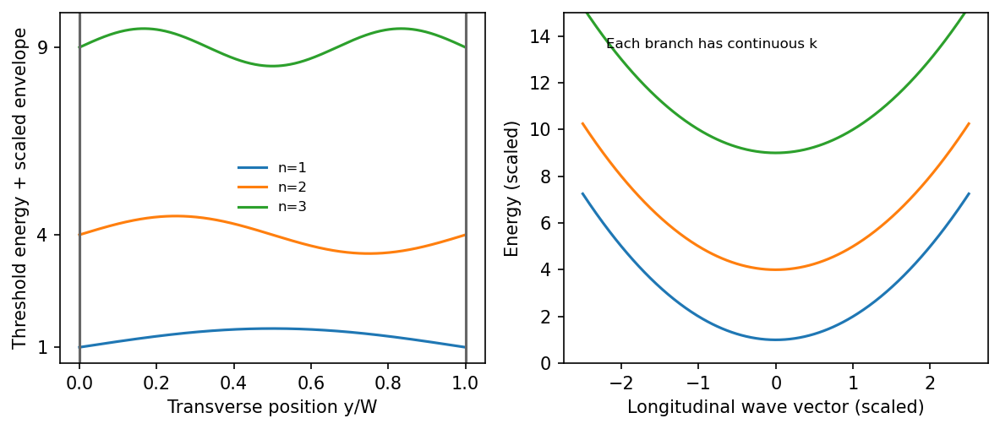

<h1 id="section-a-ii/15/i/solution">Solution</h1>

↑ **Parent:** [I](../i.md)

Let $x$ run along the wire and $y$ across it. In a separable approximation,

$$
\boxed{\psi_{nk}(x,y)=\frac{e^{ikx}}{\sqrt{L_x}}\phi_n(y),\qquad E_n(k)=E_n^\perp+\frac{\hbar^2k^2}{2m^*}.}
$$

Transverse confinement gives discrete levels $E_n^\perp$, but the long unconfined direction has a nearly continuous longitudinal [wave vector](../../../../../../wavevector.md) and a **plane-wave factor**. The result is a family of one-dimensional subbands, not a completely discrete spectrum in both in-plane directions. For a hard-wall width $W$, $E_n^\perp=\hbar^2\pi^2n^2/(2m^*W^2)$; an electrostatic confinement potential gives different thresholds. The suppressed out-of-plane degree of freedom is already frozen into the 2DEG subband.

**[Figure 2](#section-a-ii/15/i/image-discrete-transverse-thresholds-coexist-with-continuous-longitudinal-dispersion). Discrete transverse thresholds coexist with continuous longitudinal dispersion**. [Source](paper-2-wire-subbands.py).

## ↑ Ancestors (11)

1. [I](../i.md)
2. [15](../../15.md)
3. [Section A(ii)](../../../section-a-ii.md)
4. [Paper 2](../../../../paper-2-split.md)
5. [2017](../../../../split.md)
6. [Past exam of the MPhil in micro- and nanotechnology enterprise course of the University of Cambridge](../../../../../split.md)
7. [MPhil in micro- and nanotechnology enterprise course of the University of Cambridge](../../../../../../mphil-in-micro-and-nanotechnology-enterprise-course-of-the-university-of-cambridge.md)
8. [Course of the University of Cambridge](../../../../../../course-of-the-university-of-cambridge.md)
9. [University of Cambridge](../../../../../../university-of-cambridge-split.md)
10. [List of universities](../../../../../../list-of-universities.md)
11. [Codex Wiki](../../../../../../split.md)
