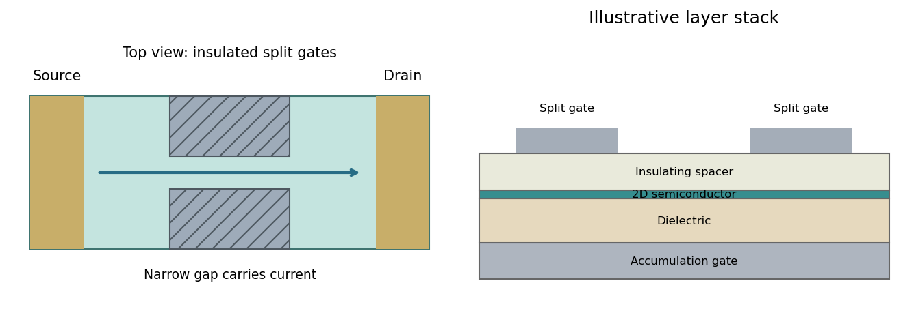

<h1 id="section-a-ii/15/ii/solution">Solution</h1>

↑ **Parent:** [Ii](../ii.md)

One suitable platform is a monolayer **[molybdenum disulfide](../../../../../../molybdenum-disulfide.md)** [semiconductor](../../../../../../semiconductor-split.md). An electrostatic accumulation gate supplies conduction electrons whose motion is confined to the atomic sheet; source and drain contacts act as reservoirs. A clean insulating substrate and dielectric or encapsulation reduce disorder and prevent gate leakage. Two split gates deplete the adjacent sheet and leave a narrow conducting gap, thereby confining the in-plane transverse direction while retaining transport along the gap.

**[Figure 3](#section-a-ii/15/ii/image-split-gates-narrow-a-gated-two-dimensional-semiconductor-sheet-between-source-and-drain-reservoirs). Split gates narrow a gated two-dimensional semiconductor sheet between source and drain reservoirs**. [Source](paper-2-split-gate-device.py).

Apply a small source-drain [voltage](../../../../../../voltage.md), measure the current and determine linear-response conductance while tuning the split-gate [voltage](../../../../../../voltage.md) and carrier [density](../../../../../../density.md). A [graphene](../../../../../../graphene.md) sheet is another two-dimensional carrier system, but its lack of an ordinary gap complicates purely electrostatic confinement; etched boundaries or a suitable gapped architecture may be needed. A two-dimensional material does not by itself guarantee ballistic transport or resolved subbands.[Electrostatic confinement in a two-dimensional [semiconductor](../../../../../../semiconductor-split.md) platform](../../../../../../split-gated-point-contact-in-mos2-hbn-structures-by-chithra-h-sharma-and-madhu-thalakulam.md)

## ↑ Ancestors (11)

1. [Ii](../ii.md)
2. [15](../../15.md)
3. [Section A(ii)](../../../section-a-ii.md)
4. [Paper 2](../../../../paper-2-split.md)
5. [2017](../../../../split.md)
6. [Past exam of the MPhil in micro- and nanotechnology enterprise course of the University of Cambridge](../../../../../split.md)
7. [MPhil in micro- and nanotechnology enterprise course of the University of Cambridge](../../../../../../mphil-in-micro-and-nanotechnology-enterprise-course-of-the-university-of-cambridge.md)
8. [Course of the University of Cambridge](../../../../../../course-of-the-university-of-cambridge.md)
9. [University of Cambridge](../../../../../../university-of-cambridge-split.md)
10. [List of universities](../../../../../../list-of-universities.md)
11. [Codex Wiki](../../../../../../split.md)
