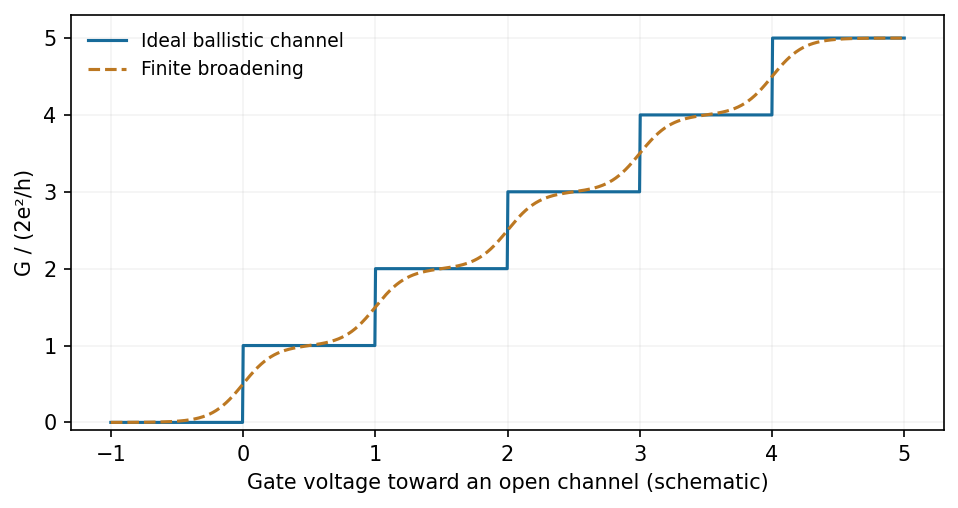

<h1 id="section-a-ii/15/iii/solution">Solution</h1>

↑ **Parent:** [Iii](../iii.md)

For a clean, adiabatically connected GaAs channel at low [temperature](../../../../../../temperature-split.md) and small bias, opening successive spin-degenerate subbands gives

$$
\boxed{G=N\frac{2e^2}{h}.}
$$

Conductance therefore shows a **staircase of plateaux**, rather than the continuously geometry-dependent classical Ohmic result. Each fully transmitted mode contributes approximately $77.5\,\mu\mathrm S$. More positive, or less negative, depletion-gate [voltage](../../../../../../voltage.md) opens a conventional GaAs constriction; more negative [voltage](../../../../../../voltage.md) closes it.

**[Figure 4](#section-a-ii/15/iii/image-conductance-rises-in-quantum-steps-as-a-depletion-gate-constriction-opens). Conductance rises in quantum steps as a depletion-gate constriction opens**. [Source](paper-2-conductance.py).

Require subband spacings larger than thermal and bias broadening and a [mean free path](../../../../../../mean-free-path.md) exceeding the constriction length. The general [Landauer formula](../../../../../../landauer-formula.md) is $G=(e^2/h)\sum_\alpha T_\alpha$ with each spin/valley channel counted separately. A material with additional valley degeneracy need not have the same step sequence as GaAs, and imperfect transmission or contact resistance blurs the ideal plateaux.

## ↑ Ancestors (11)

1. [Iii](../iii.md)
2. [15](../../15.md)
3. [Section A(ii)](../../../section-a-ii.md)
4. [Paper 2](../../../../paper-2-split.md)
5. [2017](../../../../split.md)
6. [Past exam of the MPhil in micro- and nanotechnology enterprise course of the University of Cambridge](../../../../../split.md)
7. [MPhil in micro- and nanotechnology enterprise course of the University of Cambridge](../../../../../../mphil-in-micro-and-nanotechnology-enterprise-course-of-the-university-of-cambridge.md)
8. [Course of the University of Cambridge](../../../../../../course-of-the-university-of-cambridge.md)
9. [University of Cambridge](../../../../../../university-of-cambridge-split.md)
10. [List of universities](../../../../../../list-of-universities.md)
11. [Codex Wiki](../../../../../../split.md)
