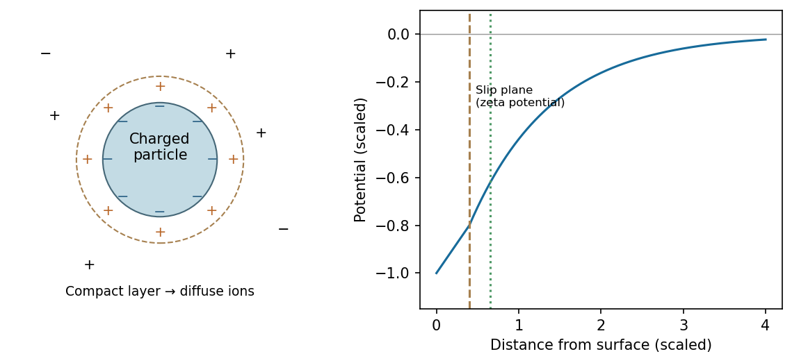

<h1 id="section-a-iii/18/solution">Solution</h1>

↑ **Parent:** [18](../18.md)

A charged colloid in a polar [electrolyte](../../../../../electrolyte.md) is surrounded by an **[electric double layer](../../../../../electric-double-layer.md)**. For a negatively charged surface, [counterions](../../../../../counterion.md) are positive and [co-ions](../../../../../co-ion.md) negative; their distributions reverse for a positive surface. A compact [Stern layer](../../../../../stern-layer.md) contains specifically adsorbed or closely approaching ions, followed by a diffuse layer where electrostatic attraction competes with thermal motion. Mobile charge integrated over the surroundings balances the particle charge in an overall neutral system.

**[Figure 6](#section-a-iii/18/image-compact-and-diffuse-countercharge-screen-a-negatively-charged-colloidal-surface). Compact and diffuse countercharge screen a negatively charged colloidal surface**. [Source](paper-2-double-layer.py).

For a mean-field dilute [electrolyte](../../../../../electrolyte.md), $n_i(r)=n_{i,\infty}\exp[-z_ie\psi(r)/(k_BT)]$ with [Poisson's equation](../../../../../poisson-s-equation.md) relates charge [density](../../../../../density.md) and potential. At weak potential, the diffuse potential outside a sphere decays approximately as $\psi(r)\propto e^{-\kappa(r-a)}/r$. The inverse screening length obeys $\kappa^2=e^2\sum_i z_i^2n_{i,\infty}/(\epsilon k_BT)$: added salt shortens the [Debye length](../../../../../debye-length.md). The [zeta potential](../../../../../zeta-potential.md) is the potential at the hydrodynamic slip plane, not necessarily the surface potential. The simple model neglects ion size, correlations and chemical charge regulation; a polar solvent with almost no dissociated ions need not provide a short screening length.

## ↑ Ancestors (10)

1. [18](../18.md)
2. [Section A(iii)](../../section-a-iii.md)
3. [Paper 2](../../../paper-2-split.md)
4. [2017](../../../split.md)
5. [Past exam of the MPhil in micro- and nanotechnology enterprise course of the University of Cambridge](../../../../split.md)
6. [MPhil in micro- and nanotechnology enterprise course of the University of Cambridge](../../../../../mphil-in-micro-and-nanotechnology-enterprise-course-of-the-university-of-cambridge.md)
7. [Course of the University of Cambridge](../../../../../course-of-the-university-of-cambridge.md)
8. [University of Cambridge](../../../../../university-of-cambridge-split.md)
9. [List of universities](../../../../../list-of-universities.md)
10. [Codex Wiki](../../../../../split.md)
