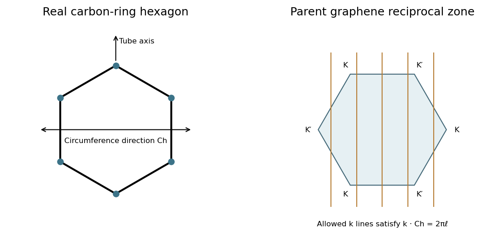

<h1 id="section-b/20/iv/solution">Solution</h1>

↑ **Parent:** [Iv](../iv.md)

The real-space carbon honeycomb has two atoms in a primitive cell of its triangular [Bravais lattice](../../../../../../bravais-lattice.md). The [reciprocal lattice](../../../../../../reciprocal-lattice.md) is also triangular, and its Wigner-Seitz cell is a hexagonal first [Brillouin zone](../../../../../../brillouin-zone.md). With a consistent orientation convention, **the reciprocal-zone hexagon is rotated by $30^\circ$ relative to a real-space carbon-ring hexagon**; reciprocal lengths scale inversely with the direct lattice spacing.

**[Figure 8](#section-b/20/iv/image-real-carbon-rings-the-rotated-graphene-reciprocal-zone-and-circumferential-momentum-quantization). Real carbon rings, the rotated graphene reciprocal zone and circumferential momentum quantization**. [Source](paper-2-nanotube-reciprocal.py).

Rolling into a tube imposes $\mathbf k\cdot\mathbf C_h=2\pi\ell$, leaving parallel allowed lines in [graphene](../../../../../../graphene.md)'s two-dimensional reciprocal space. They run along the tube-axis direction, perpendicular to the circumferential wrapping vector. The nanotube's actual one-dimensional [Brillouin zone](../../../../../../brillouin-zone.md) is an interval of axial [wave vectors](../../../../../../wavevector.md) with period $2\pi/|\mathbf T|$, where $\mathbf T$ is its axial translation. The parent hexagon is therefore a zone-folding construction, not a literal two-dimensional [Brillouin zone](../../../../../../brillouin-zone.md) for the finished one-dimensional tube.

## ↑ Ancestors (11)

1. [Iv](../iv.md)
2. [20](../../20.md)
3. [Section B](../../../section-b.md)
4. [Paper 2](../../../../paper-2-split.md)
5. [2017](../../../../split.md)
6. [Past exam of the MPhil in micro- and nanotechnology enterprise course of the University of Cambridge](../../../../../split.md)
7. [MPhil in micro- and nanotechnology enterprise course of the University of Cambridge](../../../../../../mphil-in-micro-and-nanotechnology-enterprise-course-of-the-university-of-cambridge.md)
8. [Course of the University of Cambridge](../../../../../../course-of-the-university-of-cambridge.md)
9. [University of Cambridge](../../../../../../university-of-cambridge-split.md)
10. [List of universities](../../../../../../list-of-universities.md)
11. [Codex Wiki](../../../../../../split.md)
