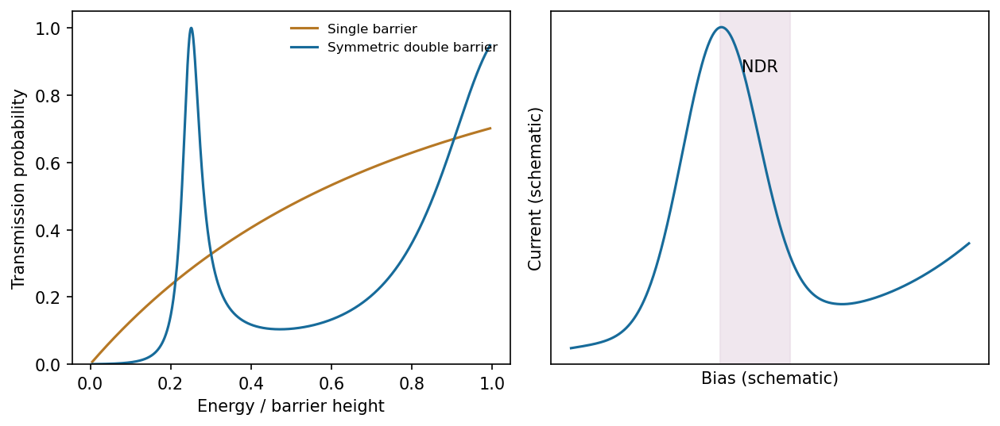

<h1 id="section-b/21/iii/solution">Solution</h1>

↑ **Parent:** [Iii](../iii.md)

Between two barriers, region III becomes a **finite intermediate well** containing both right- and left-moving oscillatory components, $Pe^{ikx}+Qe^{-ikx}$. Repeated reflection produces standing-wave-like enhancement and quasi-bound levels with finite escape lifetimes. At resonant energies, the multiple transmitted amplitudes add constructively: an ideal symmetric lossless pair can have transmission approaching unity even when a single barrier transmits poorly. Away from resonance the pair strongly suppresses transmission.

**[Figure 9](#section-b/21/iii/image-calculated-single-and-double-barrier-transmission-and-a-separate-qualitative-resonant-tunnelling-current-voltage-characteristic). Calculated single- and double-barrier transmission and a separate qualitative resonant-tunnelling current-voltage characteristic**. [Source](paper-2-resonant-tunnelling.py).

A useful phase condition is $2k\ell+\varphi_{r1}+\varphi_{r2}=2\pi n$, where $\ell$ is the intermediate-well width and the reflection phases account for penetration into the barriers. The printed figure starts the second barrier at $a+L$, so its well width is $L$; if the prose's second-barrier position $L$ is used instead, the width is $L-a$. The resonance argument is unchanged once that geometrical convention is fixed.

## ↑ Ancestors (11)

1. [Iii](../iii.md)
2. [21](../../21.md)
3. [Section B](../../../section-b.md)
4. [Paper 2](../../../../paper-2-split.md)
5. [2017](../../../../split.md)
6. [Past exam of the MPhil in micro- and nanotechnology enterprise course of the University of Cambridge](../../../../../split.md)
7. [MPhil in micro- and nanotechnology enterprise course of the University of Cambridge](../../../../../../mphil-in-micro-and-nanotechnology-enterprise-course-of-the-university-of-cambridge.md)
8. [Course of the University of Cambridge](../../../../../../course-of-the-university-of-cambridge.md)
9. [University of Cambridge](../../../../../../university-of-cambridge-split.md)
10. [List of universities](../../../../../../list-of-universities.md)
11. [Codex Wiki](../../../../../../split.md)
