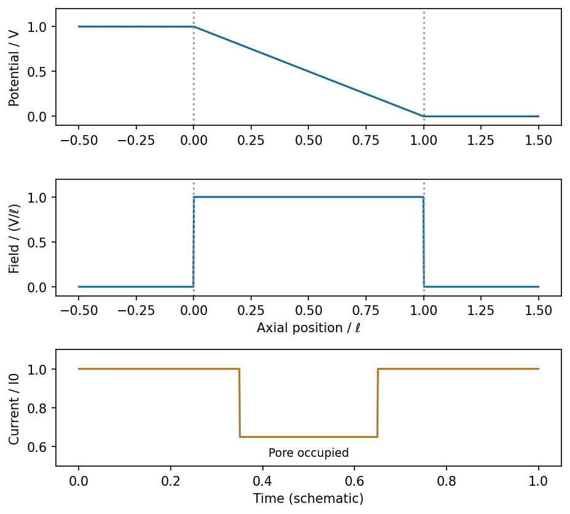

<h1 id="section-b/22/iii/solution">Solution</h1>

↑ **Parent:** [Iii](../iii.md)

With the left reservoir at $V$ and the right at zero, let the pore run from $x=0$ to $x=\ell$. In the stated idealization the reservoir potentials are flat, the pore potential is $\phi(x)=V(1-x/\ell)$, and its electric field is **$E_x=-d\phi/dx=V/\ell$**, directed from high to low potential. The field is zero in the ideal equipotential reservoirs; real access regions would round these abrupt boundaries.

**[Figure 11](#section-b/22/iii/image-ideal-potential-field-and-current-blockade-for-a-generic-insulating-particle-crossing-a-uniform-pore). Ideal potential, field and current blockade for a generic insulating particle crossing a uniform pore**. [Source](paper-2-pore-signals.py).

For constant-speed passage and an approximately position-independent in-pore obstruction, the current has a rectangular downward pulse from $I_0$ to $I_0-\Delta I$ during occupation. Entry, exit, filtering and nonuniform fields round real pulses. This describes a physical particle signal without inferring any biological identity or charge.

## ↑ Ancestors (11)

1. [Iii](../iii.md)
2. [22](../../22.md)
3. [Section B](../../../section-b.md)
4. [Paper 2](../../../../paper-2-split.md)
5. [2017](../../../../split.md)
6. [Past exam of the MPhil in micro- and nanotechnology enterprise course of the University of Cambridge](../../../../../split.md)
7. [MPhil in micro- and nanotechnology enterprise course of the University of Cambridge](../../../../../../mphil-in-micro-and-nanotechnology-enterprise-course-of-the-university-of-cambridge.md)
8. [Course of the University of Cambridge](../../../../../../course-of-the-university-of-cambridge.md)
9. [University of Cambridge](../../../../../../university-of-cambridge-split.md)
10. [List of universities](../../../../../../list-of-universities.md)
11. [Codex Wiki](../../../../../../split.md)
