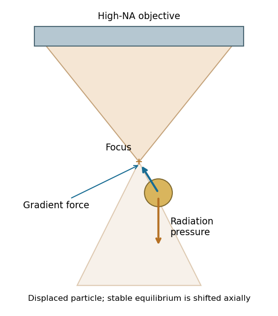

<h1 id="section-b/23b/v/solution">Solution</h1>

↑ **Parent:** [V](../v.md)

A tightly focused laser produces a strong intensity gradient. A small polarizable particle experiences a gradient [force](../../../../../../force-split.md) toward increasing intensity when the real [polarizability](../../../../../../electric-polarizability.md) has the appropriate positive sign; [radiation pressure](../../../../../../radiation-pressure.md) from scattering and absorption pushes predominantly along the beam. A high-numerical-aperture objective creates lateral confinement and a sufficiently strong opposing axial gradient for a three-dimensional [optical trap](../../../../../../optical-tweezers.md). Equilibrium is generally shifted from the intensity maximum by [radiation pressure](../../../../../../radiation-pressure.md).

**[Figure 13](#section-b/23b/v/image-gradient-forces-restore-a-displaced-particle-while-radiation-pressure-shifts-the-axial-equilibrium). Gradient forces restore a displaced particle while radiation pressure shifts the axial equilibrium**. [Source](paper-2-optical-trap.py).

For a Rayleigh sphere, $\alpha=4\pi\epsilon_m a^3(\epsilon_p-\epsilon_m)/(\epsilon_p+2\epsilon_m)$ in an absolute-permittivity convention, and $\mathbf F_{\rm grad}\simeq\tfrac14\operatorname{Re}\alpha\nabla|E|^2$ for peak complex field amplitude. Near a stable point, $F_x\simeq-k_xx$; the trap depth must exceed [thermal fluctuations](../../../../../../thermal-fluctuation.md) sufficiently to retain the particle. Viscous drag opposes motion, Brownian forcing produces fluctuations, and gravity/buoyancy are normally small at this scale.

For **absorbing gold**, use its complex wavelength-dependent permittivity: scattering, absorption and heating can frustrate trapping. The existence of an ideal dielectric gradient-force trap does not guarantee stable trapping of every metal [nanoparticle](../../../../../../nanoparticle.md) at every wavelength or power.[General [optical trapping](../../../../../../optical-tweezers.md) principle; gold-specific absorption qualification is separate](../../../../../../observation-of-a-single-beam-gradient-force-optical-trap-for-dielectric-particles-by-arthur-ashkin-and-others.md)

## ↑ Ancestors (11)

1. [V](../v.md)
2. [23B](../../23b.md)
3. [Section B](../../../section-b.md)
4. [Paper 2](../../../../paper-2-split.md)
5. [2017](../../../../split.md)
6. [Past exam of the MPhil in micro- and nanotechnology enterprise course of the University of Cambridge](../../../../../split.md)
7. [MPhil in micro- and nanotechnology enterprise course of the University of Cambridge](../../../../../../mphil-in-micro-and-nanotechnology-enterprise-course-of-the-university-of-cambridge.md)
8. [Course of the University of Cambridge](../../../../../../course-of-the-university-of-cambridge.md)
9. [University of Cambridge](../../../../../../university-of-cambridge-split.md)
10. [List of universities](../../../../../../list-of-universities.md)
11. [Codex Wiki](../../../../../../split.md)
