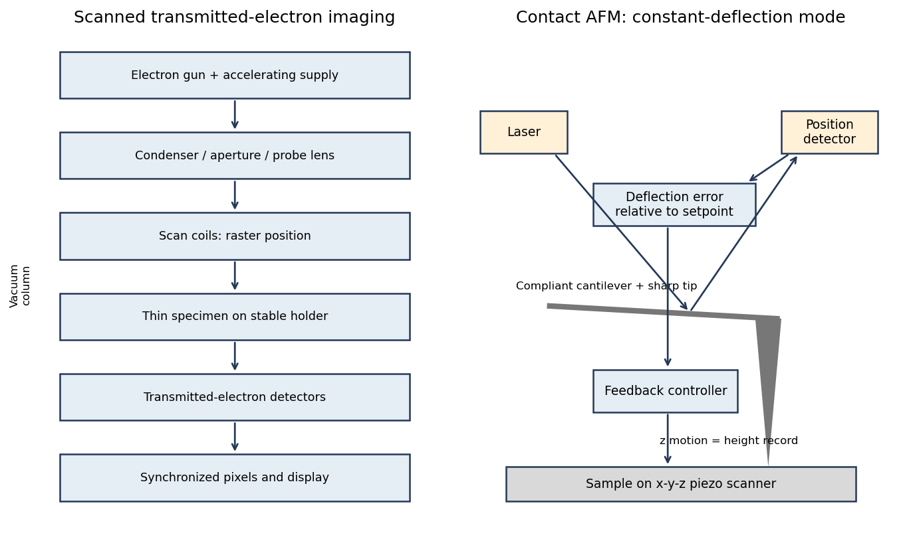
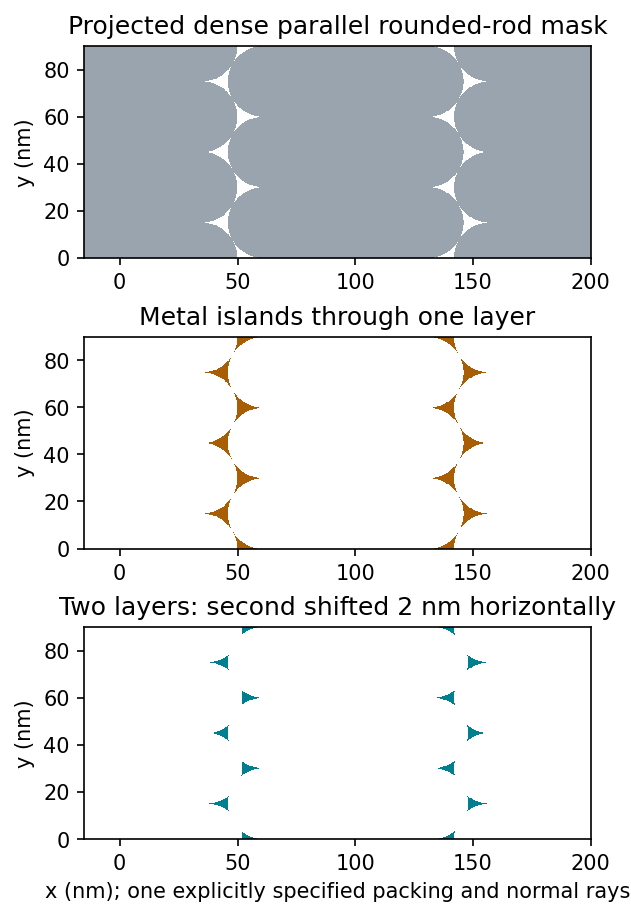
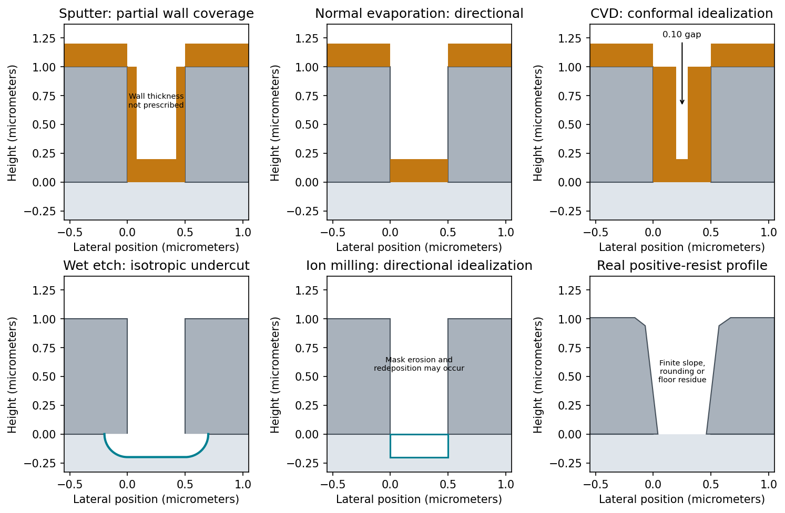
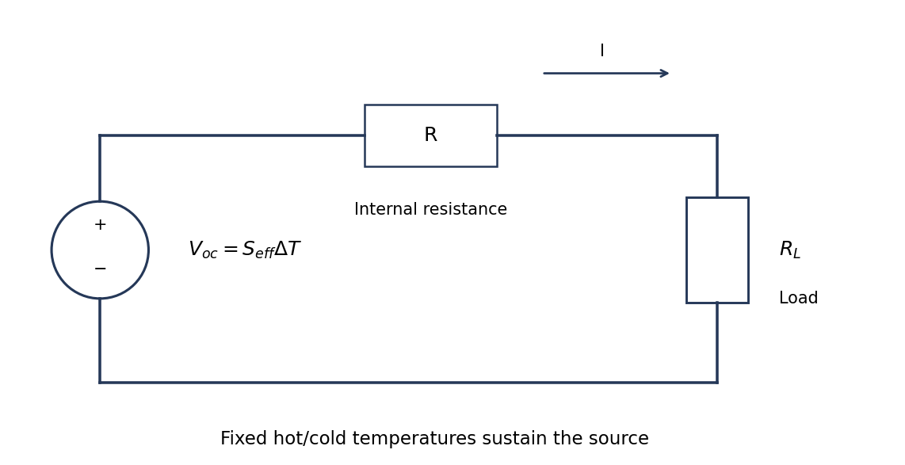
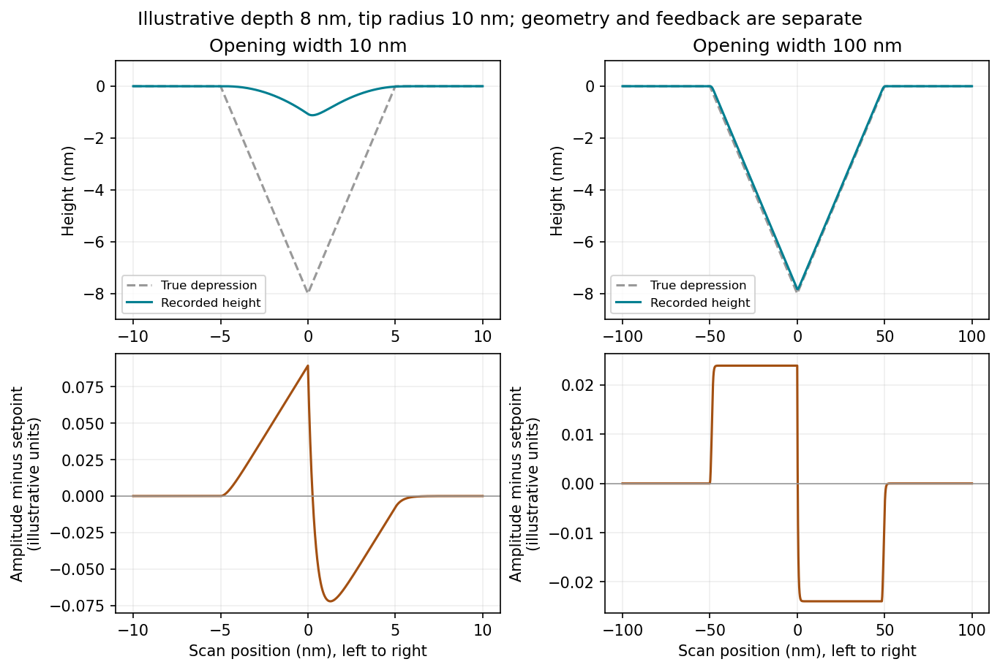
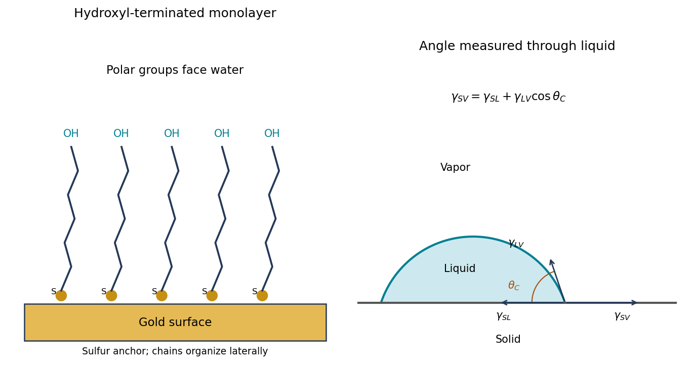
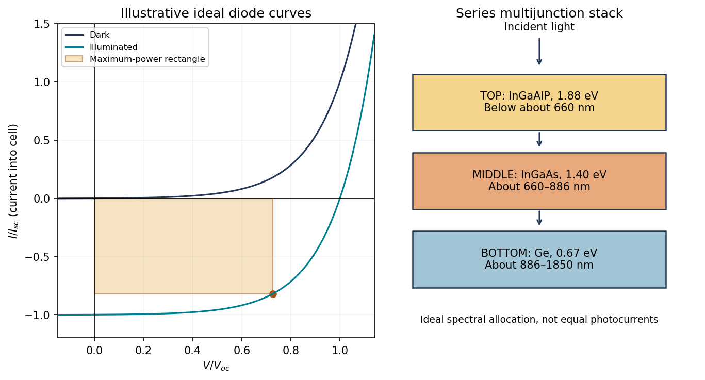

# Paper 1

↑ **Parent:** [2018](../2018.md)

Original archive: [Public FOI download](https://www.whatdotheyknow.com/request/mphil_in_micro_and_nanotechnolog_5/response/2556540/attach/2/FOI%202024%2050%20Dai%20materials.zip?cookie_passthrough=1).

Source member: `NanoMPhil Paper 1 2018.pdf`, physical pages 1–11; questions occupy pages 2–11.

**Table of contents**

- [Section A(i)](#section-a-i)
  - [1](#section-a-i/1)
    - [i](#section-a-i/1/i)
      - [Solution](#section-a-i/1/i/solution)
    - [ii](#section-a-i/1/ii)
      - [Solution](#section-a-i/1/ii/solution)
  - [2](#section-a-i/2)
    - [i](#section-a-i/2/i)
      - [Solution](#section-a-i/2/i/solution)
    - [ii](#section-a-i/2/ii)
      - [Solution](#section-a-i/2/ii/solution)
    - [iii](#section-a-i/2/iii)
      - [Solution](#section-a-i/2/iii/solution)
    - [iv](#section-a-i/2/iv)
      - [Solution](#section-a-i/2/iv/solution)
- [Section A(ii)](#section-a-ii)
  - [3](#section-a-ii/3)
    - [i](#section-a-ii/3/i)
      - [Solution](#section-a-ii/3/i/solution)
    - [ii](#section-a-ii/3/ii)
      - [Solution](#section-a-ii/3/ii/solution)
  - [4](#section-a-ii/4)
    - [i](#section-a-ii/4/i)
      - [a](#section-a-ii/4/i/a)
        - [1](#section-a-ii/4/i/a/1)
          - [Solution](#section-a-ii/4/i/a/1/solution)
        - [2](#section-a-ii/4/i/a/2)
          - [Solution](#section-a-ii/4/i/a/2/solution)
        - [3](#section-a-ii/4/i/a/3)
          - [Solution](#section-a-ii/4/i/a/3/solution)
      - [b](#section-a-ii/4/i/b)
        - [1](#section-a-ii/4/i/b/1)
          - [Solution](#section-a-ii/4/i/b/1/solution)
        - [2](#section-a-ii/4/i/b/2)
          - [Solution](#section-a-ii/4/i/b/2/solution)
    - [ii](#section-a-ii/4/ii)
      - [Solution](#section-a-ii/4/ii/solution)
- [Section A(iii)](#section-a-iii)
  - [5](#section-a-iii/5)
    - [i](#section-a-iii/5/i)
      - [Solution](#section-a-iii/5/i/solution)
    - [ii](#section-a-iii/5/ii)
      - [Solution](#section-a-iii/5/ii/solution)
    - [iii](#section-a-iii/5/iii)
      - [Solution](#section-a-iii/5/iii/solution)
    - [iv](#section-a-iii/5/iv)
      - [Solution](#section-a-iii/5/iv/solution)
  - [6](#section-a-iii/6)
    - [i](#section-a-iii/6/i)
      - [Solution](#section-a-iii/6/i/solution)
    - [ii](#section-a-iii/6/ii)
      - [Solution](#section-a-iii/6/ii/solution)
    - [iii](#section-a-iii/6/iii)
      - [Solution](#section-a-iii/6/iii/solution)
- [Section B](#section-b)
  - [7](#section-b/7)
    - [i](#section-b/7/i)
      - [a](#section-b/7/i/a)
        - [Solution](#section-b/7/i/a/solution)
      - [b](#section-b/7/i/b)
        - [Solution](#section-b/7/i/b/solution)
    - [ii](#section-b/7/ii)
      - [Solution](#section-b/7/ii/solution)
    - [iii](#section-b/7/iii)
      - [Solution](#section-b/7/iii/solution)
    - [vi](#section-b/7/vi)
      - [a](#section-b/7/vi/a)
        - [Solution](#section-b/7/vi/a/solution)
      - [b](#section-b/7/vi/b)
        - [Solution](#section-b/7/vi/b/solution)
      - [c](#section-b/7/vi/c)
        - [Solution](#section-b/7/vi/c/solution)
  - [8](#section-b/8)
    - [i](#section-b/8/i)
      - [Solution](#section-b/8/i/solution)
    - [ii](#section-b/8/ii)
      - [Solution](#section-b/8/ii/solution)
    - [iii](#section-b/8/iii)
      - [Solution](#section-b/8/iii/solution)
  - [9](#section-b/9)
    - [i](#section-b/9/i)
      - [a](#section-b/9/i/a)
        - [Solution](#section-b/9/i/a/solution)
      - [b](#section-b/9/i/b)
        - [Solution](#section-b/9/i/b/solution)
    - [ii](#section-b/9/ii)
      - [Solution](#section-b/9/ii/solution)
    - [iii](#section-b/9/iii)
      - [Solution](#section-b/9/iii/solution)
    - [vi (first occurrence)](#section-b/9/vi-first-occurrence)
      - [Solution](#section-b/9/vi-first-occurrence/solution)
    - [v](#section-b/9/v)
      - [Solution](#section-b/9/v/solution)
    - [vi (second occurrence)](#section-b/9/vi-second-occurrence)
      - [Solution](#section-b/9/vi-second-occurrence/solution)
    - [vii](#section-b/9/vii)
      - [Solution](#section-b/9/vii/solution)
  - [10](#section-b/10)
    - [i](#section-b/10/i)
      - [a](#section-b/10/i/a)
        - [Solution](#section-b/10/i/a/solution)
      - [b](#section-b/10/i/b)
        - [Solution](#section-b/10/i/b/solution)
      - [c](#section-b/10/i/c)
        - [Solution](#section-b/10/i/c/solution)
    - [ii](#section-b/10/ii)
      - [a](#section-b/10/ii/a)
        - [Solution](#section-b/10/ii/a/solution)
      - [b](#section-b/10/ii/b)
        - [Solution](#section-b/10/ii/b/solution)

<h2 id="section-a-i">Section A(i)</h2>

↑ **Parent:** [Paper 1](paper-1.md)

<h3 id="section-a-i/1">1</h3>

↑ **Parent:** [Section A(i)](#section-a-i)

<h4 id="section-a-i/1/i">i</h4>

↑ **Parent:** [1](#section-a-i/1)

<h5 id="section-a-i/1/i/solution">Solution</h5>

↑ **Parent:** [I](#section-a-i/1/i)

A [scanning transmission electron microscope](../../optics.md#scanning-transmission-electron-microscope) makes an image by assigning a transmitted-electron signal to each position of a scanned probe. **Its essential chain is [electron](../../physics.md#electron) source, probe-forming optics, scan system, thin specimen, transmitted-electron detectors and synchronized acquisition.**

An [electron gun](../../physics.md#electron-gun) and accelerating supply provide a stable beam of the chosen [kinetic energy](../../energy.md#kinetic-energy). [Condenser lens](../../optics.md#condenser-lens) optics and an aperture control probe current and convergence; the probe-forming [objective lens](../../optics.md#electron-objective-lens) focuses a small spot on the specimen. Alignment, focusing and [astigmatism](../../geometrical-optics.md#astigmatism-optical-systems) correction keep the probe usable across the field.

Scan coils deflect the probe in a raster. A stable specimen holder positions an electron-transparent region, and a high-vacuum column limits gas scattering and contamination. A [bright-field transmission electron microscopy](../../optics.md#bright-field-transmission-electron-microscopy) detector collects the central transmitted beam; an annular detector can select [annular dark-field electron imaging](../../optics.md#annular-dark-field-electron-imaging), including [high-angle annular dark-field imaging](../../optics.md#high-angle-annular-dark-field-imaging). Different angular selections give different contrasts, rather than a universal map of height.

Detector electronics, scan timing and a computer assign the collected signal to the corresponding image pixel. Spectrometers are useful additions but not essential to basic image formation. The post-specimen optics can adjust detector collection geometry; they do not set scan-image [magnification](../../optics.md#magnification) in the same way as the projection lenses of conventional transmission imaging.

**[Figure 1](#section-a-i/1/i/image-original-schematics-of-scanned-transmitted-electron-imaging-and-contact-mode-force-feedback-panels-show-different-instruments). Original schematics of scanned transmitted-electron imaging and contact-mode force feedback; panels show different instruments**.

<h4 id="section-a-i/1/ii">ii</h4>

↑ **Parent:** [1](#section-a-i/1)

<h5 id="section-a-i/1/ii/solution">Solution</h5>

↑ **Parent:** [Ii](#section-a-i/1/ii)

For a displayed width $D$ representing a scanned specimen width $d$, **the linear image [magnification](../../optics.md#magnification) is**

$$
\boxed{M=\frac{D}{d}.}
$$

The user changes the scan-coil excursion, hence $d$. A smaller raster displayed at the same width gives larger [magnification](../../optics.md#magnification). Changing the display or print size also changes displayed [magnification](../../optics.md#magnification), so the calibrated scale bar is more portable than a [magnification](../../optics.md#magnification) label. This is the scan/display principle described in the manufacturer's microscope guide.[Magnification of SEM, printed p.7: scan width and display width; the same raster-display geometry applies in STEM](../../physics-bibliography.md#scanning-electron-microscope-a-to-z-by-jeol)

At the low-magnification extreme, the probe scans the widest accessible field. Coil range, apertures, scan distortion and maintaining focus constrain the actual usable width. Formally increasing $d$ without bound would make $M$ arbitrarily small, but a real column has a finite accessible field.

At the high-magnification extreme, the scan covers a very small region. Formally $d\to0$ makes $D/d$ diverge, but exactly zero scan width samples one location and supplies no spatial image. [Electron microscope resolution](../../optics.md#electron-microscope-resolution), finite probe size, pixel spacing, drift, noise and specimen damage set the useful limit. Enlarging a field already sampled more finely than its resolvable information produces **[empty magnification](../../optical-instrument.md#empty-magnification)**, not new structural detail. For $N$ pixels across a field, the specimen sampling interval is $d/N$; this is distinct from the probe's [spatial resolution](../../optics.md#spatial-resolution).

<h3 id="section-a-i/2">2</h3>

↑ **Parent:** [Section A(i)](#section-a-i)

<h4 id="section-a-i/2/i">i</h4>

↑ **Parent:** [2](#section-a-i/2)

<h5 id="section-a-i/2/i/solution">Solution</h5>

↑ **Parent:** [I](#section-a-i/2/i)

A [tip-change artefact](../../engineering.md#tip-change-artefact) occurs when the effective apex changes during scanning, for example through material pickup, loss of an attached particle or damage. In [tapping-mode atomic force microscopy](../../engineering.md#tapping-mode-atomic-force-microscopy), **a sudden change can introduce a false height offset between parts of the image**, even on a continuous terrace.

The change alters the probe–surface interaction or the effective point at which the chosen amplitude setpoint is reached. The controller moves the vertical scanner to recover that setpoint, recording a spurious step or a change in line baseline. The sign is not fixed: different apex changes can move the apparent surface up or down.

The amplitude channel usually shows a transient deviation as the interaction changes; with stable feedback it returns toward its setpoint. It therefore need not retain the same persistent offset as the recorded height. A change in probe resonance or free amplitude can also change the operating condition. If the apex geometry has changed, widths and shapes can change too, or duplicated structures can appear as a [double-tip artefact](../../engineering.md#double-tip-artefact). A baseline correction cannot recover these lost geometric data.

<h4 id="section-a-i/2/ii">ii</h4>

↑ **Parent:** [2](#section-a-i/2)

<h5 id="section-a-i/2/ii/solution">Solution</h5>

↑ **Parent:** [Ii](#section-a-i/2/ii)

[AFM image flattening](../../engineering.md#afm-image-flattening) estimates an unwanted background and subtracts it from the recorded height:

$$
z_{\rm corrected}(x,y)=z_{\rm measured}(x,y)-b(x,y).
$$

A plane removes overall tilt; a line-by-line constant or low-order fit removes line offsets or curvature. **For a tip-change height jump, align the baselines of unchanged reference regions on either side of the event**, using a piecewise offset or appropriately masked line fits. A single global plane cannot in general remove an abrupt step.

Exclude genuine features from the fit, use the same terrace as a reference where possible, and retain the unprocessed data. The corrected image has a consistent relative background; it does not establish that the interaction [force](../../force.md), tip shape or absolute height calibration remained unchanged. In particular, flattening is a correction for the offset component of a [tip-change artefact](../../engineering.md#tip-change-artefact), not a repair of every consequence of a changed tip.

<h4 id="section-a-i/2/iii">iii</h4>

↑ **Parent:** [2](#section-a-i/2)

<h5 id="section-a-i/2/iii/solution">Solution</h5>

↑ **Parent:** [Iii](#section-a-i/2/iii)

**Sample tilt and [scanner bow](../../engineering.md#scanner-bow) are other common backgrounds that [AFM image flattening](../../engineering.md#afm-image-flattening) can remove.** Fit a plane $b=a+bx+cy$ to a genuinely flat reference area and subtract it to remove tilt. A low-order curved fit can approximate the vertical background produced by a piezoelectric scanner's non-planar motion.

Line-dependent offsets or slow drift can sometimes be removed by subtracting a reference level from each scan line. Mask pits, particles and true steps so that they do not bias the reference. An independently measured flat calibration specimen and scans in different orientations help distinguish instrumental background from actual specimen curvature.

<h4 id="section-a-i/2/iv">iv</h4>

↑ **Parent:** [2](#section-a-i/2)

<h5 id="section-a-i/2/iv/solution">Solution</h5>

↑ **Parent:** [Iv](#section-a-i/2/iv)

**Flattening removes fitted components of the image whether they are instrumental or real.** A true specimen slope, broad dome or slow height variation can be erased if it resembles the chosen background. Strong features can bias a fit and create false depressions, streaks or halos; an overly flexible polynomial can fit away scientifically useful topography.

Line-by-line correction can destroy real differences between terraces, especially when no common flat region spans the lines. Height statistics, roughness and feature depths then depend on masking and fit order. Report those choices and compare profiles before and after processing.

Flattening does not restore structures inaccessible to the tip, undo a [double-tip artefact](../../engineering.md#double-tip-artefact), remove finite-tip broadening, reconstruct a saturated signal or recover data lost to unstable feedback. It also does not calibrate the scanner. These limitations are important when a superficially smoother image is mistaken for a more accurate measurement.

<h2 id="section-a-ii">Section A(ii)</h2>

↑ **Parent:** [Paper 1](paper-1.md)

<h3 id="section-a-ii/3">3</h3>

↑ **Parent:** [Section A(ii)](#section-a-ii)

<h4 id="section-a-ii/3/i">i</h4>

↑ **Parent:** [3](#section-a-ii/3)

<h5 id="section-a-ii/3/i/solution">Solution</h5>

↑ **Parent:** [I](#section-a-ii/3/i)

Treat the specified particles only as rigid geometric shadowing objects; no biological preparation or interpretation is needed. Their projected shapes are rounded-ended rods with straight central length $100-30=70\,\mathrm{nm}$ and cap radius $15\,\mathrm{nm}$. **Normal, collimated evaporation deposits metal in the gaps between projected particle footprints**, leaving isolated small islands after mask removal, rather than a metal replica of each rod.

One concrete dense parallel packing has center translations

$$
\mathbf u=(70+15\sqrt3,15)\,\mathrm{nm},\qquad
\mathbf v=(0,30)\,\mathrm{nm}.
$$

Adjacent rounded ends then touch at triangular arrangements. The open regions are small curvilinear triangular gaps near those ends. This is a specified geometrical packing for the sketch; the words close-packed do not uniquely prescribe the domain orientation or registry of all real sheets.

**[Figure 2](#section-a-ii/3/i/image-original-geometric-calculation-of-rounded-rod-shadow-masks-deposited-islands-and-the-effect-of-shifting-a-second-layer-no-source-illustration-is-reproduced). Original geometric calculation of rounded-rod shadow masks, deposited islands and the effect of shifting a second layer; no source illustration is reproduced**.

Particle size and shape distributions change the gap size and spacing. Misorientation, missing particles, boundaries between ordered domains, overlaps, incomplete coverage and drying-induced cracks interrupt long-range order. Substrate roughness and uneven adhesion distort the arrangement. A finite source angle produces [deposition shadowing](../../engineering.md#deposition-shadowing) and penumbra; surface diffusion, island nucleation and increasing film thickness can broaden or merge deposited regions. These are generic geometry and materials effects, not assumptions about a biological assembly mechanism.

<h4 id="section-a-ii/3/ii">ii</h4>

↑ **Parent:** [3](#section-a-ii/3)

<h5 id="section-a-ii/3/ii/solution">Solution</h5>

↑ **Parent:** [Ii](#section-a-ii/3/ii)

Let $O_1$ and $O_2$ be the open projected regions in the two layers. For normal, collimated rays, **the transmitted opening is the intersection**

$$
\boxed{O_{\rm double}=O_1\cap O_2.}
$$

An upper particle blocks any lower-layer gap beneath its footprint. A translated layer can therefore reduce island size, suppress some islands or close the holes completely. If the projected openings coincide, an ideally registered second layer need not change the pattern at all. A rotated or differently registered layer can create a larger superperiod or a less regular pattern.

The additional height also increases the separation between some blocking edges and the substrate, making a finite angular source distribution more important. Deposition angle and layer separation then enter the projected aperture geometry. **No unique double-layer pattern follows without specifying registry, orientation and source direction**; the figure illustrates aligned and shifted possibilities instead of treating one as inevitable.

<h3 id="section-a-ii/4">4</h3>

↑ **Parent:** [Section A(ii)](#section-a-ii)

<h4 id="section-a-ii/4/i">i</h4>

↑ **Parent:** [4](#section-a-ii/4)

<h5 id="section-a-ii/4/i/a">a</h5>

↑ **Parent:** [I](#section-a-ii/4/i)

<h6 id="section-a-ii/4/i/a/1">1</h6>

↑ **Parent:** [A](#section-a-ii/4/i/a)

<h6 id="section-a-ii/4/i/a/1/solution">Solution</h6>

↑ **Parent:** [1](#section-a-ii/4/i/a/1)

**Expect appreciable but nonuniform sidewall coverage, rounded upper edges and possible narrowing near the opening mouth.** In [sputtering](../../engineering.md#sputtering), gas collisions and the extended source distribute arriving material over a broader range of directions than simple high-vacuum evaporation. At the specified pressure, the extent of that redistribution also depends on source-to-substrate distance and particle energies; pressure alone does not determine a unique sidewall thickness.

The top surfaces receive the nominal film. Oblique rays coat accessible walls, while the tall opening shadows some directions from its lower portions. Growth at the mouth can further shadow the floor or form an overhang. The sidewall film is therefore neither guaranteed zero nor guaranteed as thick as the horizontal film. This [step coverage](../../engineering.md#step-coverage) is generally unfavorable for clean [lift-off process](../../engineering.md#lift-off-process) if it connects the film on the resist to the film on the substrate.

**[Figure 3](#section-a-ii/4/i/a/1/image-original-schematic-process-outcomes-for-deposition-and-etching-through-a-resist-opening-sidewall-coverage-and-erosion-are-qualitative-where-not-fixed-by-the-question). Original schematic process outcomes for deposition and etching through a resist opening; sidewall coverage and erosion are qualitative where not fixed by the question**.

<h6 id="section-a-ii/4/i/a/2">2</h6>

↑ **Parent:** [A](#section-a-ii/4/i/a)

<h6 id="section-a-ii/4/i/a/2/solution">Solution</h6>

↑ **Parent:** [2](#section-a-ii/4/i/a/2)

**Normal [evaporative deposition](../../engineering.md#evaporative-deposition) gives approximately horizontal films on the resist tops and exposed substrate, with little coating of vertical walls.** A small distant electron-beam-heated source in high [vacuum](../../physics.md#vacuum) gives nearly line-of-sight arrival. Near-normal rays reach the opening floor, while vertical walls present almost no projected area.

The floor film and top film can remain disconnected, which helps a later [lift-off process](../../engineering.md#lift-off-process). A finite source size, tilted incidence, scattering or sample rotation changes that idealization and may coat one wall or shadow part of the floor. The stated $200\,\mathrm{nm}$ thickness is well below the $1\,\mathrm{\mu m}$ resist height, but this alone does not guarantee a clean break at every real edge.

<h6 id="section-a-ii/4/i/a/3">3</h6>

↑ **Parent:** [A](#section-a-ii/4/i/a)

<h6 id="section-a-ii/4/i/a/3/solution">Solution</h6>

↑ **Parent:** [3](#section-a-ii/4/i/a/3)

**A compatible, reaction-limited [chemical vapor deposition](../../engineering.md#chemical-vapor-deposition) process can give nearly conformal coverage of tops, sidewalls and floor.** Gas-phase precursors reach recessed surfaces and react there; the coating is not restricted to the line of sight of a solid source. The result is a continuous film over the resist pattern, which is unfavorable for ordinary [lift-off process](../../engineering.md#lift-off-process).

If each wall receives the same $0.20\,\mathrm{\mu m}$ coating as a horizontal surface, the nominal $0.50\,\mathrm{\mu m}$ gap narrows to

$$
\boxed{0.50-2(0.20)=0.10\,\mathrm{\mu m}.}
$$

That numerical result is the conformal idealization. Precursor depletion or rapid surface reaction can instead give poorer bottom coverage or premature closure near the mouth. Actual silver chemistry and deposition [temperature](../../temperature.md) must also be compatible with the resist; a process that decomposes the resist does not preserve the illustrated mask.

<h5 id="section-a-ii/4/i/b">b</h5>

↑ **Parent:** [I](#section-a-ii/4/i)

<h6 id="section-a-ii/4/i/b/1">1</h6>

↑ **Parent:** [B](#section-a-ii/4/i/b)

<h6 id="section-a-ii/4/i/b/1/solution">Solution</h6>

↑ **Parent:** [1](#section-a-ii/4/i/b/1)

**An approximately isotropic wet etch produces lateral undercut as well as downward removal.** In the [hydrofluoric acid](../../chemical-substance.md#hydrofluoric-acid) and [nitric acid](../../chemical-substance.md#nitric-acid) mixture, oxidation of [silicon](../../chemical-substance.md#silicon) and dissolution of the oxidized material cooperate. This is not the strongly crystal-anisotropic KOH-type picture.

If the exposed horizontal surface recedes about $200\,\mathrm{nm}$ and the local rate is isotropic, the etch front advances a comparable distance beneath each resist edge. A section through the front has rounded corners, and the [silicon](../../chemical-substance.md#silicon) support under the mask narrows. The mouth can consequently widen laterally by roughly $400\,\mathrm{nm}$ in total at the original surface level. The precise contour depends on transport, chemistry and mask integrity; the diagram represents the isotropic geometrical limit.

<h6 id="section-a-ii/4/i/b/2">2</h6>

↑ **Parent:** [B](#section-a-ii/4/i/b)

<h6 id="section-a-ii/4/i/b/2/solution">Solution</h6>

↑ **Parent:** [2](#section-a-ii/4/i/b/2)

**Near-normal [ion milling](../../engineering.md#ion-milling) preferentially removes exposed horizontal [silicon](../../chemical-substance.md#silicon) and gives a more directional trench with much less lateral undercut.** Energetic argon ions eject surface atoms by momentum transfer. The resist blocks direct trajectories to the protected regions.

After about $200\,\mathrm{nm}$ removal of exposed [silicon](../../chemical-substance.md#silicon), expect an approximately flat recessed floor and steep transitions near the mask edges. The mask is also sputtered: finite [etch selectivity](../../engineering.md#etch-selectivity), angular yield variations, mask-edge faceting and redeposition can produce sloped walls, fences or residue. No resist erosion depth can be deduced without its sputter rate. Thus a perfectly unchanged rectangular mask is only the ideal sketch.

<h4 id="section-a-ii/4/ii">ii</h4>

↑ **Parent:** [4](#section-a-ii/4)

<h5 id="section-a-ii/4/ii/solution">Solution</h5>

↑ **Parent:** [Ii](#section-a-ii/4/ii)

**A real [positive photoresist](../../engineering.md#positive-photoresist) pattern usually has finite edge slope and rounding rather than mathematically sharp vertical steps.** The optical aerial image and finite resist contrast give a graded exposure boundary. Absorption through the film, focus, reflections from [silicon](../../chemical-substance.md#silicon) and development kinetics can make the opening narrower or wider at different heights.

Incomplete development can leave residual material at the floor; standing-wave exposure can cause sidewall ripples, and substrate-related chemistry can produce footing. Bake history and developer transport can modify corners and line width. An undercut can be engineered with a suitable resist stack, but it is not an automatic consequence of ordinary positive-tone processing. The final profile must therefore be measured rather than inferred solely from the mask artwork.

<h2 id="section-a-iii">Section A(iii)</h2>

↑ **Parent:** [Paper 1](paper-1.md)

<h3 id="section-a-iii/5">5</h3>

↑ **Parent:** [Section A(iii)](#section-a-iii)

<h4 id="section-a-iii/5/i">i</h4>

↑ **Parent:** [5](#section-a-iii/5)

<h5 id="section-a-iii/5/i/solution">Solution</h5>

↑ **Parent:** [I](#section-a-iii/5/i)

In [contact-mode atomic force microscopy](../../engineering.md#contact-mode-atomic-force-microscopy), **a sharp tip on a compliant [cantilever](../../elasticity-physics.md#cantilever) remains in contact with the surface while a feedback loop controls its normal deflection**. A laser reflected from the [cantilever](../../elasticity-physics.md#cantilever) onto a position-sensitive detector converts bending into an electrical error signal. With calibrated deflection $d$ and stiffness $k_c$, the normal [force](../../force.md) is approximately $F=k_cd$ under the stated contact convention.

A piezoelectric scanner raster-scans the sample or tip. The controller adjusts vertical position to maintain the chosen deflection setpoint; that vertical displacement is recorded as topography. The right panel of the microscopy diagram identifies tip, [cantilever](../../elasticity-physics.md#cantilever), optical deflection readout, controller and vertical actuator.

**[Figure 4](#section-a-iii/5/i/image-original-instrument-diagrams-the-right-panel-shows-contact-mode-atomic-force-microscopy-and-the-recorded-vertical-feedback-signal). Original instrument diagrams; the right panel shows contact-mode atomic force microscopy and the recorded vertical feedback signal**.

The result is a probe-accessible surface, affected by finite tip shape, sample deformation, adhesion and feedback bandwidth. Lateral friction can distort or damage a soft surface, so constant deflection is not a guarantee of unchanged specimen structure.

<h4 id="section-a-iii/5/ii">ii</h4>

↑ **Parent:** [5](#section-a-iii/5)

<h5 id="section-a-iii/5/ii/solution">Solution</h5>

↑ **Parent:** [Ii](#section-a-iii/5/ii)

Four useful interactions are **dispersion attraction, electrostatic interaction, capillary attraction and short-range repulsion**. Their ranges are relative to atomic contact and depend on geometry and environment.

[Van der Waals forces](../../force.md#van-der-waals-force) provide an attractive contribution extending beyond direct atomic overlap; for an ideal sphere and plane it scales as $F=-AR/(6z^2)$ in a simple nonretarded model. Electrostatic forces can also be long-ranged: biased conducting surfaces are commonly attractive, whereas charged insulating surfaces can attract or repel depending on their charge and screening.

A capillary meniscus in humid air can pull tip and sample together. It acts over the formation and rupture range of the liquid bridge and can greatly exceed atomically localized forces; it is not a universal interaction in a dry [vacuum](../../physics.md#vacuum). At the shortest separations, overlap-related [Pauli repulsion](../../force.md#exchange-repulsion) provides a steep repulsive contact contribution.

**Atomic-scale contact contrast relies on strongly localized short-range tip–surface forces**, especially the rapidly varying repulsive interaction in the simple contact-mode picture. Long-range attraction mainly adds a background. Real atomic-resolution imaging also depends on apex structure, stability and operating mode; a generic long-range [force](../../force.md) alone does not resolve individual surface atoms.

<h4 id="section-a-iii/5/iii">iii</h4>

↑ **Parent:** [5](#section-a-iii/5)

<h5 id="section-a-iii/5/iii/solution">Solution</h5>

↑ **Parent:** [Iii](#section-a-iii/5/iii)

For a [polymer](../../polymer.md) curve parameterized by contour distance $s$, let $\mathbf t(s)$ be its unit tangent. **The [persistence length](../../mathematical-biology.md#persistence-length) is the characteristic contour distance over which tangent orientations lose correlation.** In the usual three-dimensional [worm-like chain](../../mathematical-biology.md#worm-like-chain) convention,

$$
\boxed{\langle\mathbf t(s)\cdot\mathbf t(0)\rangle=e^{-|s|/L_p},
\qquad L_p=\frac{\kappa_b}{k_BT},}
$$

where $\kappa_b$ is the bending stiffness. Segments much shorter than $L_p$ look approximately straight; a much longer chain can contain many statistically distinct orientations.

A surface image can be traced to estimate tangent correlations as a function of contour separation, after accounting for tracing resolution and substrate effects. A strictly equilibrated two-dimensional chain has a different relation between bending stiffness and correlation decay length from the three-dimensional convention. The definition must therefore state whether the surface preserves a projected conformation or allows in-plane equilibration. This is a statement about statistical filament mechanics; biological interpretation is deferred.

<h4 id="section-a-iii/5/iv">iv</h4>

↑ **Parent:** [5](#section-a-iii/5)

<h5 id="section-a-iii/5/iv/solution">Solution</h5>

↑ **Parent:** [Iv](#section-a-iii/5/iv)

Interpret the stipulated model as a [freely jointed chain](../../mathematical-biology.md#ideal-chain) with $N$ independent, isotropically oriented segments of length $b$. With end-to-end vector $\mathbf R=\sum_{j=1}^N\mathbf b_j$, cross terms vanish on averaging:

$$
\boxed{\langle\mathbf R\rangle=0,\qquad
\langle R^2\rangle=Nb^2,\qquad R_{\rm rms}=b\sqrt N.}
$$

Using only the model's supplied segment size and count gives

$$
\boxed{R_{\rm rms}=0.32\sqrt{1000}\,\mathrm{nm}\simeq10.1\,\mathrm{nm}.}
$$

The mean vector is zero, not the mean magnitude. In the three-dimensional large-$N$ [Gaussian chain](../../mathematical-biology.md#gaussian-chain) limit,

$$
\langle R\rangle=b\sqrt{\frac{8N}{3\pi}}\simeq9.32\,\mathrm{nm}.
$$

Thus the common root-mean-square interpretation of an average chain size is $10.1\,\mathrm{nm}$, while the mean scalar distance is about $9.32\,\mathrm{nm}$. The contour length $Nb=320\,\mathrm{nm}$ is a different quantity. A count of $999$ links between $1000$ positions changes these estimates by less than $0.1\%$.

These are results of the explicitly idealized statistical chain, not a prediction about the conformation or [persistence length](../../mathematical-biology.md#persistence-length) of an actual biological molecule. TODO (user-deferred biology): material-specific biological interpretation of that model.

<h3 id="section-a-iii/6">6</h3>

↑ **Parent:** [Section A(iii)](#section-a-iii)

<h4 id="section-a-iii/6/i">i</h4>

↑ **Parent:** [6](#section-a-iii/6)

<h5 id="section-a-iii/6/i/solution">Solution</h5>

↑ **Parent:** [I](#section-a-iii/6/i)

A [thermoelectric generator](../../thermoelectric-effect.md#thermoelectric-generator) uses the [Seebeck effect](../../thermoelectric-effect.md#seebeck-effect): a maintained [temperature](../../temperature.md) difference across suitable conductors produces an open-circuit electromotive [force](../../force.md). For a pair of legs,

$$
V_{\rm oc}=\int_{T_c}^{T_h}(S_p-S_n)\,dT
\simeq S_{\rm eff}(T_h-T_c)
$$

when the effective [Seebeck coefficient](../../thermoelectric-effect.md#seebeck-coefficient) is approximately constant. Repeated p- and n-type legs are usually connected electrically in series and thermally in parallel.

**Connecting a load lets part of the heat flowing from the hot side to the cold side become electrical [power](../../energy.md#power).** Both a heat source and a cold-side heat-removal path are necessary: a uniformly warm device with no maintained [temperature](../../temperature.md) difference supplies no sustained output. Internal electrical resistance, heat leakage, contact losses and the finite [temperature](../../temperature.md) difference reduce the harvested [power](../../energy.md#power); the converter is a heat engine rather than a source of energy from [temperature](../../temperature.md) alone.

<h4 id="section-a-iii/6/ii">ii</h4>

↑ **Parent:** [6](#section-a-iii/6)

<h5 id="section-a-iii/6/ii/solution">Solution</h5>

↑ **Parent:** [Ii](#section-a-iii/6/ii)

**Use a [Thévenin equivalent](../../electrical-engineering.md#thevenin-equivalent): an ideal [voltage](../../random-walk.md#voltage) source $V_{\rm oc}=S_{\rm eff}\Delta T$ in series with the internal resistance $R$, driving the load $R_L$.**

**[Figure 5](#section-a-iii/6/ii/image-original-fixed-temperature-difference-equivalent-circuit-of-a-thermoelectric-generator-with-internal-and-load-resistances-distinguished). Original fixed-temperature-difference equivalent circuit of a thermoelectric generator, with internal and load resistances distinguished**.

The same current flows through both resistances, $I=V_{\rm oc}/(R+R_L)$. The load terminal [voltage](../../random-walk.md#voltage) is $IR_L$, smaller than the open-circuit [voltage](../../random-walk.md#voltage). The electrical battery symbol represents the maintained thermoelectric source under this model; heat input is still required.

<h4 id="section-a-iii/6/iii">iii</h4>

↑ **Parent:** [6](#section-a-iii/6)

<h5 id="section-a-iii/6/iii/solution">Solution</h5>

↑ **Parent:** [Iii](#section-a-iii/6/iii)

At fixed [temperature](../../temperature.md) difference and constant internal resistance,

$$
P_L=I^2R_L=\frac{V_{\rm oc}^2R_L}{(R+R_L)^2}.
$$

Differentiation gives

$$
\frac{dP_L}{dR_L}=\frac{V_{\rm oc}^2(R-R_L)}{(R+R_L)^3}.
$$

It is positive below $R_L=R$ and negative above it, while [power](../../energy.md#power) vanishes for an open or shorted load. Therefore the [maximum power transfer theorem](../../electrical-circuit.md#maximum-power-transfer-theorem) gives

$$
\boxed{R_L=R,\qquad P_{L,\max}=\frac{V_{\rm oc}^2}{4R}
=\frac{S_{\rm eff}^2\Delta T^2}{4R}.}
$$

At this point $I=V_{\rm oc}/(2R)$ and half the electromotive [force](../../force.md) drops across the load. Maximum electrical [power](../../energy.md#power) is not generally maximum thermal-conversion efficiency. If changing current also changes the [temperature](../../temperature.md) difference because the thermal source has finite impedance, the fixed-$\Delta T$ optimization must be reconsidered.

## Section B

↑ **Parent:** [Paper 1](paper-1.md)

<h3 id="section-b/7">7</h3>

↑ **Parent:** [Section B](#section-b)

<h4 id="section-b/7/i">i</h4>

↑ **Parent:** [7](#section-b/7)

<h5 id="section-b/7/i/a">a</h5>

↑ **Parent:** [I](#section-b/7/i)

<h6 id="section-b/7/i/a/solution">Solution</h6>

↑ **Parent:** [A](#section-b/7/i/a)

Assume a conventional finite-radius tapping tip whose apex radius and shank are not negligible compared with a $10\,\mathrm{nm}$ trench. **The recorded depression is shallower and tip-limited**, because the tip contacts the sides before its apex reaches the sharp bottom. Its apparent shape is the accessible envelope of the tip and specimen, not a faithful geometric section.

At a descending edge the separation initially increases, so the oscillation amplitude tends to rise above its setpoint until the controller moves downward. At an ascending edge it tends to fall, until the controller moves upward. For a narrow trench these transients can overlap or partly cancel. With ideal tracking the amplitude remains at its setpoint even when the height is wrong because of tip geometry. Thus a small amplitude error is not proof that the trench bottom was reached.

**[Figure 6](#section-b/7/i/a/image-original-illustrative-tapping-mode-responses-to-narrow-and-wide-depressions-heights-are-tip-accessible-envelopes-and-amplitude-errors-depend-on-the-stated-finite-bandwidth-model). Original illustrative tapping-mode responses to narrow and wide depressions; heights are tip-accessible envelopes and amplitude errors depend on the stated finite-bandwidth model**.

Width alone does not determine a unique trace: depth, tip radius, cone angle, scan speed and feedback bandwidth are also needed. The plotted traces illustrate the common finite-tip interpretation rather than infer those missing quantities from the drawing.

<h5 id="section-b/7/i/b">b</h5>

↑ **Parent:** [I](#section-b/7/i)

<h6 id="section-b/7/i/b/solution">Solution</h6>

↑ **Parent:** [B](#section-b/7/i/b)

If the same tip is much smaller than the $100\,\mathrm{nm}$ opening and its shank can enter the depression, **the height trace follows the V-shaped depression much more closely**, with rounding near the apex and limitations at steep walls. It can reach the actual bottom only if the tip angle and depression depth permit access.

Properly adjusted feedback keeps the measured amplitude close to the setpoint through most of the scan. Small positive and negative amplitude errors occur on descent and ascent with the sign convention in part(a). They are more spatially separated for a wider feature. Reducing scan speed reduces dynamic errors but cannot remove finite-tip exclusion. The figure separates these geometric and feedback effects.

<h4 id="section-b/7/ii">ii</h4>

↑ **Parent:** [7](#section-b/7)

<h5 id="section-b/7/ii/solution">Solution</h5>

↑ **Parent:** [Ii](#section-b/7/ii)

**Measure pit dimensions from calibrated height data after background correction, with an explicit pit-boundary convention.** Preserve the raw image, lateral calibration and acquisition settings. Level the surrounding terraces and correct line offsets with the pits excluded from the fit; otherwise the deep features bias the background.

Segment each depression relative to its local surface, for example by a reproducible height threshold or a fitted rim. Inspect segmentation overlaid on the image. For noncircular pits, report a metric such as equivalent-area diameter

$$
\boxed{d_{\rm eq}=2\sqrt{A_{\rm pit}/\pi},}
$$

or maximum and minimum caliper diameters, rather than pretending every pit has a circular rim. Apply the same definition to all objects and exclude overlapping or edge-truncated pits where appropriate.

The visible $250\,\mathrm{nm}$ scale bar can calibrate a rendered image approximately, while the original pixel-spacing metadata is preferable. The $8\,\mathrm{nm}$ vertical scale is not a lateral calibration. Estimate uncertainty from pixels, threshold choice, background fits and repeated scans. The tip may be unable to enter narrow pits, so measured depths and diameters require a [tip convolution](../../engineering.md#tip-convolution) assessment or a sharper calibrated probe. Finally classify populations only against independently validated size/type evidence; the image alone does not establish a universal diameter cutoff for edge, screw and mixed dislocations.

<h4 id="section-b/7/iii">iii</h4>

↑ **Parent:** [7](#section-b/7)

<h5 id="section-b/7/iii/solution">Solution</h5>

↑ **Parent:** [Iii](#section-b/7/iii)

**[Conductive atomic force microscopy](../../engineering.md#conductive-atomic-force-microscopy) can map current near the pits while recording topography.** Use a conducting tip, a suitable counter-contact to the film and an imposed bias, then compare current maps and local current–[voltage](../../random-walk.md#voltage) curves near and away from dislocations. [Spreading resistance microscopy](../../engineering.md#spreading-resistance-microscopy) is another useful electrical mode when its contact conditions and calibration are suitable.

Current depends on tip contact area, contact resistance, surface oxide, bias and local carrier barriers as well as the material's conductivity. Compare regions under controlled [force](../../force.md) and bias, check repeated scans for damage and distinguish a geometrical contact artifact from an electrical change. A surface-potential image can complement these measurements, but it does not by itself measure conductivity.

<h4 id="section-b/7/vi">vi</h4>

↑ **Parent:** [7](#section-b/7)

<h5 id="section-b/7/vi/a">a</h5>

↑ **Parent:** [Vi](#section-b/7/vi)

<h6 id="section-b/7/vi/a/solution">Solution</h6>

↑ **Parent:** [A](#section-b/7/vi/a)

**[LiftMode](../../engineering.md#liftmode) is a two-pass measurement separating a measured topographic path from a longer-range interaction measurement.** The first pass records height with ordinary topographic feedback. On the second pass the tip retraces that line at a chosen vertical offset above it, reducing contact and short-range contributions while detecting electrostatic or magnetic interactions.

The lift height is relative to the recorded path, not a single constant laboratory height over a corrugated sample. Its usefulness depends on first-pass accuracy and whether the relevant long-range signal remains detectable at that separation.[LiftMode two-pass description and retracing the stored topography with a height offset](../../physics-bibliography.md#scanning-probe-microscopy-modes-by-bruker)

<h5 id="section-b/7/vi/b">b</h5>

↑ **Parent:** [Vi](#section-b/7/vi)

<h6 id="section-b/7/vi/b/solution">Solution</h6>

↑ **Parent:** [B](#section-b/7/vi/b)

**Use [Kelvin probe force microscopy](../../engineering.md#kelvin-probe-force-microscopy) to quantify a local contact-potential difference.** A conducting tip and sample form a position-dependent capacitor. Apply a [voltage](../../random-walk.md#voltage) with adjustable direct and small alternating components,

$$
V(t)=V_{\rm dc}-V_{\rm CPD}+V_{\rm ac}\cos\omega t.
$$

The electrostatic [force](../../force.md) is proportional to $C'(z)V(t)^2/2$, so its component at $\omega$ is proportional to

$$
F_\omega=C'(z)(V_{\rm dc}-V_{\rm CPD})V_{\rm ac}\cos\omega t
$$

up to the chosen force-direction convention. A [lock-in amplifier](../../electrical-circuit.md#lock-in-amplifier) detects this component and a second controller adjusts $V_{\rm dc}$ to null it. **At the null, $V_{\rm dc}=V_{\rm CPD}$.** The compensation [voltage](../../random-walk.md#voltage) becomes the potential image.[Surface Potential Imaging: conducting probe and electrostatic null measurement](../../physics-bibliography.md#scanning-probe-microscopy-modes-by-bruker)

A lift pass can reduce direct topographic interactions. Calibration on a reference with a known [work function](../../quantum-mechanics.md#work-function) is required for an absolute work-function interpretation, and the sign convention must state which electrode is biased. On a [semiconductor](../../semiconductor.md) the result can include surface band bending, trapped charge and surface chemistry, so it need not equal a simple map of bulk electrochemical potential.

<h5 id="section-b/7/vi/c">c</h5>

↑ **Parent:** [Vi](#section-b/7/vi)

<h6 id="section-b/7/vi/c/solution">Solution</h6>

↑ **Parent:** [C](#section-b/7/vi/c)

**The measured potential is a spatially weighted electrostatic signal, not an infinitesimal-point [voltage](../../random-walk.md#voltage).** The apex, cone and [cantilever](../../elasticity-physics.md#cantilever) all contribute capacitance; increasing lift height weakens the signal and broadens its lateral averaging. Small pits can consequently show reduced or distorted contrast.

Imperfect topographic tracking changes the true separation on the lift pass, producing crosstalk correlated with pit geometry. Tip contamination or work-function drift changes the reference. Adsorbed [water](../../chemical-substance.md#water), mobile charges, illumination, atmosphere and surface states can change the specimen during measurement; [semiconductor](../../semiconductor.md) band bending can also depend on the applied electrical excitation.

There is a tradeoff between small lift height and suppressing short-range/topographic interference. Repeat at several heights, check trace/retrace and an electrical reference, and compare with independently measured electrical response. A stable potential contrast is evidence of a local electrostatic difference, not by itself proof of a particular [dislocation](../../physical-chemistry.md#dislocation)'s conductivity.

<h3 id="section-b/8">8</h3>

↑ **Parent:** [Section B](#section-b)

<h4 id="section-b/8/i">i</h4>

↑ **Parent:** [8](#section-b/8)

<h5 id="section-b/8/i/solution">Solution</h5>

↑ **Parent:** [I](#section-b/8/i)

A useful scale estimate is $d\sim k_1\lambda/\mathrm{NA}$, where $\mathrm{NA}=n\sin\alpha$. **Five complementary developments are immersion optics, illumination shaping, phase-shifting masks, computational proximity correction and [multiple patterning](../../engineering.md#multiple-patterning).** They address different parts of the process rather than repeal [diffraction](../../quantum-scattering.md#diffraction).

[Immersion lithography](../../engineering.md#immersion-lithography) raises [numerical aperture](../../point-spread-function.md#numerical-aperture) by putting a compatible high-index liquid between the final lens and wafer. Off-axis, annular or dipole illumination places useful [diffraction](../../quantum-scattering.md#diffraction) orders within the projection pupil and improves contrast for selected pattern directions.

A [phase-shift mask](../../engineering.md#phase-shift-mask) uses controlled optical phase differences to sharpen destructive interference around selected features. [Optical proximity correction](../../engineering.md#optical-proximity-correction) modifies mask edges and adds assist features to compensate pattern-dependent image formation, resist and etch biases.

[Multiple patterning](../../engineering.md#multiple-patterning) divides a dense final layout into more widely spaced optical patterns, or uses spacer-based pitch division after an optical definition step. Overlay, etch control and pattern decomposition are then critical. For example, with $\lambda=193\,\mathrm{nm}$, $\mathrm{NA}=1.35$ and $k_1=0.25$, a single-exposure scale is roughly $36\,\mathrm{nm}$; obtaining dense features of order $20\,\mathrm{nm}$ commonly requires pitch multiplication rather than attributing everything to one exceptionally sharp aerial image.

These resolution enhancements also require suitable resist contrast, focus control and metrology. The manufacturer's description explains the numerical-aperture benefit of immersion; no claim about a particular 2018 production process is inferred from its current product pages.[Lithography-principles description of water immersion and increased numerical aperture](../../physics-bibliography.md#lenses-and-mirrors-by-asml)

<h4 id="section-b/8/ii">ii</h4>

↑ **Parent:** [8](#section-b/8)

<h5 id="section-b/8/ii/solution">Solution</h5>

↑ **Parent:** [Ii](#section-b/8/ii)

**Locate an isolated [nanowire](../../engineering.md#nanowire) first, then align source, drain, dielectric and top-gate patterns to it.** A suitable research-device sequence is the following; the [semiconductor](../../semiconductor.md) is unspecified, so contact-barrier and surface-cleaning details cannot be assumed universally ohmic.

Prepare a clean electrically insulating substrate, with alignment marks. Disperse a sparse population of nanowires from the suspension, remove the carrier solvent compatibly, and locate a suitable isolated wire by microscopy. Record its position relative to the marks.

Use aligned [electron beam lithography](../../engineering.md#electron-beam-lithography) and a suitable [lift-off process](../../engineering.md#lift-off-process) to open contact regions near the two ends while leaving a central channel. Clean the exposed contact regions without destroying the wire, evaporate [gold](../../chemical-substance.md#gold) and lift off. The contacts overlap the ends but do not bridge the central channel; test their electrical behavior before assuming an ohmic response.

In a second aligned pattern, define a central dielectric patch that extends beyond the proposed gate edges. Evaporate the specified [silicon](../../chemical-substance.md#silicon) monoxide and lift off using a profile that permits film separation. Verify coverage over the wire and absence of pinholes: directional deposition onto curved nanoscale geometry is not automatically conformal.

Define and evaporate a [gold](../../chemical-substance.md#gold) top gate over that insulated central patch, with its lead kept electrically separated from the source, drain and wire. Lift off and test gate leakage before extracting transistor characteristics. The dielectric must remain continuous under the gate and overlap its edges; the illustrated central gate is not a third direct metal contact to the [semiconductor](../../semiconductor.md). [Gold](../../chemical-substance.md#gold) and [silicon](../../chemical-substance.md#silicon) monoxide are used as stipulated, without silently replacing SiO by a different oxide.

<h4 id="section-b/8/iii">iii</h4>

↑ **Parent:** [8](#section-b/8)

<h5 id="section-b/8/iii/solution">Solution</h5>

↑ **Parent:** [Iii](#section-b/8/iii)

**Replace one-wire discovery and bespoke alignment with reproducible placement, uniform device geometry and a scalable interconnect process.** A circuit needs wires at known sites and orientations with controlled diameter, channel length, composition and electrical properties. Directed assembly, transfer or patterned growth can address placement, but must be validated for occupancy and alignment yield.

Use aligned array patterning rather than locating every randomly deposited wire individually. Control contact resistance, dielectric continuity and gate overlap across the wafer. Plan dielectric isolation, crossovers, vias and multiple interconnect levels so that connections do not short neighboring gates or channels. A reliable supply of the required device polarities and threshold voltages is also needed for the intended logic architecture.

Circuit manufacture additionally requires contamination control, compatible thermal budgets, [passivation](../../electrochemistry.md#passivation), dimensional and electrical metrology, defect detection, test structures and repair or redundancy strategies where appropriate. Serial electron-beam writing is useful for prototypes but can become a throughput bottleneck; scalable optical or imprint-based pattern transfer is attractive when its alignment and resolution meet the design. A successful isolated transistor does not establish circuit-level yield or reliability.

<h3 id="section-b/9">9</h3>

↑ **Parent:** [Section B](#section-b)

<h4 id="section-b/9/i">i</h4>

↑ **Parent:** [9](#section-b/9)

<h5 id="section-b/9/i/a">a</h5>

↑ **Parent:** [I](#section-b/9/i)

<h6 id="section-b/9/i/a/solution">Solution</h6>

↑ **Parent:** [A](#section-b/9/i/a)

**Use a [self-assembled monolayer](../../engineering.md#self-assembled-monolayer) of an alkanethiol with a polar terminal group, such as $\mathrm{HS(CH_2)_nOH}$.** Sulfur anchors to [gold](../../chemical-substance.md#gold) while the exposed hydroxyl groups interact favorably with [water](../../chemical-substance.md#water). A methyl-terminated monolayer would instead present a low-polarity outer surface and usually retain hydrophobic character.

Prepare a clean [gold](../../chemical-substance.md#gold) surface, allow [adsorption](../../physical-chemistry.md#adsorption) from a compatible clean solution, and rinse away unbound material. Dense coverage and molecular ordering help make the terminal chemistry reproducible. Mixed chain lengths or incomplete coverage can change the wetting response, so the presence of an OH group in the bottle alone is not sufficient. An original experiment demonstrated hydrophilic hydroxyl-terminated films and showed that mixing chain lengths changed surface order and wettability.[Science240, pp.62–63, abstract: sulfur anchoring, exposed hydroxyl groups and effects of mixed chain lengths](../../chemistry-bibliography.md#molecular-level-control-over-surface-order-in-self-assembled-monolayer-films-of-thiols-on-gold-by-colin-d-bain-and-george-m-whitesides)

This specifies the resulting interface rather than treating every freshly prepared [gold](../../chemical-substance.md#gold) surface as intrinsically identical: contamination, preparation and adsorbates influence the starting [contact angle](../../surface-tension.md#contact-angle).

<h5 id="section-b/9/i/b">b</h5>

↑ **Parent:** [I](#section-b/9/i)

<h6 id="section-b/9/i/b/solution">Solution</h6>

↑ **Parent:** [B](#section-b/9/i/b)

A useful net bookkeeping reaction for [thiol](../../chemical-substance.md#thiol) [adsorption](../../physical-chemistry.md#adsorption) is

$$
\mathrm{Au_{surface}+HS(CH_2)_nOH\longrightarrow
Au_{surface}{-}S(CH_2)_nOH+H_{ads}},
$$

with removal or reaction of the [hydrogen](../../chemical-substance.md#hydrogen) depending on environment. Equivalently, a simplified overall balance can combine two [hydrogen](../../chemical-substance.md#hydrogen) atoms into $\mathrm{H_2}$. **These balances identify sulfur anchoring; they are not a claim that one elementary [adsorption](../../physical-chemistry.md#adsorption) step universally releases [hydrogen](../../chemical-substance.md#hydrogen) gas.**

Molecules arrive at the interface, adsorb through sulfur, and reorganize laterally as coverage grows. Interactions between the chains favor packing and order, with the hydroxyl end groups facing outward. [Gold](../../chemical-substance.md#gold) surface structure, defects and [adsorption](../../physical-chemistry.md#adsorption) conditions affect the final film.

**[Figure 7](#section-b/9/i/b/image-original-schematic-of-hydroxyl-terminated-molecules-anchored-to-gold-and-the-through-liquid-contact-angle-with-interfacial-tension-balance). Original schematic of hydroxyl-terminated molecules anchored to gold and the through-liquid contact angle with interfacial-tension balance**.

<h4 id="section-b/9/ii">ii</h4>

↑ **Parent:** [9](#section-b/9)

<h5 id="section-b/9/ii/solution">Solution</h5>

↑ **Parent:** [Ii](#section-b/9/ii)

**The [contact angle](../../surface-tension.md#contact-angle) is measured through the liquid between the solid surface and the tangent to the liquid–vapor interface at the [contact line](../../surface-tension.md#contact-line).** The right panel of the wetting diagram labels that angle and the three interfacial tensions.

At $0^\circ$, the ideal macroscopic limit is [complete wetting](../../surface-tension.md#complete-wetting): a film spreads rather than remaining a finite-angle cap. Angles between $0^\circ$ and $90^\circ$ are conventionally called hydrophilic for [water](../../chemical-substance.md#water); the drop wets the surface relatively well. At $90^\circ$ the tangent is vertical. Between $90^\circ$ and $180^\circ$ the [water](../../chemical-substance.md#water) drop is conventionally hydrophobic, with increasingly weak wetting. The exact $180^\circ$ limit represents vanishing macroscopic contact in an ideal model, not a routine finite-area sessile drop on a real solid.

The categories describe [water](../../chemical-substance.md#water) under specified conditions. Roughness, contamination and contact-line pinning can make advancing and receding angles differ from each other and from the ideal equilibrium angle.

<h4 id="section-b/9/iii">iii</h4>

↑ **Parent:** [9](#section-b/9)

<h5 id="section-b/9/iii/solution">Solution</h5>

↑ **Parent:** [Iii](#section-b/9/iii)

Use unambiguous symbols $\gamma_{SV},\gamma_{SL},\gamma_{LV}$ for solid–vapor, solid–liquid and liquid–vapor interfacial energies. The printed description repeats an interface subscript, so it cannot be used literally for two different interfaces.

For a smooth homogeneous equilibrium surface, take a horizontal displacement of the [contact line](../../surface-tension.md#contact-line). The substrate-parallel [force](../../force.md) balance is

$$
\gamma_{SV}-\gamma_{SL}-\gamma_{LV}\cos\theta_C=0.
$$

Thus **the contact-angle relation is [Young's equation](../../surface-tension.md#young-s-equation)**:

$$
\boxed{\cos\theta_C=\frac{\gamma_{SV}-\gamma_{SL}}{\gamma_{LV}}.}
$$

The same result follows by varying interfacial free energy at fixed liquid volume. It assumes equilibrium, no contact-line pinning, and negligible line-tension and roughness corrections. If the inferred cosine lies outside $[-1,1]$, the finite-angle equilibrium construction fails and a wetting limit must be considered.

The name in the question should be distinguished from the [Young–Laplace equation](../../surface-tension.md#young-laplace-equation), which relates a pressure jump to interface curvature. The horizontal interfacial balance derived here is Young's equation; it does not require introducing a pressure-curvature formula.

<h4 id="section-b/9/vi-first-occurrence">vi (first occurrence)</h4>

↑ **Parent:** [9](#section-b/9)

<h5 id="section-b/9/vi-first-occurrence/solution">Solution</h5>

↑ **Parent:** [Vi (first occurrence)](#section-b/9/vi-first-occurrence)

This is the first printed “(vi)”, concerning adhesion. The reversible work per unit area to separate the solid–liquid interface into solid–vapor and liquid–vapor interfaces is

$$
W=\gamma_{SV}+\gamma_{LV}-\gamma_{SL}.
$$

Substitute $\gamma_{SV}-\gamma_{SL}=\gamma_{LV}\cos\theta_C$ from [Young's equation](../../surface-tension.md#young-s-equation):

$$
\boxed{W=\gamma_{LV}(1+\cos\theta_C).}
$$

This is the [Young-Dupré equation](../../surface-tension.md#young-dupre-equation). It has units $\mathrm{J\,m^{-2}}$, equivalent to $\mathrm{N\,m^{-1}}$. The liquid–vapor tension is the multiplier; the abbreviated printed subscript does not denote a new interface. Within this equilibrium model, smaller [water](../../chemical-substance.md#water) [contact angle](../../surface-tension.md#contact-angle) means larger reversible work of adhesion for fixed liquid–vapor tension.

<h4 id="section-b/9/v">v</h4>

↑ **Parent:** [9](#section-b/9)

<h5 id="section-b/9/v/solution">Solution</h5>

↑ **Parent:** [V](#section-b/9/v)

At the [theta temperature](../../mixture.md#theta-temperature), use the long-chain ideal-coil relations

$$
\langle R^2\rangle\propto M,\qquad R_g^2=\frac{\langle R^2\rangle}{6}.
$$

The two stated molar masses have ratio $M_2/M_1=5$. Therefore

$$
R_{{\rm rms},2}=11.2\sqrt5\,\mathrm{nm},\qquad
\boxed{R_{g,2}=11.2\sqrt{\frac56}\,\mathrm{nm}\simeq10.2\,\mathrm{nm}.}
$$

The input $11.2\,\mathrm{nm}$ is an end-to-end root-mean-square distance, not a [radius of gyration](../../polymer.md#radius-of-gyration): omitting $\sqrt6$ would give the wrong result. The apparent missing superscript in the printed masses does not affect the factor-five ratio used here. The estimate assumes the same chain architecture and unperturbed segment statistics, and uses the long-chain rather than finite-link correction.

<h4 id="section-b/9/vi-second-occurrence">vi (second occurrence)</h4>

↑ **Parent:** [9](#section-b/9)

<h5 id="section-b/9/vi-second-occurrence/solution">Solution</h5>

↑ **Parent:** [Vi (second occurrence)](#section-b/9/vi-second-occurrence)

This is the second printed “(vi)”, concerning solvent [temperature](../../temperature.md). **The coil is expected to expand, so its [radius of gyration](../../polymer.md#radius-of-gyration) increases.** For the usual upper-critical-solution-temperature behavior of polystyrene in cyclohexane, heating above the stated theta condition improves [solvent quality](../../mixture.md#solvent-quality). Effective repulsion between segments favors more expanded conformations than the ideal coil.

In a [Flory–Huggins solution theory](../../mixture.md#flory-huggins-solution-theory) description, the theta condition corresponds approximately to interaction parameter $\chi=1/2$, whereas a [good solvent](../../mixture.md#good-solvent) has a positive effective [excluded volume](../../statistical-physics.md#excluded-volume). The asymptotic size dependence crosses toward $R_g\propto N^\nu$ with $\nu$ near $0.59$ for a flexible chain in three dimensions. These scaling ideas establish the expected direction, not a numerical expansion factor for a ten-degree [temperature](../../temperature.md) change. Its value would require measured solvent-interaction data or a calibrated crossover model.

<h4 id="section-b/9/vii">vii</h4>

↑ **Parent:** [9](#section-b/9)

<h5 id="section-b/9/vii/solution">Solution</h5>

↑ **Parent:** [Vii](#section-b/9/vii)

**Taking the printed reference to part(iii) literally**, measure an equilibrium [water](../../chemical-substance.md#water) [contact angle](../../surface-tension.md#contact-angle) with a calibrated sessile-drop goniometer on a smooth homogeneous surface. With independently constrained interfacial tensions, test $\gamma_{SV}-\gamma_{SL}=\gamma_{LV}\cos\theta_C$. Advancing and receding measurements reveal pinning and hysteresis; [contact angle](../../surface-tension.md#contact-angle) alone cannot independently determine both unknown solid-interface energies.

If the intended reference was instead the polymer-size prediction in the preceding part, use [static light scattering](../../optics.md#static-light-scattering) or [small-angle neutron scattering](../../neutron.md#small-angle-neutron-scattering) at both temperatures on appropriately dilute solutions. At small scattering wave number $q$, the [Guinier approximation](../../optics.md#guinier-approximation)

$$
I(q)\simeq I(0)\exp(-q^2R_g^2/3)
$$

gives $R_g$ from the slope of $\ln I$ against $q^2$. Control concentration, aggregation and scattering contrast, and compare the extracted radii. Dynamic light scattering normally measures a hydrodynamic size rather than directly the same [radius of gyration](../../polymer.md#radius-of-gyration). Answering both readings avoids silently correcting the printed cross-reference.

<h3 id="section-b/10">10</h3>

↑ **Parent:** [Section B](#section-b)

<h4 id="section-b/10/i">i</h4>

↑ **Parent:** [10](#section-b/10)

<h5 id="section-b/10/i/a">a</h5>

↑ **Parent:** [I](#section-b/10/i)

<h6 id="section-b/10/i/a/solution">Solution</h6>

↑ **Parent:** [A](#section-b/10/i/a)

Above-gap [photon absorption](../../quantum-mechanics.md#photon-absorption) generates [electrons](../../physics.md#electron) and [electron holes](../../quantum-mechanics.md#electron-hole). A [p-n junction](../../semiconductor.md#p-n-junction)'s built-in field and carrier diffusion direct them toward selective contacts; their nonequilibrium populations can maintain separated quasi-Fermi levels and deliver electrical [power](../../energy.md#power). The equilibrium built-in [voltage](../../random-walk.md#voltage) alone is not a battery supplying continuous [power](../../energy.md#power).

Choose diode current positive into the cell. An idealized characteristic is

$$
I_{\rm dark}=I_0(e^{eV/(nk_BT)}-1),\qquad
I_{\rm light}=I_{\rm dark}-I_{\rm ph}.
$$

Illumination shifts the curve downward. At short circuit $I(0)=-I_{\rm sc}$; at open circuit $I(V_{\rm oc})=0$. Between those points, $V>0$ and $I<0$, so the delivered [power](../../energy.md#power) $P=-VI$ is positive.

**[Figure 8](#section-b/10/i/a/image-original-idealized-photovoltaic-current-voltage-curves-and-the-descending-bandgap-order-of-the-proposed-three-junction-stack). Original idealized photovoltaic current–voltage curves and the descending-bandgap order of the proposed three-junction stack**.

**The [solar-cell fill factor](../../quantum-mechanics.md#solar-cell-fill-factor) compares maximum delivered [power](../../energy.md#power) with the open/short-circuit rectangle**:

$$
\boxed{\mathrm{FF}=\frac{V_{\rm mp}|I_{\rm mp}|}{V_{\rm oc}I_{\rm sc}}.}
$$

Series resistance, leakage, [recombination](../../cosmology.md#recombination-cosmology) and [temperature](../../temperature.md) change the shape and hence the fill factor. Neither the short-circuit nor the open-circuit point itself delivers [power](../../energy.md#power).

<h5 id="section-b/10/i/b">b</h5>

↑ **Parent:** [I](#section-b/10/i)

<h6 id="section-b/10/i/b/solution">Solution</h6>

↑ **Parent:** [B](#section-b/10/i/b)

**The useful bandgap depends on the illumination spectrum, not only on whether the device is indoors or outdoors.** The stipulated $1.45\,\mathrm{eV}$ gap gives a long-wavelength absorption threshold near $855\,\mathrm{nm}$; $1.7\,\mathrm{eV}$ gives about $729\,\mathrm{nm}$ using $\lambda_g\simeq1240/E_g$ in nanometers.

Outdoor sunlight contains substantial visible and near-infrared [power](../../energy.md#power), so cadmium telluride can use a broader portion of that spectrum while retaining a useful output [voltage](../../random-walk.md#voltage). Its direct-gap absorption permits thin absorbers and large-area thin-film manufacture. Challenges include contacts and interfaces, collection and [recombination](../../cosmology.md#recombination-cosmology), material supply and managing cadmium-containing material through fabrication and end-of-life handling.

Many indoor lamps concentrate their emission in the visible and provide little near-infrared [power](../../energy.md#power). A wider-gap absorber can then trade fewer lost useful photons for a higher attainable [voltage](../../random-walk.md#voltage) and a smaller thermal dark-current penalty. Hydrogenated amorphous [silicon](../../chemical-substance.md#silicon) has strong visible absorption, permits low-temperature large-area deposition and can suit low-power indoor devices. Disorder and defects restrict transport, and light-induced degradation and [passivation](../../electrochemistry.md#passivation) stability must be controlled. Its larger gap forfeits more of the outdoor red/near-infrared spectrum.

These are suitability arguments, not guaranteed efficiencies. Indoor lamp spectra differ, and shunt leakage and [recombination](../../cosmology.md#recombination-cosmology) become particularly important at low light. Bandgap alone does not establish which finished device produces more [power](../../energy.md#power) in every room.

<h5 id="section-b/10/i/c">c</h5>

↑ **Parent:** [I](#section-b/10/i)

<h6 id="section-b/10/i/c/solution">Solution</h6>

↑ **Parent:** [C](#section-b/10/i/c)

For a monolithic series-connected [multi-junction solar cell](../../quantum-mechanics.md#multi-junction-solar-cell), **all junctions carry the same terminal current**, so a weakly illuminated junction limits the useful series current. Adjust absorber thicknesses, compositions and optical coupling to balance collected photocurrent. Tunnel interconnects provide electrical continuity; low-loss contacts and interfaces also matter. Equal incident energy in each spectral band would not guarantee equal current, because photon counts and collection efficiencies differ.

Put the largest bandgap at the illuminated top and the smallest at the bottom:

$$
\boxed{\text{light}\ \longrightarrow\
\mathrm{InGaAlP}\ (1.88\,eV)\ \longrightarrow\
\mathrm{InGaAs}\ (1.40\,eV)\ \longrightarrow\
\mathrm{Ge}\ (0.67\,eV).}
$$

The top absorber captures high-energy photons while transmitting lower-energy photons to the subsequent layers. Placing germanium first would absorb photons that the higher-gap cells could use at higher [voltage](../../random-walk.md#voltage).

The absorption edges are approximately

$$
\lambda_1=660\,\mathrm{nm},\qquad
\lambda_2=886\,\mathrm{nm},\qquad
\lambda_3=1850\,\mathrm{nm}.
$$

For ideal sharp, complete absorption without reflection, the available plotted spectral bands are therefore the visible region below $660\,\mathrm{nm}$ for the top cell, $660$–$886\,\mathrm{nm}$ for the middle cell, and $886$–$1850\,\mathrm{nm}$ for germanium. Photons beyond $1850\,\mathrm{nm}$ pass all three ideal absorbers. The source plot begins around $350\,\mathrm{nm}$, so it does not supply an ultraviolet integral below that point.

Using coarse readings of the provided curve, the band integrals are of order $1.2\times10^4$, $0.7\times10^4$ and $1.2\times10^4$ in plotted-ordinate-units times nanometers, respectively. These are only approximate areas under a low-resolution graph, not calibrated radiances in SI units: the ordinate gives no physical unit or spectral normalization. The robust result is the band allocation; precise photocurrent matching needs a calibrated spectrum and each junction's external quantum efficiency,

$$
J_{{\rm ph},j}=e\int\mathrm{EQE}_j(\lambda)\frac{\lambda I_\lambda}{hc}\,d\lambda.
$$

Thus the diagram and band boundaries establish the intended stack, while the plot cannot justify precise watt-per-area or current values.

<h4 id="section-b/10/ii">ii</h4>

↑ **Parent:** [10](#section-b/10)

<h5 id="section-b/10/ii/a">a</h5>

↑ **Parent:** [Ii](#section-b/10/ii)

<h6 id="section-b/10/ii/a/solution">Solution</h6>

↑ **Parent:** [A](#section-b/10/ii/a)

The dimensional material figure of merit and its common dimensionless form are

$$
\boxed{Z=\frac{S^2\sigma}{\kappa}=\frac{S^2}{\rho_e\kappa},
\qquad ZT=\frac{S^2\sigma T}{\kappa}.}
$$

Here $S$ is the [Seebeck coefficient](../../thermoelectric-effect.md#seebeck-coefficient), $\sigma$ the [electrical conductivity](../../electric-charge.md#electrical-conductivity), $\rho_e=1/\sigma$ the [electrical resistivity](../../electric-charge.md#electrical-resistivity), and $\kappa=\kappa_e+\kappa_l$ the total [thermal conductivity](../../heat.md#thermal-conductivity). $Z$ has units $\mathrm{K^{-1}}$; $ZT$ is dimensionless.

**Seek a large [thermoelectric power factor](../../thermoelectric-effect.md#thermoelectric-power-factor) $S^2\sigma$ and low [thermal conductivity](../../heat.md#thermal-conductivity).** Optimize carrier concentration and band structure to balance thermopower and conductivity. Alloy disorder, complex unit cells, grain boundaries or suitable nanoscale features can scatter phonons and reduce lattice heat transport.

The properties are coupled: increasing carrier density often reduces $|S|$, electronic heat conduction grows with electrical transport, and boundaries that scatter phonons may also scatter carriers. Evaluate the net change and the operating-temperature range, rather than maximizing each favorable term independently.[Carrier-concentration tradeoffs and strategies for reducing lattice heat transport](../../physics-bibliography.md#complex-thermoelectric-materials-by-g-jeffrey-snyder-and-eric-s-toberer)

<h5 id="section-b/10/ii/b">b</h5>

↑ **Parent:** [Ii](#section-b/10/ii)

<h6 id="section-b/10/ii/b/solution">Solution</h6>

↑ **Parent:** [B](#section-b/10/ii/b)

**Conducting organic materials can be attractive for flexible, lightweight and near-ambient heat harvesters; inorganic materials offer a wider established range of high-performance and high-temperature options.** The appropriate comparison includes device geometry and durability as well as peak $ZT$.

[Conducting polymers](../../polymer.md#conducting-polymer) can have low lattice [thermal conductivity](../../heat.md#thermal-conductivity), be solution processed and accommodate mechanically compliant large-area devices. Their carrier concentration and ordering can be modified through doping and processing. Contact resistance, environmental stability, reproducibility and obtaining stable complementary p- and n-type materials can limit practical modules. Their organic character does not imply that they remain stable at high [temperature](../../temperature.md).

Inorganic thermoelectrics can provide high [power](../../energy.md#power) factors, [temperature](../../temperature.md) stability and mature transport data over application-specific ranges. Some compositions are brittle, dense, expensive or contain elements requiring careful environmental management; they are not all interchangeable. Interfaces, thermal cycling and interconnects can dominate device lifetime.

An experimental example of organic optimization controlled the oxidation level of a [conducting polymer](../../polymer.md#conducting-polymer) to balance transport and its low [thermal conductivity](../../heat.md#thermal-conductivity), showing that organics are not categorically excluded from thermoelectric performance improvements.[Nature Materials10, pp.429–433, abstract: oxidation-level control and low thermal conductivity](../../physics-bibliography.md#optimization-of-the-thermoelectric-figure-of-merit-in-pedot-by-olga-bubnova-and-others) Material selection should use measured properties across the actual [temperature](../../temperature.md) interval and the achievable thermal gradient, not a blanket organic-versus-inorganic ranking.

## ↑ Ancestors (7)

1. [2018](../2018.md)
2. [Past exam of the MPhil in micro- and nanotechnology enterprise course of the University of Cambridge](../../past-exam-of-the-mphil-in-micro-and-nanotechnology-enterprise-course-of-the-university-of-cambridge.md)
3. [MPhil in micro- and nanotechnology enterprise course of the University of Cambridge](../../university-of-cambridge.md#mphil-in-micro-and-nanotechnology-enterprise-course-of-the-university-of-cambridge)
4. [Course of the University of Cambridge](../../university-of-cambridge.md#course-of-the-university-of-cambridge)
5. [University of Cambridge](../../university-of-cambridge.md)
6. [List of universities](../../README.md#list-of-universities)
7. [Codex Wiki](../../README.md)
