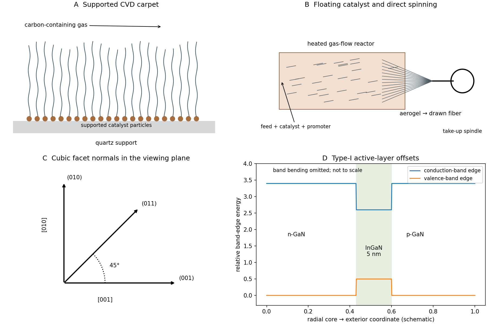
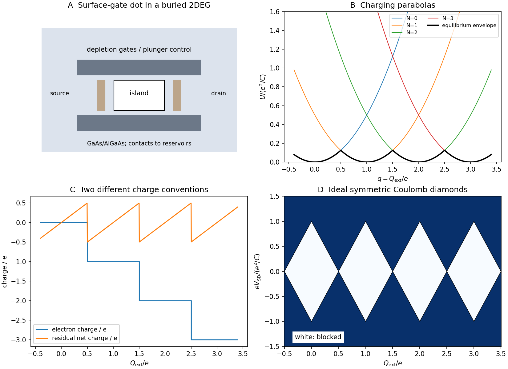

# Paper 2

↑ **Parent:** [2018](../2018.md)

Original source: [Original FOI download archive](https://www.whatdotheyknow.com/request/mphil_in_micro_and_nanotechnolog_5/response/2556540/attach/2/FOI%202024%2050%20Dai%20materials.zip?cookie_passthrough=1). Source: NanoMPhil Paper 2 2018.pdf, physical PDF pages 1–14 of that ZIP member. All nonbiology options, including both 21A and 21B, are covered. Questions 15 and 20 are user-deferred; question 13 is restricted to magnetic and materials physics.

**Table of contents**

- [Section A(i)](#section-a-i)
  - [11](#section-a-i/11)
    - [i](#section-a-i/11/i)
      - [a](#section-a-i/11/i/a)
        - [Solution](#section-a-i/11/i/a/solution)
      - [b](#section-a-i/11/i/b)
        - [Solution](#section-a-i/11/i/b/solution)
    - [ii](#section-a-i/11/ii)
      - [Solution](#section-a-i/11/ii/solution)
  - [12](#section-a-i/12)
    - [i](#section-a-i/12/i)
      - [Solution](#section-a-i/12/i/solution)
    - [ii](#section-a-i/12/ii)
      - [Solution](#section-a-i/12/ii/solution)
    - [iii](#section-a-i/12/iii)
      - [Solution](#section-a-i/12/iii/solution)
- [Section A(ii)](#section-a-ii)
  - [13](#section-a-ii/13)
    - [i](#section-a-ii/13/i)
      - [Solution](#section-a-ii/13/i/solution)
    - [ii](#section-a-ii/13/ii)
      - [Solution](#section-a-ii/13/ii/solution)
    - [iii](#section-a-ii/13/iii)
      - [Solution](#section-a-ii/13/iii/solution)
    - [iv](#section-a-ii/13/iv)
      - [Solution](#section-a-ii/13/iv/solution)
  - [14](#section-a-ii/14)
    - [i](#section-a-ii/14/i)
      - [Solution](#section-a-ii/14/i/solution)
    - [ii](#section-a-ii/14/ii)
      - [a](#section-a-ii/14/ii/a)
        - [Solution](#section-a-ii/14/ii/a/solution)
      - [b](#section-a-ii/14/ii/b)
        - [Solution](#section-a-ii/14/ii/b/solution)
      - [c](#section-a-ii/14/ii/c)
        - [Solution](#section-a-ii/14/ii/c/solution)
      - [d](#section-a-ii/14/ii/d)
        - [Solution](#section-a-ii/14/ii/d/solution)
- [Section A(iii)](#section-a-iii)
  - [15](#section-a-iii/15)
    - [i](#section-a-iii/15/i)
      - [Solution](#section-a-iii/15/i/solution)
    - [ii](#section-a-iii/15/ii)
      - [a](#section-a-iii/15/ii/a)
        - [Solution](#section-a-iii/15/ii/a/solution)
      - [b](#section-a-iii/15/ii/b)
        - [Solution](#section-a-iii/15/ii/b/solution)
      - [c](#section-a-iii/15/ii/c)
        - [Solution](#section-a-iii/15/ii/c/solution)
    - [iii](#section-a-iii/15/iii)
      - [a](#section-a-iii/15/iii/a)
        - [Solution](#section-a-iii/15/iii/a/solution)
      - [b](#section-a-iii/15/iii/b)
        - [Solution](#section-a-iii/15/iii/b/solution)
      - [c](#section-a-iii/15/iii/c)
        - [Solution](#section-a-iii/15/iii/c/solution)
      - [d](#section-a-iii/15/iii/d)
        - [Solution](#section-a-iii/15/iii/d/solution)
    - [iv](#section-a-iii/15/iv)
      - [Solution](#section-a-iii/15/iv/solution)
  - [16](#section-a-iii/16)
    - [i](#section-a-iii/16/i)
      - [Solution](#section-a-iii/16/i/solution)
    - [ii](#section-a-iii/16/ii)
      - [Solution](#section-a-iii/16/ii/solution)
    - [iii](#section-a-iii/16/iii)
      - [Solution](#section-a-iii/16/iii/solution)
    - [iv](#section-a-iii/16/iv)
      - [Solution](#section-a-iii/16/iv/solution)
  - [17](#section-a-iii/17)
    - [i](#section-a-iii/17/i)
      - [Solution](#section-a-iii/17/i/solution)
    - [ii](#section-a-iii/17/ii)
      - [Solution](#section-a-iii/17/ii/solution)
- [Section B](#section-b)
  - [18](#section-b/18)
    - [i](#section-b/18/i)
      - [Solution](#section-b/18/i/solution)
    - [ii](#section-b/18/ii)
      - [Solution](#section-b/18/ii/solution)
    - [iii](#section-b/18/iii)
      - [Solution](#section-b/18/iii/solution)
  - [19](#section-b/19)
    - [i](#section-b/19/i)
      - [Solution](#section-b/19/i/solution)
    - [ii](#section-b/19/ii)
      - [Solution](#section-b/19/ii/solution)
    - [iii](#section-b/19/iii)
      - [Solution](#section-b/19/iii/solution)
    - [iv](#section-b/19/iv)
      - [Solution](#section-b/19/iv/solution)
  - [20](#section-b/20)
    - [i](#section-b/20/i)
      - [Solution](#section-b/20/i/solution)
    - [ii](#section-b/20/ii)
      - [Solution](#section-b/20/ii/solution)
    - [iii](#section-b/20/iii)
      - [Solution](#section-b/20/iii/solution)
    - [iv](#section-b/20/iv)
      - [Solution](#section-b/20/iv/solution)
    - [v](#section-b/20/v)
      - [Solution](#section-b/20/v/solution)
  - [21A](#section-b/21a)
    - [i](#section-b/21a/i)
      - [Solution](#section-b/21a/i/solution)
    - [ii](#section-b/21a/ii)
      - [Solution](#section-b/21a/ii/solution)
    - [iii](#section-b/21a/iii)
      - [Solution](#section-b/21a/iii/solution)
    - [iv](#section-b/21a/iv)
      - [Solution](#section-b/21a/iv/solution)
  - [21B](#section-b/21b)
    - [i](#section-b/21b/i)
      - [Solution](#section-b/21b/i/solution)
    - [ii](#section-b/21b/ii)
      - [Solution](#section-b/21b/ii/solution)
    - [iii](#section-b/21b/iii)
      - [Solution](#section-b/21b/iii/solution)
    - [iv](#section-b/21b/iv)
      - [Solution](#section-b/21b/iv/solution)
    - [v](#section-b/21b/v)
      - [Solution](#section-b/21b/v/solution)

<h2 id="section-a-i">Section A(i)</h2>

↑ **Parent:** [Paper 2](paper-2.md)

<h3 id="section-a-i/11">11</h3>

↑ **Parent:** [Section A(i)](#section-a-i)

<h4 id="section-a-i/11/i">i</h4>

↑ **Parent:** [11](#section-a-i/11)

<h5 id="section-a-i/11/i/a">a</h5>

↑ **Parent:** [I](#section-a-i/11/i)

<h6 id="section-a-i/11/i/a/solution">Solution</h6>

↑ **Parent:** [A](#section-a-i/11/i/a)

Use substrate-supported [chemical vapor deposition](../../engineering.md#chemical-vapor-deposition). Prepare a clean [quartz](../../chemical-substance.md#quartz) support with a suitable supported transition-metal catalyst, often nanoscale Fe-containing particles. Catalyst loading, support chemistry and pretreatment control the active particle size and density. A heated carbon-containing gas supplies carbon to those particles, from which [carbon nanotubes](../../chemical-substance.md#carbon-nanotube) grow.

At sufficiently high nucleation density, neighboring tubes constrain one another's lateral motion, producing a roughly aligned [carbon nanotube forest](../../chemical-substance.md#carbon-nanotube-forest) normal to the support. This is collective crowding, not a requirement that [quartz](../../chemical-substance.md#quartz) epitaxially orient every tube. Gas delivery, catalyst lifetime and growth time set length and uniformity. Depending on catalyst–support adhesion, catalyst particles can remain near the support or move with growing tips.

**The catalyst is supported and the carpet remains attached to a substrate.** Check particle distribution and film uniformity separately from tube diameter and alignment; a dense black coating alone does not establish a nanotube forest. The original growth sketch contrasts this supported route with a floating-catalyst reactor.

**[Figure 1](#section-a-i/11/i/a/image-supported-and-floating-catalyst-nanotube-growth-with-radial-led-band-confinement). Supported and floating-catalyst nanotube growth, with radial LED band confinement**. Original process schematics and qualitative band-offset profile. No source microscopy is reproduced. The band sketch isolates the active-layer offsets rather than claiming a solved radial junction potential.

<h5 id="section-a-i/11/i/b">b</h5>

↑ **Parent:** [I](#section-a-i/11/i)

<h6 id="section-a-i/11/i/b/solution">Solution</h6>

↑ **Parent:** [B](#section-a-i/11/i/b)

Use [floating-catalyst chemical vapor deposition](../../engineering.md#floating-catalyst-chemical-vapor-deposition) to form a continuous suspended network. Introduce a carbon feed together with a volatile catalyst precursor into a hot gas-flow reactor. Catalyst [nanoparticles](../../engineering.md#nanoparticle) nucleate in the gas stream; tubes grow while moving through the reaction zone and assemble into an interconnected aerogel.

Withdraw that network continuously, collect it on a rotating spindle, and consolidate or twist it into a fiber. Long tubes, suitable number density and adequate overlap allow the network to transmit the drawing [force](../../force.md) without breaking into isolated clumps. The take-up rate must be matched to network production; collection is not simply a geometrically scaled version of a substrate carpet.

**The catalyst and tubes form in the flowing gas, and the product is drawn directly from a growing aerogel.** This differs both from a supported carpet and from later spinning of a separately prepared nanotube dispersion. The original demonstration combined CVD synthesis with continuous product withdrawal from the furnace.[Science304, pp.276–278, synthesis-zone spinning and rotating collection](../../physics-bibliography.md#direct-spinning-of-carbon-nanotube-fibers-from-chemical-vapor-deposition-synthesis-by-ya-li-li-and-others)

<h4 id="section-a-i/11/ii">ii</h4>

↑ **Parent:** [11](#section-a-i/11)

<h5 id="section-a-i/11/ii/solution">Solution</h5>

↑ **Parent:** [Ii](#section-a-i/11/ii)

**The floating-catalyst direct-spinning route commonly requires a small [sulfur](../../chemical-substance.md#sulfur) promoter addition.** [sulfur](../../chemical-substance.md#sulfur) changes catalyst-particle nucleation and surface chemistry, influencing the active Fe-particle population, carbon incorporation and whether sufficiently long, numerous tubes form a drawable aerogel.

A sulfur-rich catalyst surface or Fe–S-containing state can alter [surface energy](../../surface-tension.md#surface-energy), wetting and particle coarsening; a low-melting interfacial state can also affect catalyst activity. These are process-dependent mechanisms, not a statement that [sulfur](../../chemical-substance.md#sulfur) is a structural constituent required in every [carbon nanotube](../../chemical-substance.md#carbon-nanotube). Excess [sulfur](../../chemical-substance.md#sulfur) can suppress useful growth or worsen impurities. The useful dose therefore has a window and depends on catalyst and feed chemistry.

A controlled comparison changes [sulfur](../../chemical-substance.md#sulfur) supply while holding the carbon/catalyst feed and collection conditions fixed, then measures tube population, catalyst residue and spinnability rather than judging only the presence of soot. The primary direct-spinning study specifically treats sulfur-dependent processing and purity.[2014, abstract and sulfur-promoter model](../../physics-bibliography.md#spinning-of-carbon-nanotube-fibres-using-the-floating-catalyst-high-temperature-route-purity-issues-and-the-critical-role-of-sulphur-by-t-s-gspann-and-others)

<h3 id="section-a-i/12">12</h3>

↑ **Parent:** [Section A(i)](#section-a-i)

<h4 id="section-a-i/12/i">i</h4>

↑ **Parent:** [12](#section-a-i/12)

<h5 id="section-a-i/12/i/solution">Solution</h5>

↑ **Parent:** [I](#section-a-i/12/i)

Read the displayed axes as horizontal $[001]$ and vertical $[010]$; the viewing direction is therefore consistent with $[100]$. [crystal facets](../../thermodynamics.md#crystal-facet) edge-on in this projection have normals in the $yz$ plane. The flat upper/lower boundaries are approximately horizontal, the end face vertical, and the bevels approximately $45^\circ$ to both.

A probable low-index assignment is **upper face $(010)$, end face $(001)$ and lower-right bevel $(0\bar11)$**, with the upper-right bevel $(011)$ if it is also indexed. Thus the flat faces belong to $\{100\}$ and the diagonal faces to $\{110\}$.

For example,

$$
\cos\phi_{(010),(001)}=0,\qquad
\cos\phi_{(001),(011)}=\frac1{\sqrt2},
$$

giving $90^\circ$ and $45^\circ$ between normals. The upper $(010)$ normal and lower bevel $(0\bar11)$ normal instead make $135^\circ$; their acute unoriented plane angle is $45^\circ$. Adjacent polygon corners between a flat edge and bevel have internal angles near $135^\circ$.

**The distinction between a normal angle, an acute plane angle and an internal polygon angle avoids a supplementary-angle error.** This is a probable projected indexation, not a unique full three-dimensional [crystal facet](../../thermodynamics.md#crystal-facet) reconstruction. The associated work uses tomography precisely to recover information absent from one projection.[2013, study scope: three-dimensional structure and composition from electron-tomography data](../../physics-bibliography.md#three-dimensional-elemental-mapping-at-the-atomic-scale-in-bimetallic-nanocrystals-by-bart-goris-and-others) The original facet-normal diagram in the growth-and-LED figure shows the $45^\circ$ relation independently of the source micrograph.

<h4 id="section-a-i/12/ii">ii</h4>

↑ **Parent:** [12](#section-a-i/12)

<h5 id="section-a-i/12/ii/solution">Solution</h5>

↑ **Parent:** [Ii](#section-a-i/12/ii)

The [Wulff construction](../../thermodynamics.md#wulff-construction) minimizes total orientation-dependent surface [free energy](../../thermodynamic-potential.md#thermodynamic-free-energy) at fixed crystal [volume](../../geometry-and-topology.md#volume):

$$
G_{\rm surf}=\sum_i\gamma_iA_i,\qquad h_i=\Lambda\gamma_i.
$$

Planes at distances proportional to their [surface energies](../../surface-tension.md#surface-energy) bound the equilibrium shape. The construction is thermodynamic; observed growth rates need not select the same shape.

For a mixed-metal particle, minimize a more complete [free energy](../../thermodynamic-potential.md#thermodynamic-free-energy) including bulk mixing/ordering, Au–Ag interface [energy](../../energy.md), exposed-surface composition, adsorbates and elastic [strain](../../continuum-mechanics.md#strain), while conserving the amount of each metal. Important parameters include orientation-dependent [surface energies](../../surface-tension.md#surface-energy), metal chemical potentials, interface coherency, [lattice mismatch](../../semiconductor.md#lattice-mismatch), [temperature](../../temperature.md) and ligand coverage. [surface segregation](../../chemical-substance.md#surface-segregation) can change the exposed composition and hence the relevant $\gamma_i$.

**A generalized free-energy minimization can address a multicomponent particle; the elementary [Wulff construction](../../thermodynamics.md#wulff-construction) alone does not predict its core-shell composition.** Sequential Au-core formation and Ag deposition can preserve a kinetically trapped interface when diffusion is too slow to reach equilibrium. If shape relaxation is fast but interdiffusion slow, an external shape may approach a constrained minimum even though the complete particle is not at global equilibrium. Growth kinetics, ligand stabilization and finite-size effects limit a bare-surface equilibrium model. A faceted image is therefore insufficient proof that either shape or composition is an equilibrium state.

<h4 id="section-a-i/12/iii">iii</h4>

↑ **Parent:** [12](#section-a-i/12)

<h5 id="section-a-i/12/iii/solution">Solution</h5>

↑ **Parent:** [Iii](#section-a-i/12/iii)

Since [energy](../../energy.md) and [angular frequency](../../lagrangian-mechanics.md#angular-frequency) are related by $E=\hbar\omega$, the given [eigenvalue](../../linear-operator-theory.md#eigenvalue) relation yields

$$
E_i=E_P\sqrt{\frac{1+\lambda_i}{2}}.
$$

With $E_P=4.3\ {\rm eV}$,

$$
\boxed{
E_1=4.3\sqrt{0.285}\simeq2.296\ {\rm eV},\quad
E_2=4.3\sqrt{0.325}\simeq2.451\ {\rm eV},\quad
E_3=4.3\sqrt{0.400}\simeq2.720\ {\rm eV}.}
$$

The $\lambda_i$ are dimensionless modal [eigenvalues](../../linear-operator-theory.md#eigenvalue), not optical wavelengths despite the symbol. The same $\hbar$ multiplies both mode and bulk angular frequencies and cancels in the [energy](../../energy.md) ratio. These are bare-core predictions of the stipulated lossless [Drude model](../../electric-charge.md#drude-model); adding a dielectric/metallic shell, interband response or damping changes the actual resonances.

<h2 id="section-a-ii">Section A(ii)</h2>

↑ **Parent:** [Paper 2](paper-2.md)

<h3 id="section-a-ii/13">13</h3>

↑ **Parent:** [Section A(ii)](#section-a-ii)

<h4 id="section-a-ii/13/i">i</h4>

↑ **Parent:** [13](#section-a-ii/13)

<h5 id="section-a-ii/13/i/solution">Solution</h5>

↑ **Parent:** [I](#section-a-ii/13/i)

Only the magnetic-response physics is addressed here; **biological and clinical application is user-deferred**.

A single-domain particle has an approximately coherent [magnetic dipole moment](../../electromagnetism.md#magnetic-dipole-moment), but single-domain does not by itself imply rapid thermal reversal. If moments equilibrate within the measurement time, a dilute, noninteracting ensemble is [superparamagnetic](../../electromagnetism.md#superparamagnetism): its quasistatic [magnetization](../../electromagnetism.md#magnetization) is reversible, odd in field and approaches saturation with negligible [remanence](../../electromagnetism.md#remanent-magnetization) or [magnetic coercivity](../../critical-phenomenon.md#magnetic-coercivity).

For freely orientable classical moments,

$$
M(H)=n_p\mu\,\mathcal L\!\left(\frac{\mu_0\mu H}{k_BT}\right),
\qquad
\mathcal L(z)=\coth z-\frac1z.
$$

At small field, $\mathcal L(z)\simeq z/3$; at large field moments align. This Langevin form is an ideal limit, not a universal exact curve for anisotropic fixed-axis particles.

**The missing timescale/[magnetic anisotropy](../../electromagnetism.md#magnetic-anisotropy) information must be stated:** blocked single-domain particles can already show [hysteresis](../../critical-phenomenon.md#hysteresis). Also, a reversible quasistatic curve does not preclude a finite-frequency loss loop when relaxation lags an alternating field. The original curves illustrate an equilibrated dilute limit and possible blocked/interacting alternatives, not measured treatment performance.

**[Figure 2](#section-a-ii/13/i/image-conditional-magnetic-loops-and-electrostatic-screening-profiles). Conditional magnetic loops and electrostatic screening profiles**. Original illustrative magnetic curves and calculated planar mean-field ion profiles. Magnetic-loop broadening is one possible interaction outcome, not a concentration-dependent experimental fit or a clinical prediction.

<h4 id="section-a-ii/13/ii">ii</h4>

↑ **Parent:** [13](#section-a-ii/13)

<h5 id="section-a-ii/13/ii/solution">Solution</h5>

↑ **Parent:** [Ii](#section-a-ii/13/ii)

Thermally activated moment reversal, or [Néel relaxation](../../electromagnetism.md#neel-relaxation), often has an activated timescale

$$
\tau_N\simeq\tau_0e^{E_a/(k_BT)}.
$$

Lowering [temperature](../../temperature.md) increases $\tau_N$. When it becomes comparable to the observation time $t_m$, the ensemble crosses an operational [magnetic blocking temperature](../../electromagnetism.md#magnetic-blocking-temperature),

$$
T_B\simeq\frac{E_a}{k_B\ln(t_m/\tau_0)}.
$$

Above this blocking crossover, an equilibrated ensemble remains reversible; its low-field susceptibility can increase as [temperature](../../temperature.md) falls. Below it, moments cannot fully relax during the field sweep, so **[magnetic coercivity](../../critical-phenomenon.md#magnetic-coercivity) and [remanence](../../electromagnetism.md#remanent-magnetization) can emerge and the loop opens**. A distribution of particle [volumes](../../geometry-and-topology.md#volume)/anisotropies broadens the crossover.

This is a timescale-dependent blocking effect, not necessarily a thermodynamic phase transition. Rotation of whole particles in a fluid can supply an additional relaxation channel, and the particle orientation distribution affects the observed loop. Compare sweep rates and [temperatures](../../temperature.md) before interpreting one curve as an intrinsic static material law.

<h4 id="section-a-ii/13/iii">iii</h4>

↑ **Parent:** [13](#section-a-ii/13)

<h5 id="section-a-ii/13/iii/solution">Solution</h5>

↑ **Parent:** [Iii](#section-a-ii/13/iii)

At greater concentration, the mean separation falls and the independent-moment approximation can fail. The [magnetic dipole interaction](../../electromagnetism.md#magnetic-dipole-interaction) has characteristic scale

$$
E_{\rm dd}\sim\frac{\mu_0\mu^2}{4\pi r^3},
$$

with sign and angular dependence set by moment orientation. Correlated clusters, chains or frustrated arrangements change local fields and relaxation barriers.

A plausible example is a progressively less reversible loop with larger [remanence](../../electromagnetism.md#remanent-magnetization)/[magnetic coercivity](../../critical-phenomenon.md#magnetic-coercivity) when interactions slow collective relaxation; the figure illustrates that case. **The trend is not universal:** some arrangements reduce susceptibility or suppress [remanence](../../electromagnetism.md#remanent-magnetization), and aggregation can introduce a different response from a uniform concentrated dispersion. Neither loop area nor [magnetic coercivity](../../critical-phenomenon.md#magnetic-coercivity) must vary monotonically with concentration.

At the actual drive [frequency](../../wave.md#frequency), the dissipated [energy](../../energy.md) per cycle per unit [volume](../../geometry-and-topology.md#volume) is proportional to $\mu_0\oint H\,dM$. Measure this dynamic loop rather than inferring dissipation from an unrelated slow sweep. Compare equal magnetic-material amounts, inspect dispersion state, and vary [frequency](../../wave.md#frequency) to separate concentration-driven interactions from simple signal scaling. No biological efficacy is inferred.

<h4 id="section-a-ii/13/iv">iv</h4>

↑ **Parent:** [13](#section-a-ii/13)

<h5 id="section-a-ii/13/iv/solution">Solution</h5>

↑ **Parent:** [Iv](#section-a-ii/13/iv)

For the nonbiology fabrication objective, **reduce unwanted dipolar coupling while preserving a useful single-particle dynamic response**. Lithographically reduce magnetic [volume](../../geometry-and-topology.md#volume) or adjust aspect ratio to control $\mu\simeq M_sV$ and [magnetic anisotropy](../../electromagnetism.md#magnetic-anisotropy). Reducing $V$ reduces the characteristic pair interaction approximately as $V^2/r^3$, but also changes $E_a$ and relaxation time.

A nonmagnetic spacer coating or stable surface layer can maintain minimum center-to-center separation after release and reduce aggregation. At a fixed magnetic [volume](../../geometry-and-topology.md#volume) fraction this geometric constraint has a real packing cost; separation cannot be increased without limit while claiming unchanged loading.

Tune particle [volume](../../geometry-and-topology.md#volume), [magnetic anisotropy](../../electromagnetism.md#magnetic-anisotropy) and spacing together, then measure dynamic susceptibility/loop area at the specified [temperature](../../temperature.md) and [frequency](../../wave.md#frequency). In a simple single-relaxation model, useful phase lag occurs near $\omega\tau\sim1$; making particles so small that reversal is essentially instantaneous can reduce dissipative response. **Clinical treatment optimization remains user-deferred**; these are materials/fabrication controls, not a treatment recommendation.

<h3 id="section-a-ii/14">14</h3>

↑ **Parent:** [Section A(ii)](#section-a-ii)

<h4 id="section-a-ii/14/i">i</h4>

↑ **Parent:** [14](#section-a-ii/14)

<h5 id="section-a-ii/14/i/solution">Solution</h5>

↑ **Parent:** [I](#section-a-ii/14/i)

For a nonrelativistic [electron](../../physics.md#electron),

$$
\lambda=\frac hp=\frac h{\sqrt{2m_eE}},\qquad
E=20(1.6\times10^{-19})=3.2\times10^{-18}\ {\rm J}.
$$

Using the supplied constants gives

$$
\boxed{\lambda\simeq2.75\times10^{-10}\ {\rm m}=0.275\ {\rm nm}.}
$$

This is comparable with atomic lattice spacings. A suitable crystalline surface or sufficiently thin crystal can therefore diffract the [electron](../../physics.md#electron) beam; the reciprocal-lattice geometry and scattering conditions determine the actual angles. A grating or slit can also diffract matter waves if its scale and coherence conditions are suitable. The [kinetic energy](../../energy.md#kinetic-energy) is tiny compared with the [electron](../../physics.md#electron) rest [energy](../../energy.md), so relativistic corrections are negligible at the stated precision.

<h4 id="section-a-ii/14/ii">ii</h4>

↑ **Parent:** [14](#section-a-ii/14)

<h5 id="section-a-ii/14/ii/a">a</h5>

↑ **Parent:** [Ii](#section-a-ii/14/ii)

<h6 id="section-a-ii/14/ii/a/solution">Solution</h6>

↑ **Parent:** [A](#section-a-ii/14/ii/a)

Only $n=1,2$ have energies below $6\epsilon$. Squaring the corresponding expansion coefficients gives $0.2^2+0.3^2=0.13$.

The printed rounded coefficients have norm

$$
S=0.2^2+0.3^2+0.4^2+0.843^2=1.000649.
$$

Thus the expected rounded answer is **$P(E<6\epsilon)\simeq0.13$**. If the decimal coefficients are treated as literal exact inputs and the state normalized, the exact [probability](../../probability-theory.md#probability) for that input is **$0.13/S\simeq0.129916$**. This distinction avoids treating rounding error as a physical departure from [wavefunction normalization](../../wave-function.md#wavefunction-normalization).

<h5 id="section-a-ii/14/ii/b">b</h5>

↑ **Parent:** [Ii](#section-a-ii/14/ii)

<h6 id="section-a-ii/14/ii/b/solution">Solution</h6>

↑ **Parent:** [B](#section-a-ii/14/ii/b)

Orthonormal [energy eigenstates](../../energy-eigenvalue.md#energy-eigenstate) contribute incoherently to the expectation of [energy](../../energy.md):

$$
\langle E\rangle=
\frac{\epsilon}{S}\left[1(0.2)^2+4(0.3)^2+9(0.4)^2+16(0.843)^2\right]
=\frac{13.210384}{1.000649}\epsilon.
$$

Therefore **$\langle E\rangle\simeq13.2018\epsilon$** for the normalized literal decimals. Ignoring the small rounding-induced norm error gives $13.2104\epsilon$, conventionally reported at this precision as about **$13.2\epsilon$**. The mean need not equal an individual [energy](../../energy.md) [eigenvalue](../../linear-operator-theory.md#eigenvalue).

<h5 id="section-a-ii/14/ii/c">c</h5>

↑ **Parent:** [Ii](#section-a-ii/14/ii)

<h6 id="section-a-ii/14/ii/c/solution">Solution</h6>

↑ **Parent:** [C](#section-a-ii/14/ii/c)

Each [energy](../../energy.md) component acquires its own phase:

$$
\psi(x,t)=\frac1{\sqrt S}\left[
0.2e^{-i\epsilon t/\hbar}\psi_1(x)+
0.3e^{-4i\epsilon t/\hbar}\psi_2(x)+
0.4e^{-9i\epsilon t/\hbar}\psi_3(x)+
0.843e^{-16i\epsilon t/\hbar}\psi_4(x)\right].
$$

The $1/\sqrt S$ factor normalizes the printed rounded input; it can be omitted if the coefficients are regarded as an already normalized rounded representation.

**The [energy](../../energy.md) probabilities and $\langle E\rangle$ remain constant** under this time-independent [hamiltonian](../../hamiltonian-mechanics.md#hamiltonian) because phase factors have unit modulus. [position](../../classical-mechanics.md#position) probabilities can nevertheless vary: interference between different [energy](../../energy.md) components generally changes with their relative phases. A stationary [energy](../../energy.md) distribution is not the same thing as a stationary spatial [probability distribution](../../probability-distribution.md).

<h5 id="section-a-ii/14/ii/d">d</h5>

↑ **Parent:** [Ii](#section-a-ii/14/ii)

<h6 id="section-a-ii/14/ii/d/solution">Solution</h6>

↑ **Parent:** [D](#section-a-ii/14/ii/d)

The result $16\epsilon$ projects the state onto the corresponding nondegenerate [energy eigenstate](../../energy-eigenvalue.md#energy-eigenstate). Immediately after an ideal measurement,

$$
\boxed{\psi_{\rm after}(x)=e^{i\chi}\psi_4(x)}
$$

for an unobservable overall phase $\chi$. Subsequent isolated evolution adds $e^{-16i\epsilon t/\hbar}$ but does not mix in other [energy eigenstates](../../energy-eigenvalue.md#energy-eigenstate). **A repeat ideal [energy](../../energy.md) measurement gives $16\epsilon$ with [probability](../../probability-theory.md#probability) one**, provided the [hamiltonian](../../hamiltonian-mechanics.md#hamiltonian) is unchanged and no intervening disturbance occurs.

<h2 id="section-a-iii">Section A(iii)</h2>

↑ **Parent:** [Paper 2](paper-2.md)

<h3 id="section-a-iii/15">15</h3>

↑ **Parent:** [Section A(iii)](#section-a-iii)

<h4 id="section-a-iii/15/i">i</h4>

↑ **Parent:** [15](#section-a-iii/15)

<h5 id="section-a-iii/15/i/solution">Solution</h5>

↑ **Parent:** [I](#section-a-iii/15/i)

**TODO: user-deferred biological question; no biological research or solution provided.**

<h4 id="section-a-iii/15/ii">ii</h4>

↑ **Parent:** [15](#section-a-iii/15)

<h5 id="section-a-iii/15/ii/a">a</h5>

↑ **Parent:** [Ii](#section-a-iii/15/ii)

<h6 id="section-a-iii/15/ii/a/solution">Solution</h6>

↑ **Parent:** [A](#section-a-iii/15/ii/a)

**TODO: user-deferred biological question; no biological research or solution provided.**

<h5 id="section-a-iii/15/ii/b">b</h5>

↑ **Parent:** [Ii](#section-a-iii/15/ii)

<h6 id="section-a-iii/15/ii/b/solution">Solution</h6>

↑ **Parent:** [B](#section-a-iii/15/ii/b)

**TODO: user-deferred biological question; no biological research or solution provided.**

<h5 id="section-a-iii/15/ii/c">c</h5>

↑ **Parent:** [Ii](#section-a-iii/15/ii)

<h6 id="section-a-iii/15/ii/c/solution">Solution</h6>

↑ **Parent:** [C](#section-a-iii/15/ii/c)

**TODO: user-deferred biological question; no biological research or solution provided.**

<h4 id="section-a-iii/15/iii">iii</h4>

↑ **Parent:** [15](#section-a-iii/15)

<h5 id="section-a-iii/15/iii/a">a</h5>

↑ **Parent:** [Iii](#section-a-iii/15/iii)

<h6 id="section-a-iii/15/iii/a/solution">Solution</h6>

↑ **Parent:** [A](#section-a-iii/15/iii/a)

**TODO: user-deferred biological question; no biological research or solution provided.**

<h5 id="section-a-iii/15/iii/b">b</h5>

↑ **Parent:** [Iii](#section-a-iii/15/iii)

<h6 id="section-a-iii/15/iii/b/solution">Solution</h6>

↑ **Parent:** [B](#section-a-iii/15/iii/b)

**TODO: user-deferred biological question; no biological research or solution provided.**

<h5 id="section-a-iii/15/iii/c">c</h5>

↑ **Parent:** [Iii](#section-a-iii/15/iii)

<h6 id="section-a-iii/15/iii/c/solution">Solution</h6>

↑ **Parent:** [C](#section-a-iii/15/iii/c)

**TODO: user-deferred biological question; no biological research or solution provided.**

<h5 id="section-a-iii/15/iii/d">d</h5>

↑ **Parent:** [Iii](#section-a-iii/15/iii)

<h6 id="section-a-iii/15/iii/d/solution">Solution</h6>

↑ **Parent:** [D](#section-a-iii/15/iii/d)

**TODO: user-deferred biological question; no biological research or solution provided.**

<h4 id="section-a-iii/15/iv">iv</h4>

↑ **Parent:** [15](#section-a-iii/15)

<h5 id="section-a-iii/15/iv/solution">Solution</h5>

↑ **Parent:** [Iv](#section-a-iii/15/iv)

**TODO: user-deferred biological question; no biological research or solution provided.**

<h3 id="section-a-iii/16">16</h3>

↑ **Parent:** [Section A(iii)](#section-a-iii)

<h4 id="section-a-iii/16/i">i</h4>

↑ **Parent:** [16](#section-a-iii/16)

<h5 id="section-a-iii/16/i/solution">Solution</h5>

↑ **Parent:** [I](#section-a-iii/16/i)

Let $\Phi(x)$ be the [electrostatic potential](../../electric-field.md#electric-potential) in volts, relative to the bulk value, and $x$ the distance normal to the surface. The positive quantity $e$ is the elementary charge; the monovalent ions carry $\pm e$. The bulk number density $n_0$ refers to each ionic species in a symmetric electrolyte, so the total bulk ion density is $2n_0$. $\epsilon_0$ is vacuum [permittivity](../../permittivity.md), $\epsilon_r$ relative [permittivity](../../permittivity.md), $k_B$ the Boltzmann constant and $T$ absolute [temperature](../../temperature.md). The hyperbolic sine acts on the dimensionless potential $u=e\Phi/(k_BT)$.

**The printed sign is inconsistent with physical Poisson–Boltzmann screening under these usual definitions.** Indeed,

$$
n_\pm=n_0e^{\mp u},\qquad
\rho=e(n_+-n_-)=-2en_0\sinh u,
$$

and [Poisson's equation](../../partial-differential-equation.md#poisson-s-equation) gives $\Phi''=-\rho/(\epsilon_0\epsilon_r)=+2en_0\sinh u/(\epsilon_0\epsilon_r)$, with a plus sign. The literal printed equation and the physical screened solution must therefore be distinguished.

<h4 id="section-a-iii/16/ii">ii</h4>

↑ **Parent:** [16](#section-a-iii/16)

<h5 id="section-a-iii/16/ii/solution">Solution</h5>

↑ **Parent:** [Ii](#section-a-iii/16/ii)

The dimensionally meaningful small-potential condition is **$|e\Phi|\ll k_BT$**, not a comparison of volts directly with [energy](../../energy.md). Expanding $\sinh u=u+O(u^3)$ gives the physical linearized equation

$$
\Phi''=\kappa_D^2\Phi,\qquad
\boxed{\lambda_D=\kappa_D^{-1}=
\sqrt{\frac{\epsilon_0\epsilon_r k_BT}{2e^2n_0}}}.
$$

For a single plane with bulk [boundary condition](../../differential-equation.md#boundary-condition) $\Phi(\infty)=0$, $\Phi(x)=\Phi_0e^{-x/\lambda_D}$. At fixed [temperature](../../temperature.md) and [permittivity](../../permittivity.md), **$\lambda_D\propto n_0^{-1/2}$**: the curve decreases with increasing density, diverging in the ideal zero-salt limit.

Literal expansion of the printed minus-sign equation instead gives $\Phi''=-\kappa_D^2\Phi$, with sine/cosine solutions. A nonzero such solution cannot decay to zero at infinity. That literal equation does not describe a [Debye length](../../physics.md#debye-length). The figure and following ion profiles use the physically derived plus-sign equation, with this correction explicit.

<h4 id="section-a-iii/16/iii">iii</h4>

↑ **Parent:** [16](#section-a-iii/16)

<h5 id="section-a-iii/16/iii/solution">Solution</h5>

↑ **Parent:** [Iii](#section-a-iii/16/iii)

Take a positive surface potential $\Phi_0>0$, so positive ions are [co-ions](../../electrostatics.md#co-ion) and negative ions [counterions](../../chemistry.md#counterion). With $u_0=e\Phi_0/(k_BT)\ll1$,

$$
\boxed{n_{\rm co}(x)\simeq n_0[1-u_0e^{-x/\lambda_D}],\qquad
n_{\rm counter}(x)\simeq n_0[1+u_0e^{-x/\lambda_D}].}
$$

The [counterion](../../chemistry.md#counterion) density is slightly enhanced at the surface, the [co-ion](../../electrostatics.md#co-ion) density slightly depleted, and both approach $n_0$ over a [Debye length](../../physics.md#debye-length). To first order their sum is $2n_0$, while their difference supplies the screening charge. Reverse the surface sign and the ionic roles interchange. These are number-density profiles, not trajectories of individual ions.

<h4 id="section-a-iii/16/iv">iv</h4>

↑ **Parent:** [16](#section-a-iii/16)

<h5 id="section-a-iii/16/iv/solution">Solution</h5>

↑ **Parent:** [Iv](#section-a-iii/16/iv)

For large positive dimensionless surface potential $u_0=e\Phi_0/(k_BT)\gtrsim1$, use the nonlinear [Boltzmann distribution](../../thermodynamics.md#boltzmann-distribution) rather than their linear expansion:

$$
n_{\rm co}=n_0e^{-u(x)},\qquad n_{\rm counter}=n_0e^{u(x)}.
$$

The [counterions](../../chemistry.md#counterion) become strongly enriched near the wall and [co-ions](../../electrostatics.md#co-ion) strongly depleted. A planar mean-field solution is

$$
u(x)=4\operatorname{artanh}\!\left[\tanh(u_0/4)e^{-x/\lambda_D}\right].
$$

It approaches the linear screening form far from the wall. **Nonlinearity preserves positive densities and produces a much stronger near-wall asymmetry**; an extrapolated linear [co-ion](../../electrostatics.md#co-ion) profile could incorrectly become negative. The total local ion density is $2n_0\cosh u$, no longer constant.

The original figure compares weak- and strong-potential profiles. At very large local concentrations, finite ion size, specific adsorption and ion correlations limit this ideal point-ion mean-field model; it does not predict unlimited physically realizable [counterion](../../chemistry.md#counterion) packing.

<h3 id="section-a-iii/17">17</h3>

↑ **Parent:** [Section A(iii)](#section-a-iii)

<h4 id="section-a-iii/17/i">i</h4>

↑ **Parent:** [17](#section-a-iii/17)

<h5 id="section-a-iii/17/i/solution">Solution</h5>

↑ **Parent:** [I](#section-a-iii/17/i)

Interpret the given noise correlation as the three-dimensional dot-product correlation. Each Cartesian component then has $\langle\xi_i(t)\xi_j(t')\rangle=2\gamma k_BT\delta_{ij}\delta(t-t')$. For the usual Gaussian thermal-noise idealization, each coordinate is an [Ornstein-Uhlenbeck process](../../gaussian-process.md#ornstein-uhlenbeck-process). With $\tau=\gamma/k$,

$$
\mathbf x(t)=\mathbf x_0e^{-t/\tau}+
\frac1\gamma\int_0^t e^{-(t-s)/\tau}\boldsymbol\xi(s)\,ds.
$$

For a particle initially at $\mathbf x_0=0$,

$$
\langle|\mathbf x(t)|^2\rangle=
\frac{6\gamma k_BT}{\gamma^2}\int_0^t e^{-2(t-s)/\tau}ds
=\frac{3k_BT}{k}(1-e^{-2t/\tau}).
$$

Hence its long-time displacement about the trap/elastic equilibrium has

$$
\boxed{x_{\rm rms}=\sqrt{3k_BT/k}}.
$$

This also follows from [equipartition theorem](../../canonical-ensemble.md#equipartition-theorem): each of three quadratic coordinates contributes $k_BT/2$.

A different common experimental quantity is the stationary time-lag displacement. It obeys

$$
\langle|\mathbf x(t+\Delta)-\mathbf x(t)|^2\rangle
=\frac{6k_BT}{k}(1-e^{-\Delta/\tau}),
$$

with long-lag RMS $\sqrt{6k_BT/k}$. **The factor of two distinguishes fluctuations about a mean [position](../../classical-mechanics.md#position) from differences between two decorrelated [positions](../../classical-mechanics.md#position).** The observation convention must be stated rather than silently interchanged.

<h4 id="section-a-iii/17/ii">ii</h4>

↑ **Parent:** [17](#section-a-iii/17)

<h5 id="section-a-iii/17/ii/solution">Solution</h5>

↑ **Parent:** [Ii](#section-a-iii/17/ii)

For a no-slip spherical tracer of radius $a$ in an isotropic incompressible elastic continuum, a small translation produces restoring [force](../../force.md) $6\pi aG\,\mathbf x$. Thus

$$
k=6\pi aG.
$$

Combining this with the equilibrium three-dimensional positional variance gives

$$
\boxed{G=\frac{k_BT}{2\pi a\langle|\mathbf x-\langle\mathbf x\rangle|^2\rangle}}.
$$

Equivalently, if $P_\infty$ is the stationary three-dimensional displacement-MSD plateau, **$G=k_BT/(\pi aP_\infty)$**. For a single measured coordinate, $\langle x_i^2\rangle=k_BT/k$ and $G=k_BT/(6\pi a\langle x_i^2\rangle)$.

This is [passive microrheology](../../rheology.md#passive-microrheology). Calibrate bead radius, [position](../../classical-mechanics.md#position) sensitivity, [temperature](../../temperature.md) and localization noise; subtract drift and test that a plateau is resolved. The continuum must be meaningful on the bead scale, the bead must couple without slip, and [thermal equilibrium](../../thermal-equilibrium.md) must hold. Boundaries, compressibility, active motion, probe attachment and unresolved relaxation can change the inferred response. An imposed optical trap adds stiffness and must be removed or independently calibrated rather than mistaken for material [elasticity](../../elasticity-physics.md).

## Section B

↑ **Parent:** [Paper 2](paper-2.md)

<h3 id="section-b/18">18</h3>

↑ **Parent:** [Section B](#section-b)

<h4 id="section-b/18/i">i</h4>

↑ **Parent:** [18](#section-b/18)

<h5 id="section-b/18/i/solution">Solution</h5>

↑ **Parent:** [I](#section-b/18/i)

Across a radial section, the narrow-gap [indium gallium nitride](../../chemical-substance.md#indium-gallium-nitride) layer lies between wider-gap n-GaN and p-GaN. A suitable [type-I band alignment](../../semiconductor.md#type-i-band-alignment) has a downward conduction-band offset and upward valence-band offset in the [indium gallium nitride](../../chemical-substance.md#indium-gallium-nitride), confining [electrons](../../physics.md#electron) and holes to the active layer. The original band sketch isolates those offsets; the complete junction also has doping-induced [band bending](../../semiconductor.md#band-bending).

At [thermal equilibrium](../../thermal-equilibrium.md) the [Fermi level](../../quantum-ideal-gas-statistics.md#fermi-level) is common throughout. Forward bias separates the [electron](../../physics.md#electron) and hole [quasi-Fermi levels](../../chemical-potential.md#quasi-fermi-level), injects carriers from the n- and p-regions and permits [electron-hole recombination](../../quantum-mechanics.md#electron-hole-recombination) in the thin active layer. A full radial line through the wire crosses two copies of the shell well; a core-to-exterior radial coordinate crosses one.

**The 5 nm [indium gallium nitride](../../chemical-substance.md#indium-gallium-nitride) shell is the [quantum well](../../semiconductor.md#quantum-well) active region, not a metallic contact.** Finite band offsets, confinement and polarization fields affect its transition [energy](../../energy.md); the bulk gap alone is insufficient.

A plausible role for the SiN mask is selective-area growth: restrict nucleation to exposed windows and suppress parasitic deposition between wires. Retained insulating material can also help prevent unwanted electrical paths during later processing. Which role dominates depends on the actual fabrication sequence. The cited source concerns core-shell single-wire LEDs and contact engineering, so a qualitative band sketch does not reproduce its complete device model.[2014, pp.2456–2465, device/material system and contact architecture](../../physics-bibliography.md#ingan-gan-core-shell-single-nanowire-light-emitting-diodes-with-graphene-based-p-contact-by-maria-tchernycheva-and-others)

<h4 id="section-b/18/ii">ii</h4>

↑ **Parent:** [18](#section-b/18)

<h5 id="section-b/18/ii/solution">Solution</h5>

↑ **Parent:** [Ii](#section-b/18/ii)

Two suitable epitaxial techniques are **[metalorganic vapour-phase epitaxy](../../engineering.md#metalorganic-vapour-phase-epitaxy) and [molecular beam epitaxy](../../engineering.md#molecular-beam-epitaxy)**.

[MOVPE](../../engineering.md#metalorganic-vapour-phase-epitaxy) supplies metalorganic group-III precursors and a reactive nitrogen source in a flowing gas. Surface reactions, mass transport and selective nucleation control growth; it is well suited to conformal radial growth and relatively high throughput. [molecular beam epitaxy](../../engineering.md#molecular-beam-epitaxy) supplies molecular/atomic beams in high vacuum, with beam fluxes and shutters controlling delivery. It offers precise flux switching and in-situ surface monitoring, but flux, geometry and nitrogen activation can limit growth rate and conformality. Neither method automatically gives identical growth on all wire [crystal facets](../../thermodynamics.md#crystal-facet).

For an overall target near **$40\ {\rm nm\,min^{-1}}=2.4\ {\rm \mu m\,h^{-1}}$**, [MOVPE](../../engineering.md#metalorganic-vapour-phase-epitaxy) is a natural choice. This is a practical selection, not a theorem that [molecular beam epitaxy](../../engineering.md#molecular-beam-epitaxy) cannot attain that rate.

Prepare the substrate/buffer and patterned SiN growth mask; grow donor-doped [gallium nitride](../../chemical-substance.md#gallium-nitride) cores with controlled axial morphology; change conditions to favor radial deposition and incorporate indium for the thin [indium gallium nitride](../../chemical-substance.md#indium-gallium-nitride) active shell; then overgrow acceptor-doped p-GaN without degrading the active layer. Finally expose/contact the core and shell appropriately. Monitor facet-dependent thickness and indium content, and characterize the interfaces. If the active-layer normal rate itself were $40\ {\rm nm\,min^{-1}}$, 5 nm would take 7.5 s; the stated overall rate does not establish that the alloy shell actually grows at that same rate.

<h4 id="section-b/18/iii">iii</h4>

↑ **Parent:** [18](#section-b/18)

<h5 id="section-b/18/iii/solution">Solution</h5>

↑ **Parent:** [Iii](#section-b/18/iii)

One possible cause is **a different [indium gallium nitride](../../chemical-substance.md#indium-gallium-nitride) thickness or indium content that shifts this wire's emission away from 420 nm**. The detected intensity at one wavelength then falls even if its integrated radiative efficiency is unchanged. Since $hc/(420\ {\rm nm})\simeq2.95\ {\rm eV}$, composition, [strain](../../continuum-mechanics.md#strain), confinement and internal fields can all move the transition relative to that detection [energy](../../energy.md).

A second physically different possibility is poor active-layer quality: roughness, composition segregation or [strain](../../continuum-mechanics.md#strain) relaxation can introduce defects and nonradiative recombination. Locally thinner or discontinuous shell regions may also permit carrier leakage.

Measure the full spectrum and integrated emission, rather than one spectral channel. Time-resolved luminescence, excitation-dependent measurements and local structural/compositional characterization can distinguish a spectral shift, changed carrier injection and an increased nonradiative rate. **The single-wavelength observation alone does not uniquely identify lower internal quantum efficiency or one growth defect.**

<h3 id="section-b/19">19</h3>

↑ **Parent:** [Section B](#section-b)

<h4 id="section-b/19/i">i</h4>

↑ **Parent:** [19](#section-b/19)

<h5 id="section-b/19/i/solution">Solution</h5>

↑ **Parent:** [I](#section-b/19/i)

A common implementation uses a [gallium arsenide](../../chemical-substance.md#gallium-arsenide)/[aluminium gallium arsenide](../../chemical-substance.md#aluminium-gallium-arsenide) heterostructure with a [two-dimensional electron gas](../../quantum-ideal-gas-statistics.md#two-dimensional-electron-gas) near the interface. [electrons](../../physics.md#electron) supplied by remote donors occupy quantized normal-direction states, while an undoped spacer reduces ionized-impurity scattering. Surface metallic gates, insulated from the conducting layer, deplete selected regions when negatively biased.

Leave a small conducting island bounded by depleted regions and connect it weakly to source and drain reservoirs through two tunable constrictions. A plunger gate controls the island potential/population; barrier gates control tunnel coupling. Ohmic contacts connect the reservoirs to the measurement circuit. **Vertical heterostructure confinement plus lateral [depletion force](../../mixture.md#depletion-force) defines the dot.** A 2DEG without lateral gates would remain extended in its plane.

The original device diagram labels the gates, island, tunnel barriers and reservoirs. Charge stability and spectroscopy versus gate/bias should verify that an isolated weakly coupled island has actually formed; a lithographic outline alone is insufficient.

**[Figure 3](#section-b/19/i/image-gate-defined-dot-charging-parabolas-charge-steps-and-coulomb-diamonds). Gate-defined dot, charging parabolas, charge steps and Coulomb diamonds**. Original schematic and constant-capacitance model plots. The conductance map is an idealized symmetric-bias cartoon, not experimental data or a microscopic tunnelling calculation.

<h4 id="section-b/19/ii">ii</h4>

↑ **Parent:** [19](#section-b/19)

<h5 id="section-b/19/ii/solution">Solution</h5>

↑ **Parent:** [Ii](#section-b/19/ii)

Let $C$ be the island's total electrostatic [capacitance](../../electromagnetism.md#capacitance) and $Q_{\rm ext}$ the charge offset induced by gates, reservoir potentials and fixed background charges. In the constant-capacitance model,

$$
U_N=\frac{(Ne-Q_{\rm ext})^2}{2C}+\text{constant independent of }N.
$$

Taking the difference gives

$$
\begin{aligned}
U_{N+1}-U_N
&=\frac{[(N+1)e-Q_{\rm ext}]^2-[Ne-Q_{\rm ext}]^2}{2C}\\
&=\boxed{\frac eC[(N+\tfrac12)e-Q_{\rm ext}]}.
\end{aligned}
$$

Changing gate voltage changes $Q_{\rm ext}$ approximately linearly, for example through $C_gV_g$.

For fixed $N$, $U_N(Q_{\rm ext})$ is a parabola. At small [temperature](../../temperature.md)/bias, the preferred integer is the one nearest $Q_{\rm ext}/e$; the equilibrium [energy](../../energy.md) follows the lower envelope of these parabolas. Adjacent charge states become degenerate at **$Q_{\rm ext}=(N+\tfrac12)e$**, allowing small-bias sequential current when the two barriers are transmissive.

The excess-electron charge $-Ne$ is a staircase. If “net charge” includes the induced compensating charge, define $q_{\rm net}=Q_{\rm ext}-Ne$; that residual charge is a sawtooth between $-e/2$ and $e/2$ in equilibrium. The opposite sign convention reverses the sawtooth. **State the charge convention:** an integer electron-charge staircase and a residual electrostatic-charge sawtooth describe different quantities.

<h4 id="section-b/19/iii">iii</h4>

↑ **Parent:** [19](#section-b/19)

<h5 id="section-b/19/iii/solution">Solution</h5>

↑ **Parent:** [Iii](#section-b/19/iii)

A larger source–drain bias opens an [energy](../../energy.md) window between reservoir [electrochemical potentials](../../chemical-potential.md#electrochemical-potential). When a charge-addition/removal transition enters that window, sequential tunnelling becomes allowed even away from a zero-bias degeneracy. The low-conductance regions in a gate/bias map are **[Coulomb diamonds](../../quantum-mechanics.md#coulomb-diamond)**.

For an illustrative symmetric device with reservoir potentials $\pm eV_{\rm SD}/2$, let $q=Q_{\rm ext}/e$ and $E_{\rm ch}=e^2/C$. In the charge-$N$ interval, the classical blockade domain is

$$
|eV_{\rm SD}|<E_{\rm ch}[1-2|q-N|].
$$

It shrinks to zero at $q=N\pm1/2$. Unequal [capacitances](../../electromagnetism.md#capacitance) change edge slopes and voltage division; the figure's symmetry is a chosen model, not a universal device property.

Quantum confinement adds discrete single-particle levels and spin structure. In a constant-interaction approximation, successive addition energies contain $e^2/C$ plus the relevant orbital spacing, so diamond sizes need not all match. Excited-state tunnelling can produce extra conductance lines. At stronger coupling, [cotunnelling](../../quantum-mechanics.md#cotunnelling) and charge fluctuations can give leakage beyond a simple sequential classical model. Thus [temperature](../../temperature.md) and coupling must be small enough to resolve the charging and level structure separately.

<h4 id="section-b/19/iv">iv</h4>

↑ **Parent:** [19](#section-b/19)

<h5 id="section-b/19/iv/solution">Solution</h5>

↑ **Parent:** [Iv](#section-b/19/iv)

An initially localized escaping [electron](../../physics.md#electron) occupies a superposition of lead [momentum](../../momentum.md) states. In a uniform free one-dimensional lead,

$$
\psi(x,t)=\int a(k)e^{ikx-i\hbar k^2t/(2m^*)}\,dk.
$$

A packet centered at $k_0$ moves with [group velocity](../../dispersion-relation.md#group-velocity) $\hbar k_0/m^*$ and generally spreads because its components have different velocities. For an initially unchirped minimum-uncertainty [Gaussian wave packet](../../wave-function.md#gaussian-wave-packet),

$$
\sigma_x(t)=\sigma_x(0)
\sqrt{1+\left[\frac{\hbar t}{2m^*\sigma_x^2(0)}\right]^2}.
$$

This illustrates dispersive evolution; the actual emission contact determines $a(k)$ and whether only outward-propagating components are appreciable. It does not instantaneously become a single lead [plane wave](../../wave-function.md#plane-wave).

A **[single-electron transistor](../../semiconductor.md#single-electron-transistor) used as a sensitive electrometer** exploits [Coulomb blockade](../../quantum-mechanics.md#coulomb-blockade): a nearby charge shifts the offset $Q_{\rm ext}$ and therefore the conductance peaks. This requires stable calibrated [capacitances](../../electromagnetism.md#capacitance) and low charge noise, rather than merely a small conductor.

<h3 id="section-b/20">20</h3>

↑ **Parent:** [Section B](#section-b)

<h4 id="section-b/20/i">i</h4>

↑ **Parent:** [20](#section-b/20)

<h5 id="section-b/20/i/solution">Solution</h5>

↑ **Parent:** [I](#section-b/20/i)

**TODO: user-deferred biological question; no biological research or solution provided.**

<h4 id="section-b/20/ii">ii</h4>

↑ **Parent:** [20](#section-b/20)

<h5 id="section-b/20/ii/solution">Solution</h5>

↑ **Parent:** [Ii](#section-b/20/ii)

**TODO: user-deferred biological question; no biological research or solution provided.**

<h4 id="section-b/20/iii">iii</h4>

↑ **Parent:** [20](#section-b/20)

<h5 id="section-b/20/iii/solution">Solution</h5>

↑ **Parent:** [Iii](#section-b/20/iii)

**TODO: user-deferred biological question; no biological research or solution provided.**

<h4 id="section-b/20/iv">iv</h4>

↑ **Parent:** [20](#section-b/20)

<h5 id="section-b/20/iv/solution">Solution</h5>

↑ **Parent:** [Iv](#section-b/20/iv)

**TODO: user-deferred biological question; no biological research or solution provided.**

<h4 id="section-b/20/v">v</h4>

↑ **Parent:** [20](#section-b/20)

<h5 id="section-b/20/v/solution">Solution</h5>

↑ **Parent:** [V](#section-b/20/v)

**TODO: user-deferred biological question; no biological research or solution provided.**

<h3 id="section-b/21a">21A</h3>

↑ **Parent:** [Section B](#section-b)

<h4 id="section-b/21a/i">i</h4>

↑ **Parent:** [21A](#section-b/21a)

<h5 id="section-b/21a/i/solution">Solution</h5>

↑ **Parent:** [I](#section-b/21a/i)

A useful five-part classification is **electrostatic double-layer, dispersion, steric, [depletion force](../../mixture.md#depletion-force) and solvent-mediated interactions**. It is a practical classification rather than a unique exhaustive list.

Electrostatic double-layer [forces](../../force.md) arise from surface charge and mobile-ion redistribution. Like-charged surfaces often repel; opposite charges can attract. Their range changes with salt screening. [London dispersion forces](../../force.md#london-dispersion-force) comes from correlated electronic fluctuations and is one contribution to [Van der Waals force](../../force.md#van-der-waals-force); its sign and strength across a medium depend on dielectric response.

[steric stabilization](../../mixture.md#steric-stabilization) occurs when adsorbed or grafted layers overlap, increasing chain confinement and/or local osmotic [free energy](../../thermodynamic-potential.md#thermodynamic-free-energy). [depletion force](../../mixture.md#depletion-force) arises when smaller nonadsorbing solutes are excluded from a narrow gap: their greater accessible [volume](../../geometry-and-topology.md#volume) outside favors bringing the large particles together. Structured-solvent [forces](../../force.md) include short-range [hydration force](../../mixture.md#hydration-force) and [hydrophobic attraction](../../physical-chemistry.md#hydrophobic-attraction); their microscopic origin differs from the [depletion force](../../mixture.md#depletion-force) of an added solute.

The original sketches show double-layer overlap, a polymer-coated gap, [depletion force](../../mixture.md#depletion-force) exclusion and solvent structure, alongside a dispersion-potential curve. A realistic suspension can experience several simultaneously. Charge neutrality of a particle does not remove dispersion, steric or solvent-mediated interactions.

**[Figure 4](#section-b/21a/i/image-colloidal-interaction-mechanisms-and-viscoelastic-material-response). Colloidal interaction mechanisms and viscoelastic material response**. Original interaction cartoons, model potentials, step-response curves and parallel Maxwell–dashpot rheology. Potential parameters and rheological constants are chosen illustrative values, not fitted measurements.

<h4 id="section-b/21a/ii">ii</h4>

↑ **Parent:** [21A](#section-b/21a)

<h5 id="section-b/21a/ii/solution">Solution</h5>

↑ **Parent:** [Ii](#section-b/21a/ii)

Write $C_4=\alpha Q^2/[2(4\pi\epsilon_0\epsilon_r)^2]$. Differentiating the stipulated potential gives

$$
\boxed{F_r=-\frac{du}{dr}=-\frac{4C_4}{r^5}
=-\frac{2\alpha Q^2}{(4\pi\epsilon_0\epsilon_r)^2r^5}}.
$$

For positive $\alpha$, the [force](../../force.md) points toward smaller separation for either sign of $Q$.

Its physical origin is **[charge-induced dipole attraction](../../electrostatics.md#charge-induced-dipole-attraction)**, rather than [London dispersion forces](../../force.md#london-dispersion-force). A point-charge field induces $\mathbf p=\alpha\mathbf E$ and the [energy](../../energy.md) cost of inducing that moment gives $u=-\alpha E^2/2$. The charge changes the [electric dipole moment](../../electrostatics.md#electric-dipole-moment); it does not, within this linear model, change the intrinsic coefficient $\alpha$. For a conducting sphere in a uniform medium, $\alpha=4\pi\epsilon_0\epsilon_r a^3$; other dielectric contrasts give another [electric polarizability](../../electrostatics.md#electric-polarizability).

There is a distance inconsistency in the stated model: the point-charge field uses center-to-center separation $R$, whereas the question calls $r$ a surface gap. For a point ion and sphere, **$R=a+r$**. A controlled far-field dipole model therefore uses $u\simeq-C_4/(a+r)^4$, with $R\gg a$. The boxed derivative is the literal result for the given mathematical $u(r)$; it is not a justification for extending that dipole formula to contact.

<h4 id="section-b/21a/iii">iii</h4>

↑ **Parent:** [21A](#section-b/21a)

<h5 id="section-b/21a/iii/solution">Solution</h5>

↑ **Parent:** [Iii](#section-b/21a/iii)

For $\alpha>0$, the given model predicts **attraction proportional to $r^{-5}$ in [force](../../force.md)**, independent of the ion's charge sign; the [energy](../../energy.md) is proportional to $-r^{-4}$ and vanishes at large separation. A larger [electric polarizability](../../electrostatics.md#electric-polarizability) gives a stronger interaction.

This is induction by a charged object. Ordinary nonretarded London interaction between two small neutral polarizable objects instead has an $R^{-6}$ [energy](../../energy.md) dependence; geometry-integrated colloidal dispersion laws can have other powers. Calling the specified $r^{-4}$ law a generic dispersion [force](../../force.md) would conceal its charge-dependent origin.

Attraction can favor association or adsorption. A stable suspension normally requires an opposing free-energy barrier, such as double-layer or [steric repulsion](../../mixture.md#steric-repulsion), relative to [Brownian motion](../../brownian-motion.md). Salt, surface coatings and solvent quality alter that balance. However, one ion–particle pair potential alone does not establish the phase behavior or aggregation rate of a many-particle suspension; concentrations, diffusion, surface chemistry and the remaining interactions also matter.

<h4 id="section-b/21a/iv">iv</h4>

↑ **Parent:** [21A](#section-b/21a)

<h5 id="section-b/21a/iv/solution">Solution</h5>

↑ **Parent:** [Iv](#section-b/21a/iv)

The literal $u(r)=-C_4/r^4$ curve is monotone increasing from $-\infty$ at $r\to0^+$ toward zero from below as $r\to\infty$:

$$
u'(r)=4C_4/r^5>0.
$$

**Taken literally at a zero gap, it predicts an unbounded collapse [energy](../../energy.md) and [force](../../force.md).** That extrapolation is outside the far-field dipole approximation and cannot describe actual touching matter.

Finite atomic/ionic dimensions, electronic overlap and [Pauli repulsion](../../force.md#exchange-repulsion) supply short-distance constraints. Solvent and hydration layers, steric coatings and surface chemistry can add further contributions. An illustrative regularized model is $u_{\rm toy}=A/r^{12}-C_4/r^4$ with $A>0$; it has a finite minimum at $r=(3A/C_4)^{1/8}$ and becomes repulsive at shorter distances. This is a schematic regularization, not a derived complete ion–sphere contact law.

Separately, correcting the center-distance convention to $R=a+r$ already removes this particular $r=0$ divergence from the far-field expression, but does not make a dipole approximation accurate at contact. Near-field multipoles and microscopic repulsion still require a better model. Calibrated [colloidal probe technique](../../engineering.md#colloidal-probe-technique) measurements can test where a long-range [force](../../force.md) model ceases to agree with actual approach curves.[1991, pp.239–241, sphere–plane force measurements and short-range deviations](../../chemistry-bibliography.md#direct-measurement-of-colloidal-forces-using-an-atomic-force-microscope-by-william-a-ducker-and-others)

<h3 id="section-b/21b">21B</h3>

↑ **Parent:** [Section B](#section-b)

<h4 id="section-b/21b/i">i</h4>

↑ **Parent:** [21B](#section-b/21b)

<h5 id="section-b/21b/i/solution">Solution</h5>

↑ **Parent:** [I](#section-b/21b/i)

In a **[material creep](../../engineering.md#creep-deformation) experiment**, apply a small step [shear stress](../../viscous-fluid-flow.md#shear-stress) $\sigma_0H(t)$ and measure the resulting [strain](../../continuum-mechanics.md#strain). The [creep compliance](../../rheology.md#creep-compliance) is $J(t)=\gamma(t)/\sigma_0$. An elastic solid reaches a bounded [strain](../../continuum-mechanics.md#strain); a fluid can continue deforming.

In a **stress-relaxation experiment**, impose a small [strain](../../continuum-mechanics.md#strain) step $\gamma_0H(t)$ and measure [stress](../../continuum-mechanics.md#stress) while holding the deformation. The [relaxation modulus](../../rheology.md#relaxation-modulus) is $G_{\rm rel}(t)=\sigma(t)/\gamma_0$ after the loading transient. A fluid's stored [shear stress](../../viscous-fluid-flow.md#shear-stress) can decay to zero, while an elastic solid retains a nonzero long-time contribution.

The original curves distinguish the controlled input from measured output. The [strain](../../continuum-mechanics.md#strain)/[stress](../../continuum-mechanics.md#stress) must be small enough for [linear response](../../statistical-physics.md#linear-response-theory), and real finite loading rise time, instrument compliance, wall slip and [temperature](../../temperature.md) must be characterized. Otherwise an instrumental transient can be mistaken for a material relaxation mode.

<h4 id="section-b/21b/ii">ii</h4>

↑ **Parent:** [21B](#section-b/21b)

<h5 id="section-b/21b/ii/solution">Solution</h5>

↑ **Parent:** [Ii](#section-b/21b/ii)

A [strain](../../continuum-mechanics.md#strain) increment $\Delta\gamma_j$ applied at time $t_j$ contributes

$$
\Delta\sigma_j(t)=\Delta\gamma_j\,G_{\rm rel}(t-t_j)H(t-t_j).
$$

Linearity lets the contributions add, and time-translation invariance makes the kernel depend only on elapsed time:

$$
\boxed{\sigma(t)=\sum_j\Delta\gamma_jG_{\rm rel}(t-t_j)H(t-t_j)}.
$$

In the continuous limit this is [Boltzmann superposition](../../rheology.md#boltzmann-superposition),

$$
\sigma(t)=\int_{-\infty}^tG_{\rm rel}(t-s)\dot\gamma(s)\,ds.
$$

The material's prehistory must be included, or it must start from a specified relaxed state. Aging, yielding and large-strain changes can violate this simple superposition. An instantaneous Newtonian contribution can be written separately as $\eta_s\dot\gamma(t)$; for an ideal step it is an impulse, not an ordinary finite relaxation tail.

<h4 id="section-b/21b/iii">iii</h4>

↑ **Parent:** [21B](#section-b/21b)

<h5 id="section-b/21b/iii/solution">Solution</h5>

↑ **Parent:** [Iii](#section-b/21b/iii)

A [Kelvin-Voigt model](../../rheology.md#kelvin-voigt-model) element places a [spring](../../elasticity-physics.md#spring) and [dashpot](../../rheology.md#dashpot) in parallel, giving

$$
\sigma=G\gamma+\eta\dot\gamma.
$$

Under a [stress](../../continuum-mechanics.md#stress) step from a relaxed state,

$$
\boxed{\gamma(t)=\frac{\sigma_0}{G}(1-e^{-t/\tau}),\qquad\tau=\eta/G,\quad t>0.}
$$

It captures delayed but bounded [material creep](../../engineering.md#creep-deformation) and eventual [strain](../../continuum-mechanics.md#strain) recovery after unloading, rather than steady terminal flow.

For an ideal [strain](../../continuum-mechanics.md#strain) step,

$$
\sigma(t)=G\gamma_0H(t)+\eta\gamma_0\delta(t).
$$

After the loading impulse, the [stress](../../continuum-mechanics.md#stress) remains $G\gamma_0$. **The model does not produce a gradual stress-relaxation tail at held [strain](../../continuum-mechanics.md#strain).** A real finite-rate ramp replaces the impulse by a finite [dashpot](../../rheology.md#dashpot) [stress](../../continuum-mechanics.md#stress) during loading, but the subsequent held-strain [stress](../../continuum-mechanics.md#stress) is still constant. Thus this model describes [material creep](../../engineering.md#creep-deformation) retardation but not a solid's genuine time-dependent relaxation toward another finite modulus.

<h4 id="section-b/21b/iv">iv</h4>

↑ **Parent:** [21B](#section-b/21b)

<h5 id="section-b/21b/iv/solution">Solution</h5>

↑ **Parent:** [Iv](#section-b/21b/iv)

Let the Maxwell branch contain [spring](../../elasticity-physics.md#spring) modulus $G$ and series viscosity $\eta_M$, in parallel with a [dashpot](../../rheology.md#dashpot) of viscosity $\eta_s$. The branch [strains](../../continuum-mechanics.md#strain) are equal and stresses add. Writing $\sigma_M$ for the Maxwell [stress](../../continuum-mechanics.md#stress),

$$
\dot\gamma=\frac{\dot\sigma_M}{G}+\frac{\sigma_M}{\eta_M},
\qquad \sigma=\sigma_M+\eta_s\dot\gamma.
$$

For $\gamma=\operatorname{Re}(\gamma_0e^{i\omega t})$ and $\tau=\eta_M/G$,

$$
\boxed{G^*(\omega)=i\omega\eta_s+
G\frac{i\omega\tau}{1+i\omega\tau}}.
$$

Multiplying the Maxwell fraction by $1-i\omega\tau$ gives

$$
\boxed{G'=\frac{G(\omega\tau)^2}{1+(\omega\tau)^2},\qquad
G''=\omega\eta_s+\frac{G\omega\tau}{1+(\omega\tau)^2}}.
$$

The sign of the imaginary coefficient depends on the phasor convention; these expressions use $e^{i\omega t}$, so $G''>0$ represents dissipation. In the time domain, the equivalent constitutive relation is

$$
\sigma+\tau\dot\sigma=(\eta_M+\eta_s)\dot\gamma+\tau\eta_s\ddot\gamma.
$$

The original mechanical schematic shows the series [spring](../../elasticity-physics.md#spring)/[dashpot](../../rheology.md#dashpot) branch separately from the parallel [dashpot](../../rheology.md#dashpot).

<h4 id="section-b/21b/v">v</h4>

↑ **Parent:** [21B](#section-b/21b)

<h5 id="section-b/21b/v/solution">Solution</h5>

↑ **Parent:** [V](#section-b/21b/v)

For $\omega\tau\ll1$,

$$
G'(\omega)\simeq\frac{\eta_M^2}{G}\omega^2,\qquad
G''(\omega)\simeq(\eta_M+\eta_s)\omega,
$$

and

$$
\eta^*(\omega)=\frac{G^*}{i\omega}
=\eta_s+\frac{\eta_M}{1+i\omega\tau}
\longrightarrow\boxed{\eta_0=\eta_M+\eta_s}.
$$

Thus **the material flows at sufficiently low [frequency](../../wave.md#frequency)**: its static [shear modulus](../../elasticity-physics.md#shear-modulus) vanishes and its terminal response is viscous. The [dashpot](../../rheology.md#dashpot) in the Maxwell branch allows its [spring](../../elasticity-physics.md#spring) [stress](../../continuum-mechanics.md#stress) to relax, so there is no permanent elastic path through the parallel network.

The fact that both $G'$ and $G''$ tend to zero is not evidence of a force-free material: [stress](../../continuum-mechanics.md#stress) at fixed [shear rate](../../viscous-fluid-flow.md#shear-rate) tends to $\eta_0\dot\gamma$. At higher [frequency](../../wave.md#frequency) the [spring](../../elasticity-physics.md#spring) stores [energy](../../energy.md), but a finite-frequency elastic response does not make the long-time material a solid.

## ↑ Ancestors (7)

1. [2018](../2018.md)
2. [Past exam of the MPhil in micro- and nanotechnology enterprise course of the University of Cambridge](../../past-exam-of-the-mphil-in-micro-and-nanotechnology-enterprise-course-of-the-university-of-cambridge.md)
3. [MPhil in micro- and nanotechnology enterprise course of the University of Cambridge](../../university-of-cambridge.md#mphil-in-micro-and-nanotechnology-enterprise-course-of-the-university-of-cambridge)
4. [Course of the University of Cambridge](../../university-of-cambridge.md#course-of-the-university-of-cambridge)
5. [University of Cambridge](../../university-of-cambridge.md)
6. [List of universities](../../README.md#list-of-universities)
7. [Codex Wiki](../../README.md)
