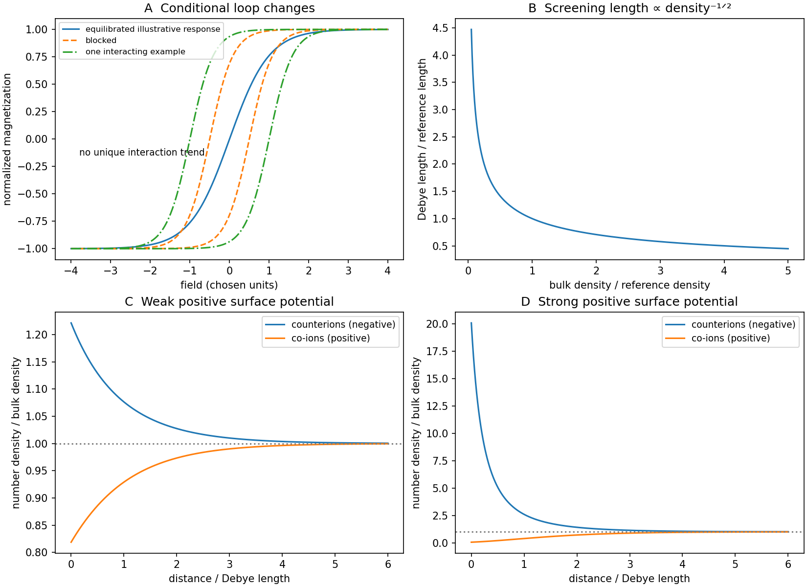

<h1 id="section-a-ii/13/i/solution">Solution</h1>

↑ **Parent:** [I](../i.md)

Only the magnetic-response physics is addressed here; **biological and clinical application is user-deferred**.

A single-domain particle has an approximately coherent [magnetic dipole moment](../../../../../../magnetic-dipole-moment.md), but single-domain does not by itself imply rapid thermal reversal. If moments equilibrate within the measurement time, a dilute, noninteracting ensemble is [superparamagnetic](../../../../../../superparamagnetism.md): its quasistatic [magnetization](../../../../../../magnetization.md) is reversible, odd in field and approaches saturation with negligible [remanence](../../../../../../remanent-magnetization.md) or [magnetic coercivity](../../../../../../magnetic-coercivity.md).

For freely orientable classical moments,

$$
M(H)=n_p\mu\,\mathcal L\!\left(\frac{\mu_0\mu H}{k_BT}\right),
\qquad
\mathcal L(z)=\coth z-\frac1z.
$$

At small field, $\mathcal L(z)\simeq z/3$; at large field moments align. This Langevin form is an ideal limit, not a universal exact curve for anisotropic fixed-axis particles.

**The missing timescale/[magnetic anisotropy](../../../../../../magnetic-anisotropy.md) information must be stated:** blocked single-domain particles can already show [hysteresis](../../../../../../hysteresis.md). Also, a reversible quasistatic curve does not preclude a finite-frequency loss loop when relaxation lags an alternating field. The original curves illustrate an equilibrated dilute limit and possible blocked/interacting alternatives, not measured treatment performance.

**[Figure 2](#section-a-ii/13/i/image-conditional-magnetic-loops-and-electrostatic-screening-profiles). Conditional magnetic loops and electrostatic screening profiles**. Original illustrative magnetic curves and calculated planar mean-field ion profiles. Magnetic-loop broadening is one possible interaction outcome, not a concentration-dependent experimental fit or a clinical prediction.

## ↑ Ancestors (11)

1. [I](../i.md)
2. [13](../../13.md)
3. [Section A(ii)](../../../section-a-ii.md)
4. [Paper 2](../../../../paper-2-split.md)
5. [2018](../../../../split.md)
6. [Past exam of the MPhil in micro- and nanotechnology enterprise course of the University of Cambridge](../../../../../split.md)
7. [MPhil in micro- and nanotechnology enterprise course of the University of Cambridge](../../../../../../mphil-in-micro-and-nanotechnology-enterprise-course-of-the-university-of-cambridge.md)
8. [Course of the University of Cambridge](../../../../../../course-of-the-university-of-cambridge.md)
9. [University of Cambridge](../../../../../../university-of-cambridge-split.md)
10. [List of universities](../../../../../../list-of-universities.md)
11. [Codex Wiki](../../../../../../split.md)
