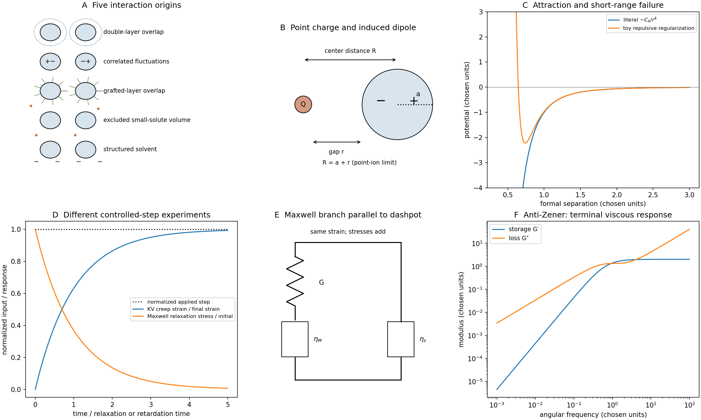

<h1 id="section-b/21a/i/solution">Solution</h1>

↑ **Parent:** [I](../i.md)

A useful five-part classification is **electrostatic double-layer, dispersion, steric, [depletion force](../../../../../../depletion-force.md) and solvent-mediated interactions**. It is a practical classification rather than a unique exhaustive list.

Electrostatic double-layer [forces](../../../../../../force-split.md) arise from surface charge and mobile-ion redistribution. Like-charged surfaces often repel; opposite charges can attract. Their range changes with salt screening. [London dispersion forces](../../../../../../london-dispersion-force.md) comes from correlated electronic fluctuations and is one contribution to [Van der Waals force](../../../../../../van-der-waals-force.md); its sign and strength across a medium depend on dielectric response.

[steric stabilization](../../../../../../steric-stabilization.md) occurs when adsorbed or grafted layers overlap, increasing chain confinement and/or local osmotic [free energy](../../../../../../thermodynamic-free-energy.md). [depletion force](../../../../../../depletion-force.md) arises when smaller nonadsorbing solutes are excluded from a narrow gap: their greater accessible [volume](../../../../../../volume.md) outside favors bringing the large particles together. Structured-solvent [forces](../../../../../../force-split.md) include short-range [hydration force](../../../../../../hydration-force.md) and [hydrophobic attraction](../../../../../../hydrophobic-attraction.md); their microscopic origin differs from the [depletion force](../../../../../../depletion-force.md) of an added solute.

The original sketches show double-layer overlap, a polymer-coated gap, [depletion force](../../../../../../depletion-force.md) exclusion and solvent structure, alongside a dispersion-potential curve. A realistic suspension can experience several simultaneously. Charge neutrality of a particle does not remove dispersion, steric or solvent-mediated interactions.

**[Figure 4](#section-b/21a/i/image-colloidal-interaction-mechanisms-and-viscoelastic-material-response). Colloidal interaction mechanisms and viscoelastic material response**. Original interaction cartoons, model potentials, step-response curves and parallel Maxwell–dashpot rheology. Potential parameters and rheological constants are chosen illustrative values, not fitted measurements.

## ↑ Ancestors (11)

1. [I](../i.md)
2. [21A](../../21a.md)
3. [Section B](../../../section-b.md)
4. [Paper 2](../../../../paper-2-split.md)
5. [2018](../../../../split.md)
6. [Past exam of the MPhil in micro- and nanotechnology enterprise course of the University of Cambridge](../../../../../split.md)
7. [MPhil in micro- and nanotechnology enterprise course of the University of Cambridge](../../../../../../mphil-in-micro-and-nanotechnology-enterprise-course-of-the-university-of-cambridge.md)
8. [Course of the University of Cambridge](../../../../../../course-of-the-university-of-cambridge.md)
9. [University of Cambridge](../../../../../../university-of-cambridge-split.md)
10. [List of universities](../../../../../../list-of-universities.md)
11. [Codex Wiki](../../../../../../split.md)
