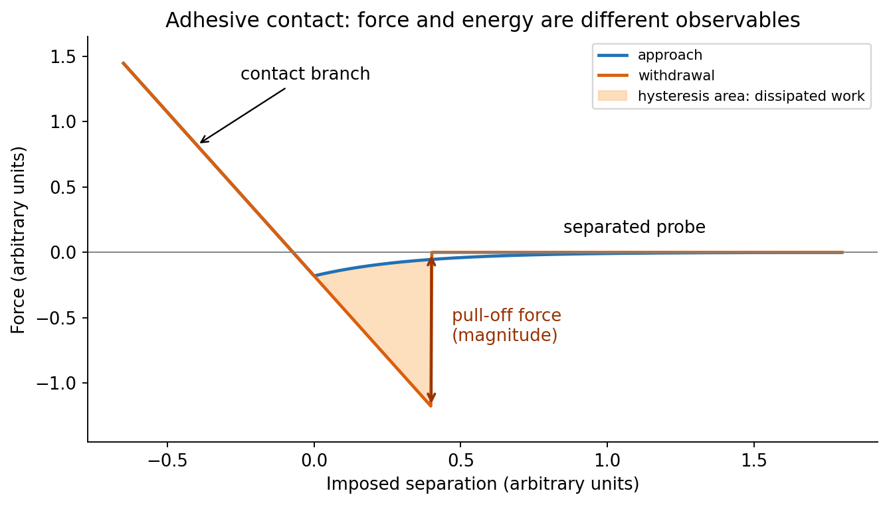
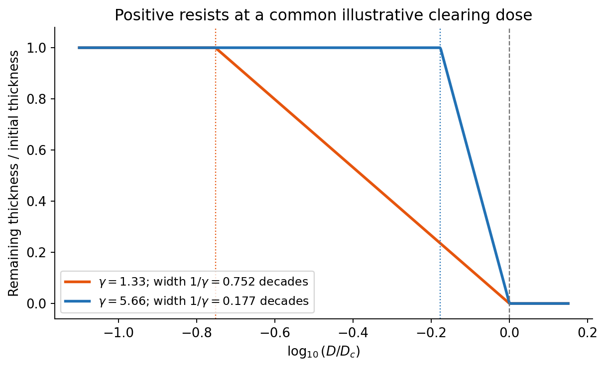
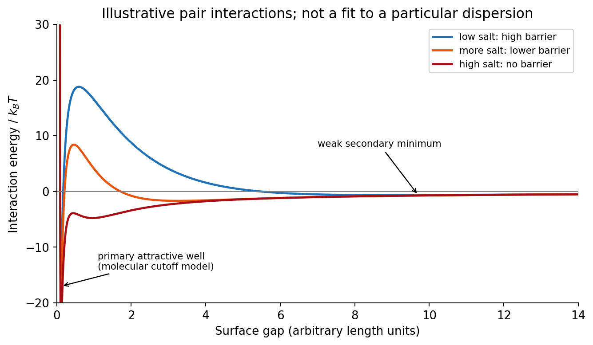
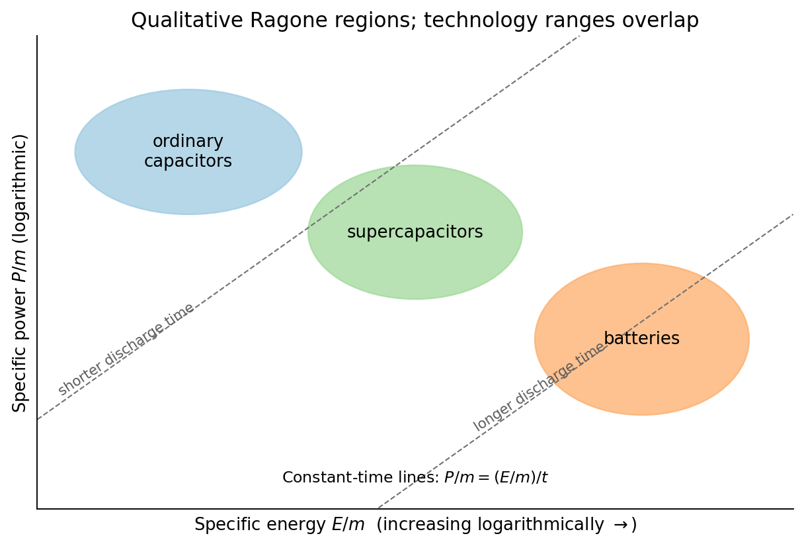
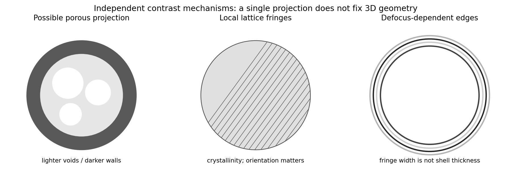
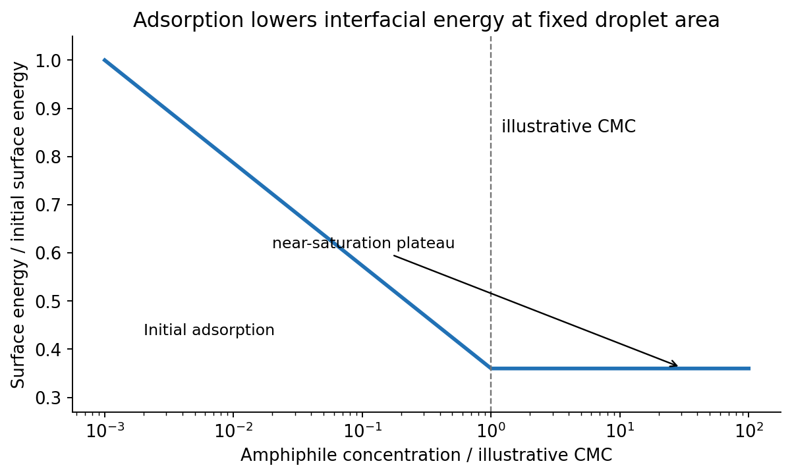
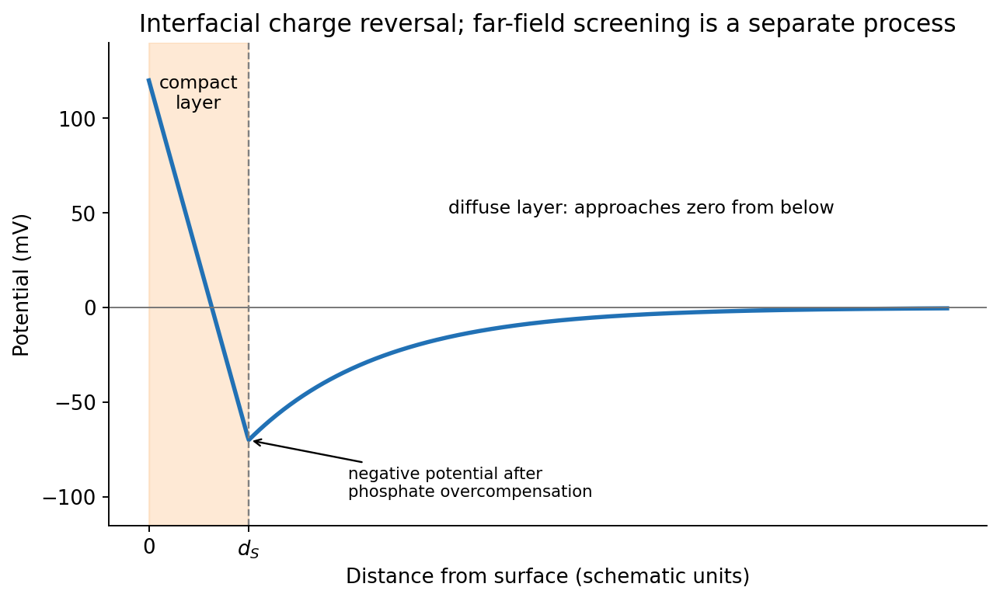

# Paper 1

↑ **Parent:** [2019](../2019.md)

Original archive: [Cambridge FOI 2024/50 released ZIP](https://www.whatdotheyknow.com/request/mphil_in_micro_and_nanotechnolog_5/response/2556540/attach/2/FOI%202024%2050%20Dai%20materials.zip?cookie_passthrough=1). The original is the member `NanoMPhil Paper 1 2019.pdf`, physical pages 1–15.

**Table of contents**

- [Section A(i)](#section-a-i)
  - [1](#section-a-i/1)
    - [i](#section-a-i/1/i)
      - [Solution](#section-a-i/1/i/solution)
    - [ii](#section-a-i/1/ii)
      - [Solution](#section-a-i/1/ii/solution)
    - [iii](#section-a-i/1/iii)
      - [a](#section-a-i/1/iii/a)
        - [Solution](#section-a-i/1/iii/a/solution)
      - [b](#section-a-i/1/iii/b)
        - [Solution](#section-a-i/1/iii/b/solution)
      - [c](#section-a-i/1/iii/c)
        - [Solution](#section-a-i/1/iii/c/solution)
      - [d](#section-a-i/1/iii/d)
        - [Solution](#section-a-i/1/iii/d/solution)
  - [2](#section-a-i/2)
    - [i](#section-a-i/2/i)
      - [Solution](#section-a-i/2/i/solution)
    - [ii](#section-a-i/2/ii)
      - [Solution](#section-a-i/2/ii/solution)
    - [iii](#section-a-i/2/iii)
      - [Solution](#section-a-i/2/iii/solution)
- [Section A(ii)](#section-a-ii)
  - [3](#section-a-ii/3)
    - [i](#section-a-ii/3/i)
      - [Solution](#section-a-ii/3/i/solution)
    - [ii](#section-a-ii/3/ii)
      - [Solution](#section-a-ii/3/ii/solution)
  - [4](#section-a-ii/4)
    - [i](#section-a-ii/4/i)
      - [Solution](#section-a-ii/4/i/solution)
    - [ii](#section-a-ii/4/ii)
      - [Solution](#section-a-ii/4/ii/solution)
    - [iii](#section-a-ii/4/iii)
      - [Solution](#section-a-ii/4/iii/solution)
- [Section A(iii)](#section-a-iii)
  - [5](#section-a-iii/5)
    - [i](#section-a-iii/5/i)
      - [Solution](#section-a-iii/5/i/solution)
    - [ii](#section-a-iii/5/ii)
      - [Solution](#section-a-iii/5/ii/solution)
    - [iii](#section-a-iii/5/iii)
      - [Solution](#section-a-iii/5/iii/solution)
  - [6](#section-a-iii/6)
    - [i](#section-a-iii/6/i)
      - [a](#section-a-iii/6/i/a)
        - [Solution](#section-a-iii/6/i/a/solution)
      - [b](#section-a-iii/6/i/b)
        - [Solution](#section-a-iii/6/i/b/solution)
      - [c](#section-a-iii/6/i/c)
        - [Solution](#section-a-iii/6/i/c/solution)
    - [ii](#section-a-iii/6/ii)
      - [Solution](#section-a-iii/6/ii/solution)
  - [7](#section-a-iii/7)
    - [i](#section-a-iii/7/i)
      - [Solution](#section-a-iii/7/i/solution)
    - [ii](#section-a-iii/7/ii)
      - [Solution](#section-a-iii/7/ii/solution)
- [Section B](#section-b)
  - [8](#section-b/8)
    - [i](#section-b/8/i)
      - [Solution](#section-b/8/i/solution)
    - [ii](#section-b/8/ii)
      - [Solution](#section-b/8/ii/solution)
    - [iii](#section-b/8/iii)
      - [Solution](#section-b/8/iii/solution)
    - [iv](#section-b/8/iv)
      - [Solution](#section-b/8/iv/solution)
  - [9](#section-b/9)
    - [i](#section-b/9/i)
      - [Solution](#section-b/9/i/solution)
    - [ii](#section-b/9/ii)
      - [a](#section-b/9/ii/a)
        - [Solution](#section-b/9/ii/a/solution)
      - [b](#section-b/9/ii/b)
        - [Solution](#section-b/9/ii/b/solution)
      - [c](#section-b/9/ii/c)
        - [Solution](#section-b/9/ii/c/solution)
  - [10](#section-b/10)
    - [i](#section-b/10/i)
      - [a](#section-b/10/i/a)
        - [Solution](#section-b/10/i/a/solution)
      - [b](#section-b/10/i/b)
        - [Solution](#section-b/10/i/b/solution)
      - [c](#section-b/10/i/c)
        - [Solution](#section-b/10/i/c/solution)
    - [ii](#section-b/10/ii)
      - [Solution](#section-b/10/ii/solution)
    - [iii](#section-b/10/iii)
      - [Solution](#section-b/10/iii/solution)
    - [iv](#section-b/10/iv)
      - [a](#section-b/10/iv/a)
        - [Solution](#section-b/10/iv/a/solution)
      - [b](#section-b/10/iv/b)
        - [Solution](#section-b/10/iv/b/solution)
      - [c](#section-b/10/iv/c)
        - [Solution](#section-b/10/iv/c/solution)
  - [11](#section-b/11)
    - [i](#section-b/11/i)
      - [Solution](#section-b/11/i/solution)
    - [ii](#section-b/11/ii)
      - [Solution](#section-b/11/ii/solution)
    - [iii](#section-b/11/iii)
      - [Solution](#section-b/11/iii/solution)
    - [iv](#section-b/11/iv)
      - [Solution](#section-b/11/iv/solution)
  - [12](#section-b/12)
    - [i](#section-b/12/i)
      - [Solution](#section-b/12/i/solution)
    - [ii](#section-b/12/ii)
      - [Solution](#section-b/12/ii/solution)
    - [iii](#section-b/12/iii)
      - [Solution](#section-b/12/iii/solution)
    - [iv](#section-b/12/iv)
      - [Solution](#section-b/12/iv/solution)
    - [v](#section-b/12/v)
      - [a](#section-b/12/v/a)
        - [Solution](#section-b/12/v/a/solution)
      - [b](#section-b/12/v/b)
        - [Solution](#section-b/12/v/b/solution)

<h2 id="section-a-i">Section A(i)</h2>

↑ **Parent:** [Paper 1](paper-1.md)

<h3 id="section-a-i/1">1</h3>

↑ **Parent:** [Section A(i)](#section-a-i)

<h4 id="section-a-i/1/i">i</h4>

↑ **Parent:** [1](#section-a-i/1)

<h5 id="section-a-i/1/i/solution">Solution</h5>

↑ **Parent:** [I](#section-a-i/1/i)

The repeated, similarly oriented rounded triangular outlines in panel (a) are characteristic of [AFM tip convolution](../../engineering.md#afm-tip-convolution): a narrow raised object can image the shape of a blunt or contaminated [AFM probe](../../engineering.md#afm-probe), rather than reveal its own lateral shape. A finite tip radius broadens lateral dimensions. Replace or clean the [AFM probe](../../engineering.md#afm-probe), check it on an independently characterized sharp-feature standard, and repeat at low load; agreement after a tip change is stronger evidence than a visually pleasing image. Image processing cannot uniquely recover unmeasured sidewalls or prove that every particle with a similar outline is an artefact.

Panel (b) contains horizontal streaks associated with steep features. The natural instrumental diagnosis is [AFM feedback artefact](../../engineering.md#afm-feedback-artefact): the height controller does not track a rapid change faithfully, or rings after it. Reduce the scan speed and adjust proportional/integral gains below the oscillation threshold. Compare trace and retrace and rotate the fast-scan direction: a streak following the scan rather than the specimen is instrumental. Loose contamination can also produce scan-line streaks, so clean or change the [AFM probe](../../engineering.md#afm-probe) if tuning does not remove them. **Tip-shape broadening in (a), and scan-direction tracking/streaking in (b), are the principal diagnoses; the images alone do not uniquely establish every underlying cause.**

<h4 id="section-a-i/1/ii">ii</h4>

↑ **Parent:** [1](#section-a-i/1)

<h5 id="section-a-i/1/ii/solution">Solution</h5>

↑ **Parent:** [Ii](#section-a-i/1/ii)

[piezoelectric scanner creep](../../quantum-mechanics.md#piezoelectric-scanner-creep) is the continued slow displacement after a step in scanner drive, even when the commanded voltage has stopped changing. The scanner's [strain](../../continuum-mechanics.md#strain) continues to relax, and the motion can resemble a slowly decaying, approximately logarithmic drift. After changing scan size, position or offset, early lines can therefore have stretched or compressed coordinates. Allow settling, avoid large abrupt moves, use a position-sensor [closed-loop control](../../control-theory.md#closed-loop-control) system, and compare repeated images. This time-dependent response differs from the direction-dependent [piezoelectric hysteresis](../../quantum-mechanics.md#piezoelectric-hysteresis) and from ordinary thermal drift.

<h4 id="section-a-i/1/iii">iii</h4>

↑ **Parent:** [1](#section-a-i/1)

<h5 id="section-a-i/1/iii/a">a</h5>

↑ **Parent:** [Iii](#section-a-i/1/iii)

<h6 id="section-a-i/1/iii/a/solution">Solution</h6>

↑ **Parent:** [A](#section-a-i/1/iii/a)

**A steady-current image is not supported by the electrical connection drawn.** [tunnelling atomic force microscopy](../../engineering.md#tunnelling-atomic-force-microscopy) requires a conducting [AFM probe](../../engineering.md#afm-probe), an applied [bias voltage](../../electric-field.md#bias-voltage) and a continuous return path from the contacted region to the current amplifier. [graphene](../../chemical-substance.md#graphene) is conducting, but a flake on insulating [glass](../../chemical-substance.md#glass) is not electrically grounded merely because the other side or edge of the [glass](../../chemical-substance.md#glass) is earthed. Charging transients or displacement current are not its steady conductivity. Add a metal contact actually touching the [graphene](../../chemical-substance.md#graphene) before using its current contrast; ordinary force-based [surface topography](../../optics.md#surface-topography) can still be recorded without that contact. The manufacturer's nanostructure measurements explicitly distinguish objects connected to conducting pads from unconnected particles on the same insulating substrate.[application note 132, Figure 11 and accompanying discussion of electrical connection](../../physics-bibliography.md#simultaneous-electrical-and-mechanical-property-mapping-at-the-nanoscale-with-peakforce-tuna-by-bruker)

<h5 id="section-a-i/1/iii/b">b</h5>

↑ **Parent:** [Iii](#section-a-i/1/iii)

<h6 id="section-a-i/1/iii/b/solution">Solution</h6>

↑ **Parent:** [B](#section-a-i/1/iii/b)

**[quantitative nanomechanical mapping](../../engineering.md#quantitative-nanomechanical-mapping) can image the flake without an electrical return path.** Repeated [AFM force curves](../../engineering.md#afm-force-curve) provide [surface topography](../../optics.md#surface-topography), [adhesion](../../continuum-mechanics.md#adhesion) and deformation or effective [elastic modulus](../../elasticity-physics.md#elastic-modulus) channels. The step and differences in tip–surface interaction can distinguish [graphene](../../chemical-substance.md#graphene) from [glass](../../chemical-substance.md#glass). For an atomically thin supported sheet the contact response is strongly substrate dependent, so fitting a three-dimensional half-space contact model does not directly measure the intrinsic in-plane [Young's modulus](../../elasticity-physics.md#young-s-modulus) of free [graphene](../../chemical-substance.md#graphene). Calibrate the [cantilever spring constant](../../engineering.md#cantilever-spring-constant), deflection sensitivity and tip radius, use small loads, and compare bare substrate. The manufacturer's description specifies the force-curve origin of the mechanical channels.[application note 132, Quantitative Mechanical Property Mapping](../../physics-bibliography.md#simultaneous-electrical-and-mechanical-property-mapping-at-the-nanoscale-with-peakforce-tuna-by-bruker)

<h5 id="section-a-i/1/iii/c">c</h5>

↑ **Parent:** [Iii](#section-a-i/1/iii)

<h6 id="section-a-i/1/iii/c/solution">Solution</h6>

↑ **Parent:** [C](#section-a-i/1/iii/c)

**[friction force microscopy](../../engineering.md#friction-force-microscopy) is suitable.** Contact scanning twists the [AFM cantilever](../../engineering.md#afm-cantilever); the lateral photodetector difference measures [friction](../../newtonian-mechanics.md#friction) and can distinguish the supported [graphene](../../chemical-substance.md#graphene) and [glass](../../chemical-substance.md#glass) even if their heights are close. Acquire both trace and retrace and use half their lateral-signal difference to suppress slope-induced cross-talk. Keep the normal load low enough to avoid dragging or damaging the flake, control humidity and contamination, and calibrate torsional sensitivity if a quantitative [coefficient of friction](../../newtonian-mechanics.md#coefficient-of-friction) is required. An electrical connection is unnecessary.

<h5 id="section-a-i/1/iii/d">d</h5>

↑ **Parent:** [Iii](#section-a-i/1/iii)

<h6 id="section-a-i/1/iii/d/solution">Solution</h6>

↑ **Parent:** [D](#section-a-i/1/iii/d)

**Conventional [semiconductor](../../semiconductor.md) [scanning capacitance microscopy](../../engineering.md#scanning-capacitance-microscopy) is not a reliable dopant-contrast image of this specimen as drawn.** Its usual $dC/dV$ signal relies on a tip–insulator–[semiconductor](../../semiconductor.md) [capacitance](../../electromagnetism.md#capacitance) whose depletion region changes under AC bias. An isolated conducting [graphene](../../chemical-substance.md#graphene) sheet on thick insulating [glass](../../chemical-substance.md#glass) provides neither that conventional depletion geometry nor a controlled charge reservoir; simply earthing [glass](../../chemical-substance.md#glass) does not supply one. Capacitive or electrostatic contrast may be detectable with a suitably designed back [electrode](../../electrochemistry.md#electrode), a contacted flake and an appropriate capacitance-sensitive instrument, but that is an additional electrical device specification. Force-based [surface topography](../../optics.md#surface-topography) remains possible independently of the specialized [capacitance](../../electromagnetism.md#capacitance) channel.

<h3 id="section-a-i/2">2</h3>

↑ **Parent:** [Section A(i)](#section-a-i)

<h4 id="section-a-i/2/i">i</h4>

↑ **Parent:** [2](#section-a-i/2)

<h5 id="section-a-i/2/i/solution">Solution</h5>

↑ **Parent:** [I](#section-a-i/2/i)

At position (1), the [AFM probe](../../engineering.md#afm-probe) is far from the surface, with approximately zero [force](../../force.md). At (2), attractive interactions bend the [AFM cantilever](../../engineering.md#afm-cantilever) toward the surface; when the attractive [force](../../force.md) gradient exceeds the [cantilever spring constant](../../engineering.md#cantilever-spring-constant), the equilibrium becomes unstable and [jump-to-contact](../../engineering.md#jump-to-contact) occurs. Position (3) is on the mechanical-contact branch: changes in imposed height largely bend the [AFM cantilever](../../engineering.md#afm-cantilever) and, for a compliant specimen, indent the sample. This branch can include compressive contact and adhesive contact under tension; contact does not itself imply a positive [force](../../force.md) at every point. At (4), during withdrawal the tip remains attached and pulls the [AFM cantilever](../../engineering.md#afm-cantilever) downward until the [pull-off force](../../continuum-mechanics.md#pull-off-force) is reached and it detaches. **Approach and retraction follow different paths because [adhesion](../../continuum-mechanics.md#adhesion) creates a hysteretic contact.** The numbered points identify stages on the source curve, not four extra question parts.

<h4 id="section-a-i/2/ii">ii</h4>

↑ **Parent:** [2](#section-a-i/2)

<h5 id="section-a-i/2/ii/solution">Solution</h5>

↑ **Parent:** [Ii](#section-a-i/2/ii)

In [quantitative nanomechanical mapping](../../engineering.md#quantitative-nanomechanical-mapping), the operational [adhesion](../../continuum-mechanics.md#adhesion) is the magnitude of the most attractive [force](../../force.md) immediately before detachment on a calibrated retraction curve:

$$
F_{\rm adh}=-\min F_{\rm retract},\qquad F=k_c\delta_c.
$$

Here $k_c$ is the [cantilever spring constant](../../engineering.md#cantilever-spring-constant) and $\delta_c$ its deflection after baseline subtraction. The area between approach and retraction relates to dissipated work, whereas the minimum [force](../../force.md) is a [force](../../force.md), not an [energy](../../energy.md). Chemical attraction, [Van der Waals forces](../../force.md#van-der-waals-force) and ambient-water capillary bridges can all contribute. Match loading rate and peak load, calibrate deflection sensitivity and $k_c$, compare clean reference surfaces, and control humidity; otherwise different maps may reflect different tips or capillary conditions rather than different specimens.

**[Figure 1](#section-a-i/2/ii/image-original-illustrative-force-cycle-schematic-distinguishing-pull-off-force-from-dissipated-work). Original illustrative force-cycle schematic distinguishing pull-off force from dissipated work**.

<h4 id="section-a-i/2/iii">iii</h4>

↑ **Parent:** [2](#section-a-i/2)

<h5 id="section-a-i/2/iii/solution">Solution</h5>

↑ **Parent:** [Iii](#section-a-i/2/iii)

Three suitable approaches give complementary contrast. [tapping-mode atomic force microscopy](../../engineering.md#tapping-mode-atomic-force-microscopy) supplies [surface topography](../../optics.md#surface-topography) and an oscillation-phase image. It reduces lateral drag and is often effective for soft [block copolymer](../../polymer.md#block-copolymer) domains. Its phase contrast depends on elastic response, [adhesion](../../continuum-mechanics.md#adhesion), dissipation and operating setpoint together: a bright phase domain is not automatically the stiffer polymer. Check contrast as amplitude and setpoint change and use a known reference.

[quantitative nanomechanical mapping](../../engineering.md#quantitative-nanomechanical-mapping) fits the repulsive portions of many [AFM force curves](../../engineering.md#afm-force-curve) and separately maps effective [elastic modulus](../../elasticity-physics.md#elastic-modulus), [adhesion](../../continuum-mechanics.md#adhesion) and deformation. It directly addresses the stiffness difference and limits maximum [force](../../force.md). Its quantitative result depends on tip radius, [force](../../force.md) calibration, contact model, loading rate and film thickness; domains narrower than the contact footprint are mixed and the substrate can dominate a thin film. Use small indentation, substrate controls and a suitable viscoelastic interpretation.

[friction force microscopy](../../engineering.md#friction-force-microscopy) can reveal domains with different frictional and adhesive response, using torsional deflection during contact scans. It is simple and sensitive to surface chemistry, but continuous shear may deform or displace soft domains, and slope/topography can contaminate the lateral signal. Acquire trace–retrace pairs at several low normal loads and check reproducibility. **Use a mechanical-modulus map to test the stiffness assignment; phase or [friction](../../newtonian-mechanics.md#friction) contrast alone does not uniquely identify stiffness or chemical composition.**

<h2 id="section-a-ii">Section A(ii)</h2>

↑ **Parent:** [Paper 1](paper-1.md)

<h3 id="section-a-ii/3">3</h3>

↑ **Parent:** [Section A(ii)](#section-a-ii)

<h4 id="section-a-ii/3/i">i</h4>

↑ **Parent:** [3](#section-a-ii/3)

<h5 id="section-a-ii/3/i/solution">Solution</h5>

↑ **Parent:** [I](#section-a-ii/3/i)

For a [positive photoresist](../../engineering.md#positive-photoresist), let $D_0$ be the largest exposure preserving the initial film thickness and $D_c$ the clearing dose. The [photoresist contrast](../../engineering.md#photoresist-contrast) is $\gamma=1/\log_{10}(D_c/D_0)$. An aerial image $I=\bar I[1+M\cos(2\pi\nu x)]$ can clear its maxima while retaining its minima only if

$$
\frac{1+M}{1-M}\geq\frac{D_c}{D_0}=10^{1/\gamma},\qquad
M\geq M_c=\frac{10^{1/\gamma}-1}{10^{1/\gamma}+1}.
$$

Thus $M_c=0.6991$ and $0.2006$ for the lower- and higher-contrast materials. Reading those levels on the supplied [modulation transfer function](../../point-spread-function.md#modulation-transfer-function) gives **maximum normalized [spatial frequencies](../../fourier-analysis.md#spatial-frequency) approximately $\nu/\nu_0=0.40$ and $0.60$**, respectively. The stated partial coherence is already represented by that curve; do not multiply the read [frequencies](../../wave.md#frequency) by another coherence factor.

The unambiguous pattern dimensions are full pitch $P=1/(x\nu_0)$ and equal line/space width $w=P/2$, where $x$ is the read normalized [frequency](../../wave.md#frequency). To convert the paper's Rayleigh-frequency label into [lengths](../../physics.md#length), explicitly use the circular-pupil [Rayleigh criterion](../../point-spread-function.md#rayleigh-criterion) $d_R=0.61\lambda/NA$ and $\nu_0=1/d_R$. With the ArF vacuum wavelength $193\ \mathrm{nm}$ and the stated [numerical aperture](../../point-spread-function.md#numerical-aperture), $d_R=235.5\ \mathrm{nm}$, giving

$$
\begin{array}{c|cc}
\gamma&P\ (\mathrm{\mu m})&w\ (\mathrm{\mu m})\\\hline
1.33&0.589&0.294\\
5.66&0.392&0.196
\end{array}
$$

**The higher-contrast material resolves a line/space feature about two-thirds as wide.** The pitch and half-pitch distinction matters: the point-separation [Rayleigh criterion](../../point-spread-function.md#rayleigh-criterion) is not itself an equal-line/space width. If a course defines $\nu_0$ as an optical cutoff rather than $1/d_R$, use that specified [frequency](../../wave.md#frequency) in $w=1/(2x\nu_0)$; the normalized graph readings and their ratio are unchanged. No absolute clearing dose is provided.

<h4 id="section-a-ii/3/ii">ii</h4>

↑ **Parent:** [3](#section-a-ii/3)

<h5 id="section-a-ii/3/ii/solution">Solution</h5>

↑ **Parent:** [Ii](#section-a-ii/3/ii)

On a graph of normalized remaining thickness against $\log_{10}D$, both [positive photoresist](../../engineering.md#positive-photoresist) curves remain near unity below $D_0$ and fall to zero by $D_c$. Their transition widths are $\log_{10}(D_c/D_0)=1/\gamma$: $0.752$ decades for the lower-contrast material and $0.177$ decades for the higher-contrast material. The latter therefore has a much steeper transition. The curves can be aligned at a common illustrative clearing dose; their absolute horizontal placement cannot be inferred from [photoresist contrast](../../engineering.md#photoresist-contrast) alone.

The higher-contrast material distinguishes bright and dark regions even when [diffraction](../../quantum-scattering.md#diffraction) has reduced their intensity modulation. The lower-contrast material requires a much stronger aerial-image modulation and loses small features earlier. Finite resist thickness, standing waves, acid [diffusion](../../thermodynamics.md#diffusion), development conditions and photon statistics can limit actual performance beyond this threshold model.

**[Figure 2](#section-a-ii/3/ii/image-original-normalized-positive-resist-contrast-curves-illustrating-transition-widths-with-no-assumed-absolute-sensitivity). Original normalized positive-resist contrast curves illustrating transition widths, with no assumed absolute sensitivity**.

<h3 id="section-a-ii/4">4</h3>

↑ **Parent:** [Section A(ii)](#section-a-ii)

<h4 id="section-a-ii/4/i">i</h4>

↑ **Parent:** [4](#section-a-ii/4)

<h5 id="section-a-ii/4/i/solution">Solution</h5>

↑ **Parent:** [I](#section-a-ii/4/i)

Solve the stated [depth of focus](../../engineering.md#depth-of-focus) relation before substituting into the resolution expression:

$$
NA=\sqrt{\frac{k_2\lambda}{DOF}}
=\sqrt{\frac{0.5(248)}{300}}=0.6429,
\qquad
R=k_1\sqrt{\frac{\lambda\,DOF}{k_2}}
=\boxed{289.3\ \mathrm{nm}}.
$$

This uses the supplied empirical $k_1$ and $k_2$ unchanged and interprets $R$ as the minimum line or space width of an equal-line/space square grating. Under that convention its pitch is **$2R=578.6\ \mathrm{nm}$**. Other pattern shapes or a different definition of the quoted [depth of focus](../../engineering.md#depth-of-focus) would require different process factors.

<h4 id="section-a-ii/4/ii">ii</h4>

↑ **Parent:** [4](#section-a-ii/4)

<h5 id="section-a-ii/4/ii/solution">Solution</h5>

↑ **Parent:** [Ii](#section-a-ii/4/ii)

An immersion liquid increases [numerical aperture](../../point-spread-function.md#numerical-aperture) through $NA=n\sin\alpha$, if the optics can use the same ray angle $\alpha$ inside a transparent, chemically compatible liquid of [refractive index](../../electromagnetic-wave.md#refractive-index) $n$. With unchanged $k_1$ and vacuum wavelength, the width scales as $R_{\rm imm}=R_{\rm air}/n$ at fixed angle. If the two empirical formulae printed in the question are used literally with fixed $k_2$, they give $DOF_{\rm imm}=300/n^2\ \mathrm{nm}$.

For a physical axial displacement inside the medium, however, the familiar paraxial defocus range contains an additional index factor: $DOF\propto n\lambda_0/NA^2$. That convention gives $DOF_{\rm imm}/DOF_{\rm air}\simeq1/n$ at fixed ray angle, or an approximately $n$-fold larger [depth of focus](../../engineering.md#depth-of-focus) at fixed $NA$ and resolution. Thus **immersion can improve lateral resolution, while its focus benefit depends on what is held fixed and on the axial-focus convention**. It cannot improve resolution merely by inserting $n$ into $NA$ while ignoring optical redesign, absorption or resist compatibility. No liquid index is supplied for a numerical prediction.

<h4 id="section-a-ii/4/iii">iii</h4>

↑ **Parent:** [4](#section-a-ii/4)

<h5 id="section-a-ii/4/iii/solution">Solution</h5>

↑ **Parent:** [Iii](#section-a-ii/4/iii)

First, use a [phase-shift mask](../../engineering.md#phase-shift-mask): neighbouring openings transmit appropriately phased light, increasing the intensity slope and improving separation of neighbouring bright regions. The benefit is pattern dependent and phase conflicts or mask defects must be controlled. Second, use [off-axis illumination](../../engineering.md#off-axis-illumination) matched to the grating orientation, so useful diffracted orders fall inside the projection pupil and contribute interference contrast at smaller pitch. Check orientation dependence and the reduced process window; it does not enlarge the geometrical pupil.

Third, use [optical proximity correction](../../engineering.md#optical-proximity-correction) and subresolution assist features to compensate the pattern-dependent aerial-image distortion at edges and corners. Verify the printed critical dimensions using a focus–exposure matrix and [scanning electron microscopy](../../optics.md#scanning-electron-microscope). These are three adaptations of the existing exposure process that lower effective $k_1$; none promises arbitrary subwavelength structure. A thinner, higher-contrast [photoresist](../../engineering.md#photoresist) and an antireflection underlayer can further improve pattern transfer, but do not change the wavelength.

<h2 id="section-a-iii">Section A(iii)</h2>

↑ **Parent:** [Paper 1](paper-1.md)

<h3 id="section-a-iii/5">5</h3>

↑ **Parent:** [Section A(iii)](#section-a-iii)

<h4 id="section-a-iii/5/i">i</h4>

↑ **Parent:** [5](#section-a-iii/5)

<h5 id="section-a-iii/5/i/solution">Solution</h5>

↑ **Parent:** [I](#section-a-iii/5/i)

[charge stabilization of colloids](../../mixture.md#charge-stabilization-of-colloids) supplies repulsion when like-charged surfaces and their [electric double layers](../../electrostatics.md#electric-double-layer) approach. [steric stabilization](../../mixture.md#steric-stabilization) uses attached or adsorbed molecular layers whose overlap costs conformational and osmotic [free energy](../../thermodynamic-potential.md#thermodynamic-free-energy). Combining both gives [electrosteric stabilization](../../mixture.md#electrosteric-stabilization); a solvated coating must remain attached and well solvated. A viscous medium slows encounters but does not by itself create an equilibrium repulsive barrier.

[DLVO theory](../../mixture.md#dlvo-theory) adds screened electrostatic repulsion to [Van der Waals force](../../force.md#van-der-waals-force). A representative close-gap form is

$$
U(h)\simeq B e^{-\kappa h}-\frac{A_Ha}{12h},
$$

for equal spheres of radius $a$, with [Hamaker constant](../../mathematical-biology.md#hamaker-constant) $A_H$ and inverse [Debye–Hückel screening length](../../mathematical-biology.md#debye-huckel-screening-length) $\kappa$. The formula is schematic near molecular contact, where hydration, surface roughness and finite [ion](../../chemistry.md#ion) size matter. A repulsive barrier many $k_BT$ high produces kinetic stability even if the primary attractive minimum is deeper than the dispersed state. Entry into that primary minimum generally gives strongly bound aggregation; a shallow secondary minimum can give reversible flocculation.

Adding [electrolyte](../../electrochemistry.md#electrolyte) increases $\kappa$, shortens the repulsion and can remove the barrier, enabling fast diffusion-limited aggregation. The [critical coagulation concentration](../../mixture.md#critical-coagulation-concentration) is the approximate salt [concentration](../../mathematical-physics.md#concentration) at which this rapid-coagulation regime begins under specified conditions. It is not a universal property of the salt alone. Test the prediction using time-resolved [dynamic light scattering](../../biology.md#dynamic-light-scattering) or turbidity at controlled particle [concentration](../../mathematical-physics.md#concentration), pH and [temperature](../../temperature.md); check that added [ions](../../chemistry.md#ion) do not specifically adsorb or change the surface chemistry.

**[Figure 3](#section-a-iii/5/i/image-original-schematic-dlvo-interaction-curves-showing-a-stabilizing-barrier-secondary-minimum-and-barrier-loss-on-salt-addition). Original schematic DLVO interaction curves showing a stabilizing barrier, secondary minimum and barrier loss on salt addition**.

<h4 id="section-a-iii/5/ii">ii</h4>

↑ **Parent:** [5](#section-a-iii/5)

<h5 id="section-a-iii/5/ii/solution">Solution</h5>

↑ **Parent:** [Ii](#section-a-iii/5/ii)

**TODO: user-deferred biology subquestion.**

<h4 id="section-a-iii/5/iii">iii</h4>

↑ **Parent:** [5](#section-a-iii/5)

<h5 id="section-a-iii/5/iii/solution">Solution</h5>

↑ **Parent:** [Iii](#section-a-iii/5/iii)

In the high-surface-potential [Schulze-Hardy rule](../../mixture.md#schulze-hardy-rule), the [critical coagulation concentration](../../mixture.md#critical-coagulation-concentration) scales approximately as $z^{-6}$ with the [counterion](../../chemistry.md#counterion) valence. Hence

$$
c_{\rm Al}=c_{\rm Ca}\left(\frac{2}{3}\right)^6
=0.01\frac{64}{729}
=\boxed{8.78\times10^{-4}\ \mathrm{mol\,L^{-1}}}.
$$

The more highly charged [counterion](../../chemistry.md#counterion) therefore requires about eleven times less [concentration](../../mathematical-physics.md#concentration) in this idealized estimate. This assumes the cations are the [counterions](../../chemistry.md#counterion) of a negatively charged surface, the surface-potential regime is appropriate, and the only changing mechanism is electrostatic stabilization. Specific [adsorption](../../physical-chemistry.md#adsorption) and hydrolysis of aluminium [ions](../../chemistry.md#ion) can invalidate this scaling; matching [ionic strengths](../../mixture.md#ionic-strength) instead is not the same prediction.

<h3 id="section-a-iii/6">6</h3>

↑ **Parent:** [Section A(iii)](#section-a-iii)

<h4 id="section-a-iii/6/i">i</h4>

↑ **Parent:** [6](#section-a-iii/6)

<h5 id="section-a-iii/6/i/a">a</h5>

↑ **Parent:** [I](#section-a-iii/6/i)

<h6 id="section-a-iii/6/i/a/solution">Solution</h6>

↑ **Parent:** [A](#section-a-iii/6/i/a)

The more negative standard [reduction](../../chemical-reaction.md#reduction-chemistry) potential identifies iron as the species more readily oxidized. Combining $\mathrm{Fe\to Fe^{2+}+2e^-}$ with $\mathrm{Sn^{2+}+2e^-\to Sn}$ gives the spontaneous standard [galvanic cell](../../electrochemistry.md#galvanic-cell) reaction

$$
\boxed{\mathrm{Fe(s)+Sn^{2+}(aq)\longrightarrow Fe^{2+}(aq)+Sn(s)}}.
$$

The [electron](../../physics.md#electron) balance is two per reaction, and the activities of the pure metals are unity.

<h5 id="section-a-iii/6/i/b">b</h5>

↑ **Parent:** [I](#section-a-iii/6/i)

<h6 id="section-a-iii/6/i/b/solution">Solution</h6>

↑ **Parent:** [B](#section-a-iii/6/i/b)

For a [galvanic cell](../../electrochemistry.md#galvanic-cell), subtract the standard [anode](../../electrochemistry.md#anode) [reduction](../../chemical-reaction.md#reduction-chemistry) potential from the standard [cathode](../../electrochemistry.md#cathode) [reduction](../../chemical-reaction.md#reduction-chemistry) potential:

$$
E^\circ_{\rm cell}=E^\circ_{\rm Sn^{2+}/Sn}-E^\circ_{\rm Fe^{2+}/Fe}
=-0.136-(-0.440)=\boxed{+0.304\ \mathrm V}.
$$

A [reduction](../../chemical-reaction.md#reduction-chemistry) potential is not multiplied by the number of transferred [electrons](../../physics.md#electron).

<h5 id="section-a-iii/6/i/c">c</h5>

↑ **Parent:** [I](#section-a-iii/6/i)

<h6 id="section-a-iii/6/i/c/solution">Solution</h6>

↑ **Parent:** [C](#section-a-iii/6/i/c)

**Iron is the negative [anode](../../electrochemistry.md#anode) and tin is the positive [cathode](../../electrochemistry.md#cathode)** of this spontaneous [galvanic cell](../../electrochemistry.md#galvanic-cell). [electrons](../../physics.md#electron) travel through the external circuit from iron to tin. An intact tin coating protects iron mainly by physically excluding the corrosive medium. If a defect exposes iron while the metals remain electrically connected, tin is not a sacrificial coating: the exposed iron can become the anodic corrosion site. A small exposed iron area coupled to a large cathodic tin area can be especially damaging; this distinction follows from the electrode-potential order rather than the appearance of the coating.

<h4 id="section-a-iii/6/ii">ii</h4>

↑ **Parent:** [6](#section-a-iii/6)

<h5 id="section-a-iii/6/ii/solution">Solution</h5>

↑ **Parent:** [Ii](#section-a-iii/6/ii)

With $n=2$, the standard reaction [Gibbs free energy](../../thermodynamic-potential.md#gibbs-free-energy) and dimensionless [equilibrium constant](../../chemical-potential.md#equilibrium-constant) are

$$
\Delta_rG^\circ=-nFE^\circ=-2(96500)(0.304)
=\boxed{-58.672\ \mathrm{kJ\,mol^{-1}}},
\qquad
K=\exp\!\left(\frac{nFE^\circ}{RT}\right)
=\boxed{1.93\times10^{10}}.
$$

For the reaction as written, $Q=a_{\rm Fe^{2+}}/a_{\rm Sn^{2+}}$, and the [Nernst equation](../../electrochemistry.md#nernst-equation) gives $E=E^\circ-(RT/2F)\ln Q$. Consequently **zero cell potential requires $[\mathrm{Fe^{2+}}]/[\mathrm{Sn^{2+}}]=K\simeq1.93\times10^{10}$** under the specified unit-activity-coefficient assumption. Reversing that ratio reverses the conclusion. This mathematical ratio does not by itself guarantee experimentally attainable [concentrations](../../mathematical-physics.md#concentration) without precipitation or other chemistry.

<h3 id="section-a-iii/7">7</h3>

↑ **Parent:** [Section A(iii)](#section-a-iii)

<h4 id="section-a-iii/7/i">i</h4>

↑ **Parent:** [7](#section-a-iii/7)

<h5 id="section-a-iii/7/i/solution">Solution</h5>

↑ **Parent:** [I](#section-a-iii/7/i)

A [Ragone plot](../../energy.md#ragone-plot) has [specific energy](../../energy.md#specific-energy) $e_s=E/m$ on its horizontal logarithmic axis and [specific power](../../energy.md#specific-power) $p_s=P/m$ on its vertical logarithmic axis, normally in $\mathrm{Wh\,kg^{-1}}$ and $\mathrm{W\,kg^{-1}}$. The comparison must use the same [mass](../../classical-mechanics.md#mass) convention: complete devices cannot fairly be compared with electrode-active-material values. At approximately constant delivered power, the discharge time is

$$
t_{\rm h}=\frac{e_s}{p_s},\qquad t_{\rm s}=3600\frac{e_s}{p_s}.
$$

Thus constant-time lines slope upward on the log–log plot. **Ordinary [capacitors](../../electromagnetism.md#capacitor) lie toward high power and low [energy](../../energy.md); [batteries](../../electrical-circuit.md#electric-battery) toward higher [energy](../../energy.md) and lower power; [supercapacitors](../../electromagnetism.md#supercapacitor) bridge the two.** Technology and operating limits produce overlapping regions, not universal sharp boxes.

**[Figure 4](#section-a-iii/7/i/image-original-qualitative-ragone-comparison-with-logarithmic-axes-and-representative-constant-discharge-time-lines). Original qualitative Ragone comparison with logarithmic axes and representative constant-discharge-time lines**.

<h4 id="section-a-iii/7/ii">ii</h4>

↑ **Parent:** [7](#section-a-iii/7)

<h5 id="section-a-iii/7/ii/solution">Solution</h5>

↑ **Parent:** [Ii](#section-a-iii/7/ii)

An ordinary [capacitor](../../electromagnetism.md#capacitor) stores [energy](../../energy.md) by separating charge across a [dielectric](../../permittivity.md#dielectric): $E=CV^2/2$ and $Q=CV$. Electronic charge redistribution is rapid, giving high [specific power](../../energy.md#specific-power), but the [dielectric](../../permittivity.md#dielectric) breakdown field and modest [capacitance](../../electromagnetism.md#capacitance) limit [specific energy](../../energy.md#specific-energy). Series resistance limits pulse power and produces heating; a large nominal [capacitance](../../electromagnetism.md#capacitance) does not remove those losses.

A [supercapacitor](../../electromagnetism.md#supercapacitor) has a much larger interfacial area and nanometre-scale charge separation. An [electric double-layer capacitor](../../electromagnetism.md#electric-double-layer-capacitor) stores charge without a bulk [redox](../../chemical-reaction.md#redox) transformation; [pseudocapacitance](../../electromagnetism.md#pseudocapacitance) adds sufficiently fast surface or near-surface [redox](../../chemical-reaction.md#redox) storage. [ion](../../chemistry.md#ion) motion in pores, [electrolyte](../../electrochemistry.md#electrolyte) stability and series resistance constrain its response. Its [specific energy](../../energy.md#specific-energy) usually exceeds an ordinary [capacitor](../../electromagnetism.md#capacitor)'s while high [specific power](../../energy.md#specific-power) and cycling durability remain possible.

An [electric battery](../../electrical-circuit.md#electric-battery) stores chemical [free energy](../../thermodynamic-potential.md#thermodynamic-free-energy) through coupled [electrode](../../electrochemistry.md#electrode) [oxidation-reduction reactions](../../chemical-reaction.md#redox). It can store substantial [energy](../../energy.md) per [mass](../../classical-mechanics.md#mass), but charge transfer, ionic transport, [diffusion](../../thermodynamics.md#diffusion) and heat removal constrain rapid discharge. The terminal voltage and accessible capacity depend on discharge rate and state of charge. Accordingly the plotted order follows the storage and transport mechanisms; it is not a claim that every [battery](../../electrical-circuit.md#electric-battery) has less power than every [supercapacitor](../../electromagnetism.md#supercapacitor).

## Section B

↑ **Parent:** [Paper 1](paper-1.md)

<h3 id="section-b/8">8</h3>

↑ **Parent:** [Section B](#section-b)

<h4 id="section-b/8/i">i</h4>

↑ **Parent:** [8](#section-b/8)

<h5 id="section-b/8/i/solution">Solution</h5>

↑ **Parent:** [I](#section-b/8/i)

Disperse a very small amount of the dry powder in a clean volatile solvent compatible with [aluminium oxide](../../chemical-substance.md#aluminium-oxide), use brief gentle sonication to separate loose agglomerates, and place a dilute drop on a holey carbon-coated [transmission electron microscopy](../../optics.md#transmission-electron-microscopy) grid. Wick away excess liquid and dry thoroughly. Look first at low magnification and select isolated particles or thin edges over holes, rather than an electron-opaque pile. Record a solvent-only grid to identify contamination and compare several independently prepared areas.

This is quick and preserves individual particles without mechanical thinning. However, [spray pyrolysis](../../engineering.md#spray-pyrolysis) can make hollow or porous particles that may fracture during sonication; sedimentation and drying can select sizes and aggregate particles. [aluminium oxide](../../chemical-substance.md#aluminium-oxide) is insulating, so charging or beam-induced changes can complicate images, and the carbon support can overlap weak contrast. Vary dose and dwell time to test stability. A projected image of one selected thin particle is not an unbiased three-dimensional size or porosity distribution of the whole powder.

<h4 id="section-b/8/ii">ii</h4>

↑ **Parent:** [8](#section-b/8)

<h5 id="section-b/8/ii/solution">Solution</h5>

↑ **Parent:** [Ii](#section-b/8/ii)

This is a conventional transmitted-beam [bright-field transmission electron microscopy](../../optics.md#bright-field-transmission-electron-microscopy) image containing high-resolution [electron phase contrast](../../optics.md#electron-phase-contrast) and visible lattice fringes, rather than an element-specific chemical map. Relative to the scale bar, the smaller particle has an outer projected diameter of roughly **$40\ \mathrm{nm}$**. It is approximately rounded and contains a denser outer rim with several lighter internal regions separated by material. A porous or internally hollow particle is a plausible morphological interpretation; the image is not a simple featureless solid sphere.

Greater projected thickness generally removes more intensity from the transmitted beam, producing darker [mass–thickness contrast](../../optics.md#mass-thickness-contrast). Different crystallite orientations also scatter intensity differently and give [diffraction contrast](../../optics.md#diffraction-contrast). Local lattice fringes reveal crystalline material and changes of fringe orientation indicate more than one coherent domain. Bright/dark edge fringes also contain defocus-dependent [Fresnel contrast](../../optics.md#fresnel-contrast); their width is not a direct shell-thickness measurement. **Neither an exact alumina polymorph nor three-dimensional closed porosity can be uniquely established from this projection alone.** Use calibrated fringe spacings and [electron](../../physics.md#electron) [diffraction](../../quantum-scattering.md#diffraction) for phase identification, tilt-series imaging for void geometry, and a through-focus or dose series to test contrast artefacts.

**[Figure 5](#section-b/8/ii/image-original-generic-schematic-separating-projected-porosity-crystallite-orientation-and-edge-contrast-interpretations). Original generic schematic separating projected porosity, crystallite orientation and edge-contrast interpretations**.

<h4 id="section-b/8/iii">iii</h4>

↑ **Parent:** [8](#section-b/8)

<h5 id="section-b/8/iii/solution">Solution</h5>

↑ **Parent:** [Iii](#section-b/8/iii)

For a weak phase object, the [contrast transfer function](../../optics.md#contrast-transfer-function) gives the signed transfer of an object's spatial Fourier components into intensity contrast. In a common convention,

$$
H(u)=E(u)\sin\chi(u),\qquad
\chi(u)=\pi\left(\frac12 C_S\lambda^3u^4+\Delta f\lambda u^2\right),
$$

where $u$ is a cyclic [spatial frequency](../../fourier-analysis.md#spatial-frequency), $\Delta f$ the defocus, $C_S$ the [spherical aberration](../../geometrical-optics.md#spherical-aberration) coefficient, and $E(u)$ a coherence envelope. A zero suppresses that [frequency](../../wave.md#frequency); crossing a zero reverses contrast. The overall sign depends on the image convention, but the zeros do not. Single-image division by $H$ cannot recover information exactly at its zeros. The microscope manufacturer's discussion explicitly connects the first zero with interpretable resolution and the higher-frequency sign changes.[glossary, first-zero and envelope-function discussion](../../physics-bibliography.md#phase-contrast-transfer-function-pctf-by-jeol)

The plotted first nontrivial zero is at approximately $u_0=4.0\ \mathrm{nm^{-1}}$. Hence **the smallest spacing in the first uninterrupted contrast band is about $d_0=1/u_0=0.25\ \mathrm{nm}$**. This axis is cycles per [length](../../physics.md#length), not an angular wave number requiring a factor of $2\pi$. Smaller spacings can contribute in later bands, but their contrast has reversed and requires appropriate interpretation or multiple-defocus reconstruction.

<h4 id="section-b/8/iv">iv</h4>

↑ **Parent:** [8](#section-b/8)

<h5 id="section-b/8/iv/solution">Solution</h5>

↑ **Parent:** [Iv](#section-b/8/iv)

There is a verified inconsistency in the printed data: the original PDF says $0.025\ \mathrm{nm}$, whereas the relativistic [de Broglie wavelength](../../wave-function.md#de-broglie-wavelength) at $200\ \mathrm{kV}$ is approximately $0.00251\ \mathrm{nm}$:

$$
\lambda=\frac{h}{\sqrt{2m_e eV\left(1+eV/(2m_ec^2)\right)}}.
$$

Use consistent [length](../../physics.md#length) units, $C_S=1.2\times10^6\ \mathrm{nm}$, and distinguish literal arithmetic from a physically consistent estimate. The familiar approximate [Scherzer defocus](../../optics.md#scherzer-defocus) is $\Delta f_S\simeq-1.2\sqrt{C_S\lambda}$, or about **$-66\ \mathrm{nm}$** with $\lambda=0.0025\ \mathrm{nm}$. Slightly different optimum-phase conventions use $\sqrt{4/3}$ in place of $1.2$, giving about $-63\ \mathrm{nm}$; both are underfocus by a few tens of nanometres. The manufacturer's tabulated $200\ \mathrm{kV}$ values confirm that scale.[glossary, underfocus convention and accelerating-voltage/spherical-aberration table](../../physics-bibliography.md#scherzer-focus-by-jeol)

Using the question's additional numerical relation exactly as supplied, with $u=1/(0.22\ \mathrm{nm})$, gives

$$
\Delta f=\frac{0.54-\tfrac12 C_S\lambda^3u^4}{\lambda u^2}.
$$

For the physically appropriate rounded wavelength this is **$\Delta f\simeq-67.0\ \mathrm{nm}$**. The CTF itself gives an independent check: its first nonzero zero satisfies $\tfrac12 C_S\lambda^3u_0^4+\Delta f\lambda u_0^2=0$, so $u_0\simeq4.0\ \mathrm{nm^{-1}}$ implies **$\Delta f\simeq-60\ \mathrm{nm}$**. The plotted condition is therefore a little less underfocused than the usual Scherzer setting and has a first-zero spacing near $0.25\ \mathrm{nm}$. The nominal $0.22\ \mathrm{nm}$ and approximate optimization formula should not be treated as exactly reproducing every plotted parameter.

If the printed $0.025\ \mathrm{nm}$ is retained literally, the approximate Scherzer formula instead gives $-208\ \mathrm{nm}$, the supplied $0.54$ relation gives $-7.75\ \mathrm{\mu m}$, and the plotted first zero requires $-6.00\ \mathrm{\mu m}$. These do not describe a consistent $200\ \mathrm{kV}$ microscope. **The physically consistent comparison is approximately $-63$ to $-67\ \mathrm{nm}$ optimum underfocus versus $-60\ \mathrm{nm}$ from the plot; the wavelength correction is explicit.**

<h3 id="section-b/9">9</h3>

↑ **Parent:** [Section B](#section-b)

<h4 id="section-b/9/i">i</h4>

↑ **Parent:** [9](#section-b/9)

<h5 id="section-b/9/i/solution">Solution</h5>

↑ **Parent:** [I](#section-b/9/i)

From the illuminated side downward, the p-type [gallium arsenide](../../chemical-substance.md#gallium-arsenide) cap provides a low-resistance route to the front metal contact. It should remain beneath the contact grid but be removed from the optical aperture to reduce parasitic absorption. The wider-[band gap](../../bloch-s-theorem.md#band-gap) p-type [aluminium gallium arsenide](../../chemical-substance.md#aluminium-gallium-arsenide) window transmits much of the useful light and reduces front-surface recombination of carriers in the adjacent absorber. The optical-window and reduced-recombination rationale has a primary experimental basis in early heteroface devices.[Applied Physics Letters 21 (1972), p. 379, transparency and surface-recombination rationale; p. 380, contacts and antireflection coating](../../physics-bibliography.md#high-efficiency-ga1-xalxas-gaas-solar-cells-by-jerry-m-woodall-and-h-j-hovel)

The p-type [gallium arsenide](../../chemical-substance.md#gallium-arsenide) emitter and n-type [gallium arsenide](../../chemical-substance.md#gallium-arsenide) base form the [p-n junction](../../semiconductor.md#p-n-junction). Absorbed photons generate [electrons](../../physics.md#electron) and [electron holes](../../quantum-mechanics.md#electron-hole); [diffusion](../../thermodynamics.md#diffusion) and the junction's [electric field](../../electric-field.md) direct them toward the appropriate contacts. The n-type [aluminium gallium arsenide](../../chemical-substance.md#aluminium-gallium-arsenide) back-surface-field layer provides a barrier to minority holes moving toward the substrate and reduces rear recombination. The n-type [gallium arsenide](../../chemical-substance.md#gallium-arsenide) substrate supports the epitaxial layers and conducts majority carriers to the rear contact.

The front metal must collect current with limited shading and the back metal provides the return contact. Interpreting the patterned hatched region as the optical antireflection coating, it reduces reflected light over the exposed window. **Carrier selectivity, low recombination, low series resistance and low shading must work together; the equilibrium junction field alone is not a source of electrical [energy](../../energy.md).**

<h4 id="section-b/9/ii">ii</h4>

↑ **Parent:** [9](#section-b/9)

<h5 id="section-b/9/ii/a">a</h5>

↑ **Parent:** [Ii](#section-b/9/ii)

<h6 id="section-b/9/ii/a/solution">Solution</h6>

↑ **Parent:** [A](#section-b/9/ii/a)

One workable route uses two resist coatings and a metal-defined optical aperture. The following are eleven fabrication operations; exposure/development is grouped as one lithographic operation, and rear metallization includes its contact activation if required. Detailed cleaning, rinsing and inspection occur between compatible operations.

1. Spin-coat a first [photoresist](../../engineering.md#photoresist) on the front surface to define a mesa mask.  
2. Expose and develop that mask, retaining resist over the complete active-cell mesa, including its future front contacts.  
3. Etch the exposed [semiconductor](../../semiconductor.md) through the p-type layers and slightly into the n-type base. This removes the unwanted junction around the cell and produces the lateral mesa step.  
4. Strip the first [photoresist](../../engineering.md#photoresist), leaving a clean mesa with its cap intact.  
5. Spin-coat a second [photoresist](../../engineering.md#photoresist) suitable for the [lift-off process](../../engineering.md#lift-off-process).  
6. Expose and develop openings at the intended front grid or contact pads, positioned safely inside the mesa edge.  
7. Evaporate a p-contact metal stack onto the exposed [gallium arsenide](../../chemical-substance.md#gallium-arsenide) and resist. Au/Zn-based contact metallization is a conventional candidate, subject to doping and contact-resistance qualification.  
8. Dissolve the second [photoresist](../../engineering.md#photoresist) to lift off unwanted metal, leaving the front contacts on the cap.  
9. Selectively remove the cap from the light-receiving aperture, using the front metal as a hard mask and the [aluminium gallium arsenide](../../chemical-substance.md#aluminium-gallium-arsenide) window as the etch stop.  
10. Deposit the rear n-contact metallization, for example a qualified AuGe/Ni/Au system, with an appropriate contact-activation anneal if required and compatible with the front contact.  
11. Deposit an antireflection [dielectric](../../permittivity.md#dielectric) over the optical aperture through a mechanical shadow mask that keeps the contact pads accessible. Its [refractive index](../../electromagnetic-wave.md#refractive-index) and thickness are chosen for the target optical band.

**The essential material changes are junction isolation at the mesa edge, metal retained on the front cap, cap removed only from the optical aperture, and a conducting rear contact.** The metal systems and anneal are a process design, not compositions specified by the drawing. A workable design must also qualify the passivation of etched sidewalls and the front-contact surface preparation.

<h5 id="section-b/9/ii/b">b</h5>

↑ **Parent:** [Ii](#section-b/9/ii)

<h6 id="section-b/9/ii/b/solution">Solution</h6>

↑ **Parent:** [B](#section-b/9/ii/b)

Use optical [photolithography](../../engineering.md#photolithography) for the two masks and a resist profile compatible with the selected process. A controlled wet mesa etch or a calibrated [reactive-ion etching](../../engineering.md#reactive-ion-etching) process must pass completely through the p–n interface, with limited sidewall damage. Use profilometry or cross-section controls to verify depth and a test device to check leakage. For the front [lift-off process](../../engineering.md#lift-off-process), directional evaporation and an undercut resist profile discourage a continuous metal fence bridging the mask sidewall.

The cap-removal step requires a separately qualified selective etchant: its selectivity between [gallium arsenide](../../chemical-substance.md#gallium-arsenide) and the particular [aluminium gallium arsenide](../../chemical-substance.md#aluminium-gallium-arsenide) alloy depends on alloy composition, chemistry and processing conditions. Establish etch rate and endpoint on a witness stack; a universal etch time cannot be inferred from a diagram without thicknesses. The front metal must resist that etchant. Back metallization and activation must establish an ohmic contact rather than an unintended rectifying junction. Verify specific contact resistance on test structures and avoid an anneal that degrades the p–n profile. The final [dielectric](../../permittivity.md#dielectric) can be deposited by a low-damage evaporation or other compatible thin-film method.

<h5 id="section-b/9/ii/c">c</h5>

↑ **Parent:** [Ii](#section-b/9/ii)

<h6 id="section-b/9/ii/c/solution">Solution</h6>

↑ **Parent:** [C](#section-b/9/ii/c)

Mesa definition comes first so that the two front contacts can be aligned to an already isolated active area and can avoid damaged mesa edges. Keeping the cap until after metallization provides the intended contact surface and protects the window during the contact process. [lift-off process](../../engineering.md#lift-off-process) must precede selective cap removal if the retained metal is to act as that etch mask. The cap etch must stop above the emitter rather than destroy the junction.

Rear metallization after the wet-processing stages avoids unnecessarily exposing the rear contact to their etchants. Contact activation precedes the optical coating where possible, because the anneal can alter [dielectric](../../permittivity.md#dielectric) properties and optical thickness. The antireflection coating goes last and leaves the pads uncoated for electrical access. **The key ordering constraints are clean [semiconductor](../../semiconductor.md) before contacts, electrical isolation without severing the intended current path, selective aperture opening, and a thermal budget compatible with every retained layer.** If a different metal or etchant requires a changed order, it must preserve these same functions.

<h3 id="section-b/10">10</h3>

↑ **Parent:** [Section B](#section-b)

<h4 id="section-b/10/i">i</h4>

↑ **Parent:** [10](#section-b/10)

<h5 id="section-b/10/i/a">a</h5>

↑ **Parent:** [I](#section-b/10/i)

<h6 id="section-b/10/i/a/solution">Solution</h6>

↑ **Parent:** [A](#section-b/10/i/a)

For identical spherical drops, total oil volume and interfacial area satisfy

$$
V_o=N\frac{4\pi r^3}{3},\qquad A=N4\pi r^2=\frac{3V_o}{r},\qquad E_s=\gamma_{ow}A.
$$

Taking $10\ \mathrm{vol}\%$ to mean the oil fraction of the final [emulsion](../../mixture.md#emulsion), $V_o/(V_o+V_w)=0.10$ gives $V_o=V_w/9=1.111\times10^{-4}\ \mathrm{m^3}$. Thus $A=333.3\ \mathrm{m^2}$ and **$E_s=16.7\ \mathrm J$**. This corresponds to about $2.65\times10^{13}$ drops.

There is a wording convention worth making explicit: if the oil addition instead means $0.10$ times the initial water volume, then $V_o=100\ \mathrm{mL}$, $A=300\ \mathrm{m^2}$ and **$E_s=15.0\ \mathrm J$**. These differ only in the stated volume-fraction convention. The calculation uses the oil–water interface and neglects the container and air interfaces.

<h5 id="section-b/10/i/b">b</h5>

↑ **Parent:** [I](#section-b/10/i)

<h6 id="section-b/10/i/b/solution">Solution</h6>

↑ **Parent:** [B](#section-b/10/i/b)

An [amphiphile](../../physical-chemistry.md#amphiphile) adsorbs at the oil–water interface, reducing the [interfacial tension](../../critical-phenomenon.md#interfacial-tension). At fixed drop radius and oil volume, $E_s(c)=A\gamma_{ow}(c)$ therefore falls with increasing [concentration](../../mathematical-physics.md#concentration) and tends toward a plateau once the interface is nearly saturated and further [amphiphile](../../physical-chemistry.md#amphiphile) mostly enters [micelles](../../physical-chemistry.md#micelle). For an approximately ideal dilute nonionic [surfactant](../../surface-tension.md#surfactant), the [Gibbs adsorption equation](../../physical-chemistry.md#gibbs-adsorption-equation) $d\gamma=-RT\Gamma\,d\ln a$ connects the fall in [interfacial tension](../../critical-phenomenon.md#interfacial-tension) to positive surface excess $\Gamma$. Ionic systems require the appropriate [counterion](../../chemistry.md#counterion) activities.

The [critical micelle concentration](../../physical-chemistry.md#critical-micelle-concentration) gives the familiar break in a tension-versus-log-concentration curve, rather than a fall to zero interfacial [energy](../../energy.md). If mixing creates a different droplet size distribution as [amphiphile](../../physical-chemistry.md#amphiphile) is added, area also changes; a tension [reduction](../../chemical-reaction.md#reduction-chemistry) alone does not determine the total interfacial [energy](../../energy.md). The plotted prediction holds area fixed.

**[Figure 6](#section-b/10/i/b/image-original-fixed-area-emulsion-energy-schematic-showing-adsorption-driven-decrease-and-an-illustrative-micellization-plateau). Original fixed-area emulsion-energy schematic showing adsorption-driven decrease and an illustrative micellization plateau**.

<h5 id="section-b/10/i/c">c</h5>

↑ **Parent:** [I](#section-b/10/i)

<h6 id="section-b/10/i/c/solution">Solution</h6>

↑ **Parent:** [C](#section-b/10/i/c)

A [Pickering emulsion](../../mixture.md#pickering-emulsion) is stabilized by particles adsorbed at the liquid–liquid interface. A partially wetting sphere removes a patch of that interface. The smaller detachment barrier into either bulk phase is approximately

$$
\Delta E=\pi r_p^2\gamma_{ow}(1-|\cos\theta|)^2,
$$

where $\theta$ is the three-phase [contact angle](../../surface-tension.md#contact-angle). At approximately neutral wetting, $\theta=90^\circ$, the stated particle radius gives

$$
\Delta E=\pi(20\times10^{-9})^2(0.050)
=6.28\times10^{-17}\ \mathrm J
\simeq\boxed{1.53\times10^4\,k_BT}
$$

at $25^\circ\mathrm C$. Such a large attachment [energy](../../energy.md) makes thermal detachment unlikely. A sufficiently covered interface resists drop coalescence, and a water-wet particle preference supports an oil-in-water dispersion. However, **radius alone does not guarantee stabilization**: completely water-wet or oil-wet particles have a vanishing attachment barrier in this model, and sufficient particle coverage is necessary. Sedimentation and droplet ripening are separate failure modes. The classical particle-stabilized-emulsion experiments provide the historical basis of the terminology.[Journal of the Chemical Society, Transactions 91 (1907), pp. 2001–2021](../../chemistry-bibliography.md#cxcvi-emulsions-by-spencer-umfreville-pickering)

<h4 id="section-b/10/ii">ii</h4>

↑ **Parent:** [10](#section-b/10)

<h5 id="section-b/10/ii/solution">Solution</h5>

↑ **Parent:** [Ii](#section-b/10/ii)

Balance upward surface-tension [force](../../force.md) $2\pi r\gamma\cos\theta$ against the weight $\rho g\pi r^2h$ of the liquid column. The [capillary action](../../surface-tension.md#capillary-action) is

$$
h=\frac{2\gamma\cos\theta}{\rho g r}
=\frac{4\gamma\cos\theta}{\rho g D}.
$$

With perfect wetting, $\cos\theta=1$, $D=10^{-3}\ \mathrm m$, $\rho=1000\ \mathrm{kg\,m^{-3}}$ and $g=9.81\ \mathrm{m\,s^{-2}}$, **$h=2.94\times10^{-2}\ \mathrm m=29.4\ \mathrm{mm}$**. The diameter, not the radius, is $1\ \mathrm{mm}$. This neglects the small meniscus-volume correction, gas-density buoyancy and contact-angle hysteresis.

<h4 id="section-b/10/iii">iii</h4>

↑ **Parent:** [10](#section-b/10)

<h5 id="section-b/10/iii/solution">Solution</h5>

↑ **Parent:** [Iii](#section-b/10/iii)

For two equal spheres, the [Derjaguin approximation](../../mixture.md#derjaguin-approximation) uses $R_{\rm eff}=R/2$. A planar nonretarded [Van der Waals force](../../force.md#van-der-waals-force) interaction has [energy](../../energy.md) per area $W(h)=-A_H/(12\pi h^2)$, so

$$
F=2\pi R_{\rm eff}W(h)=-\frac{A_HR}{12h^2}
=-\frac{(15.6\times10^{-20})(10^{-3})}{12(10^{-9})^2}
=\boxed{-1.30\times10^{-5}\ \mathrm N}.
$$

The [force](../../force.md) is **attractive, with magnitude $13.0\ \mathrm{\mu N}$**, taking separation increase as positive. Using the sphere–plane value of $R_{\rm eff}$ would overestimate it by a factor of two. The gap is much smaller than either radius, as required. Treat the supplied [Hamaker constant](../../mathematical-biology.md#hamaker-constant) as the effective one for the intervening medium; roughness, solvation and molecular-scale contact can modify a literal $1\ \mathrm{nm}$ experiment.

<h4 id="section-b/10/iv">iv</h4>

↑ **Parent:** [10](#section-b/10)

<h5 id="section-b/10/iv/a">a</h5>

↑ **Parent:** [Iv](#section-b/10/iv)

<h6 id="section-b/10/iv/a/solution">Solution</h6>

↑ **Parent:** [A](#section-b/10/iv/a)

The change from a positive surface potential to a negative potential outside the compact layer is consistent with specific phosphate [adsorption](../../physical-chemistry.md#adsorption) that overcompensates the positive oxide charge. The negative compact-layer charge then has a diffuse excess of positive [counterions](../../chemistry.md#counterion). This [charge reversal](../../electrostatics.md#charge-reversal) is an interfacial-chemistry interpretation, not something a single monotone double-layer profile with an unchanged positive boundary charge could generate by screening alone. Surface potential and [zeta potential](../../electrostatics.md#zeta-potential) at a slip plane are distinct observables.

The [Stern model](../../electrostatics.md#stern-model) separates the specifically adsorbed compact layer from a diffuse layer. In a spherical diffuse layer, a [Poisson-Boltzmann equation](../../electrostatics.md#poisson-boltzmann-equation) description is

$$
\frac1{r^2}\frac{d}{dr}\!\left(r^2\frac{d\psi}{dr}\right)
=-\frac1\varepsilon\sum_i z_i e n_{i,\infty}
\exp\!\left(-\frac{z_i e\psi}{k_BT}\right).
$$

At sufficiently small $|z_ie\psi|/k_BT$, the [Debye–Hückel approximation](../../electrostatics.md#debye-huckel-approximation) gives $\nabla^2\psi=\kappa^2\psi$. If $a_s$ is the outer compact-layer radius, its decaying solution is

$$
\psi(r)=\psi(a_s)\frac{a_s}{r}\exp[-\kappa(r-a_s)].
$$

For a locally flat surface, the geometric factor tends to unity. Thus the far-field negative potential approaches zero from below over the [Debye–Hückel screening length](../../mathematical-biology.md#debye-huckel-screening-length). Neither $+120$ nor $-70\ \mathrm{mV}$ is safely in the low-potential linear regime at room [temperature](../../temperature.md), so the simple exponential is a far-field approximation, not a globally valid fit. The phosphate layer requires [adsorption](../../physical-chemistry.md#adsorption) chemistry or an equivalent specified boundary model.

**[Figure 7](#section-b/10/iv/a/image-original-illustrative-compact-layer-charge-reversal-followed-by-a-negative-screened-far-field-potential). Original illustrative compact-layer charge reversal followed by a negative screened far-field potential**.

<h5 id="section-b/10/iv/b">b</h5>

↑ **Parent:** [Iv](#section-b/10/iv)

<h6 id="section-b/10/iv/b/solution">Solution</h6>

↑ **Parent:** [B](#section-b/10/iv/b)

For an ideal dilute [electrolyte](../../electrochemistry.md#electrolyte) with molar [ionic strength](../../mixture.md#ionic-strength) $I=\tfrac12\sum_i c_i z_i^2$, measured in $\mathrm{mol\,L^{-1}}$, the [Debye–Hückel screening length](../../mathematical-biology.md#debye-huckel-screening-length) is

$$
\kappa^{-1}=\left(\frac{\varepsilon_r\varepsilon_0RT}{2F^2(1000)I}\right)^{1/2}.
$$

Taking water's relative [permittivity](../../permittivity.md) as approximately $78.5$ at $25^\circ\mathrm C$, $I=0.10\ \mathrm M$ for NaCl. Therefore **$\kappa^{-1}\simeq0.96\ \mathrm{nm}$**. This is an exponential screening [length](../../physics.md#length), not a hard outer edge of the diffuse layer. The factor of $1000$ converts molarity into $\mathrm{mol\,m^{-3}}$.

<h5 id="section-b/10/iv/c">c</h5>

↑ **Parent:** [Iv](#section-b/10/iv)

<h6 id="section-b/10/iv/c/solution">Solution</h6>

↑ **Parent:** [C](#section-b/10/iv/c)

A $0.10\ \mathrm M$ formula-unit [concentration](../../mathematical-physics.md#concentration) of fully dissociated $\mathrm{AlCl_3}$ gives $0.10\ \mathrm M$ trivalent cations and $0.30\ \mathrm M$ chloride:

$$
I=\frac12[0.10(3)^2+0.30(1)^2]=0.60\ \mathrm M.
$$

At unchanged [temperature](../../temperature.md) and [permittivity](../../permittivity.md), the [Debye–Hückel screening length](../../mathematical-biology.md#debye-huckel-screening-length) scales as $I^{-1/2}$, giving **$\kappa^{-1}=0.96/\sqrt6\simeq0.39\ \mathrm{nm}$**. It falls by a factor $\sqrt6$, not by three. This is a formal screening estimate: at this [ionic strength](../../mixture.md#ionic-strength), trivalent-ion activity, finite [ion](../../chemistry.md#ion) size, hydrolysis and specific [adsorption](../../physical-chemistry.md#adsorption) make the ideal dilute model quantitatively limited.

<h3 id="section-b/11">11</h3>

↑ **Parent:** [Section B](#section-b)

<h4 id="section-b/11/i">i</h4>

↑ **Parent:** [11](#section-b/11)

<h5 id="section-b/11/i/solution">Solution</h5>

↑ **Parent:** [I](#section-b/11/i)

The oxygen-pressure exponents can be explained by a change in the dominant charge state of metal vacancies, with holes carrying the p-type current. For a divalent metal oxide, a doubly negative metal vacancy is $V_{\rm M}^{\prime\prime}$ in [Kröger–Vink notation](../../physical-chemistry.md#kroger-vink-notation). A conventional oxygen-incorporation reaction is

$$
\frac12\mathrm O_2(g)\rightleftharpoons
O_{\rm O}^{\times}+V_{\rm M}^{\prime\prime}+2h^\bullet.
$$

Treating regular oxygen-site activity as constant, the [law of mass action](../../mathematical-biology.md#law-of-mass-action) gives $K_2=[V_{\rm M}^{\prime\prime}]p_h^2/p_{\rm O_2}^{1/2}$. If these are the compensating defects, [charge neutrality](../../electric-charge.md#charge-neutrality) gives $p_h=2[V_{\rm M}^{\prime\prime}]$, hence $p_h^3\propto p_{\rm O_2}^{1/2}$ and **$\sigma\propto p_{\rm O_2}^{1/6}$**, assuming nearly constant hole mobility.

For singly negative vacancies, use

$$
\frac12\mathrm O_2(g)\rightleftharpoons
O_{\rm O}^{\times}+V_{\rm M}^{\prime}+h^\bullet.
$$

Now $p_h=[V_{\rm M}^{\prime}]$ and $p_h^2\propto p_{\rm O_2}^{1/2}$, so **$\sigma\propto p_{\rm O_2}^{1/4}$**. The charge-state equilibrium $V_{\rm M}^{\prime}\rightleftharpoons V_{\rm M}^{\prime\prime}+h^\bullet$ gives $[V_{\rm M}^{\prime\prime}]/[V_{\rm M}^{\prime}]=K_{\rm ion}/p_h$: the singly charged fraction can therefore dominate as oxygen pressure and hole [concentration](../../mathematical-physics.md#concentration) increase. This is a consistent dilute-defect model, not a unique experimental identification of every defect. Changes in mobility, defect association or other compensating defects require independent tests.

<h4 id="section-b/11/ii">ii</h4>

↑ **Parent:** [11](#section-b/11)

<h5 id="section-b/11/ii/solution">Solution</h5>

↑ **Parent:** [Ii](#section-b/11/ii)

In a [galvanic cell](../../electrochemistry.md#galvanic-cell), a spontaneous [oxidation-reduction reaction](../../chemical-reaction.md#redox) supplies electrical work: $\Delta_rG<0$ for discharge, the [anode](../../electrochemistry.md#anode) is negative, and the [cathode](../../electrochemistry.md#cathode) positive. A discharging [electric battery](../../electrical-circuit.md#electric-battery) and a hydrogen–oxygen [fuel cell](../../electrochemistry.md#fuel-cell) are two practical examples. The first stores its reactants internally; the second is supplied continuously with fuel and oxidant.

An [electrolytic cell](../../electrochemistry.md#electrolytic-cell) consumes externally supplied electrical [work](../../energy.md#work) to drive electrode reactions or material transfer under an applied potential. Its [anode](../../electrochemistry.md#anode) is positive and [cathode](../../electrochemistry.md#cathode) negative. [water electrolysis](../../electrochemistry.md#water-electrolysis) for hydrogen production and metal [electroplating](../../electrochemistry.md#electroplating) are two practical examples. **[oxidation](../../chemical-reaction.md#oxidation) always occurs at the [anode](../../electrochemistry.md#anode) and [reduction](../../chemical-reaction.md#reduction-chemistry) at the [cathode](../../electrochemistry.md#cathode) in both cell types; the [electrode](../../electrochemistry.md#electrode) signs change.** The [electrolyte](../../electrochemistry.md#electrolyte) conducts [ions](../../chemistry.md#ion), while [electrons](../../physics.md#electron) flow through the external circuit. A rechargeable [battery](../../electrical-circuit.md#electric-battery) can operate in either regime depending on whether it is discharging or being charged.

<h4 id="section-b/11/iii">iii</h4>

↑ **Parent:** [11](#section-b/11)

<h5 id="section-b/11/iii/solution">Solution</h5>

↑ **Parent:** [Iii](#section-b/11/iii)

The reversible voltage follows from the two-electron hydrogen reaction:

$$
E_{\rm rev}=-\frac{\Delta_rG^\circ}{2F}=\frac{237000}{193000}
=1.22798\ \mathrm V.
$$

At the specified geometric [current density](../../electric-charge.md#current-density), the magnitude of each activation loss follows its [Tafel equation](../../electrochemistry.md#tafel-equation), $\eta=b\log_{10}(j/j_0)$:

$$
\eta_{\rm H}=0.0295\log_{10}(10/10^{-4})=0.1475\ \mathrm V,
\qquad
\eta_{\rm O}=0.09\log_{10}(10/10^{-7})=0.7200\ \mathrm V.
$$

Both losses reduce the delivered [fuel cell](../../electrochemistry.md#fuel-cell) voltage. Therefore **$V=0.36048\ \mathrm V$ and $P/A=jV=3.60\ \mathrm{W\,m^{-2}}$**. The very small oxygen exchange current is responsible for most of the activation loss. The calculation uses [current densities](../../electric-charge.md#current-density) on a common area basis, unit water activity and the stated gas conditions, and neglects the losses the problem excludes.

<h4 id="section-b/11/iv">iv</h4>

↑ **Parent:** [11](#section-b/11)

<h5 id="section-b/11/iv/solution">Solution</h5>

↑ **Parent:** [Iv](#section-b/11/iv)

At unchanged intrinsic catalyst kinetics, increasing the electrochemically accessible true area by $100$ multiplies exchange current per geometric area by $100$. Equivalently, the local [current density](../../electric-charge.md#current-density) at a fixed total geometric current falls by $100$. Each [Tafel equation](../../electrochemistry.md#tafel-equation) activation loss decreases by $b\log_{10}100=2b$:

$$
\eta_{\rm H,new}=0.1475-0.0590=0.0885\ \mathrm V,
\qquad
\eta_{\rm O,new}=0.7200-0.1800=0.5400\ \mathrm V.
$$

Thus **$V_{\rm new}=0.59948\ \mathrm V$ and $P_{\rm new}/A=5.99\ \mathrm{W\,m^{-2}}$**, an increase of $2.39\ \mathrm{W\,m^{-2}}$, or about $66.3\%$. Power does not increase a hundredfold, because the voltage improvement is logarithmic and the specified geometric current is unchanged. This assumes both [electrodes](../../electrochemistry.md#electrode) gain accessible active area, the original exchange currents use the original area basis, and the porous structure does not introduce additional transport or Ohmic losses.

<h3 id="section-b/12">12</h3>

↑ **Parent:** [Section B](#section-b)

<h4 id="section-b/12/i">i</h4>

↑ **Parent:** [12](#section-b/12)

<h5 id="section-b/12/i/solution">Solution</h5>

↑ **Parent:** [I](#section-b/12/i)

A [thermoelectric generator](../../thermoelectric-effect.md#thermoelectric-generator) uses the [Seebeck effect](../../thermoelectric-effect.md#seebeck-effect) and needs a spatial [temperature gradient](../../heat.md#temperature-gradient): a couple develops $V\simeq(S_p-S_n)\Delta T$ between hot and cold junctions. It can deliver continuous power under a steady thermal gradient and has no moving parts, but requires sustained heat flow and adequate hot- and cold-side thermal contacts. Thermal conduction, internal [electrical resistance](../../electric-charge.md#electrical-resistance) and the material's [thermoelectric figure of merit](../../thermoelectric-effect.md#thermoelectric-figure-of-merit) limit conversion.

A [pyroelectric generator](../../electromagnetism.md#pyroelectric-generator) responds to a time-dependent spontaneous [electric polarization](../../electromagnetism.md#polarization-density). Under approximately uniform heating or cooling, $I=pA\,dT/dt$ when the electrical boundary condition allows charge flow. It can harvest temporal thermal fluctuations without a persistent spatial gradient. However, at a constant uniform [temperature](../../temperature.md) its ordinary pyroelectric current stops; practical extraction needs cycling, low-leakage electronics and a suitable load. A large open-circuit voltage is not evidence of a large available average power. Temperature-driven nanowire measurements provide a primary experimental example of this distinction.[Nano Letters 12 (2012), abstract and temperature-variation mechanism](../../physics-bibliography.md#pyroelectric-nanogenerators-for-harvesting-thermoelectric-energy-by-ya-yang-and-others)

<h4 id="section-b/12/ii">ii</h4>

↑ **Parent:** [12](#section-b/12)

<h5 id="section-b/12/ii/solution">Solution</h5>

↑ **Parent:** [Ii](#section-b/12/ii)

For [electrode](../../electrochemistry.md#electrode) area $A$, the change in spontaneous [polarization density](../../electromagnetism.md#polarization-density) supplies a charge scale $\Delta Q=pA\Delta T$, while the film's [capacitance](../../electromagnetism.md#capacitance) is $C=\varepsilon A/d$. The voltage magnitude is therefore $|\Delta V|=|p|d|\Delta T|/\varepsilon$. More explicitly, for an initially compensated film with no change in free [electrode](../../electrochemistry.md#electrode) charge, $\Delta D=\varepsilon\Delta E+p\Delta T=0$. Taking $z$ from the lower [electrode](../../electrochemistry.md#electrode) to the upper one gives $\Delta V_{\rm upper-lower}=-d\Delta E=pd\Delta T/\varepsilon$.

$$
\Delta V_{\rm upper-lower}
=\frac{(-30\times10^{-6})(10^{-6})(1)}{10\varepsilon_0}
=\boxed{-0.339\ \mathrm V}.
$$

The measurable magnitude is **$0.339\ \mathrm V$**, with polarity reversed by reversing the poling direction or the [temperature](../../temperature.md) change. This is an ideal open-circuit estimate: leakage, the measuring instrument's input [capacitance](../../electromagnetism.md#capacitance) and finite charge-relaxation time can reduce or reshape the observed voltage.

<h4 id="section-b/12/iii">iii</h4>

↑ **Parent:** [12](#section-b/12)

<h5 id="section-b/12/iii/solution">Solution</h5>

↑ **Parent:** [Iii](#section-b/12/iii)

The [secondary pyroelectric effect](../../electromagnetism.md#secondary-pyroelectric-effect) is the change of [polarization density](../../electromagnetism.md#polarization-density) produced when thermal strain acts through [piezoelectricity](../../quantum-mechanics.md#piezoelectricity). It is additional to the primary change at fixed strain. A linear constitutive description along the polar axis is

$$
\Delta P_3=p_3^{\varepsilon}\Delta T+\sum_j e_{3j}\varepsilon_j,
\qquad
p_3^{\rm free}=p_3^{\varepsilon}+\sum_j e_{3j}\alpha_j,
$$

where $e_{3j}$ are piezoelectric stress coefficients and $\alpha_j$ the freely developing thermal strains per kelvin. Thermal-expansion mismatch with a support or a deliberately chosen compliant structure can change the secondary contribution. It enhances the total response only if its sign reinforces the primary response; mechanical boundary conditions and thermal cycling must be characterized rather than assuming every restraint is beneficial.

**Preventing axial expansion removes the free axial-strain contribution, but does not automatically eliminate every secondary contribution.** In a one-dimensional idealization with only $\varepsilon_3$ coupling and perfect axial clamping, that strain-mediated term vanishes. A real rod may still expand transversely, and nonzero $e_{31}$ or $e_{32}$ can change $P_3$ through those strains. In a stress-based constitutive equation, the same restraint appears as thermal stress and a piezoelectric term; do not add it a second time to a coefficient already specified for the constrained condition. Full suppression of all relevant thermal strains leaves the primary coefficient at fixed strain. The answer therefore depends on which degrees of freedom are constrained, not simply on the word “nanorod”.

<h4 id="section-b/12/iv">iv</h4>

↑ **Parent:** [12](#section-b/12)

<h5 id="section-b/12/iv/solution">Solution</h5>

↑ **Parent:** [Iv](#section-b/12/iv)

A [wireless sensor node](../../engineering.md#wireless-sensor-node) combines a sensor, signal conditioning and conversion, a processor, a radio and a power subsystem. It can use a [battery](../../electrical-circuit.md#electric-battery), a wired supply where practical, or local harvesting such as light, vibration or a thermal gradient, usually with a storage [capacitor](../../electromagnetism.md#capacitor), [supercapacitor](../../electromagnetism.md#supercapacitor) or rechargeable [battery](../../electrical-circuit.md#electric-battery) to bridge interruptions. Harvested power must meet the time-averaged demand and storage must supply peak radio current.

Reduce power by [duty cycling](../../electrical-circuit.md#duty-cycling) the sensor, processor and radio; use a low-leakage sleep mode and switch off unused peripherals. Buffer and batch data, transmit fewer unnecessary bits, use event-triggered acquisition when it meets the application, and reduce retries with a reliable link and an appropriate transmit-power level. Include wake-up, sensing, processing and communication [energy](../../energy.md) in the budget: reducing payload alone may not reduce a radio dominated by startup overhead.

<h4 id="section-b/12/v">v</h4>

↑ **Parent:** [12](#section-b/12)

<h5 id="section-b/12/v/a">a</h5>

↑ **Parent:** [V](#section-b/12/v)

<h6 id="section-b/12/v/a/solution">Solution</h6>

↑ **Parent:** [A](#section-b/12/v/a)

The [duty cycle](../../electrical-circuit.md#duty-cycle) $D=t_{\rm active}/(t_{\rm active}+t_{\rm sleep})$ is the fraction of time spent active. At a constant supply voltage and with switching [energy](../../energy.md) neglected,

$$
\bar P=V\,[DI_a+(1-D)I_s].
$$

For $D=0.01$, the average current is $0.01(25\ \mathrm{mA})+0.99(6.1\ \mathrm{\mu A})=256.039\ \mathrm{\mu A}$. Thus **$\bar P=512.078\ \mathrm{\mu W}\simeq0.512\ \mathrm{mW}$**. Multiplying only the active power by the [duty cycle](../../electrical-circuit.md#duty-cycle) would omit the sleep contribution.

<h5 id="section-b/12/v/b">b</h5>

↑ **Parent:** [V](#section-b/12/v)

<h6 id="section-b/12/v/b/solution">Solution</h6>

↑ **Parent:** [B](#section-b/12/v/b)

For $D=0.001$, the same [duty cycle](../../electrical-circuit.md#duty-cycle) model gives $\bar I=25\ \mathrm{\mu A}+0.999(6.1\ \mathrm{\mu A})=31.0939\ \mathrm{\mu A}$. Thus **$\bar P=62.1878\ \mathrm{\mu W}$**. The tenfold [reduction](../../chemical-reaction.md#reduction-chemistry) in active fraction reduces average power by only about $8.23$ because the sleep current remains. The ideal limit as $D\to0$ is **$VI_s=12.2\ \mathrm{\mu W}$**, before leakage elsewhere or wake-up [energy](../../energy.md). Active and sleep contributions become comparable at a [duty cycle](../../electrical-circuit.md#duty-cycle) of roughly $I_s/(I_a+I_s)=0.0244\%$; below that scale lowering sleep current is particularly valuable.

## ↑ Ancestors (7)

1. [2019](../2019.md)
2. [Past exam of the MPhil in micro- and nanotechnology enterprise course of the University of Cambridge](../../past-exam-of-the-mphil-in-micro-and-nanotechnology-enterprise-course-of-the-university-of-cambridge.md)
3. [MPhil in micro- and nanotechnology enterprise course of the University of Cambridge](../../university-of-cambridge.md#mphil-in-micro-and-nanotechnology-enterprise-course-of-the-university-of-cambridge)
4. [Course of the University of Cambridge](../../university-of-cambridge.md#course-of-the-university-of-cambridge)
5. [University of Cambridge](../../university-of-cambridge.md)
6. [List of universities](../../README.md#list-of-universities)
7. [Codex Wiki](../../README.md)
