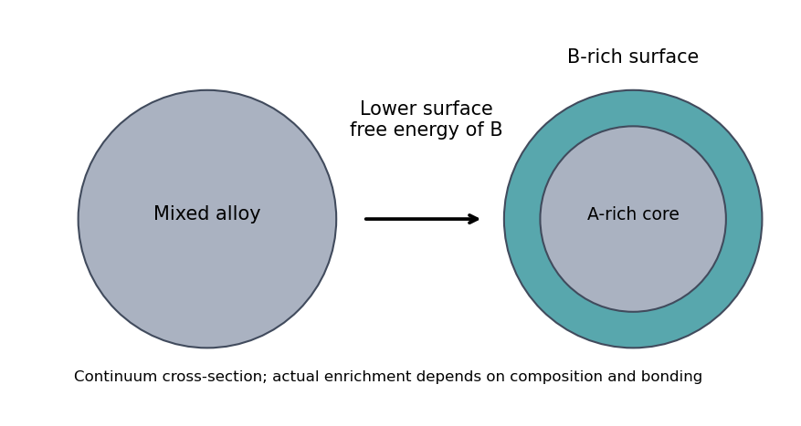

<h1 id="section-a-i/13/iii/solution">Solution</h1>

↑ **Parent:** [Iii](../iii.md)

Both starting arrangements converge toward the same **chemically ordered [alloy](../../../../../../alloy.md)**, exhibiting [chemical ordering in alloys](../../../../../../chemical-ordering-in-alloys.md). This supports a lower [free energy](../../../../../../thermodynamic-free-energy.md) for the ordered unlike-metal neighbour pattern than for the segregated core-shell or disordered precursor at the final [temperature](../../../../../../temperature-split.md). In a simple nearest-neighbour model, ordering is favoured when

$$
w=\epsilon_{AB}-\tfrac12(\epsilon_{AA}+\epsilon_{BB})<0,
$$

with consistent bond-energy conventions. Bulk mixing and ordering then compensate the loss of [configurational entropy](../../../../../../configurational-entropy.md) on cooling. Annealing alone does not supply numerical bond or surface energies, and elastic mismatch or adsorbed [ligands](../../../../../../ligand-biochemistry.md) can also matter.

The final morphology does not show a thick single-metal skin: the surface-energy difference is not large enough to overwhelm the bulk preference for ordering throughout the particle. Some atomic-scale surface enrichment is compatible with the drawing, so exact equality of the two surface free energies is not established.

If B has a much lower surface [free energy](../../../../../../thermodynamic-free-energy.md), **[Surface segregation](../../../../../../surface-segregation.md) of B and an A-rich interior** become favourable. A nearly continuous B shell is likely if enough B is present and the surface-energy gain exceeds the cost of disrupting favourable A-B bonds; otherwise only partial enrichment occurs.

**[Figure 1](#section-a-i/13/iii/image-an-illustrative-surface-energy-preference-enriches-the-outermost-layers-without-fixing-a-universal-shell-thickness). An illustrative surface-energy preference enriches the outermost layers without fixing a universal shell thickness**. [Source](paper-2-surface-segregation.py).

## ↑ Ancestors (11)

1. [Iii](../iii.md)
2. [13](../../13.md)
3. [Section A(i)](../../../section-a-i.md)
4. [Paper 2](../../../../paper-2-split.md)
5. [2019](../../../../split.md)
6. [Past exam of the MPhil in micro- and nanotechnology enterprise course of the University of Cambridge](../../../../../split.md)
7. [MPhil in micro- and nanotechnology enterprise course of the University of Cambridge](../../../../../../mphil-in-micro-and-nanotechnology-enterprise-course-of-the-university-of-cambridge.md)
8. [Course of the University of Cambridge](../../../../../../course-of-the-university-of-cambridge.md)
9. [University of Cambridge](../../../../../../university-of-cambridge-split.md)
10. [List of universities](../../../../../../list-of-universities.md)
11. [Codex Wiki](../../../../../../split.md)
