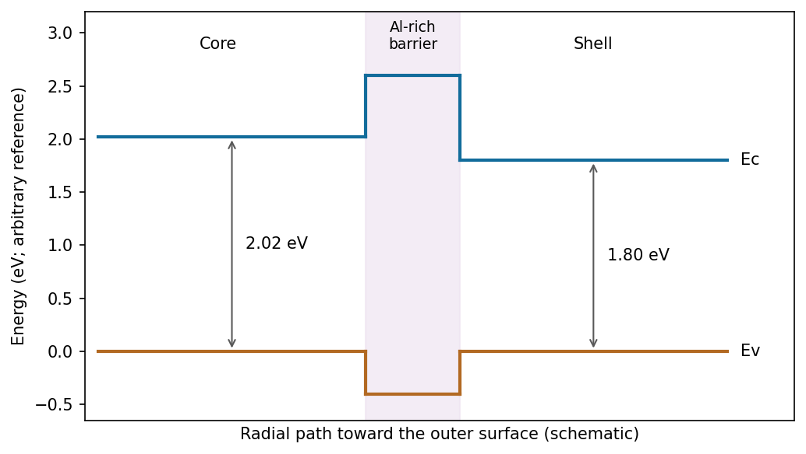

<h1 id="section-a-i/14/ii/solution">Solution</h1>

↑ **Parent:** [Ii](../ii.md)

The emission energies are approximately

$$
E_{\rm core}=\frac{1240}{615}=2.02\,\mathrm{eV},\qquad E_{\rm shell}=\frac{1240}{690}=1.80\,\mathrm{eV}.
$$

Draw the Al-rich interface as a wider-gap barrier between these two emitting regions: a raised conduction-band edge impedes [electron](../../../../../../electron.md) transfer, and a lowered valence-band edge impedes [hole](../../../../../../electron-hole.md) transfer. The following is a consistent straddling-barrier schematic, with the shell having the smaller optical gap.

**[Figure 2](#section-a-i/14/ii/image-one-consistent-core-al-rich-interface-shell-alignment-absolute-offsets-are-not-fixed-by-the-emission-wavelengths). One consistent core–Al-rich-interface–shell alignment; absolute offsets are not fixed by the emission wavelengths**. [Source](paper-2-radial-bands.py).

**The two emission wavelengths determine optical transition energies, not unique conduction- and valence-band offsets.** [Exciton](../../../../../../exciton.md) binding, confinement and [strain](../../../../../../strain.md) can shift emission relative to the bulk [band gap](../../../../../../band-gap.md). The stated barrier supports inhibited [charge exchange](../../../../../../charge-exchange.md); its separate [electron](../../../../../../electron.md) and [hole](../../../../../../electron-hole.md) barrier heights need additional band-alignment data.

## ↑ Ancestors (11)

1. [Ii](../ii.md)
2. [14](../../14.md)
3. [Section A(i)](../../../section-a-i.md)
4. [Paper 2](../../../../paper-2-split.md)
5. [2019](../../../../split.md)
6. [Past exam of the MPhil in micro- and nanotechnology enterprise course of the University of Cambridge](../../../../../split.md)
7. [MPhil in micro- and nanotechnology enterprise course of the University of Cambridge](../../../../../../mphil-in-micro-and-nanotechnology-enterprise-course-of-the-university-of-cambridge.md)
8. [Course of the University of Cambridge](../../../../../../course-of-the-university-of-cambridge.md)
9. [University of Cambridge](../../../../../../university-of-cambridge-split.md)
10. [List of universities](../../../../../../list-of-universities.md)
11. [Codex Wiki](../../../../../../split.md)
