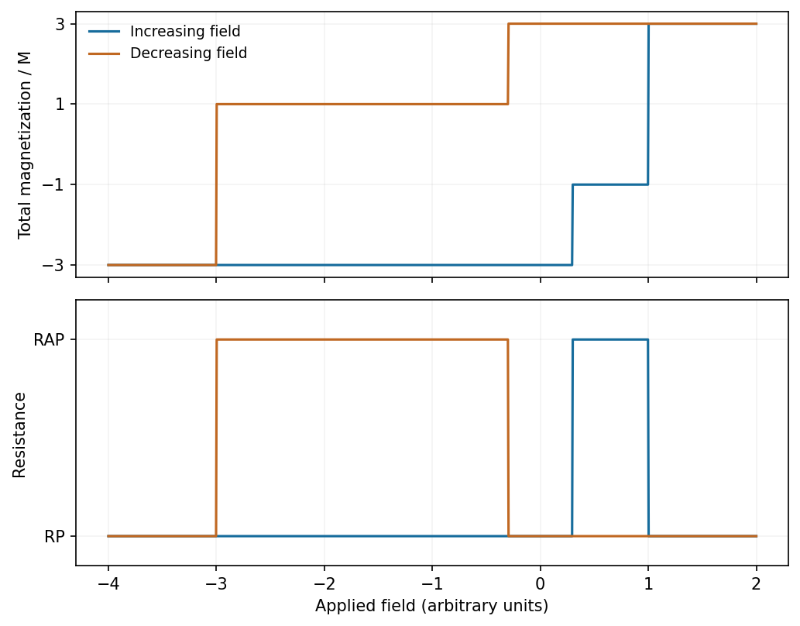

<h1 id="section-a-ii/16/ii/solution">Solution</h1>

↑ **Parent:** [Ii](../ii.md)

For collinear saturated layers, $M_{\rm tot}=2Ms_p+Ms_f$, where $s_p,s_f=\pm1$. Thus parallel states have **$M_{\rm tot}=\pm3M$ and $R=R_P$**, whereas antiparallel states have **$M_{\rm tot}=\pm M$ and $R=R_{AP}>R_P$**. The free layer switches in the smaller-field interval; the reference layer switches only at larger fields and its loop is shifted by [exchange bias](../../../../../../exchange-bias.md).

**[Figure 3](#section-a-ii/16/ii/image-illustrative-major-magnetization-and-resistance-loops-with-an-exchange-shifted-reference-layer-reversal). Illustrative major magnetization and resistance loops, with an exchange-shifted reference-layer reversal**. [Source](paper-2-spin-valve.py).

The plotted switching fields are illustrative rather than supplied measurements. In the normal read-head minor-loop range, the reference stays positive and only the $3M\leftrightarrow M$ pair is sampled. Rotational reversal and domain formation can round these ideal abrupt steps.

## ↑ Ancestors (11)

1. [Ii](../ii.md)
2. [16](../../16.md)
3. [Section A(ii)](../../../section-a-ii.md)
4. [Paper 2](../../../../paper-2-split.md)
5. [2019](../../../../split.md)
6. [Past exam of the MPhil in micro- and nanotechnology enterprise course of the University of Cambridge](../../../../../split.md)
7. [MPhil in micro- and nanotechnology enterprise course of the University of Cambridge](../../../../../../mphil-in-micro-and-nanotechnology-enterprise-course-of-the-university-of-cambridge.md)
8. [Course of the University of Cambridge](../../../../../../course-of-the-university-of-cambridge.md)
9. [University of Cambridge](../../../../../../university-of-cambridge-split.md)
10. [List of universities](../../../../../../list-of-universities.md)
11. [Codex Wiki](../../../../../../split.md)
