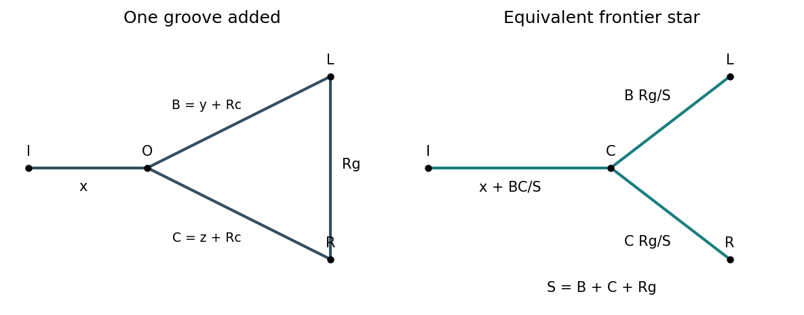

<h1 id="section-a-iii/19/ii/solution">Solution</h1>

↑ **Parent:** [Ii](../ii.md)

For a triangular resistance network with edge resistances $A,B,C$, replacing it by a star gives the arm at each terminal as the product of its two adjacent triangle resistances divided by $A+B+C$. This [Delta-star transformation](../../../../../../delta-star-transformation.md) preserves the pressure-flow relation at all three terminals, just as in a linear [electrical network](../../../../../../electrical-network.md).

Apply it recursively to the two-rail ladder. Represent the first $n$ grooves by a three-terminal star with arms $x_n,y_n,z_n$ leading respectively to the fixed inlet, frontier of the left rail and frontier of the right rail. Grooves are added from inlet toward outlet. Adding the next pair of rail segments gives $B=y_n+R_c$ and $C=z_n+R_c$; the new groove $R_g$ closes a triangle between the old star centre and the two new rail endpoints. Convert that triangle to a star and combine its centre arm in series with $x_n$.

**[Figure 4](#section-a-iii/19/ii/image-adding-one-groove-reduces-to-a-triangle-to-star-transformation-at-the-ladder-frontier). Adding one groove reduces to a triangle-to-star transformation at the ladder frontier**. [Source](paper-2-hydraulic-reduction.py).

This method retains unequal pressure drops and unequal flow division along the rails; their finite resistances cannot be ignored when assigning the groove flows.

## ↑ Ancestors (11)

1. [Ii](../ii.md)
2. [19](../../19.md)
3. [Section A(iii)](../../../section-a-iii.md)
4. [Paper 2](../../../../paper-2-split.md)
5. [2019](../../../../split.md)
6. [Past exam of the MPhil in micro- and nanotechnology enterprise course of the University of Cambridge](../../../../../split.md)
7. [MPhil in micro- and nanotechnology enterprise course of the University of Cambridge](../../../../../../mphil-in-micro-and-nanotechnology-enterprise-course-of-the-university-of-cambridge.md)
8. [Course of the University of Cambridge](../../../../../../course-of-the-university-of-cambridge.md)
9. [University of Cambridge](../../../../../../university-of-cambridge-split.md)
10. [List of universities](../../../../../../list-of-universities.md)
11. [Codex Wiki](../../../../../../split.md)
