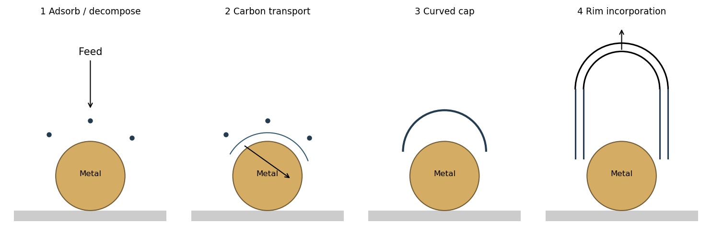

<h1 id="section-b/20/iii/solution">Solution</h1>

↑ **Parent:** [Iii](../iii.md)

A carbon-containing feed adsorbs and decomposes on a catalytic metal particle, releasing mobile carbon. Carbon can migrate over the surface and/or through the particle, depending on [catalyst](../../../../../../catalyst.md), [temperature](../../../../../../temperature-split.md) and feedstock. [Supersaturation](../../../../../../supersaturation.md) and graphitic [nucleation](../../../../../../nucleation.md) generate a curved cap; nonhexagonal rings provide the curvature needed to close its end. Continued carbon incorporation at the cap rim lifts or extends the cap into a tube while leaving a growth interface at the [catalyst](../../../../../../catalyst.md).

**[Figure 5](#section-b/20/iii/image-adsorption-carbon-transport-cap-nucleation-and-continued-graphitic-wall-growth-at-a-catalyst). Adsorption, carbon transport, cap nucleation and continued graphitic-wall growth at a catalyst**. [Source](paper-2-catalytic-growth.py).

With strong catalyst-support adhesion the particle remains at the base; with weaker adhesion it can lift with the growing tube. Several shells can nucleate and extend to form a multiwall tube. Continued growth requires access to active [catalyst](../../../../../../catalyst.md) sites: encapsulation by an impermeable carbon coating can terminate it. The [catalyst](../../../../../../catalyst.md) need not be liquid in every [chemical vapour deposition](../../../../../../chemical-vapor-deposition.md) growth mechanism, and bulk dissolution is not the only possible carbon-transport route.

## ↑ Ancestors (11)

1. [Iii](../iii.md)
2. [20](../../20.md)
3. [Section B](../../../section-b.md)
4. [Paper 2](../../../../paper-2-split.md)
5. [2019](../../../../split.md)
6. [Past exam of the MPhil in micro- and nanotechnology enterprise course of the University of Cambridge](../../../../../split.md)
7. [MPhil in micro- and nanotechnology enterprise course of the University of Cambridge](../../../../../../mphil-in-micro-and-nanotechnology-enterprise-course-of-the-university-of-cambridge.md)
8. [Course of the University of Cambridge](../../../../../../course-of-the-university-of-cambridge.md)
9. [University of Cambridge](../../../../../../university-of-cambridge-split.md)
10. [List of universities](../../../../../../list-of-universities.md)
11. [Codex Wiki](../../../../../../split.md)
