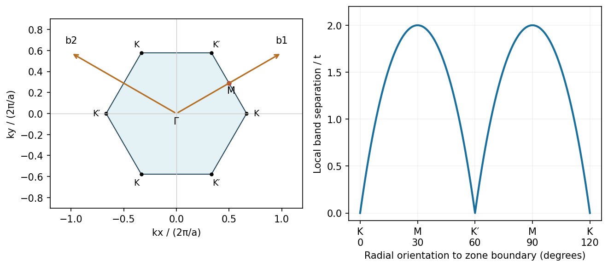

<h1 id="section-b/20/iv/solution">Solution</h1>

↑ **Parent:** [Iv](../iv.md)

Let the [graphene](../../../../../../graphene.md) [lattice constant](../../../../../../lattice-constant.md) be $a=\sqrt3b$, and choose direct primitive vectors $\mathbf a_1=a(1/2,\sqrt3/2)$ and $\mathbf a_2=a(-1/2,\sqrt3/2)$. Reciprocal primitive vectors satisfying $\mathbf a_i\cdot\mathbf b_j=2\pi\delta_{ij}$ are

$$
\mathbf b_1=\frac{2\pi}{a}(1,1/\sqrt3),\qquad\mathbf b_2=\frac{2\pi}{a}(-1,1/\sqrt3).
$$

The first [Brillouin zone](../../../../../../brillouin-zone.md) is a hexagon. Its corners K and K' are inequivalent valleys; M denotes an edge midpoint. In the nearest-neighbour model, $E_\pm(\mathbf k)=\pm t|f(\mathbf k)|$, where $f(\mathbf k)=\sum_{j=1}^3e^{i\mathbf k\cdot\boldsymbol\delta_j}$ and $\boldsymbol\delta_j$ are the three bond vectors. The band separation is $2t|f|$: it **vanishes at K/K' and is $2t$ at M**, varying continuously along each edge.

**[Figure 6](#section-b/20/iv/image-graphene-reciprocal-primitive-vectors-and-the-orientation-dependent-band-separation-on-its-zone-boundary). Graphene reciprocal primitive vectors and the orientation-dependent band separation on its zone boundary**. [Source](paper-2-graphene-zone.py).

This [graphene zone-boundary band separation](../../../../../../graphene-zone-boundary-band-separation.md) is a local conduction-to-valence separation. Ideal [graphene](../../../../../../graphene.md) itself remains globally gapless because the bands touch at the corners. Circumferential quantization in a nanotube selects lines through this two-dimensional band structure; whether they pass through a valley determines the ideal metallic versus semiconducting distinction.

## ↑ Ancestors (11)

1. [Iv](../iv.md)
2. [20](../../20.md)
3. [Section B](../../../section-b.md)
4. [Paper 2](../../../../paper-2-split.md)
5. [2019](../../../../split.md)
6. [Past exam of the MPhil in micro- and nanotechnology enterprise course of the University of Cambridge](../../../../../split.md)
7. [MPhil in micro- and nanotechnology enterprise course of the University of Cambridge](../../../../../../mphil-in-micro-and-nanotechnology-enterprise-course-of-the-university-of-cambridge.md)
8. [Course of the University of Cambridge](../../../../../../course-of-the-university-of-cambridge.md)
9. [University of Cambridge](../../../../../../university-of-cambridge-split.md)
10. [List of universities](../../../../../../list-of-universities.md)
11. [Codex Wiki](../../../../../../split.md)
