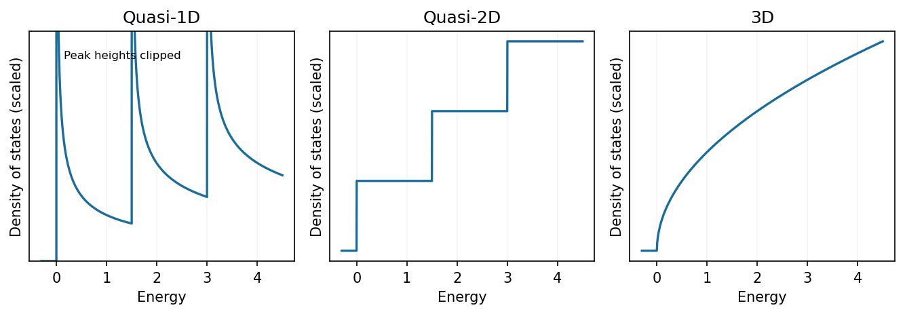

<h1 id="section-b/21/i/solution">Solution</h1>

↑ **Parent:** [I](../i.md)

For parabolic bands, the [density of states](../../../../../../density-of-states.md) near a subband edge scales as **$g_{1D}\propto(E-E_n)^{-1/2}$**, **$g_{2D}\propto\Theta(E-E_n)$**, and **$g_{3D}\propto\sqrt{E-E_c}$**. Thus a quasi-1D wire has inverse-square-root singularities at successive transverse subband thresholds, a quasi-2D well has a staircase, and a bulk 3D band rises smoothly from zero. Each expression vanishes below its threshold.

**[Figure 7](#section-b/21/i/image-parabolic-band-density-of-states-in-one-two-and-three-unconfined-dimensions). Parabolic-band density of states in one, two and three unconfined dimensions**. [Source](paper-2-density-of-states.py).

These sketches assume extended noninteracting states with simple quadratic dispersion. Finite [temperature](../../../../../../temperature-split.md), disorder and finite lifetime broaden measured threshold features; the ideal singularity is integrable and does not represent infinitely many states in a finite [energy](../../../../../../energy-split.md) interval.

## ↑ Ancestors (11)

1. [I](../i.md)
2. [21](../../21.md)
3. [Section B](../../../section-b.md)
4. [Paper 2](../../../../paper-2-split.md)
5. [2019](../../../../split.md)
6. [Past exam of the MPhil in micro- and nanotechnology enterprise course of the University of Cambridge](../../../../../split.md)
7. [MPhil in micro- and nanotechnology enterprise course of the University of Cambridge](../../../../../../mphil-in-micro-and-nanotechnology-enterprise-course-of-the-university-of-cambridge.md)
8. [Course of the University of Cambridge](../../../../../../course-of-the-university-of-cambridge.md)
9. [University of Cambridge](../../../../../../university-of-cambridge-split.md)
10. [List of universities](../../../../../../list-of-universities.md)
11. [Codex Wiki](../../../../../../split.md)
