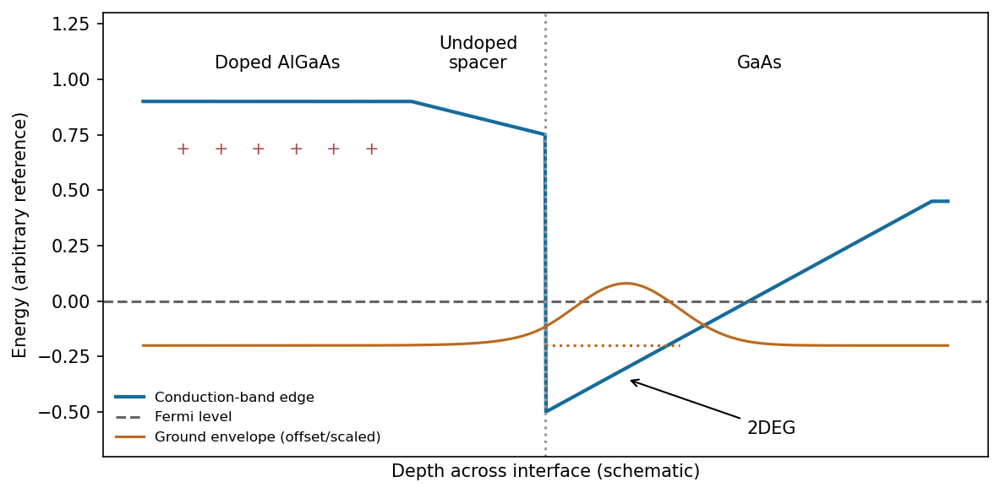

<h1 id="section-b/21/iii/solution">Solution</h1>

↑ **Parent:** [Iii](../iii.md)

A larger-gap AlGaAs barrier has a higher conduction-band edge than GaAs. Donors in AlGaAs supply [electrons](../../../../../../electron.md) that transfer into lower-energy GaAs states, leaving a positively charged donor region. The resulting electrostatic field bends the GaAs [conduction band](../../../../../../conduction-band.md) into a triangular interface well. Motion normal to the interface is quantized, while motion parallel to it remains approximately free, producing a **[two-dimensional electron gas](../../../../../../two-dimensional-electron-gas.md)**.

**[Figure 8](#section-b/21/iii/image-an-illustrative-remotely-doped-heterojunction-separates-the-electron-envelope-from-ionized-donors). An illustrative remotely doped heterojunction separates the electron envelope from ionized donors**. [Source](paper-2-modulation-doping.py).

The confined envelope peaks just inside GaAs and decays into the AlGaAs barrier; a triangular-well treatment gives an Airy-function-like envelope with boundary matching. An undoped spacer separates the [electrons](../../../../../../electron.md) from the donors, strongly reducing ionized-impurity scattering compared with uniformly doped 3D material and enabling high mobility. [Band offsets](../../../../../../band-offset.md), donor supply, interface roughness and electrostatics jointly determine whether a single occupied subband is obtained.

## ↑ Ancestors (11)

1. [Iii](../iii.md)
2. [21](../../21.md)
3. [Section B](../../../section-b.md)
4. [Paper 2](../../../../paper-2-split.md)
5. [2019](../../../../split.md)
6. [Past exam of the MPhil in micro- and nanotechnology enterprise course of the University of Cambridge](../../../../../split.md)
7. [MPhil in micro- and nanotechnology enterprise course of the University of Cambridge](../../../../../../mphil-in-micro-and-nanotechnology-enterprise-course-of-the-university-of-cambridge.md)
8. [Course of the University of Cambridge](../../../../../../course-of-the-university-of-cambridge.md)
9. [University of Cambridge](../../../../../../university-of-cambridge-split.md)
10. [List of universities](../../../../../../list-of-universities.md)
11. [Codex Wiki](../../../../../../split.md)
