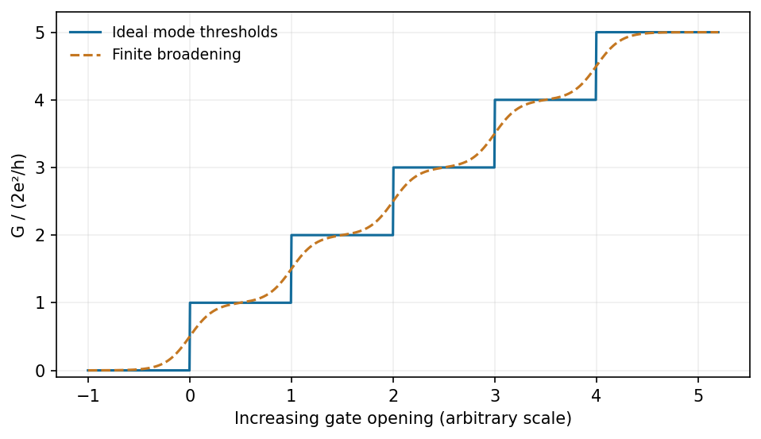

<h1 id="section-b/21/v/solution">Solution</h1>

↑ **Parent:** [V](../v.md)

With [ballistic conductance quantization](../../../../../../ballistic-conductance-quantization.md), as a gate opens the channel, **conductance plateaux at $G=N_b(2e^2/h)$** appear; successive transverse modes add one quantum, approximately $77.5\,\mu\mathrm S$ per spin-degenerate subband. Their appearance is the key low-temperature electrical signature.

**[Figure 9](#section-b/21/v/image-ideal-conductance-plateaux-sharpen-as-thermal-and-disorder-broadening-become-small-compared-with-subband-spacing). Ideal conductance plateaux sharpen as thermal and disorder broadening become small compared with subband spacing**. [Source](paper-2-conductance-steps.py).

Require transverse confinement with separated subbands, $k_BT$ and measurement-bias [energy](../../../../../../energy-split.md) well below the subband spacing, a [mean free path](../../../../../../mean-free-path.md) exceeding the channel length, and smooth low-reflection coupling to reservoirs. Correct for appreciable external series resistance. Phase coherence is needed for additional interference oscillations, but perfect phase coherence across an entire macroscopic circuit is not a separate requirement for the basic mode-counting result. A field that resolves spin splitting can produce $e^2/h$ increments.[Gate-controlled ballistic GaAs-AlGaAs point contacts and conductance steps](../../../../../../quantized-conductance-of-point-contacts-by-b-j-van-wees-and-others.md)

## ↑ Ancestors (11)

1. [V](../v.md)
2. [21](../../21.md)
3. [Section B](../../../section-b.md)
4. [Paper 2](../../../../paper-2-split.md)
5. [2019](../../../../split.md)
6. [Past exam of the MPhil in micro- and nanotechnology enterprise course of the University of Cambridge](../../../../../split.md)
7. [MPhil in micro- and nanotechnology enterprise course of the University of Cambridge](../../../../../../mphil-in-micro-and-nanotechnology-enterprise-course-of-the-university-of-cambridge.md)
8. [Course of the University of Cambridge](../../../../../../course-of-the-university-of-cambridge.md)
9. [University of Cambridge](../../../../../../university-of-cambridge-split.md)
10. [List of universities](../../../../../../list-of-universities.md)
11. [Codex Wiki](../../../../../../split.md)
